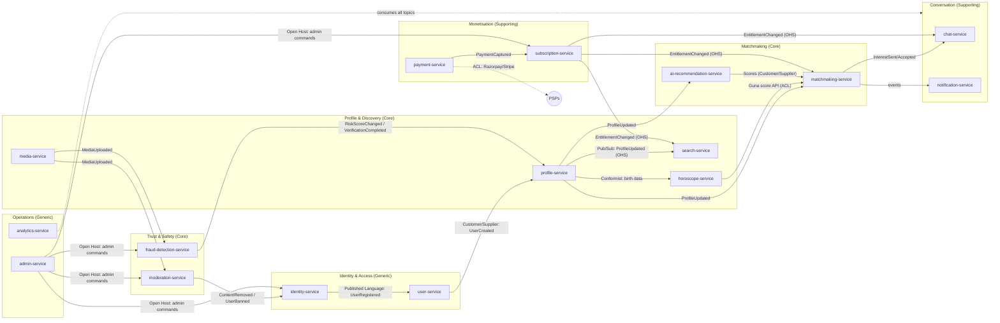
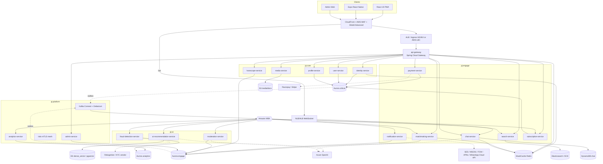
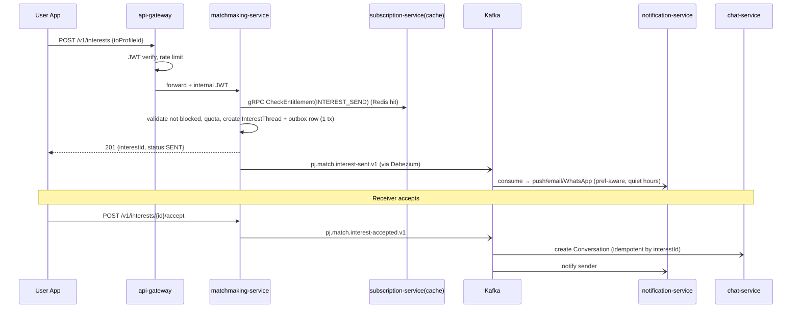
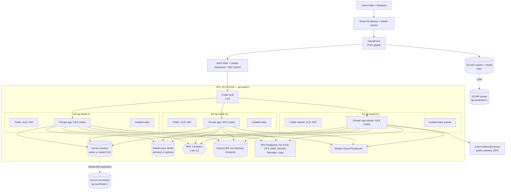
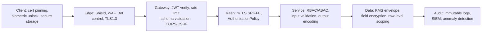
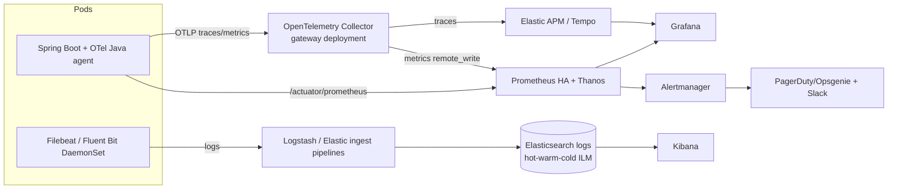

# Pahadi Jodi — High-Level Design & System Architecture

> Matrimonial platform for the Uttarakhand (Pahadi) community and its global diaspora.
> Document 01 of the series. Audience: architects, staff engineers, SRE, security, product.
> Status: Baseline v1.0. Conventions in §0 are binding for all other documents.

---

## 0. Shared Conventions (binding)

| Item | Convention |
|---|---|
| Brand | Pahadi Jodi |
| Services (kebab-case) | `api-gateway`, `identity-service`, `user-service`, `profile-service`, `matchmaking-service`, `search-service`, `chat-service`, `notification-service`, `subscription-service`, `payment-service`, `ai-recommendation-service`, `media-service`, `moderation-service`, `horoscope-service`, `analytics-service`, `admin-service`, `fraud-detection-service` |
| Java packages | `in.pahadijodi.<svc>` (e.g. `in.pahadijodi.profile`) with sub-packages `domain`, `application`, `adapter.in`, `adapter.out`, `config` |
| Persistence | One PostgreSQL **schema per service** (DB-per-service logical isolation); no cross-schema joins or cross-service DB credentials |
| Aurora clusters | `aurora-critical` (identity, user, profile, payment, subscription), `aurora-engage` (matchmaking, notification, moderation, horoscope, admin), `aurora-analytics` (analytics, fraud-detection read models) |
| Kafka topics | `pj.<domain>.<event>.v1`, e.g. `pj.profile.updated.v1`, `pj.payment.captured.v1` |
| Event envelope | `{eventId, eventType, version, occurredAt, producer, traceId, tenantRegion, partitionKey, payload}` |
| Reliability pattern | Transactional outbox table per service + Debezium (Kafka Connect) CDC; consumers idempotent via `processed_event(event_id)` |
| Regions | Primary `ap-south-1` (Mumbai); DR + read replica `ap-southeast-1` (Singapore); diaspora edge via CloudFront (PoPs in Middle East, US, UK, Australia, SG) with optional `me-central-1` / `us-east-1` static/media edge caches |
| K8s namespaces | `pj-edge` (gateway, ingress), `pj-core` (identity, user, profile, media, horoscope), `pj-engage` (matchmaking, search, chat, notification, subscription, payment), `pj-ai` (ai-recommendation, fraud-detection, moderation inference), `pj-platform` (Kafka Connect, ArgoCD agents, observability agents, admin, analytics) |

---

## 1. Vision, Personas, Scope

### 1.1 Vision
The most trusted matrimonial network for Uttarakhand: every profile carries *pahadi context* (village, patti, district, Garhwal/Kumaon region, boli/dialect, kuldevta, gotra, festivals), and every match is explainable, safe and culturally aware. Differentiators vs Shaadi/BharatMatrimony/Jeevansathi:

1. **Roots-first discovery** — village → patti → tehsil → district hierarchy with an interactive map; "same valley" and "same region" matches.
2. **Community-native taxonomy** — Garhwali, Kumaoni, Jaunsari, Bhotiya, Rajput, Brahmin, SC/ST/OBC groups, with sub-community, gotra, and *thar* (surname) data curated with community advisors.
3. **Diaspora-grade** — Dehradun/Delhi/Mumbai/Bengaluru plus UAE, UK, US, Canada, Australia, Singapore; timezone-aware chat, NRI verification, multi-currency billing.
4. **Trust & safety by design** — gov-ID, selfie liveness, AI fraud scoring, human verification workbench, DPDP-compliant data handling.
5. **AI assist, not AI replace** — explainable compatibility, bio coach, ice-breakers in Hindi/Garhwali-Kumaoni transliteration/English.

### 1.2 Personas

| Persona | Needs | Key journeys |
|---|---|---|
| **Candidate (bride/groom, 21–40)** | Authentic matches, privacy, speed | Sign up (OTP) → profile (80% completion) → verify → browse/search → interest → chat → video call |
| **Parent / family manager** | Manage profile on behalf of child, family details, horoscope | Create profile as guardian, shortlist, shared private list, share kundli |
| **Diaspora user** | Timezone-friendly, trust, international payments | Stripe billing, video calls, "family roots" mapping |
| **Relationship Manager (VIP)** | Curate matches for VIP clients | Admin workbench, exclusive match lists, call logs |
| **Verification Agent** | Verify ID/selfie quickly | Verification workbench with SLA queue |
| **Moderator** | Review flagged content | Moderation queue, bulk actions, ban |
| **Super Admin / Finance / Support** | Revenue, refunds, fraud, content mgmt | Dashboards, refund workflow, RBAC-limited |

### 1.3 Scope

**In scope (v1)**: all 17 services; Web (React 19 PWA), Mobile (Expo RN), Admin Web; Razorpay + Stripe; OpenAI/Azure OpenAI; WhatsApp Business API; WebRTC calling.
**Out of scope (v1)**: offline wedding services marketplace, physical meetups, matrimonial events (v2 roadmap), non-Uttarakhand communities.

### 1.4 Regulatory scope
DPDP Act 2023 (India), IT Rules 2021 (grievance officer, 72h takedown), RBI recurring-payments e-mandate rules (auto renewal), PCI-DSS SAQ-A (tokenised via gateways), GDPR-style handling for UK/EU diaspora (lawful basis, erasure), UIDAI Aadhaar rules (no Aadhaar number storage in clear; use masked/virtual ID + KUA/ASA partner such as DigiLocker/Signzy/IDfy).

---

## 2. Requirements

### 2.1 Functional (grouped by capability → owning service)

| Capability | Owner | Highlights |
|---|---|---|
| Registration & auth | identity-service | Email+password, mobile OTP, Google/Facebook/Apple OIDC, TOTP/SMS 2FA, device mgmt, session revocation |
| Account/Preferences | user-service | Account lifecycle, consent records, partner preferences, privacy settings |
| Profile | profile-service | Multi-section profile, family, education, profession, income, lifestyle, native village, completeness score |
| Media | media-service | Pre-signed S3 uploads, photo/video/doc, transcoding, virus scan, watermark, face-blur for privacy tier |
| Verification | media-service (docs) + fraud-detection-service (face/liveness) + admin-service (workbench) | Aadhaar/PAN, selfie, face match, blue tick |
| Search | search-service | ES-backed filters, saved searches, nearby, geo |
| Matchmaking | matchmaking-service | Interests, shortlist, block/ignore, notes, compatibility score, daily recos |
| AI | ai-recommendation-service | Embedding similarity, LLM compatibility narrative, profile assistant, chat assistant |
| Chat & calls | chat-service | WebSocket, voice notes, receipts, reactions, translation, WebRTC signalling, TURN, recording consent |
| Notifications | notification-service | Email (SES), SMS (MSG91/SNS), push (FCM/APNs), WhatsApp (Cloud API) |
| Subscriptions | subscription-service | Plans, entitlements, quotas, boost, auto-renew state machine |
| Payments | payment-service | Razorpay/Stripe, UPI, cards, netbanking, refunds, reconciliation |
| Horoscope | horoscope-service | Birth chart (Vedic), Ashtakoot/Guna Milan (36 points), Manglik |
| Moderation | moderation-service | Text/image toxicity, report handling, queue |
| Fraud | fraud-detection-service | Fake, scam, duplicate detection, risk score, liveness |
| Analytics | analytics-service | Event ingestion, funnels, premium analytics ("who viewed me") |
| Admin | admin-service | Dashboards, user mgmt, CMS, bans, verification workbench |

### 2.2 Pahadi-specific functional requirements
- Hierarchical geography: State → Region (Garhwal / Kumaon) → District (13) → Tehsil → Patti/Block → Village (≈16,800 villages; seeded from Census 2011 + LGD codes).
- Interactive SVG/Leaflet map of Uttarakhand with district drill-down and "profiles per district" heat layer.
- Language preference: Garhwali, Kumaoni, Jaunsari, Hindi, English, Bhotiya dialects (Rongpa, Jad), Nepali.
- Family roots mapping: native place vs current residence vs "ancestral village" graph; "same tehsil" boost.
- Community recommendation engine & festival calendar (Harela, Phool Dei, Ghee Sankranti, Uttarayani, Nanda Devi Raj Jaat, Bikhauti, Egas/Bagwal) personalised cultural prefs (food veg/non-veg, pahadi cuisine, folk music, trekking).
- Gotra/thar rule engine (e.g., same-gotra warnings, configurable by community).

### 2.3 Non-functional requirements with SLOs

**Scale targets (design point)**

| Metric | Value |
|---|---|
| Registered users | 1,000,000 (design to 5M) |
| MAU | 250,000 (25%) |
| DAU | 60,000 (6% of registered) |
| Peak concurrent users | 12,000 (evening 8–11 PM IST, festival/Sunday spikes ×2) |
| Peak API RPS (edge) | 3,000 sustained, 6,000 burst (festival campaign) |
| Concurrent WebSocket connections | 8,000 steady, 15,000 peak |
| Paid conversion | 6% → 60,000 paid subscribers |
| Profiles in search index | 1.0M (≈ 800k active) |

**SLOs**

| Area | SLI | SLO |
|---|---|---|
| Availability (user-facing APIs) | successful non-5xx / total | 99.95% monthly (≈ 21.9 min budget) |
| Auth (login, OTP verify) | availability | 99.99% |
| Payments capture path | availability | 99.95%; webhook processing p99 < 5 s |
| API latency (read) | p95 / p99 | 150 ms / 400 ms at gateway |
| API latency (write) | p95 / p99 | 250 ms / 700 ms |
| Search | p95 / p99 | 300 ms / 800 ms (filters + facets) |
| Chat message delivery | end-to-end p95 | < 400 ms (same region), < 1.2 s diaspora |
| Daily recommendation freshness | batch ready by | 06:00 IST for 100% of active users |
| Notification (push) | p95 enqueue→provider | < 5 s; OTP SMS < 10 s p95 |
| Media upload | 10 MB photo complete | < 8 s on 4G |
| RPO / RTO | regional failure | RPO ≤ 5 min (Aurora Global DB), RTO ≤ 30 min; AZ failure RTO < 2 min, RPO 0 |
| Error budget policy | burn rate | 14.4× over 1h → page; 6× over 6h → page; 1× over 3d → ticket |
| Security | critical CVE patch | ≤ 72 h; pen-test twice yearly |
| Data durability | S3 / Aurora | 11 nines / 6-way replication |

**Other NFRs**: WCAG 2.1 AA; i18n (en, hi, + transliterated Garhwali/Kumaoni labels); PWA Lighthouse ≥ 90; mobile cold start < 2.5 s; backwards-compatible API versioning (`/v1`) with 12-month deprecation; GDPR/DPDP export within 30 days and erasure within 30 days; audit log retention 7 years (financial) / 1 year (access).

---

## 3. Capacity Estimation

### 3.1 Traffic
- DAU 60k × avg 40 API calls/session-day × 2.2 sessions ≈ 5.3M calls/day → avg 61 RPS.
- Peak factor: 50% of traffic in 3h window → 2.6M / 10,800 s = 245 RPS; add search-heavy bursts, polling, and websockets handshake, notification clicks → plan **peak 3,000 RPS at edge** (≈12× headroom for campaigns and growth to 5M users; steady-state autoscaled).
- Read:write = 85:15.

Per-endpoint peak (RPS): search 600, profile view 900, feed/recos 400, chat REST (history) 250, interest actions 150, auth/token refresh 300, media signed URL 120, other 280.

### 3.2 Storage

| Data | Calculation | Size |
|---|---|---|
| Profiles (Aurora) | 1M × ~12 KB (JSONB sections + normalised) | 12 GB |
| Accounts/identity/devices | 1M × 3 KB + 2.5 devices × 1 KB | 6 GB |
| Interests/shortlist/blocks | 1M × 60 rows × 120 B | 7.2 GB |
| Subscriptions/payments/ledger | 60k paying × 12 txn × 1.5 KB + ledger entries | 3 GB / yr |
| Outbox + processed_event | 7 d retention, 30M events × 1 KB | ~30 GB rolling |
| Horoscope charts | 400k × 20 KB | 8 GB |
| Audit logs (OpenSearch/S3 Parquet) | 20M events/day × 600 B = 12 GB/day, 7y finance subset | ~4 TB/yr hot→cold |
| **Aurora total (primary data)** | incl. indexes ×2, 3 yrs growth ×2 | **~400 GB provisioned**, 1 TB Aurora storage ceiling |

**Media** (S3):
- Photos: avg 5/profile × 800k × (orig 2.5 MB + 4 renditions 0.6 MB) ≈ 800k×5×3.1 MB = **12.4 TB**.
- Videos: 10% of profiles × 1 × 25 MB (transcoded 720p HLS ≈ 40 MB with ladder) = 100k × 40 MB = **4 TB**.
- Documents (Aadhaar/PAN/selfie): 600k verified × 3 × 1.5 MB = **2.7 TB** (SSE-KMS, separate bucket, lifecycle 1y post-verification → delete raw ID image; keep verification result only).
- Chat media (images/voice/video): 60k DAU × 0.3 media msgs/day × 400 KB × 365 = **2.6 TB/yr**.
- **Total ≈ 22 TB at 1M users**, growth ~8 TB/yr; S3 Standard → Intelligent-Tiering after 30 d.

### 3.3 Chat volume
- 30% of DAU chat actively = 18k users × 40 messages/day = 720k msgs/day (text) ≈ 8 msg/s avg, peak ×15 = **120 msg/s**.
- Message size 500 B + metadata 500 B → 1 KB → 0.72 GB/day → **263 GB/yr**; fan-out for receipts/typing ×4 events (typing is ephemeral via Redis pub/sub, not persisted).
- DynamoDB on-demand: 120 WCU peak writes (+receipts as updates ≈ 240 WCU) — trivial; storage 263 GB/yr (TTL none; archive >2y to S3).

### 3.4 Bandwidth (CDN egress)
- Page/image views: 60k DAU × 80 images/day × 120 KB (WebP thumbs/cards) = 576 GB/day.
- Full-size photo views: 60k × 10 × 600 KB = 360 GB/day. Video streaming: 60k × 8% × 3 videos × 15 MB = 216 GB/day.
- Total ≈ **1.15 TB/day ≈ 35 TB/month** CDN egress (CloudFront, ~95% cache hit on media). API JSON: 5.3M × 6 KB = 32 GB/day (~1 TB/mo).
- WebRTC: P2P first; TURN relay ~30% of calls. 4,000 call-min/day × 30% × 1 Mbps ×60 s/8 = ~9 GB/day TURN relay.

### 3.5 Elasticsearch sizing
- Doc size indexed ≈ 3 KB (structured filters + keyword + geo + dense vector 384 dim float32 optional via int8 quantisation → 384 B) → 1M × ~3.5 KB = 3.5 GB primary; with 1 replica = 7 GB. Tiny; the constraint is **query concurrency and update rate**, not size.
- Query load: 600 RPS peak × avg 25 ms CPU/shard fan-out. 3 primary shards × 1 replica per index ("profiles-v{n}" alias). Rule-of-thumb: 10 GB shard target ⇒ 1 shard suffices by size; use **3 shards** for parallelism & future growth to 5M (re-index via alias swap).
- Cluster: 3 dedicated master (m6g.large), 3 data hot nodes (r6gd.xlarge, 32 GB RAM, 4 vCPU, 237 GB NVMe) across 3 AZs, 2 coordinating (c6g.xlarge). Heap 16 GB. Handles ~1,500 QPS with filter caching.
- Index update rate: profile updated events ≈ 40/s peak → bulk indexer micro-batches 500 docs / 1 s.

### 3.6 Kafka throughput
- Events/day: profile views 3M, interests 150k, chat events 2.5M (messages+receipts), notifications 1.2M, analytics clickstream 15M, audit 20M ⇒ **~42M events/day ≈ 490/s avg, 7k/s peak**; avg 1.2 KB ⇒ 8.4 MB/s peak ingress; replication ×3 ⇒ 25 MB/s.
- Retention 7 d (analytics 3 d raw + tiered to S3 via Kafka Connect S3 sink): 42M × 1.2 KB × 7 × 3 replicas ≈ **1.06 TB** → MSK 3 brokers kafka.m7g.large with 1 TB EBS each is ample; start with 3 brokers, 48 partitions on the hot topics (`pj.analytics.event.v1`: 24, `pj.chat.message.sent.v1`: 24, others 6–12).

### 3.7 Redis
- Sessions/refresh tokens: 60k DAU × 2 devices × 1 KB = 120 MB. Rate limit counters 50 MB. Entitlement cache 1M × 0.4 KB = 400 MB. Profile card cache (hot 200k × 3 KB) = 600 MB. Presence/typing 100 MB. Recommendation lists 60k × 50 ids × 12 B = 40 MB. Total **~2 GB working**, provision cache.r7g.large ×(1 primary+2 replicas) per cluster, 3 logical clusters (session/ratelimit, cache, chat-pubsub).

### 3.8 Compute (steady state)
Rule: ~250 RPS/vCPU for lightweight Spring Boot reads with Virtual Threads, 60 RPS/vCPU for DB-bound writes. Total peak → ~64 vCPU service pods + headroom 2×; EKS nodes: 8–14 × m7g.xlarge (4 vCPU, 16 GB) Graviton + Karpenter spot for stateless services; AI workers on 2× g5.xlarge only if self-hosting face model (else Rekognition/Azure Face API).

---

## 4. Domain-Driven Design — Context Map

### 4.1 Bounded contexts (core / supporting / generic)

| Subdomain | Type | Context(s) | Ubiquitous language |
|---|---|---|---|
| Matchmaking, compatibility | **Core** | matchmaking, ai-recommendation, horoscope | Interest, Match, Compatibility, Guna Milan |
| Profile & roots | **Core** | profile, search | Profile, Section, Native Village, Root |
| Trust (verification/fraud) | **Core** | fraud-detection, moderation, media (docs) | VerificationCase, RiskScore, BlueTick |
| Conversation | Supporting | chat | Conversation, Message, CallSession |
| Monetisation | Supporting | subscription, payment | Plan, Entitlement, Invoice, Ledger |
| Identity | Generic | identity, user | Principal, Credential, Device, Consent |
| Notifications, Analytics, Admin | Generic | notification, analytics, admin | Template, Channel, Report |

### 4.2 Context map



Integration relationships: **Open Host Service + Published Language** (events with JSON Schema/Avro in Schema Registry); **Anti-Corruption Layers** around Razorpay, Stripe, OpenAI/Azure OpenAI, Aadhaar/PAN KYC vendor, AWS Rekognition, WhatsApp, astrology engine (Swiss Ephemeris); **Shared Kernel** limited to `pj-commons` library (event envelope, error model, tracing, security context) — no domain classes shared.

### 4.3 Key aggregates per context (invariants)

| Context | Aggregate | Invariant example |
|---|---|---|
| identity | `Principal` | Exactly one primary login identifier verified; max 5 trusted devices; 2FA enforced for admin roles |
| profile | `Profile` | Cannot publish unless completeness ≥ 60% & mandatory consent; age ≥ 18 (F)/21 (M); marital-status transitions validated |
| matchmaking | `InterestThread` | Single active interest per (from,to); cannot send to blocked/blocking user; quota check via entitlements |
| chat | `Conversation` | Only created after mutual accept or entitled premium "chat unlock"; participants immutable |
| subscription | `Subscription` | One active plan per account; state machine PENDING→ACTIVE→GRACE→EXPIRED/CANCELLED |
| payment | `PaymentOrder` | Amount immutable post-creation; idempotency key unique; refund ≤ captured − refunded |
| fraud | `VerificationCase` | Blue tick requires gov-ID PASS + selfie liveness PASS + face-match ≥ 0.85 |

---

## 5. System Architecture

### 5.1 Logical architecture



### 5.2 Service interaction rules
1. **Edge → service**: gateway validates JWT (JWKS cached), applies rate limits, injects `X-Request-Id`, `traceparent`, and a **signed internal identity header** (short-lived JWT re-minted by gateway, audience = downstream) — services never trust client headers.
2. **Sync calls** only for queries needed for the response (profile-service → media-service signed URLs; matchmaking → subscription entitlement via Redis cache; search → none). Resilience4j: timeout 800 ms, circuit breaker (50% failure/20 calls), bulkhead, retry w/ jitter only on idempotent GETs.
3. **Async** for everything that mutates another context: events via outbox → Kafka.
4. **No distributed transactions**: sagas for payment→subscription, profile verification, account deletion (see §6.4).
5. **gRPC** for internal low-latency (entitlements, profile-card batch fetch); REST/JSON for public edge; Avro/JSON-Schema on Kafka governed by Confluent-compatible Schema Registry (Apicurio on EKS or AWS Glue SR), BACKWARD_TRANSITIVE compatibility.

### 5.3 Critical-path sequence: send interest → chat unlock



---

## 6. Architectural Style & ADRs

### 6.1 Hexagonal layout (every service)

```
in.pahadijodi.<svc>
 ├─ domain            # aggregates, value objects, domain events, domain services, ports (interfaces) — zero framework deps
 ├─ application       # use cases (command/query handlers), transaction boundaries, port orchestration
 ├─ adapter.in        # REST controllers, gRPC servers, Kafka listeners, schedulers
 ├─ adapter.out       # JPA repositories, Kafka outbox writer, Redis, ES, S3, PSP/OpenAI clients (ACL)
 └─ config            # Spring wiring, security, observability
```
ArchUnit tests enforce: `domain` depends on nothing; `application` depends only on `domain`; adapters never depend on each other.

### 6.2 CQRS — where and where not

| Service | CQRS? | Write model | Read model | Sync mechanism |
|---|---|---|---|---|
| profile-service ⇒ search-service | **Yes (physical)** | Aurora normalised aggregate | Elasticsearch document | `pj.profile.updated.v1` → indexer, eventual (p95 < 3 s) |
| matchmaking-service | Yes (logical) | InterestThread tables | Redis/pg materialised "inbox" views & counters | in-process projection + events |
| ai-recommendation | Yes | Feature store/embeddings | Daily reco lists in Redis | Batch + streaming |
| chat-service | Yes (append-only log + conversation list projection) | DynamoDB message table | DynamoDB conversation-summary table | DDB Streams / app-level |
| analytics-service | Yes | Kafka raw → S3 Parquet | Aurora/ClickHouse aggregates (see §7) | Streaming (Kafka Streams) |
| identity, payment, subscription | **No** — strong consistency, simple CRUD/state machine | — | — | — |

### 6.3 Event-driven backbone
- **Outbox**: each service has `outbox_event(id, aggregate_type, aggregate_id, event_type, payload jsonb, trace_id, created_at)`; Debezium PostgreSQL connector (`pgoutput`, EventRouter SMT) publishes to `pj.<domain>.<event>.v1`, partition key = aggregateId (ordering per aggregate).
- **Inbox/idempotency**: `processed_event(event_id PK, consumer, processed_at)`; handler runs in the same TX as its side effect.
- **Retries/DLQ**: non-blocking retry topics (`.retry-1m`, `.retry-10m`) and `.dlq` per consumer group (Spring Kafka `@RetryableTopic`); DLQ alert + replay tool in admin-service.
- **Schema governance**: registry subject = topic-value; CI gate runs compatibility check.
- **Event ordering/exactly-once semantics**: at-least-once + idempotent consumers; Kafka transactions used only inside Kafka Streams jobs.

### 6.4 Sagas

| Saga | Style | Steps (compensations) |
|---|---|---|
| **Subscription purchase** | Orchestrated by payment-service (state machine persisted) | 1 create PaymentOrder → 2 PSP checkout → 3 webhook `captured` → 4 emit `pj.payment.captured.v1` → subscription activates + entitlements; failure/timeout → `pj.payment.failed.v1`; if activation fails after capture → auto-refund (compensation) + alert |
| **Auto renewal** | Choreography | scheduler in subscription (T-3d reminder) → payment-service charges mandate (Razorpay Subscriptions/ Stripe Billing) → captured → extend; fail ×3 over 7 d grace → downgrade |
| **Verification (blue tick)** | Choreography with orchestrator case in fraud-detection | doc upload (media) → KYC vendor check → selfie liveness → face-match → risk score → manual review (admin) → `pj.verification.completed.v1` → profile adds badge, search reindex |
| **Account deletion (DPDP erasure)** | Orchestrated by user-service | mark PENDING_DELETION → fan-out `pj.user.deletion-requested.v1` → each service erases/anonymises and emits `...deletion-completed.v1` → user-service finalises; legal-hold exceptions for financial records |
| **Profile publish** | Choreography | profile completeness → moderation (text/image) → publish → search index |

### 6.5 Architecture Decision Records (summary)

| # | Decision | Alternatives | Rationale | Consequences |
|---|---|---|---|---|
| ADR-001 | Microservices on EKS, 17 services, grouped into 5 namespaces | Modular monolith | Required by brief; independent scaling of chat/search/AI; team autonomy | Operational overhead; mitigated with platform team, golden-path Helm chart, shared `pj-commons` starter |
| ADR-002 | Java 21 + Virtual Threads + Spring Boot 3.3 | Reactive WebFlux | Simpler imperative code, near-WebFlux throughput for IO-bound; chat uses Netty-based handling | Pin carefully (avoid `synchronized` around blocking IO), JFR monitoring |
| ADR-003 | Aurora PostgreSQL 16 (Multi-AZ) per criticality cluster | RDS Postgres / DynamoDB-only | JSONB flexibility + relational integrity, fast failover (<30 s), Global Database DR | Cost; connection pooling via RDS Proxy/PgBouncer |
| ADR-004 | **Chat messages in DynamoDB**, conversation metadata/outbox in Aurora? **No — metadata also DynamoDB** | Postgres partitioned, Cassandra | Append-heavy, key-based access (conversationId, ts), TTL/archival, single-digit ms, zero ops, 263 GB/yr trivial; PITR | Eventually consistent GSI; limited ad-hoc queries (ship to ES/S3 for moderation search). Outbox still needed → chat uses DynamoDB Streams → Lambda/Kafka producer instead of Debezium |
| ADR-005 | Kafka (Amazon MSK) for events | SNS/SQS, Kinesis, Pulsar | Replay, ordering per key, ecosystem (Connect, Streams, Debezium) | Need schema governance; MSK ops simpler than self-managed |
| ADR-006 | Elasticsearch via **Elastic Cloud on AWS (Marketplace)** for prod; ECK on EKS for non-prod | AWS OpenSearch, self-managed ECK in prod | See §7.4 | Vendor lock-in to Elastic license; mitigated by thin `SearchPort` |
| ADR-007 | Transactional outbox + Debezium | Dual writes, Kafka transactions from app | Atomicity w/o 2PC | Replication slot monitoring; lag alerts |
| ADR-008 | JWT (RS256/ES256) short-lived access (10 min) + rotating opaque refresh (30 d, device-bound) stored hashed in Redis/PG | Session cookies | Mobile+web, stateless gateway validation; refresh reuse detection | Revocation requires deny-list (Redis jti, TTL=10min) |
| ADR-009 | Istio ambient/sidecar mTLS with SPIFFE IDs, AuthorizationPolicy | App-level mTLS | Zero trust service-to-service without code | Sidecar overhead (~0.2 vCPU/pod) — use ambient mode ztunnel to reduce |
| ADR-010 | WebRTC P2P with coturn TURN on EC2 (autoscaled) + signalling via chat-service WebSocket | Twilio/Agora | Cost at scale, data residency, consent control | Operate TURN; fallback to Twilio Network Traversal if needed |
| ADR-011 | LLM via Azure OpenAI (India region—Central India) w/ OpenAI fallback behind `LlmPort`; PII minimised before prompt | Self-host open models | Quality, compliance (data not used for training, in-region), speed to market | Token cost → cache + batch; evaluate Llama-3 distilled for toxicity classification later |
| ADR-012 | Embeddings stored in Elasticsearch `dense_vector` (HNSW, int8) for ANN; precompute | pgvector, Pinecone | Co-located with filters (hybrid kNN + filter) | Re-embedding job on model change; version field |
| ADR-013 | Analytics OLAP on S3 Parquet + Athena for ad-hoc; hot aggregates in Aurora analytics cluster; ClickHouse deferred until >5M | Redshift | Cost at this scale | Revisit at stage 3 |
| ADR-014 | Multi-region: active-passive (Mumbai→Singapore), CloudFront for diaspora | Active-active | Data-residency simplicity (DPDP), consistency; users are India-centric | Regional failover runbook, RTO 30 min |
| ADR-015 | Feature flags (Unleash/AWS AppConfig) & dark-launch for every AI feature | Branch-based | Safe experimentation | Flag hygiene |

---

## 7. Data Architecture

### 7.1 Store-per-use-case matrix

| Use case | Store | Why |
|---|---|---|
| Identity, users, profiles, interests, subscriptions, payments, ledger | **Aurora PostgreSQL 16** | ACID, relational constraints, JSONB for flexible profile sections, partial/GIN indexes |
| Hot reads: profile cards, entitlements, sessions, rate limits, OTP, daily recos, presence | **ElastiCache Redis 7** (cluster mode off for sessions, on for caches) | Sub-ms; TTL semantics |
| Search & discovery, facets, geo, kNN | **Elasticsearch 8.x** | Faceting/relevance/geo/kNN in one engine |
| Chat messages, conversation summaries, receipts | **DynamoDB** (on-demand, PITR) | Key-value append workload; PK=`conv#{id}`, SK=`ts#{ulid}`; GSI by `userId` for inbox; TTL for ephemeral (typing not stored) |
| Photos, video, docs, exports, data lake | **S3** (+KMS, Object Lock for audit), CloudFront OAC | Durable, cheap |
| Events/streams | **MSK Kafka** | Backbone |
| Logs/audit search | **Elastic (separate logging deployment)** / S3 archive | ELK requirement |
| Metrics | Prometheus (Amazon Managed Prometheus optional) + Thanos/AMP long-term | |
| OLAP | S3 Parquet + Athena; Aurora analytics aggregates | |
| Embeddings | ES dense_vector | Hybrid filter+kNN |
| Config/feature flags | AppConfig/Unleash (PG) | |

Why not Postgres for chat? 263 GB/yr with high-cardinality partitioning would be fine up to ~5M users, but DynamoDB removes vacuum/partition-maintenance toil and isolates chat spikes from `aurora-engage`. Why not Cassandra? Operational cost far exceeds benefit at this volume.

### 7.2 Aurora topology
- `aurora-critical`: writer db.r7g.2xlarge + 2 readers (3 AZ), RDS Proxy, Global DB secondary in ap-southeast-1 (db.r7g.xlarge ×1). Schemas: `identity`, `usr`, `profile`, `payment`, `subscription`.
- `aurora-engage`: writer db.r7g.xlarge + 1 reader. Schemas: `matchmaking`, `notification`, `moderation`, `horoscope`, `admin`.
- `aurora-analytics`: db.r7g.large ×2 (writer + reader). Schemas: `analytics`, `fraud`.
- Per-service DB users with least privilege: `svc_<name>` owning only its schema; Flyway migrations run by a separate `migrator_<name>` role in a Kubernetes pre-install Job (not at app startup in prod).
- Hot tables partitioned: `matchmaking.profile_view` (monthly range), `audit.*`, `notification.delivery_log` (monthly), `outbox_event` (daily, drop old partitions).
- Index strategy examples: `profile.profile (user_id UNIQUE)`, GIN on `jsonb_path_ops` for `lifestyle`, `(district_code, community_code) WHERE status='ACTIVE'`.

### 7.3 Caching strategy (global rules)
- Cache-aside with versioned keys `pj:{svc}:{entity}:{id}:v{schemaVer}`; TTL jitter ±10%; negative caching 30 s.
- Invalidation via events (`pj.profile.updated.v1` evicts `profile-card`), not TTL alone. Stampede protection: single-flight per key + probabilistic early refresh.
- CloudFront: images immutable (`Cache-Control: public,max-age=31536000,immutable`, keys include content hash), signed URLs/cookies for private-tier photos (blurred until interest accepted/premium).
- Redis: `maxmemory-policy allkeys-lru` on cache cluster, `noeviction` on session/ratelimit cluster. Rate limits use token-bucket via Lua scripts.

### 7.4 Elasticsearch vs OpenSearch decision
Requirement says **Elasticsearch**. Options: (a) AWS OpenSearch Service — fork (Apache 2.0), managed, VPC-native but diverged APIs (no Elastic kNN improvements like int8_hnsw/ELSER, no Elastic ML anomaly detection); (b) **Elastic Cloud (hosted on AWS, ap-south-1 via PrivateLink)** — official, newest ES 8.x features, Kibana/APM/ML included, SLA 99.95%, ops offloaded; (c) ECK on EKS — full control, cheaper compute but we own upgrades, snapshots, shard rebalancing, and 24×7 on-call.
**Decision**: Production search and observability clusters on **Elastic Cloud (AWS PrivateLink)**; dev/stage use **ECK on EKS** (same CRDs/API) for parity at low cost. Access only via `SearchPort` adapter so a switch to OpenSearch is an adapter swap if licensing/cost changes. Snapshots to S3 nightly; cross-cluster replication (CCR) to Singapore for DR.

**Index design (profiles)**: alias `profiles` → `profiles-v7`; custom analyzers for Devanagari + transliteration (ICU `hi-Latn` transliterator) so "Pauri", "पौड़ी" and "Paudi" match; village name `completion` suggester + synonyms (district/spelling variants); `geo_point` for current location & native village; `dense_vector` 384 dim int8_hnsw; ILM not needed (not time-series) — re-index by alias swap with `_reindex` slices. Filters executed via `filter` context (cached); relevance via `function_score` (recency of activity, completeness, verified boost, premium visibility boost) — never expose boost to ranking opacity abuse (cap boost at +15%).

### 7.5 Data classification & residency

| Class | Examples | Controls |
|---|---|---|
| C4 Restricted | Aadhaar ref, PAN, bank/UPI tokens, ID images, selfies, biometrics (templates) | Field-level envelope encryption, separate bucket/KMS key, no logs, 2-person access, auto-delete |
| C3 Confidential | Phone, email, DOB, exact address, income, horoscope, chat contents | Encryption at rest, masked in logs, RBAC/ABAC, DPDP consent |
| C2 Internal | Preferences, activity | Standard |
| C1 Public | Visible profile fields per privacy setting | |

All primary data resides in ap-south-1 (DPDP localisation-friendly); DR copy in Singapore under same legal entity controls — confirm cross-border transfer notifications at launch (DPDP s.16: permitted unless restricted by notified negative list).

---

## 8. Deployment Architecture

### 8.1 Deployment diagram (single region, 3 AZs)



### 8.2 Kubernetes topology
- **EKS 1.30+**, managed control plane; nodes via **Karpenter** (NodePools: `general` Graviton on-demand/spot mix 40/60 for stateless; `critical` on-demand only for identity/payment/chat-ws; `ai` GPU optional).
- Namespaces per §0 with ResourceQuota, LimitRange, NetworkPolicy default-deny, PodSecurity `restricted`.
- Each Deployment: ≥3 replicas across AZs (`topologySpreadConstraints` maxSkew 1), PDB `minAvailable: 2`, HPA (CPU 60% + custom RPS/ Kafka lag via KEDA), readiness/liveness/startup probes using Spring Actuator groups, `terminationGracePeriodSeconds: 45` with `preStop` sleep 10 s, graceful shutdown enabled.
- Chat WebSocket pods: sticky not required (Redis pub/sub for fan-out); connection draining; scale on `ws_connections` metric (target 2,500/pod → 6 pods for 15k).
- JVM: container-aware, `-XX:MaxRAMPercentage=70`, ZGC generational for latency services, CDS/AppCDS images; GraalVM native not used (Spring AOT optional later).
- Images: distroless/Temurin 21 JRE, built via Jib or Buildpacks, signed with cosign, SBOM (Syft), scanned (Trivy/ECR).
- Helm umbrella: one **common library chart** `pj-service` + per-service values; ArgoCD **App-of-Apps** with ApplicationSets per env (dev/stage/prod) and per namespace; progressive delivery with **Argo Rollouts** (canary 5→25→50→100 using Istio traffic split + Prometheus analysis).
- Terraform modules: `network`, `eks`, `aurora`, `elasticache`, `msk`, `dynamodb`, `s3`, `cloudfront-waf`, `iam-irsa`, `observability`, `route53`, `kms` — state in S3 + DynamoDB lock, per-env workspaces/accounts.

### 8.3 Environments & accounts (AWS Organizations)
`pj-shared` (ECR, CI, Terraform state), `pj-dev`, `pj-stage`, `pj-prod`, `pj-security` (GuardDuty, Security Hub, CloudTrail org trail, log archive), `pj-dr`. Prod access only via SSO + break-glass with approval.

### 8.4 Resource sizing table (prod steady state)

| Service | Pods (min–max) | CPU/Mem req | Notes |
|---|---|---|---|
| api-gateway | 4–20 | 1 / 1.5Gi | Redis rate limiter |
| identity-service | 4–12 | 1 / 1.5Gi | bcrypt/argon2 CPU bound |
| user-service | 3–8 | 0.5 / 1Gi | |
| profile-service | 4–16 | 1 / 1.5Gi | |
| matchmaking-service | 4–16 | 1 / 1.5Gi | |
| search-service | 4–16 | 1 / 1.5Gi | thin; ES does the work |
| chat-service | 6–24 | 1 / 2Gi | WS connections |
| notification-service | 3–10 | 0.5 / 1Gi | KEDA on Kafka lag |
| subscription / payment | 3–6 each | 0.5 / 1Gi | critical pool |
| ai-recommendation | 2–8 | 2 / 4Gi | batch jobs via CronJob/Argo Workflows |
| media-service | 3–10 | 1 / 2Gi | ffmpeg workers as Jobs (MediaConvert alternative) |
| moderation / fraud | 2–8 each | 1 / 2Gi | |
| horoscope | 2–6 | 1 / 1.5Gi | CPU-bound ephemeris |
| analytics / admin | 2–6 each | 1 / 2Gi | |

---

## 9. Security Architecture

### 9.1 Principles
Zero trust (never trust network location), least privilege, defence in depth, secure by default, privacy by design, assume breach (detect + contain).

### 9.2 Layered controls



### 9.3 Authentication
- **Credentials**: Argon2id (m=64 MB, t=3, p=1) for passwords; breached-password check (k-anonymity HIBP); lockout with exponential backoff + CAPTCHA (hCaptcha/Turnstile) after 5 failures.
- **Mobile OTP**: 6-digit, TTL 5 min, 5 attempts, per-number rate limit (3/h) + per-device + per-IP; HMAC-stored in Redis; SMS pumping defence (country allow-list, cost anomaly alert, DLT-registered templates India).
- **Social login**: OIDC Authorization Code + PKCE; Google, Facebook, Apple (Sign in with Apple JWT client-secret rotation); account linking by verified email only.
- **2FA**: TOTP (RFC 6238) + SMS fallback + recovery codes (hashed); mandatory for admin roles and for payment-method changes/sensitive actions (step-up auth, `acr` claim).
- **Device management**: device fingerprint (hashed), push token binding, list/revoke devices, new-device email alert, refresh-token rotation with **reuse detection** (reuse ⇒ revoke whole family).
- **Biometric (mobile)**: local unlock gates access to stored refresh token in Keychain/Keystore; not a server-side credential.

### 9.4 JWT / OAuth2 specifics
- identity-service = Authorization Server (Spring Authorization Server), OIDC discovery + JWKS at `/.well-known/jwks.json`; keys ES256 in KMS-backed signing (key id `kid`, rotation every 90 d with overlapping validity; signing via AWS KMS `Sign` or in-memory key loaded from Secrets Manager with 90 d rotation).
- **Access token** (10 min): `iss, sub (userId UUID), aud (api.pahadijodi.in), exp, iat, jti, scope, roles[], plan (FREE|PREMIUM|PLUS|VIP), did (device id), acr (pwd|mfa), region, ver`. No PII beyond ids. Entitlements are *not* embedded (stale risk) — looked up via cache.
- **Refresh token**: opaque 256-bit, hashed (SHA-256) in `identity.refresh_token`, rotated every use, 30-day sliding / 90-day absolute.
- **Internal tokens**: gateway exchanges external JWT for internal JWT (aud=service, TTL 60 s) for service-to-service on-behalf-of; machine identities use client-credentials with mTLS-bound tokens (RFC 8705) or IRSA + SPIFFE.
- Web: access token in memory; refresh token in `HttpOnly; Secure; SameSite=Strict` cookie scoped to `/v1/auth/refresh`; CSRF double-submit for cookie-authenticated endpoints. Mobile: Keychain/Keystore.

### 9.5 Authorization — RBAC + ABAC

**Roles**: `USER`, `GUARDIAN`, `VERIFICATION_AGENT`, `MODERATOR`, `SUPPORT`, `FINANCE`, `RELATIONSHIP_MANAGER`, `ADMIN`, `SUPER_ADMIN`, plus machine roles `SVC_*`.
**ABAC attributes**: subject (id, role, plan, verified, region, age-gender context), resource (owner, privacy tier, status, sensitivity class), action, environment (time, IP risk, device trust, acr).
Policy engine: **OPA (Rego) sidecar/library via Spring `AuthorizationManager`**, with policies in Git, bundle-distributed; deny by default; decision log to audit.

Example Rego policies:

```rego
package pj.profile

default allow = false

# Owner or guardian can edit
allow { input.action == "profile:update"; input.subject.id == input.resource.ownerId }
allow { input.action == "profile:update"; input.resource.guardianIds[_] == input.subject.id }

# View contact details only if mutual accepted OR premium & verified & not blocked
allow {
  input.action == "profile:view_contact"
  not blocked
  input.resource.privacy.contact == "ON_ACCEPT"
  input.relationship.interestStatus == "ACCEPTED"
}
allow {
  input.action == "profile:view_contact"
  not blocked
  input.subject.plan != "FREE"
  input.subject.verified == true
  input.resource.privacy.contact == "PREMIUM_VERIFIED"
}
blocked { input.relationship.blockedEitherWay == true }

# Photos: blurred unless viewer meets tier
photo_tier = "BLURRED" { not input.subject.verified }
photo_tier = "FULL"    { input.subject.verified; not blocked }
```

```rego
package pj.admin
default allow = false
allow { input.subject.roles[_] == "FINANCE"; input.action == "refund:approve"; input.resource.amount <= 50000; input.env.acr == "mfa" }
allow { input.subject.roles[_] == "SUPER_ADMIN"; input.env.acr == "mfa"; input.env.ipTrusted == true }
# Four-eyes: refunds > 50000 INR need second approver != first
allow { input.action == "refund:approve"; input.resource.amount > 50000; input.resource.firstApprover != input.subject.id; input.subject.roles[_] == "SUPER_ADMIN" }
```

Method-level: `@PreAuthorize("@pj.can(#profileId,'profile:update')")`. Mass-assignment prevented with explicit command DTOs; object-level auth on **every** by-id endpoint (BOLA defence), property-level filtering through `ProfileView` projections per viewer tier.

### 9.6 Encryption
- **In transit**: TLS 1.3 at CloudFront/ALB (ACM certs, HSTS preload), mTLS in mesh, TLS to Aurora (`verify-full`), MSK (TLS+SASL/IAM), Redis in-transit encryption + AUTH/ACL, Elastic PrivateLink TLS.
- **At rest**: KMS CMKs per data class (`pj-pii`, `pj-docs`, `pj-fin`, `pj-logs`) with annual rotation and key policies separating admins from users; Aurora, S3 (SSE-KMS + bucket keys), EBS, DynamoDB, MSK, ElastiCache, Elastic all encrypted.
- **Envelope field-level encryption (C4/C3)**: AWS Encryption SDK / Tink — per-record DEK (AES-256-GCM) wrapped by KMS CMK; ciphertext + `key_id` + `dek_wrapped` stored as `bytea`. Applies to: PAN, Aadhaar reference token, bank/UPI VPA, DOB-exact (optional), phone, birth time/place. **Blind index** (HMAC-SHA256 with separate key) on phone/email/PAN for equality lookups & duplicate detection without decrypting.
- **Aadhaar**: never store the 12-digit number (UIDAI rule). Use KYC partner's DigiLocker/Offline e-KYC; store only `verification_ref`, last-4, name-match score, and result. Raw doc images purged within 7 days of decision (configurable) from `pj-docs` bucket.
- **Backups/Snapshots**: encrypted with same CMKs; cross-region copy with replica KMS keys.

### 9.7 DPDP Act 2023 compliance map

| DPDP obligation | Implementation |
|---|---|
| Notice & consent (s.5–6) | Layered consent screens, granular purposes (profile display, matching AI, marketing, horoscope), `user.consent_record(purpose, version, granted_at, ip, artifact_hash)`; consent withdrawal as easy as grant |
| Purpose limitation & minimisation (s.4, 8) | Data inventory, schema reviews; AI prompts anonymised; Aadhaar not stored |
| Accuracy | Self-service edit; verification |
| Security safeguards (s.8(5)) | §9 controls; annual audit |
| Breach notification (s.8(6)) | IR runbook: detect → triage → notify Data Protection Board & affected users within 72 h |
| Children (s.9) | 18+ hard gate (DOB + gov-ID); no verifiable-parental-consent flow needed |
| Data principal rights (s.11–14) | Export (`/v1/me/data-export` zip within 30 d), correction, erasure (saga §6.4), grievance redressal (officer, 30 d SLA, in-app ticket), nominate |
| Retention | Inactive 24 mo → warn → deactivate; deleted profile data purged in 30 d (backups age out ≤ 35 d); financial 8 yrs |
| Significant Data Fiduciary readiness | DPO, DPIA (esp. biometric/face + AI), annual independent audit |
| Cross-border (s.16) | Primary in India; DR region logged & notified |

### 9.8 OWASP Top 10 (2021) + API Top 10 mapping

| Risk | Control |
|---|---|
| A01 Broken Access Control / API1 BOLA | OPA deny-by-default, object-level checks, ArchUnit rule: all controllers annotated; integration tests for IDOR per endpoint; UUIDv7 ids (non-enumerable) |
| A02 Cryptographic Failures | TLS1.3, Argon2id, KMS envelope, no secrets in code, FIPS-validated crypto provider where required |
| A03 Injection | JPA parameterised queries/Criteria, ES query builders (no string concatenation), strict Bean Validation + Zod on client, output encoding, CSP |
| A04 Insecure Design | Threat modelling (STRIDE) per epic, abuse-case stories, misuse tests (§9.10) |
| A05 Security Misconfiguration | CIS-hardened images, Kyverno/OPA Gatekeeper admission policies, Checkov/tfsec in CI, Actuator exposed only on mgmt port inside mesh |
| A06 Vulnerable Components | Dependabot/Renovate, OWASP Dependency-Check, Trivy, SBOM; fail build on CVSS ≥ 7 |
| A07 Identification & Auth Failures | MFA, lockout, OTP throttling, token rotation/reuse detection, credential-stuffing bot rules |
| A08 Software & Data Integrity | Signed images (cosign) + admission verification, protected branches, 2-person review, provenance (SLSA L3 target), schema-registry validation of events |
| A09 Logging & Monitoring Failures | Central audit + security events, alert rules (§10), GuardDuty/Security Hub/CloudTrail |
| A10 SSRF | Egress allow-list via NetworkPolicy/Istio egress gateway, URL fetchers (image import from social) use allow-listed schemes/hosts & IMDSv2 only |
| API3 Excessive Data Exposure / BOPLA | View projections, field-level auth, response filtering |
| API4 Unrestricted Resource Consumption | Rate limits, pagination caps (max 50), request size limits, ES query timeouts, GraphQL-free |
| API6 Unrestricted Access to Sensitive Business Flows | Interest-send quotas, scraping defence (behavioural bot score, honeypot profiles, view velocity limits), OTP cost controls |
| API9 Improper Inventory | OpenAPI registry, gateway route allow-list, deprecation headers |

### 9.9 Edge protection — WAF rules & rate limits

| Layer | Rule | Setting |
|---|---|---|
| AWS WAF managed | `AWSManagedRulesCommonRuleSet`, `SQLiDatabase`, `KnownBadInputs`, `AmazonIpReputationList`, `AnonymousIpList` (count mode for diaspora VPNs), `BotControl` (targeted) | Block / challenge |
| Custom | Block `/actuator/*`, `/internal/*` at edge; geo-challenge for countries outside launch list on `/auth/*` | Block |
| Rate (WAF) | 2,000 req/5 min per IP global; 100 req/5 min per IP on `/v1/auth/*`; 20 per 5 min on `/v1/auth/otp/*` | Block 10 min |
| Rate (gateway, Redis token bucket) | Per user: 20 rps burst 40; search 5 rps; interests by plan (Free 5/day, Premium 50/day, Plus 100/day); OTP 3/h/number; chat 30 msg/min | 429 + `Retry-After` |
| Payload | Body ≤ 1 MB JSON; uploads via pre-signed S3 (≤ 25 MB image/ 200 MB video) with content-type + magic-byte validation post-upload | |
| Headers | CSP strict-dynamic, X-Content-Type-Options, Referrer-Policy, Permissions-Policy, COOP/COEP | |

### 9.10 STRIDE threat model (system level)

| Threat | Example | Mitigation |
|---|---|---|
| **S**poofing | Fake profiles with stolen photos; token theft | Gov-ID + liveness, reverse-image search (fraud svc), refresh rotation, device binding |
| **T**ampering | Modify payment amount; replay webhooks | Server-side pricing, HMAC-verified PSP webhooks + idempotency, signed events, S3 Object Lock for audit |
| **R**epudiation | Admin denies refund/ban | Immutable audit log (WORM S3 + hash chain), 4-eyes, session recording for admin |
| **I**nformation disclosure | IDOR leaking contacts; PII in logs; scraping | ABAC, response projections, log scrubbing (Logback masking converter + Logstash filters), anti-scraping |
| **D**enial of service | Login/OTP floods, ES heavy queries, WS exhaustion | Shield Advanced, WAF, rate limits, query cost limits (max_result_window, `terminate_after`, timeouts), connection caps per user |
| **E**levation of privilege | Admin API abuse, JWT alg confusion, K8s breakout | Alg pinned (ES256), role claims verified against DB for admin, PSA restricted, IRSA least privilege, no `hostPath`, Falco runtime detection |
| Romance/financial scams | Advance-fee/‘NRI in need’ chats | AI scam detector, link/UPI-ID patterns, first-message warnings, report & auto-limit |
| Insider threat | Support agent browsing profiles | Just-in-time access, reason-code required, access auditing & anomaly alert |

### 9.11 Audit logging
- Structured JSON events `{ts, actor{id,role,ip,device}, action, resource{type,id}, outcome, reason, traceId, before/after hash}` emitted to `pj.audit.event.v1` (outbox) → Kafka Connect → (a) Elastic `audit-*` (90 d hot), (b) S3 Parquet with **Object Lock (compliance mode)** 7 y. Covers: auth events, PII access by staff, payments/refunds, verification decisions, bans, config changes, policy decisions.
- Hash-chained daily digests signed with KMS for tamper evidence.

### 9.12 Secrets & supply chain
AWS Secrets Manager (+ rotation Lambdas for Aurora creds) surfaced via **External Secrets Operator**; no secrets in Helm values/git (SOPS for bootstrap only). IRSA per service account; Terraform state encrypted; CI uses GitHub OIDC → AWS role (no long-lived keys). Pen-tests, bug bounty (private) post-launch; DAST (ZAP) nightly on stage; IAST optional.

### 9.13 Safety, fraud & abuse (cross-cutting)
- Report/Block/Ignore at every touchpoint; auto-restrict on risk ≥ 0.8; contact details masked until policy permits; moderation SLA: critical reports < 1 h, others < 24 h.
- Women-safety defaults: photo privacy tier, "only verified can message", safe-mode for first contact, harassment classifier on messages with hold-for-review.

---

## 10. Observability Architecture

### 10.1 Stack



- **Logs (ELK)**: JSON logs with `traceId, spanId, service, env, userIdHash`; PII masked at source. ILM: hot 3 d (SSD) → warm 14 d → cold 30 d (searchable snapshot S3) → delete 90 d (security/audit separate). Volume: ~120 GB/day raw → ~40 GB/day after compression ⇒ logging cluster 3 hot × r6gd.xlarge + 2 warm.
- **Metrics**: Micrometer → Prometheus (kube-prometheus-stack, 2 replicas, 15 s scrape, 15 d local, Thanos sidecar → S3 for 13 mo). Cardinality guard: no userId labels.
- **Traces**: OpenTelemetry Java agent auto-instrumentation (HTTP, JDBC, Kafka, Redis, ES); W3C `traceparent` propagated through Kafka headers and event envelope `traceId`. Sampling: head 10% + tail-based 100% for errors/slow (>1 s) in collector. RUM (web vitals, RN) via OTel JS to collector.
- **Profiling**: Pyroscope/Parca continuous profiling; JFR on demand.
- **Synthetic**: Grafana k6 / CloudWatch Synthetics hitting login→search→interest every minute from Mumbai, Dubai, London.

### 10.2 Golden signals & dashboards
1. **Executive/SLO**: availability, error budget burn, latency p95, active users, sign-ups, conversion.
2. **Service RED** (rate/errors/duration) template per service via Grafana provisioning; JVM (GC pause, virtual-thread pinning, heap), HikariCP (active/pending), Kafka consumer lag, Redis hit ratio, circuit-breaker state.
3. **Data**: Aurora (CPU, replica lag, deadlocks, AAS), ES (search latency, JVM heap, rejected threads, indexing lag), MSK (under-replicated partitions, bytes in), DynamoDB (throttles).
4. **Business**: interests/day, accept rate, chat started, verification funnel, payment success rate by method (UPI/card/netbanking), OTP delivery success by provider.
5. **Security**: auth failures, WAF blocks, impossible-travel, privileged actions, GuardDuty findings.

### 10.3 Alert examples (Prometheus rules)

```yaml
- alert: ApiHighErrorBudgetBurnFast
  expr: |
    (sum(rate(http_server_requests_seconds_count{status=~"5..",ns="pj-edge"}[5m]))
     / sum(rate(http_server_requests_seconds_count{ns="pj-edge"}[5m]))) > (14.4 * 0.0005)
    and
    (sum(rate(http_server_requests_seconds_count{status=~"5..",ns="pj-edge"}[1h]))
     / sum(rate(http_server_requests_seconds_count{ns="pj-edge"}[1h]))) > (14.4 * 0.0005)
  for: 2m
  labels: {severity: page}
- alert: KafkaConsumerLagHigh
  expr: kafka_consumergroup_lag{group=~"search-indexer|notification-.*"} > 50000
  for: 5m
  labels: {severity: page}
- alert: DebeziumReplicationSlotLag
  expr: pg_replication_slots_pg_wal_lsn_diff > 5e9
  for: 10m
  labels: {severity: page}
- alert: PaymentWebhookFailures
  expr: sum(rate(payment_webhook_processed_total{result="error"}[10m])) > 0.1
  for: 5m
  labels: {severity: page}
- alert: OtpDeliveryDegraded
  expr: sum(rate(otp_delivered_total[10m])) / sum(rate(otp_sent_total[10m])) < 0.9
  for: 10m
  labels: {severity: ticket}
- alert: EsSearchP95High
  expr: histogram_quantile(0.95, sum by (le) (rate(search_query_duration_seconds_bucket[5m]))) > 0.6
  for: 10m
  labels: {severity: ticket}
```
Paging policy: 24×7 on-call (primary/secondary), runbooks linked in alert annotations, incident severities SEV1–4 with status page and post-mortems (blameless, action items tracked).

---

## 11. Scalability, Resilience & DR

### 11.1 Staged scaling plan

| Stage | Users | Peak RPS | Key topology | Main bottlenecks → actions |
|---|---|---|---|---|
| **S0 Launch** | 0–100k (MAU 25k) | ≤ 400 | Single region, 3 AZ; EKS 5×m7g.large; Aurora writer r7g.large + 1 reader per cluster (can merge `engage`+`analytics`); Redis 1 cluster; MSK 3× m7g.large; Elastic 3-node small; DynamoDB on-demand | Cold-start JVMs, ES mappings, OTP cost → CDS, load test, OTP rate limits |
| **S1 Growth** | 100k–1M (MAU 250k) | 3,000 | Table in §8.4; Aurora critical r7g.2xlarge + 2 readers; RDS Proxy; 3 Redis clusters; ES 3 hot + 2 coord; Singapore DR warm | DB connections (use Proxy + Hikari 10/pod), search fan-out (filter cache, shard request cache), notification fan-out (partitioned consumers), recommendation batch (nightly Spark-less: Argo Workflows with 8 pods; shard users by `hash(userId)%64`) |
| **S2 Scale** | 1M–5M (MAU 1.2M) | 12,000 | Aurora critical split: identity+user vs profile vs payments clusters; read replicas ×4 w/ read/write split; `profile` hash-partitioned by `user_id` (16 partitions); ES 6 data nodes, 6 primary shards, rolling re-index; Kafka 6 brokers, partitions ×2; chat WS 60 pods across 2 NLBs; separate Redis shards by key slot (cluster mode, 6 shards); ClickHouse for analytics; multi-cell prep | Hot partitions (celebrity/featured profiles → request coalescing + CDN-cached profile cards), Debezium single-connector throughput (one per cluster), WS connection state (migrate fan-out to Redis Streams or NATS), TURN egress cost |
| **S3 Beyond** | 5M+ | 30k+ | **Cell-based architecture** (cells by user-id hash/region; each cell a full stack) with global routing layer; active-active for stateless + Aurora Global writer forwarding; consider Citus/ sharding by `user_id` | Cross-cell queries (search is global index fan-in), data-residency |

### 11.2 Partitioning / sharding strategies
- **Kafka**: key = `profileId`/`conversationId`/`userId` depending on domain; partitions fixed at creation sized for 5× headroom; consumer concurrency ≤ partitions.
- **Postgres**: logical shard key `user_id` (UUIDv7 time-ordered ⇒ use hash for write distribution on large tables via native hash partitioning; avoid random UUIDv4 B-tree bloat). Cross-service references by ID only.
- **Elasticsearch**: routing by none (global search); optionally routing by `region` (Garhwal/Kumaon/Other) in S3 if needed; `index.max_result_window` 10k + `search_after` for deep paging.
- **DynamoDB**: PK `conv#{conversationId}` (bounded: ≤ 100k msgs; segment by month `conv#{id}#{yyyymm}` if needed). Hot-key avoidance — adaptive capacity.
- **Redis**: cluster hash tags only where multi-key Lua needed (`{userId}`).
- **Multi-tenancy region field**: `tenantRegion` in envelope & tables enables later cell routing without data model change.

### 11.3 Performance techniques
Virtual threads + bounded connection pools; batch fetch with `IN`/DataLoader pattern for profile cards (≤ 50 ids, single gRPC call); keyset pagination; precomputed compatibility for top-N; two-phase search (ES ids → profile-card Redis multi-get → DB fallback); HTTP/2/3 at CloudFront; Brotli; WebP/AVIF images; lazy-load; edge-cached map GeoJSON; GraalVM not required.

### 11.4 Resilience patterns
Timeouts everywhere, circuit breakers, bulkheads per dependency, **graceful degradation matrix**:

| Failing dependency | Degraded behaviour |
|---|---|
| Elasticsearch | Fallback to Aurora reader limited search (basic filters) with banner |
| Redis cache | Read-through to DB with reduced rate limits (fail-open for read, fail-closed for OTP/auth) |
| Kafka/MSK | Outbox accumulates (durable in PG); user flows continue; async features delayed |
| Azure OpenAI | Rule-based/embedding-only recommendations; AI assist disabled via flag |
| PSP down | Switch routing Razorpay↔Stripe (INR via Razorpay primary, international via Stripe); retry queue |
| SMS provider | Failover MSG91 → SNS → WhatsApp OTP; push/email alternative |
| Rekognition/KYC vendor | Queue verification, manual review path |
| TURN | Twilio NTS fallback for calls |

### 11.5 Disaster recovery

| Scenario | Detection | Recovery | RPO / RTO |
|---|---|---|---|
| Pod/node loss | probes | K8s reschedule, PDB | 0 / seconds |
| AZ outage | Route53/ALB health, AZ alarms | Multi-AZ everything; Aurora failover (~30 s), MSK ISR, Redis replica promote | 0 / < 2 min |
| Region outage (Mumbai) | Multi-signal, human-declared | Promote Aurora Global secondary (SG) (`failover-global-cluster`), switch Route53, Elastic CCR follower→leader, MSK MirrorMaker 2 offsets, DynamoDB Global Table (chat table enabled with replica in SG), S3 CRR, ArgoCD syncs `pj-dr` cluster (pre-provisioned at 20% capacity, scale-out via Karpenter) | RPO ≤ 5 min / RTO ≤ 30 min (game-day proven quarterly) |
| Data corruption/ operator error | audit, alerts | Aurora PITR (35 d), DynamoDB PITR, S3 versioning + Object Lock, ES snapshots | RPO ≤ 5 min / RTO 1–4 h |
| Ransomware / account compromise | GuardDuty | Immutable backups in separate `pj-security` account (AWS Backup vault lock) | RPO ≤ 24 h |

### 11.6 Chaos & load testing
- **Performance**: k6/Gatling scenarios (login 15%, search 30%, profile view 25%, interest 10%, chat 15%, payments 2%, other 3%) at 1×, 2×, 4× peak; soak 24 h; spike 0→6k RPS in 60 s; thresholds = SLOs; run in CI nightly on stage and before every major release.
- **Chaos** (AWS FIS + Litmus/Chaos Mesh): kill pods (random 30%), AZ blackhole, Aurora failover, Redis failover, Kafka broker kill, latency injection 500 ms on payment/PSP and OpenAI ACL, DNS failure, clock skew, ES node loss; steady-state hypothesis asserts SLO metrics; monthly in stage, quarterly game-day in prod off-peak with a halt switch.
- **Resilience tests in CI**: TestContainers + Toxiproxy for failure injection in consumer retry/outbox logic.

---

## 12. Cost Estimation (USD / month, AWS ap-south-1, on-demand list prices approximate Oct-2026; 1 USD ≈ ₹84)

> Assumptions: Graviton instances, 1-yr Compute Savings Plan/RI discounts shown separately; excludes staff, marketing, and taxes. Third-party volumes: SMS India ₹0.15–0.25 per DLT SMS, WhatsApp template ₹0.35–0.80 per conversation (marketing) / utility cheaper, email SES $0.10/1k.

### 12.1 Itemised

| # | Line item | Launch (≤100k users) | Growth (≈500k) | **1M+ users (design point)** | Basis at 1M |
|---|---|---:|---:|---:|---|
| 1 | EKS control planes (prod + stage + dr) | 219 | 219 | 219 | 3 × $73 |
| 2 | EKS worker nodes (EC2, mixed spot) | 1,100 | 2,600 | 4,800 | ~16 m7g.xlarge/2xlarge eq. avg + stage/dr, 40% spot |
| 3 | Aurora PostgreSQL (3 clusters + DR secondary) | 1,400 | 3,800 | 7,200 | critical 2xl×3 + engage xl×2 + analytics l×2 + SG xl; storage 1 TB + I/O |
| 4 | RDS Proxy | 120 | 260 | 420 | per-vCPU pricing |
| 5 | ElastiCache Redis (3 clusters) | 450 | 900 | 1,500 | r7g.large × 9 + backups |
| 6 | MSK Kafka (3 brokers m7g.large, 1 TB ea.) + MSK Connect | 900 | 1,300 | 1,900 | broker-hours + storage + connect workers |
| 7 | Elastic Cloud — search cluster | 800 | 1,600 | 2,600 | 3 hot 64 GB RAM + coordinating + ML node optional |
| 8 | Elastic Cloud — logging/APM/audit | 900 | 1,900 | 3,400 | ~40 GB/day ingest, 90 d retention |
| 9 | DynamoDB (chat) on-demand + PITR + Global Table replica | 60 | 220 | 420 | ~25M writes/mo, 250 GB, 2 regions |
| 10 | S3 (22 TB + requests + CRR) | 120 | 330 | 620 | 22 TB × $0.025 (IT tiering) + CRR transfer |
| 11 | CloudFront egress (35 TB/mo) + requests | 400 | 1,700 | 2,900 | blended ~$0.085/GB India/ME/US w/ commit discounts |
| 12 | WAF + Shield Advanced ($3,000 base) | 3,200 | 3,300 | 3,500 | Shield Advanced base dominates (**optional until S1 — use Shield Standard + WAF ≈ $300 at launch**) |
| 13 | NAT Gateways + data processing + VPC endpoints | 300 | 650 | 1,100 | 3 NAT + traffic; endpoints reduce |
| 14 | ALB/NLB + data | 150 | 400 | 700 | LCUs |
| 15 | Route 53, ACM, KMS, Secrets Manager, CloudTrail, Config, GuardDuty, Security Hub | 350 | 700 | 1,100 | |
| 16 | Observability misc (AMP/Grafana managed or self-hosted PV, Thanos S3, Pyroscope) | 200 | 450 | 800 | Grafana self-hosted on EKS |
| 17 | coturn TURN (c6g.xlarge ×3, ASG) + bandwidth | 150 | 350 | 700 | ~300 GB/mo relay |
| 18 | Media processing (MediaConvert/ffmpeg jobs, Lambda thumbnails) | 80 | 350 | 700 | 100k video mins/mo |
| 19 | AWS Rekognition (face match + liveness + moderation) | 150 | 800 | 1,800 | ~120k face-liveness+compare/mo × ~$0.015 (liveness ~$0.015/session) + image moderation $1/1k |
| 20 | Azure OpenAI (GPT-4o-mini class + embeddings) | 300 | 1,500 | 3,800 | Daily reco explanations, compat narrative, chat assist, moderation fallback; ~600M tokens/mo with caching & batching |
| 21 | KYC vendor (Aadhaar/PAN/DigiLocker e-KYC) | 400 | 1,500 | 3,000 | ~₹10–25 per verification; ~12k–15k verifications/mo |
| 22 | SMS (OTP + alerts, DLT) | 250 | 900 | 1,700 | ~700k SMS/mo × ₹0.18 ≈ $1.5k |
| 23 | WhatsApp Business (utility+marketing via BSP) | 200 | 900 | 2,000 | ~600k conversations |
| 24 | Email (SES) + push (FCM free, APNs free) | 40 | 120 | 220 | 2.2M emails/mo |
| 25 | Payment gateway fees (Razorpay ~2%, UPI ~0%, Stripe ~2.9%+) *(pass-through on revenue; shown for P&L)* | 600 | 3,800 | 9,000 | revenue ≈ $450k/mo @ 60k paid × ~₹630 avg ARPU monthly eq. → ~2% blended |
| 26 | CI/CD (GitHub Actions/Enterprise seats, runners), ECR, Sonar/Snyk | 400 | 700 | 1,100 | |
| 27 | Dev/Stage environments (scaled-down copies) | 1,200 | 1,800 | 2,400 | stage ~25–30% of prod |
| 28 | Support tooling (PagerDuty, Zendesk-like, status page, Sentry) | 300 | 500 | 800 | |
| | **Subtotal** | **13,239** | **31,799** | **57,000** (approx) | |
| | Contingency (10%) | 1,300 | 3,200 | 5,700 | |
| | **Total (list, excl. PSP fees)** | **~14.0k** | **~30.4k** | **~53.5k** | PSP fees reclassified as COGS |

*Note*: Totals above are rounded estimates; the PSP line is revenue-linked COGS and excluded from the infra total (infra total 1M+ ≈ **$54k/month ≈ ₹45 lakh/month**, ~$0.054 per registered user/month; ≈ **$0.21 per MAU**). Launch can be reduced to **~$8–9k** by dropping Shield Advanced, running a single Aurora cluster, one MSK 3-node smallest brokers, and ECK-hosted logging.

### 12.2 Revenue sanity check (1M users)
60k paid × blended ARPU ₹630/mo ($7.5) ≈ $450k/month ⇒ infra+third-party ≈ 12% of revenue, gross margin comfortable. Break-even paid subscribers ≈ 7,500 at S1 costs.

### 12.3 Cost optimisation levers
1. **Savings Plans / Reserved**: 1-yr compute SP (-25–30%), Aurora RIs (-30–35%), ElastiCache RIs (-30%), MSK commit — typical overall −18–22% (≈ −$9–11k).
2. **Spot + Karpenter** consolidation for stateless; scale-to-zero for non-prod nights/weekends (−60% on dev/stage).
3. **Graviton** everywhere (−20% price/perf).
4. **CloudFront**: price class (exclude South America/Africa if no users), commit-based Security Savings Bundle, Origin Shield; image AVIF/WebP + responsive sizes cut egress 30–40%; HLS adaptive bitrate with 480p default on mobile data.
5. **Storage tiering**: S3 Intelligent-Tiering, lifecycle for raw uploads (delete original ID docs; archive chat media after 12 mo), abort incomplete multipart.
6. **Elastic**: ILM warm/cold with searchable snapshots; drop debug logs; sampling; move audit to S3-only after 90 d.
7. **LLM costs**: prompt caching & response memoisation by profile-pair hash, batch API (50% cheaper) for daily recos, small models for classification, embeddings only on profile change, token budgets per plan (Plus/VIP only for heavy features), fallback to distilled open model (self-hosted on g5) at > 1B tokens/mo.
8. **SMS/WhatsApp**: prefer push/email, WhatsApp OTP where cheaper, consent-based marketing frequency caps, DLT template optimisation, SIM-box/pumping fraud controls.
9. **Rekognition**: only run liveness once per verification attempt, cache face embeddings, reuse for duplicate detection; run moderation on thumbnails not originals.
10. **NAT cost**: VPC endpoints (S3/ECR/STS/KMS/Logs), ECR pull-through cache; keep chatty traffic intra-VPC.
11. **FinOps**: cost allocation tags per service/namespace (Kubecost), budgets with anomaly detection, monthly cost review, unit-economics dashboards (cost/MAU, cost/verification, cost/AI-reco).

### 12.4 Team & timeline (context for cost)
Core team ~28 FTE (4 squads: Identity/Trust, Profile/Discovery, Engagement/Chat, Monetisation/Platform + UX, QA, SRE, Data/AI). Phased delivery: Phase 0 foundation (8 w), Phase 1 MVP: identity, user, profile, media, search, matchmaking, notification, subscription, payment (16 w), Phase 2: chat/video, horoscope, verification/fraud, moderation, admin (12 w), Phase 3: AI features, analytics, VIP/RM tooling, diaspora hardening (12 w). Public beta at ~week 28, GA after security audit & load test at ~week 40.

---

## Appendix A — Cross-document index

| Doc | Content |
|---|---|
| 01 (this) | HLD, capacity, security, observability, scale, cost |
| 02+ | LLD per service, DB ER/DDL, API contracts, Kafka contracts, sequence diagrams, K8s/Helm/Terraform, CI/CD, folder structure, coding standards, deployment strategy, interview questions |

## Appendix B — Key topic catalogue (referenced by other docs)

| Topic | Producer | Key consumers |
|---|---|---|
| `pj.identity.user-registered.v1` | identity | user, analytics, fraud |
| `pj.user.created.v1` / `pj.user.deletion-requested.v1` | user | profile, all (erasure) |
| `pj.profile.updated.v1` / `pj.profile.published.v1` | profile | search, matchmaking, ai-reco, moderation, fraud, analytics |
| `pj.media.uploaded.v1` / `pj.media.processed.v1` | media | moderation, fraud, profile |
| `pj.verification.completed.v1` | fraud-detection | profile, notification, admin |
| `pj.match.interest-sent.v1` / `pj.match.interest-accepted.v1` | matchmaking | notification, chat, analytics |
| `pj.chat.message.sent.v1` | chat | moderation, notification, analytics |
| `pj.payment.captured.v1` / `pj.payment.failed.v1` / `pj.payment.refunded.v1` | payment | subscription, notification, analytics, admin |
| `pj.subscription.entitlement-changed.v1` | subscription | matchmaking, chat, search, ai-reco |
| `pj.moderation.content-removed.v1` / `pj.user.banned.v1` | moderation/admin | profile, search, identity, chat |
| `pj.fraud.risk-score-changed.v1` | fraud-detection | profile, search, admin |
| `pj.notification.requested.v1` / `.delivered.v1` | any / notification | notification, analytics |
| `pj.audit.event.v1` | all | audit sink |
| `pj.analytics.event.v1` | clients via analytics ingest | analytics, ai-reco |
