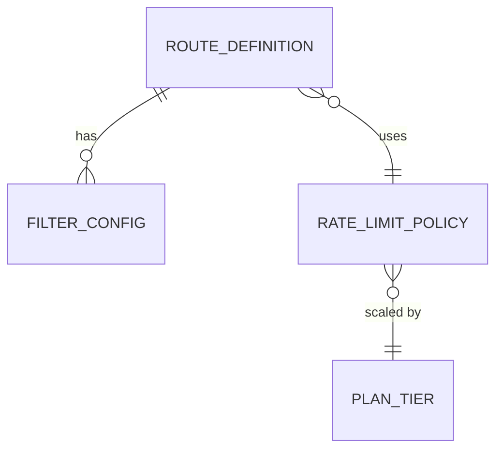
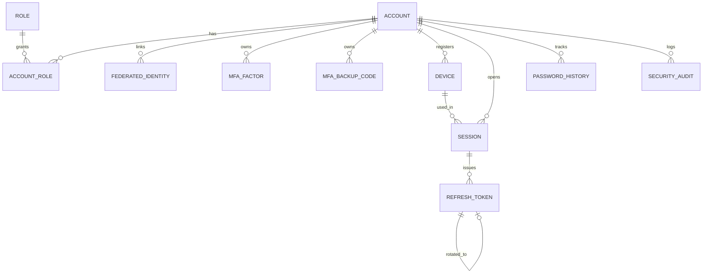
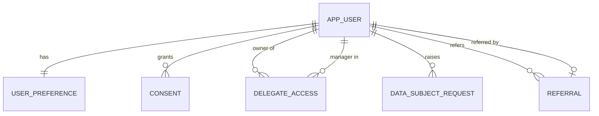
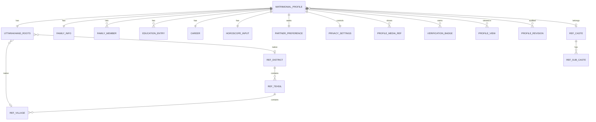
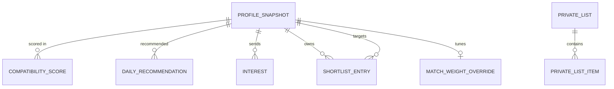
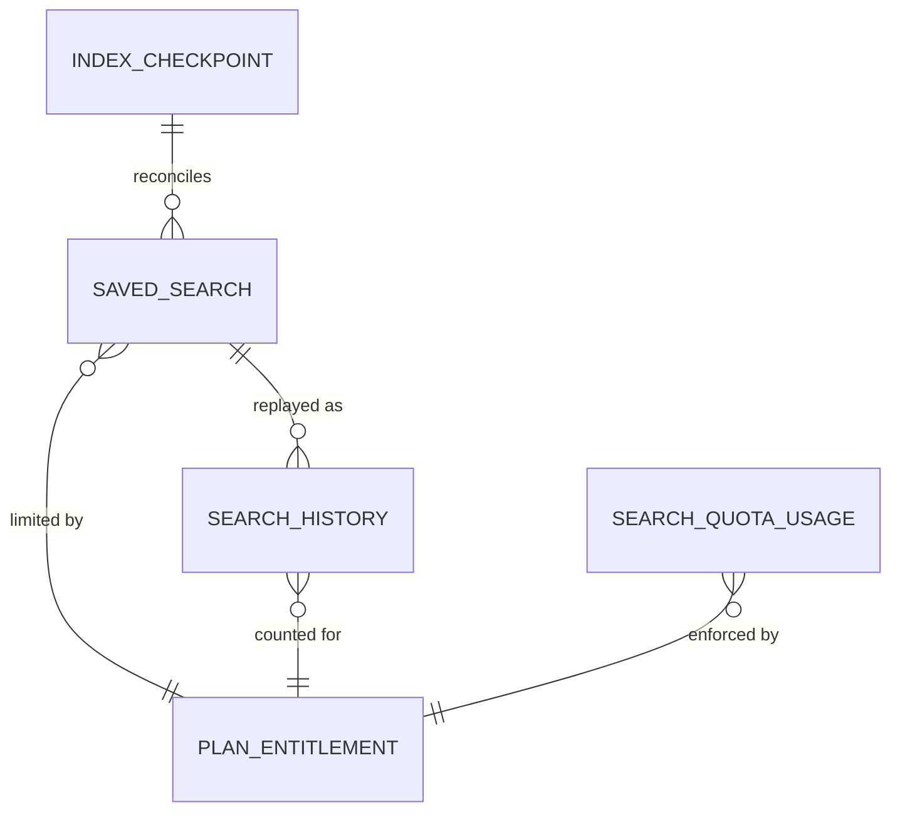

# 02 — Core Services (1–6)

Services covered: `api-gateway`, `identity-service`, `user-service`, `profile-service`, `matchmaking-service`, `search-service`.

## 0. Shared conventions applied in this document

| Concern | Convention |
|---|---|
| Service names | kebab-case (`identity-service`) |
| Java base package | `in.pahadijodi.<svc>` (e.g. `in.pahadijodi.identity`) with `domain`, `application`, `adapter.in`, `adapter.out`, `config` (hexagonal) |
| Kafka topics | `pj.<domain>.<event>.v1`, e.g. `pj.identity.user-registered.v1`; DLQ = `<topic>.dlq`; retry = `<topic>.retry.<n>` |
| Kafka envelope | Avro/JSON-Schema with common header: `eventId (uuid)`, `eventType`, `occurredAt`, `producer`, `traceId`, `schemaVersion`, `aggregateId`, `payload` |
| Kafka key | aggregate id (user id / profile id) so ordering per aggregate is preserved |
| Delivery | Transactional **outbox** table per service, Debezium (or poller) publishes; consumers are idempotent via `processed_event` table (`event_id` PK) |
| DB | PostgreSQL 16 (Aurora), **schema-per-service** (`identity`, `usr`, `profile`, `match`), separate DB credentials per service, Flyway migrations `V<n>__desc.sql` |
| IDs | UUIDv7 (time-ordered) generated in app; `bigint` surrogate only for internal join tables |
| Timestamps | `timestamptz`, UTC; `created_at`, `updated_at`, `version` (optimistic lock) on aggregates |
| Errors | RFC 9457 `application/problem+json` with `type`, `title`, `status`, `code`, `traceId` |
| Auth | Bearer JWT (RS256/ES256) validated at gateway and again in service (defence in depth) |
| Pagination | cursor-based (`?cursor=&limit=`), max limit 50 |

Common error codes used below: `400 VALIDATION_FAILED`, `401 UNAUTHENTICATED`, `403 FORBIDDEN`, `404 NOT_FOUND`, `409 CONFLICT`, `412 PRECONDITION_FAILED` (ETag), `422 BUSINESS_RULE_VIOLATION`, `423 ACCOUNT_LOCKED`, `429 RATE_LIMITED`, `503 DEPENDENCY_UNAVAILABLE`.

---

## 1. api-gateway

### 1.1 Responsibilities
- Single public entry (behind AWS CloudFront → AWS WAF → ALB → gateway pods).
- TLS termination at ALB; mTLS/mesh (Istio or Linkerd) from gateway to services.
- Route to services, API versioning (`/api/v1/...`), request/response correlation (`X-Request-Id`, W3C `traceparent`).
- JWT signature/expiry/audience validation using JWKS cached from identity-service; coarse authorization (role/scope per route).
- Rate limiting (per IP, per user, per route class, per plan tier) with Redis token bucket.
- Request hygiene: size limits, content-type allowlist, header sanitisation, CORS, security headers, idempotency-key pass-through.
- Circuit breaking, timeouts, retries (idempotent GETs only), bulkheads (Resilience4j).
- BFF aggregation endpoints for web and mobile (`/bff/web/*`, `/bff/mobile/*`) – e.g. home feed combining recommendations + unread counts + subscription state.
- WebSocket upgrade routing for chat (sticky by user id hash) and WebRTC signalling.
- Does **not** hold business logic or its own DB (Redis only).

### 1.2 Domain model
Stateless. Config aggregates only: `RouteDefinition`, `RateLimitPolicy(tier, route class, replenishRate, burst, requestedTokens)`, `ApiVersionPolicy`, `ClientApp (web/ios/android/admin)`.

### 1.3 Database schema
No relational DB. Redis keys (see 1.8). Route/rate-limit policy sourced from Kubernetes ConfigMap / Spring Cloud Config (git-backed), hot-reloaded.



### 1.4 Route configuration (Spring Cloud Gateway)
```yaml
spring:
  cloud:
    gateway:
      httpclient:
        connect-timeout: 2000
        response-timeout: 8s
        pool: { type: elastic, max-idle-time: 30s }
      default-filters:
        - name: RequestId
        - name: SecurityHeaders
        - name: RemoveRequestHeader
          args: { name: X-Internal-User }          # never trust client-supplied internal headers
        - name: DedupeResponseHeader
          args: { name: Access-Control-Allow-Origin, strategy: RETAIN_FIRST }
      globalcors:
        cors-configurations:
          '[/**]':
            allowedOrigins: ["https://www.pahadijodi.in","https://admin.pahadijodi.in"]
            allowedMethods: [GET,POST,PUT,PATCH,DELETE,OPTIONS]
            allowedHeaders: [Authorization,Content-Type,Idempotency-Key,If-Match,X-Device-Id]
            exposedHeaders: [ETag,X-Request-Id,X-RateLimit-Remaining,Retry-After]
            maxAge: 3600
      routes:
        - id: identity-public
          uri: lb://identity-service
          predicates: [ Path=/api/v1/auth/** ]
          filters:
            - name: RequestRateLimiter
              args: { redis-rate-limiter.replenishRate: 5, redis-rate-limiter.burstCapacity: 10,
                      key-resolver: "#{@ipKeyResolver}", deny-empty-key: true }
            - name: CircuitBreaker
              args: { name: identityCb, fallbackUri: "forward:/fallback/identity" }
        - id: identity-secure
          uri: lb://identity-service
          predicates: [ Path=/api/v1/account/** ]
          filters: [ JwtAuth, UserRateLimit=authenticated ]
        - id: user
          uri: lb://user-service
          predicates: [ Path=/api/v1/users/** ]
          filters: [ JwtAuth, UserRateLimit=authenticated ]
        - id: profile
          uri: lb://profile-service
          predicates: [ Path=/api/v1/profiles/** ]
          filters: [ JwtAuth, UserRateLimit=authenticated, ProfileViewQuota ]
        - id: match
          uri: lb://matchmaking-service
          predicates: [ Path=/api/v1/matches/**,/api/v1/shortlists/** ]
          filters: [ JwtAuth, UserRateLimit=authenticated ]
        - id: search
          uri: lb://search-service
          predicates: [ Path=/api/v1/search/** ]
          filters: [ JwtAuth, UserRateLimit=search, RetryGet ]
        - id: chat-ws
          uri: lb:ws://chat-service
          predicates: [ Path=/ws/chat/** ]
          filters: [ JwtAuth=query-token-allowed, WsConnectionLimit=5 ]
        - id: payments-webhooks     # no JWT, signature verified in payment-service
          uri: lb://payment-service
          predicates: [ Path=/api/v1/webhooks/razorpay,/api/v1/webhooks/stripe, Method=POST ]
          filters:
            - name: RequestSize
              args: { maxSize: 256KB }
            - name: IpAllowlist
              args: { cidrs: "${psp.webhook.cidrs}" }
        - id: admin
          uri: lb://admin-service
          predicates: [ Host=admin-api.pahadijodi.in, Path=/api/v1/admin/** ]
          filters: [ JwtAuth=role:ADMIN, IpAllowlist=corp-vpn, UserRateLimit=admin ]
        - id: bff-web
          uri: forward:/bff/web
          predicates: [ Path=/bff/web/** ]
          filters: [ JwtAuth ]
```

### 1.5 Filters (order)
| Order | Filter | Purpose |
|---|---|---|
| -300 | `RequestIdFilter` | generate/propagate `X-Request-Id`, OTel context |
| -250 | `IpResolverFilter` | trust `X-Forwarded-For` only from ALB CIDR; derive client IP |
| -200 | `SizeAndContentTypeFilter` | 1 MB default body cap (uploads go direct to S3 via presigned URL) |
| -150 | `RateLimitFilter` | Redis token bucket |
| -100 | `JwtAuthFilter` | validate JWT, reject revoked `jti`/session, enforce `aud`, `scope` |
| -90 | `ClaimsToHeadersFilter` | strip inbound `X-User-*`; inject signed `X-User-Id`, `X-User-Roles`, `X-User-Plan`, `X-Device-Id` (HMAC `X-Gateway-Sig`) |
| -80 | `ProfileViewQuota` | coarse plan pre-check (authoritative check in profile/subscription) |
| 0 | `RouteToService` | with CircuitBreaker + timeout |
| +100 | `ResponseHeadersFilter` | HSTS, `X-Content-Type-Options`, `Cache-Control: no-store` for authenticated |
| +200 | `AccessLogFilter` | structured log (no PII/tokens), metrics |

### 1.6 Rate limiting (Redis token bucket)
- Implementation: Lua script (atomic) via `ReactiveRedisTemplate`; Spring `RedisRateLimiter` for standard cases, custom `PlanAwareRateLimiter` for tiering.
- Key: `rl:{class}:{subject}` where subject = `ip:<ip>` | `u:<userId>` | `dev:<deviceId>`.

| Class | Subject | Replenish/s | Burst | Notes |
|---|---|---|---|---|
| auth | IP | 5 | 10 | plus identity-service per-account lockouts |
| otp-send | IP + mobile | 1 per 60 s, 5/day | 5 | stricter in identity-service |
| authenticated (FREE) | user | 10 | 30 | |
| authenticated (PREMIUM+) | user | 30 | 90 | tier from JWT `plan` claim |
| search | user | 3 | 10 | quota in search-service is daily |
| admin | user | 20 | 40 | |
| anonymous | IP | 3 | 6 | |

Response on throttle: `429` + `Retry-After`, `X-RateLimit-Remaining`. Fail-open policy for Redis outage on authenticated traffic (with local Caffeine fallback limiter at 2× conservative), fail-closed for `/auth/**`.

### 1.7 JWT validation
- JWKS fetched from `https://identity.internal/.well-known/jwks.json`, cached 10 min in-memory with background refresh; unknown `kid` triggers one forced refresh (rate-limited) to support key rotation.
- Validate: signature, `exp`, `nbf`, `iss=https://id.pahadijodi.in`, `aud` contains `pj-api`, `typ=at+jwt`.
- Revocation: access tokens are 10 min; logout/ban writes `revoked:sid:<sid>` in Redis (TTL = remaining token life) and `revoked:user:<uid>` (ban) – checked by gateway (O(1)).
- Service-to-service: services re-validate JWT locally using shared `pj-security-starter`; internal calls use mTLS + service JWT (`client_credentials`).

### 1.8 Caching (gateway)
| Key | Value | TTL | Invalidation |
|---|---|---|---|
| `jwks:cache` (local) | JWKS | 10 min | on unknown kid |
| `rl:*` | bucket tokens | auto | n/a |
| `revoked:sid:<sid>` | 1 | token TTL | expiry |
| `revoked:user:<uid>` | epoch of ban | 24 h | on unban |
| `bff:home:<uid>` | aggregated home JSON | 30 s | event-driven eviction on new match/message |

### 1.9 WAF interplay
- AWS WAF on CloudFront/ALB: managed rule groups (CommonRuleSet, KnownBadInputs, SQLi, IP reputation, Bot Control), geo/rate rules (2000 req/5 min/IP), custom rule blocking oversized bodies.
- Gateway trusts only WAF-forwarded traffic (ALB SG allows CloudFront prefix list; custom header `X-Origin-Verify` secret checked).
- WAF-blocked requests logged to S3/Kinesis → OpenSearch; fraud-detection-service consumes IP-reputation feed. Gateway adds defence (rate limit, schema validation) so WAF failure does not remove protection.

### 1.10 Versioning
- URI major version `/api/v1`; additive changes only within a major. Breaking → `/api/v2` routed side-by-side; deprecation via `Deprecation` + `Sunset` headers, minimum 6 months for mobile clients.
- Mobile minimum-supported-version check: `X-App-Version` below min → `426 UPGRADE_REQUIRED`.

### 1.11 BFF notes
- Two thin BFF modules inside gateway (`bff-web`, `bff-mobile`) using WebClient with parallel fan-out + per-call timeouts (300 ms) and partial-response degradation (`"degraded":["recommendations"]`).
- Mobile BFF returns trimmed payloads, image variants by `X-Network-Quality`, and supports `If-None-Match` for offline sync.
- Anything with business rules stays in domain services.

### 1.12 REST APIs (gateway-owned)
| Method | Path | Auth | Description | Errors |
|---|---|---|---|---|
| GET | `/bff/web/home` | JWT | Aggregated home (recs, unread, plan) | 401, 429 |
| GET | `/bff/mobile/home` | JWT | Lean variant | 401, 426, 429 |
| GET | `/actuator/health/**` | internal | readiness/liveness | – |
| GET | `/fallback/{svc}` | – | `503` problem+json | 503 |

### 1.13 Kafka events
None produced. (Access logs go via Fluent Bit.) Consumes `pj.identity.user-banned.v1` and `pj.identity.session-revoked.v1` (via lightweight consumer) to update Redis revocation keys.

### 1.14 Design patterns
API Gateway, BFF, Chain of Responsibility (filters), Circuit Breaker, Bulkhead, Token Bucket, Strategy (key resolvers), Cache-aside, Anti-Corruption Layer (BFF response shaping), Sidecar (mesh).

### 1.15 Security controls
Header spoofing prevention (strip + HMAC-sign internal headers), CORS allowlist, HSTS, request-size caps, JSON depth limits, no stack traces, IP allowlist for webhooks/admin, mTLS to upstream, JWT `aud` enforcement, per-route scope, secrets in AWS Secrets Manager (External Secrets Operator), SSRF-safe (no user-controlled URIs), log scrubbing.

### 1.16 Scaling
- Min 3 replicas across 3 AZs (PodAntiAffinity/topologySpread), HPA on CPU 60 % **and** `http_server_requests` RPS per pod (KEDA/Prometheus adapter), max 40. PDB `minAvailable: 2`.
- Reactive (Netty) → ~5–8k RPS per 2 vCPU pod. Redis: ElastiCache cluster mode, 3 shards × 2 replicas.
- Graceful shutdown 30 s with `preStop` sleep for ALB deregistration.

---

## 2. identity-service

### 2.1 Responsibilities
- Credentials & authentication: email+password (argon2id), mobile OTP, social login (Google, Facebook, Apple via OIDC/OAuth2), Two-Factor (TOTP + SMS/email OTP fallback + backup codes).
- Token issuance: short-lived access JWT, rotating opaque refresh tokens with reuse detection; JWKS endpoint; OAuth2 authorization server (Spring Authorization Server) for web/mobile (Auth Code + PKCE) and `client_credentials` for services.
- Session & device management (list/revoke devices, trusted device for 2FA skip, biometric-bound refresh for mobile).
- Account lifecycle: registration, email/mobile verification, password reset, account lock, ban/suspend (from admin/moderation), deletion request (DPDP Act right to erasure → emits event).
- Authorization data: roles, permissions, ABAC attribute provision (plan, verification level, account status, region) for claim enrichment; policy evaluation library shared as `pj-security-starter`.
- Audit log of security events (immutable, append-only).

### 2.2 Domain model
- **Aggregate `Account`** (root): `AccountId`, `Email`(VO), `MobileNumber`(VO, E.164), `PasswordHash`(VO), `AccountStatus` (PENDING, ACTIVE, SUSPENDED, BANNED, DELETION_PENDING, DELETED), `Role` set, `FailedLoginCounter`, `LockedUntil`, `MfaSettings`.
- **Entity `FederatedIdentity`** (provider, subject, email, linkedAt).
- **Entity `MfaFactor`** (TOTP secret encrypted, backup codes hashed, verifiedAt).
- **Aggregate `Session`** (`sid`, `deviceId`, `refreshTokenFamilyId`, `ip`, `userAgent`, `createdAt`, `lastSeenAt`, `revokedAt`).
- **Entity `RefreshToken`** (hash, familyId, parentId, usedAt, expiresAt).
- **Entity `Device`** (fingerprint hash, platform, push token ref, trusted flag, biometricKeyId).
- **Entity `OtpChallenge`** (purpose, destination hash, codeHash, attempts, expiresAt).
- Domain events: `UserRegistered`, `EmailVerified`, `MobileVerified`, `LoginSucceeded`, `LoginFailed`, `MfaEnabled`, `PasswordChanged`, `SessionRevoked`, `UserBanned`, `AccountDeletionRequested`.

### 2.3 Database schema (PostgreSQL, schema `identity`)
```sql
CREATE SCHEMA IF NOT EXISTS identity;

CREATE TYPE identity.account_status AS ENUM
  ('PENDING','ACTIVE','SUSPENDED','BANNED','DELETION_PENDING','DELETED');

CREATE TABLE identity.account (
  id               uuid PRIMARY KEY,
  email            citext UNIQUE,
  email_verified   boolean NOT NULL DEFAULT false,
  mobile_e164      varchar(16) UNIQUE,
  mobile_verified  boolean NOT NULL DEFAULT false,
  password_hash    text,                         -- argon2id encoded string, NULL for social-only
  password_changed_at timestamptz,
  status           identity.account_status NOT NULL DEFAULT 'PENDING',
  failed_logins    smallint NOT NULL DEFAULT 0,
  locked_until     timestamptz,
  mfa_enabled      boolean NOT NULL DEFAULT false,
  country_code     char(2),
  created_at       timestamptz NOT NULL DEFAULT now(),
  updated_at       timestamptz NOT NULL DEFAULT now(),
  version          bigint NOT NULL DEFAULT 0,
  CONSTRAINT chk_contact CHECK (email IS NOT NULL OR mobile_e164 IS NOT NULL)
);
CREATE INDEX idx_account_status ON identity.account(status) WHERE status <> 'ACTIVE';

CREATE TABLE identity.role (
  id smallint PRIMARY KEY, name varchar(40) UNIQUE NOT NULL);       -- USER, MODERATOR, SUPPORT, ADMIN, SUPER_ADMIN, RELATIONSHIP_MANAGER, SERVICE
CREATE TABLE identity.account_role (
  account_id uuid REFERENCES identity.account(id) ON DELETE CASCADE,
  role_id    smallint REFERENCES identity.role(id),
  granted_by uuid, granted_at timestamptz NOT NULL DEFAULT now(),
  PRIMARY KEY (account_id, role_id));

CREATE TABLE identity.federated_identity (
  id uuid PRIMARY KEY,
  account_id uuid NOT NULL REFERENCES identity.account(id) ON DELETE CASCADE,
  provider varchar(16) NOT NULL CHECK (provider IN ('GOOGLE','FACEBOOK','APPLE')),
  subject  varchar(255) NOT NULL,
  email    citext,
  linked_at timestamptz NOT NULL DEFAULT now(),
  UNIQUE (provider, subject));
CREATE INDEX idx_fed_account ON identity.federated_identity(account_id);

CREATE TABLE identity.mfa_factor (
  id uuid PRIMARY KEY,
  account_id uuid NOT NULL REFERENCES identity.account(id) ON DELETE CASCADE,
  type varchar(10) NOT NULL CHECK (type IN ('TOTP','SMS','EMAIL')),
  secret_enc bytea,                      -- AES-256-GCM envelope-encrypted via KMS data key
  verified_at timestamptz,
  last_used_step bigint,                 -- TOTP replay protection
  created_at timestamptz NOT NULL DEFAULT now(),
  UNIQUE (account_id, type));
CREATE TABLE identity.mfa_backup_code (
  id uuid PRIMARY KEY, account_id uuid NOT NULL REFERENCES identity.account(id) ON DELETE CASCADE,
  code_hash text NOT NULL, used_at timestamptz);
CREATE INDEX idx_backup_account ON identity.mfa_backup_code(account_id) WHERE used_at IS NULL;

CREATE TABLE identity.device (
  id uuid PRIMARY KEY,
  account_id uuid NOT NULL REFERENCES identity.account(id) ON DELETE CASCADE,
  fingerprint_hash char(64) NOT NULL,
  platform varchar(10) NOT NULL CHECK (platform IN ('WEB','IOS','ANDROID')),
  name varchar(80), push_token_ref varchar(255),
  trusted_until timestamptz, biometric_key_id varchar(100),
  first_seen_at timestamptz NOT NULL DEFAULT now(), last_seen_at timestamptz NOT NULL DEFAULT now(),
  UNIQUE (account_id, fingerprint_hash));

CREATE TABLE identity.session (
  id uuid PRIMARY KEY,                    -- = sid claim
  account_id uuid NOT NULL REFERENCES identity.account(id) ON DELETE CASCADE,
  device_id uuid REFERENCES identity.device(id) ON DELETE SET NULL,
  family_id uuid NOT NULL,
  ip inet, user_agent varchar(300), geo_country char(2),
  mfa_verified boolean NOT NULL DEFAULT false,
  created_at timestamptz NOT NULL DEFAULT now(), last_seen_at timestamptz NOT NULL DEFAULT now(),
  revoked_at timestamptz, revoke_reason varchar(40));
CREATE INDEX idx_session_account_active ON identity.session(account_id) WHERE revoked_at IS NULL;

CREATE TABLE identity.refresh_token (
  id uuid PRIMARY KEY,
  session_id uuid NOT NULL REFERENCES identity.session(id) ON DELETE CASCADE,
  family_id uuid NOT NULL,
  token_hash char(64) NOT NULL UNIQUE,    -- SHA-256 of opaque token; raw never stored
  parent_id uuid REFERENCES identity.refresh_token(id),
  issued_at timestamptz NOT NULL DEFAULT now(),
  expires_at timestamptz NOT NULL,
  used_at timestamptz);
CREATE INDEX idx_rt_family ON identity.refresh_token(family_id);
CREATE INDEX idx_rt_expiry ON identity.refresh_token(expires_at);

CREATE TABLE identity.otp_challenge (
  id uuid PRIMARY KEY,
  purpose varchar(20) NOT NULL CHECK (purpose IN ('LOGIN','REGISTER','VERIFY_MOBILE','VERIFY_EMAIL','RESET_PASSWORD','MFA')),
  destination_hash char(64) NOT NULL,
  code_hash char(64) NOT NULL,            -- HMAC-SHA256(code, pepper)
  attempts smallint NOT NULL DEFAULT 0,
  expires_at timestamptz NOT NULL, consumed_at timestamptz,
  created_at timestamptz NOT NULL DEFAULT now());
CREATE INDEX idx_otp_dest ON identity.otp_challenge(destination_hash, created_at DESC);

CREATE TABLE identity.password_history (
  account_id uuid REFERENCES identity.account(id) ON DELETE CASCADE,
  password_hash text NOT NULL, changed_at timestamptz NOT NULL DEFAULT now(),
  PRIMARY KEY (account_id, changed_at));

CREATE TABLE identity.security_audit (   -- append-only; REVOKE UPDATE, DELETE; partitioned monthly
  id bigint GENERATED ALWAYS AS IDENTITY,
  account_id uuid, event_type varchar(40) NOT NULL, ip inet, device_id uuid,
  details jsonb, occurred_at timestamptz NOT NULL DEFAULT now(),
  PRIMARY KEY (id, occurred_at)) PARTITION BY RANGE (occurred_at);

CREATE TABLE identity.outbox (
  id uuid PRIMARY KEY, aggregate_id uuid NOT NULL, topic varchar(120) NOT NULL,
  key varchar(64) NOT NULL, payload jsonb NOT NULL, headers jsonb,
  created_at timestamptz NOT NULL DEFAULT now());
CREATE TABLE identity.processed_event (event_id uuid PRIMARY KEY, processed_at timestamptz NOT NULL DEFAULT now());

CREATE TABLE identity.signing_key (       -- JWKS rotation
  kid varchar(40) PRIMARY KEY, alg varchar(10) NOT NULL, public_jwk jsonb NOT NULL,
  kms_key_arn varchar(200) NOT NULL, status varchar(10) NOT NULL CHECK (status IN ('ACTIVE','RETIRING','RETIRED')),
  created_at timestamptz NOT NULL DEFAULT now(), retire_at timestamptz);
```


### 2.4 Authentication flows (detail)

**Email + password (argon2id)**
- Algorithm: argon2id, parameters m=64 MiB, t=3, p=2 (tuned to ~250 ms on prod hardware; stored in the encoded hash so params can be raised – rehash-on-login when params outdated). Optional server-side pepper (HMAC with KMS-held key) before hashing.
- Policy: min 10 chars, zxcvbn score ≥ 3, HIBP k-anonymity breach check, no reuse of last 5 (`password_history`).
- Lockout: 5 failures/15 min → exponential lock (15 min → 24 h), counters in Redis + `failed_logins`; generic error messages to prevent enumeration; constant-time compare; dummy hash on unknown user to equalise timing.
- Registration: create `PENDING` account → send verification email link (signed, 24 h, single use) → `ACTIVE` → `UserRegistered` event.

**Mobile OTP**
- `POST /auth/otp/send` → 6-digit CSPRNG code, HMAC-hashed, TTL 5 min, max 5 attempts, resend cooldown 60 s, 5 sends/day/number, 20/day/IP; delivery via notification-service (SMS DLT-registered templates, WhatsApp fallback). Same-response for unknown numbers (no enumeration). Login via OTP auto-registers if unknown mobile (status PENDING_PROFILE).
- Mobile (Android) SMS Retriever hash appended.

**Social login (OIDC)**
- Web: Authorization Code + PKCE handled by the SPA → posts `code`+`code_verifier` to identity; mobile: native SDK returns `id_token` → `POST /auth/social/{provider}`.
- Validation: signature via provider JWKS (Google `https://accounts.google.com`, Apple `https://appleid.apple.com`, Facebook Limited Login OIDC / Graph `debug_token`), check `iss`, `aud` (our client ids), `exp`, `nonce`. Apple private-relay email handled; Apple requires `client_secret` JWT (ES256) generated from KMS-stored key.
- Account linking: match by verified provider `sub`; link to existing account by verified email only after the user proves ownership (prevents pre-hijacking). Unverified provider emails never auto-link.

**TOTP 2FA**
- RFC 6238, SHA-1/6 digits/30 s (authenticator compatibility), ±1 step window, `last_used_step` blocks replay. Secret generated 160-bit, stored envelope-encrypted (KMS data key, AAD = accountId). Enrol: `POST /account/mfa/totp/enroll` → otpauth URI/QR → `verify` activates and returns 10 single-use backup codes (hashed with argon2id).
- Step-up: login returns `mfa_required` + short-lived `mfa_token` (5 min, scope `mfa`); trusted device (30 days, signed cookie/device key) may skip. Sensitive ops (change password, payments > threshold, delete account) require fresh MFA (`auth_time` < 5 min).
- Mandatory for ADMIN/MODERATOR roles; WebAuthn passkeys on roadmap (factor type extensible).

**Device management**
- Device record on each login; new-device login → email/push alert + risk score (fraud-detection `pj.fraud.risk-scored.v1`). `GET /account/devices`, `DELETE /account/devices/{id}` revokes all sessions of that device. Mobile biometric: app generates keypair in Secure Enclave/Keystore bound to biometrics; server stores public key; `POST /auth/biometric/login` with signed challenge (nonce) → new session (no password).

**Refresh-token rotation with reuse detection**
- Refresh token = 256-bit opaque random, stored as SHA-256 hash; TTL 30 days sliding (max 90 absolute), bound to `session`+`device`.
- On `/auth/token/refresh`: lookup by hash inside `SELECT ... FOR UPDATE`; if `used_at IS NULL` → mark used, issue child (same `family_id`) + new access token. If **already used** (replay) → revoke whole family & session, write audit `REFRESH_REUSE_DETECTED`, emit `pj.identity.session-revoked.v1`, force re-login (an optional 10 s grace window handles legit client retries/network races by returning the same child idempotently).
- Cookies for web: `__Host-rt` HttpOnly, Secure, SameSite=Strict, path `/api/v1/auth`; access token in memory only.

### 2.5 JWT claims & JWKS
Access token (ES256, `kid` header, 10 min):
```json
{
  "iss": "https://id.pahadijodi.in",
  "sub": "018f3c2e-7a1b-7c3d-9e10-2b6f5c0a1d44",
  "aud": ["pj-api"],
  "iat": 1730000000, "nbf": 1730000000, "exp": 1730000600,
  "jti": "9b2c...", "sid": "018f3c...", "typ": "at+jwt",
  "auth_time": 1729999900, "amr": ["pwd","otp"], "acr": "mfa",
  "roles": ["USER"],
  "scope": "profile:read profile:write chat:use",
  "plan": "PREMIUM", "ver": 2,
  "st": "ACTIVE", "ctry": "IN", "did": "018f3d..."
}
```
- `plan` and `ver` (verification level 0–3) are refreshed from subscription/verification events; they are advisory at the edge, authoritative checks occur in owning services.
- No PII (email/mobile/name) in tokens.
- **JWKS**: `GET /.well-known/jwks.json` (public, `Cache-Control: max-age=600`). Keys signed via AWS KMS asymmetric keys (private key never leaves KMS); rotation every 90 days: publish new `kid` (RETIRING old stays in JWKS for ≥ max token TTL + cache TTL), then switch signing. Discovery: `/.well-known/openid-configuration`.
- ID tokens/OAuth2 endpoints via Spring Authorization Server (`/oauth2/authorize`, `/oauth2/token`, `/oauth2/revoke`, `/oauth2/introspect` for opaque service tokens).

### 2.6 Authorization: RBAC + ABAC
- RBAC: roles above → coarse method security `@PreAuthorize("hasRole('ADMIN')")`.
- ABAC: Policy Decision Point library (`pj-abac`) using attribute sets – **subject** (userId, roles, plan, verification level, account status, age, gender, country), **resource** (ownerId, visibility, status, community), **action**, **environment** (time, IP risk, MFA freshness, device trust). Policies authored as JSON/Rego-like rules versioned in git and loaded by each service; evaluated in-process (≈µs). Examples:
  - `profile.read-contact` permit if `subject.plan ∈ {PREMIUM,PREMIUM_PLUS,VIP}` ∧ `resource.contactVisibility ≠ HIDDEN` ∧ `!blocked(subject,resource.owner)` ∧ `subject.ver ≥ 1`.
  - `admin.user.ban` permit if role ∈ {ADMIN,SUPER_ADMIN} ∧ `env.mfaAgeSeconds < 300` ∧ `env.ipTrust = CORP`.
  - `chat.initiate` deny if `subject.st ≠ ACTIVE` or either party blocked.
- Policy decisions are audit-logged for sensitive resources.

### 2.7 REST APIs
| Method | Path | Auth | Request → Response | Errors |
|---|---|---|---|---|
| POST | `/api/v1/auth/register` | none | `{email,password,mobile?,acceptTerms}` → `202 {accountId, verificationSent}` | 400, 409 EMAIL_TAKEN, 422 WEAK_PASSWORD |
| POST | `/api/v1/auth/email/verify` | none | `{token}` → 204 | 400 TOKEN_INVALID, 410 TOKEN_EXPIRED |
| POST | `/api/v1/auth/login` | none | `{email,password,deviceInfo}` → `{accessToken,expiresIn}` + refresh (cookie/body) or `{mfaRequired:true,mfaToken}` | 401 INVALID_CREDENTIALS, 423 ACCOUNT_LOCKED, 403 ACCOUNT_BANNED, 429 |
| POST | `/api/v1/auth/otp/send` | none | `{mobile,purpose}` → `202 {challengeId,resendAfter}` | 400, 429 |
| POST | `/api/v1/auth/otp/verify` | none | `{challengeId,code,deviceInfo}` → tokens | 401 OTP_INVALID, 410 OTP_EXPIRED, 429 |
| POST | `/api/v1/auth/social/{google\|facebook\|apple}` | none | `{idToken\|code,codeVerifier,nonce,deviceInfo}` → tokens, `isNewUser` | 401 TOKEN_INVALID, 409 LINK_REQUIRED |
| POST | `/api/v1/auth/mfa/verify` | mfaToken | `{code\|backupCode,trustDevice}` → tokens | 401, 429 |
| POST | `/api/v1/auth/token/refresh` | refresh token | → new tokens | 401 REFRESH_INVALID, 401 REFRESH_REUSED |
| POST | `/api/v1/auth/logout` | JWT | `{allDevices?}` → 204 | – |
| POST | `/api/v1/auth/password/forgot` | none | `{email\|mobile}` → 202 (always) | 429 |
| POST | `/api/v1/auth/password/reset` | none | `{token,newPassword}` → 204 | 400, 422 |
| POST | `/api/v1/auth/biometric/challenge` / `/login` | none | nonce / signed assertion → tokens | 401 |
| GET | `/api/v1/account/me` | JWT | account summary (masked contacts) | 401 |
| POST | `/api/v1/account/password/change` | JWT + fresh MFA | `{current,new}` → 204 (revokes other sessions) | 401, 422 |
| POST | `/api/v1/account/mfa/totp/enroll` / `/verify` / `DELETE /mfa/totp` | JWT | QR URI / backup codes | 409 ALREADY_ENROLLED |
| GET/DELETE | `/api/v1/account/devices[/{id}]` | JWT | list/revoke | 404 |
| GET/DELETE | `/api/v1/account/sessions[/{id}]` | JWT | list/revoke | 404 |
| POST | `/api/v1/account/delete-request` | JWT + fresh MFA | → 202, 30-day grace | 409 |
| GET | `/.well-known/jwks.json` | none | JWKS | – |
| POST | `/internal/v1/accounts/{id}/ban` | service/admin | `{reason,until?}` → 204 | 403, 404 |

### 2.8 Kafka events
| Topic | Key | Payload |
|---|---|---|
| `pj.identity.user-registered.v1` (P) | accountId | `accountId, email?(hashed), mobileCountry, method(EMAIL/OTP/GOOGLE…), registeredAt` (no raw PII; user-service fetches via API or claim) |
| `pj.identity.email-verified.v1` / `mobile-verified.v1` (P) | accountId | `accountId, verifiedAt` |
| `pj.identity.login-succeeded.v1` (P) | accountId | `accountId, sid, deviceId, ip, country, amr, newDevice, at` (→ fraud, analytics) |
| `pj.identity.login-failed.v1` (P) | accountId/ipHash | `reason, ip, deviceFp, at` |
| `pj.identity.session-revoked.v1` (P) | sid | `sid, accountId, reason` (→ gateway, chat) |
| `pj.identity.user-banned.v1` / `user-unbanned.v1` (P) | accountId | `accountId, reason, until, by` |
| `pj.identity.account-deletion-requested.v1` (P) | accountId | `accountId, scheduledFor` (→ all services erase) |
| `pj.subscription.plan-changed.v1` (C) | accountId | updates `plan` attribute cache |
| `pj.verification.level-changed.v1` (C) | accountId | updates `ver` attribute |
| `pj.moderation.user-action-taken.v1` (C) | accountId | suspend/ban |
| `pj.fraud.account-flagged.v1` (C) | accountId | force step-up / lock |

### 2.9 Design patterns
Hexagonal ports/adapters (`AuthenticationProvider` port with Password/Otp/Social adapters – Strategy), Aggregate + Domain Events, Transactional Outbox, State pattern (account status), Template Method (login pipeline: validate→risk→mfa→issue), Chain of Responsibility (risk checks), Factory (token issuers), Repository, Specification (password policy), CQRS-lite (session list read model from Redis).

### 2.10 Security controls
argon2id + pepper; OTP/TOTP secrets envelope-encrypted (KMS); token hashing; constant-time comparisons; anti-enumeration; CAPTCHA (hCaptcha/Turnstile) after 3 failures or risk score; per-IP/per-account/per-number limits; refresh reuse detection; PKCE; `state`/`nonce`; JWKS KMS-signed; CSRF-safe (SameSite Strict + custom header); audit trail append-only; DB role without DELETE on audit; PII columns column-encrypted where possible; SMS pumping protection (country allowlist, per-prefix caps); admin roles mandatory MFA; dependency scanning; no secrets in logs; Aurora encryption at rest (KMS CMK).

### 2.11 Caching
| Key | TTL | Notes / invalidation |
|---|---|---|
| `otp:rl:{dest}` / `otp:day:{dest}` | 60 s / 24 h | counters |
| `login:fail:{accountId}` / `login:fail:ip:{ip}` | 15 min | reset on success |
| `sess:{sid}` → status+deviceId | 10 min | delete on revoke |
| `abac:attrs:{accountId}` → plan, ver, st | 5 min | evicted on plan/verification events |
| `mfa:token:{id}` | 5 min | single use |
| `jwks` (HTTP cache + Caffeine) | 10 min | rotate |
| Social provider JWKS | 1 h | per provider |

### 2.12 Scaling
Stateless pods, min 4, HPA on CPU 55 % + login p95 latency (argon2id CPU-bound → dedicated node pool with compute-optimised c7i, `limits=2 vCPU`, bounded hashing executor of N threads/pod with queue + 503 shed). Aurora writer + 2 readers (reads: session list/audit); partition `security_audit` monthly; purge expired OTP/refresh via nightly job; Redis cluster. Login peak: 1M users, 20 % DAU, ~300 logins/s peak → ~12 pods. Multi-AZ; JWT validation scales independently at gateway/services (no calls to identity).

---

## 3. user-service

### 3.1 Responsibilities
- Owns the **user account profile shell**: display identity (first name, last name, gender, DOB, who-created-profile), contact details (encrypted), user preferences (language, notification channels, timezone, theme), consents (ToS, privacy, marketing, call-recording), KYC status summary pointer, onboarding state machine, and lifecycle (active/deactivated/snoozed/deleted).
- Created from `pj.identity.user-registered.v1`; source of truth for who a user is (not the detailed matrimonial profile – that is profile-service).
- Profile-for-whom (self, son, daughter, brother, sister…) and **managing-account delegation** (parent managing child's profile).
- Data subject requests (export/delete) orchestration (DPDP Act 2023 / GDPR for diaspora).
- Referral codes and invites.

### 3.2 Domain model
- **Aggregate `User`**: `UserId` (= accountId), `PersonName`(VO), `Gender`, `DateOfBirth`(VO, age derived), `CreatedFor` (SELF/SON/DAUGHTER/BROTHER/SISTER/RELATIVE/FRIEND), `ContactInfo`(VO encrypted), `Locale`, `OnboardingState`, `UserStatus` (ONBOARDING, ACTIVE, DEACTIVATED, SNOOZED, SUSPENDED, DELETED).
- **Entity `ConsentRecord`** (type, version, grantedAt, ip, withdrawnAt).
- **Entity `UserPreference`** (notification channels/quiet hours, language, theme).
- **Entity `DelegateAccess`** (managerUserId, scope, status).
- **Entity `DataSubjectRequest`**, **`Referral`**.

### 3.3 Database schema (schema `usr`)
```sql
CREATE SCHEMA IF NOT EXISTS usr;

CREATE TABLE usr.app_user (
  id uuid PRIMARY KEY,                           -- same as identity.account.id
  first_name varchar(60) NOT NULL,
  last_name  varchar(60),
  gender char(1) NOT NULL CHECK (gender IN ('M','F','O')),
  date_of_birth date,
  created_for varchar(12) NOT NULL DEFAULT 'SELF'
     CHECK (created_for IN ('SELF','SON','DAUGHTER','BROTHER','SISTER','RELATIVE','FRIEND')),
  email_enc bytea, email_hash char(64),          -- field-level encryption + blind index
  mobile_enc bytea, mobile_hash char(64),
  country_code char(2) NOT NULL DEFAULT 'IN',
  timezone varchar(40) NOT NULL DEFAULT 'Asia/Kolkata',
  status varchar(16) NOT NULL DEFAULT 'ONBOARDING'
     CHECK (status IN ('ONBOARDING','ACTIVE','DEACTIVATED','SNOOZED','SUSPENDED','DELETION_PENDING','DELETED')),
  onboarding_step varchar(24) NOT NULL DEFAULT 'BASIC',
  snoozed_until timestamptz,
  referral_code varchar(10) UNIQUE NOT NULL,
  referred_by uuid REFERENCES usr.app_user(id),
  created_at timestamptz NOT NULL DEFAULT now(), updated_at timestamptz NOT NULL DEFAULT now(),
  version bigint NOT NULL DEFAULT 0,
  CHECK (date_of_birth IS NULL OR date_of_birth <= (current_date - interval '18 years'))
);
CREATE INDEX idx_user_status ON usr.app_user(status);
CREATE INDEX idx_user_mobile_hash ON usr.app_user(mobile_hash);
CREATE INDEX idx_user_email_hash ON usr.app_user(email_hash);

CREATE TABLE usr.user_preference (
  user_id uuid PRIMARY KEY REFERENCES usr.app_user(id) ON DELETE CASCADE,
  ui_language varchar(8) NOT NULL DEFAULT 'en',        -- en, hi, gbl (Garhwali), kmn (Kumaoni)
  chat_translate_to varchar(8),
  theme varchar(6) NOT NULL DEFAULT 'SYSTEM',
  notif_email boolean NOT NULL DEFAULT true, notif_sms boolean NOT NULL DEFAULT true,
  notif_push boolean NOT NULL DEFAULT true, notif_whatsapp boolean NOT NULL DEFAULT false,
  quiet_hours_start time, quiet_hours_end time,
  digest_frequency varchar(8) NOT NULL DEFAULT 'DAILY');

CREATE TABLE usr.consent (
  id uuid PRIMARY KEY, user_id uuid NOT NULL REFERENCES usr.app_user(id) ON DELETE CASCADE,
  type varchar(24) NOT NULL CHECK (type IN ('TERMS','PRIVACY','MARKETING','CALL_RECORDING','HOROSCOPE_DATA','PROFILE_SHARING_ABROAD')),
  policy_version varchar(12) NOT NULL, granted_at timestamptz NOT NULL DEFAULT now(),
  ip inet, withdrawn_at timestamptz);
CREATE INDEX idx_consent_user ON usr.consent(user_id, type);

CREATE TABLE usr.delegate_access (
  id uuid PRIMARY KEY,
  owner_user_id uuid NOT NULL REFERENCES usr.app_user(id) ON DELETE CASCADE,
  manager_user_id uuid NOT NULL REFERENCES usr.app_user(id) ON DELETE CASCADE,
  relation varchar(16) NOT NULL, scopes text[] NOT NULL,
  status varchar(10) NOT NULL DEFAULT 'PENDING' CHECK (status IN ('PENDING','ACTIVE','REVOKED')),
  created_at timestamptz NOT NULL DEFAULT now(),
  UNIQUE (owner_user_id, manager_user_id));

CREATE TABLE usr.data_subject_request (
  id uuid PRIMARY KEY, user_id uuid NOT NULL, type varchar(10) NOT NULL CHECK (type IN ('EXPORT','ERASE','RECTIFY')),
  status varchar(12) NOT NULL DEFAULT 'OPEN', requested_at timestamptz NOT NULL DEFAULT now(),
  due_at timestamptz NOT NULL, completed_at timestamptz, export_s3_key varchar(300));

CREATE TABLE usr.referral (
  id uuid PRIMARY KEY, referrer_id uuid NOT NULL REFERENCES usr.app_user(id),
  referee_id uuid NOT NULL UNIQUE REFERENCES usr.app_user(id), status varchar(12) NOT NULL DEFAULT 'JOINED',
  reward_granted_at timestamptz);

CREATE TABLE usr.outbox (id uuid PRIMARY KEY, aggregate_id uuid NOT NULL, topic varchar(120) NOT NULL,
  key varchar(64) NOT NULL, payload jsonb NOT NULL, headers jsonb, created_at timestamptz NOT NULL DEFAULT now());
CREATE TABLE usr.processed_event (event_id uuid PRIMARY KEY, processed_at timestamptz NOT NULL DEFAULT now());
```


### 3.4 REST APIs
| Method | Path | Auth | Summary | Errors |
|---|---|---|---|---|
| GET | `/api/v1/users/me` | JWT | own user + onboarding state + prefs | 401 |
| PATCH | `/api/v1/users/me` | JWT + `If-Match` | update name/gender/dob (dob immutable after verification) | 400, 412, 422 AGE_BELOW_18 |
| POST | `/api/v1/users/me/onboarding/complete-step` | JWT | `{step,data}` advance state machine | 422 INVALID_TRANSITION |
| GET/PUT | `/api/v1/users/me/preferences` | JWT | notification/language/theme | 400 |
| GET | `/api/v1/users/me/consents` ; POST `/consents`; DELETE `/consents/{type}` | JWT | manage consent | 422 MANDATORY_CONSENT |
| POST | `/api/v1/users/me/deactivate` / `/reactivate` / `/snooze` `{until}` | JWT | lifecycle | 409 |
| POST/GET/DELETE | `/api/v1/users/me/delegates[/{id}]` | JWT | invite/accept/revoke family manager | 404, 409 |
| POST | `/api/v1/users/me/data-export` / `/data-erasure` | JWT + fresh MFA | DSR creation → 202 | 409 OPEN_REQUEST_EXISTS |
| GET | `/api/v1/users/{id}/summary` | JWT (ABAC) | public mini-card (first name, age, city) | 403, 404 |
| GET | `/internal/v1/users/{id}` | service | full user for backend | 404 |
| GET | `/api/v1/users/me/referral` | JWT | code + stats | – |

### 3.5 Kafka events
| Topic | Dir | Key | Payload |
|---|---|---|---|
| `pj.identity.user-registered.v1` | C | accountId | creates `app_user` shell (idempotent) |
| `pj.identity.account-deletion-requested.v1` | C | accountId | start erasure workflow |
| `pj.user.user-created.v1` | P | userId | `userId, gender, createdFor, country, referredBy` |
| `pj.user.user-updated.v1` | P | userId | `userId, changedFields[], gender, ageBucket, status` |
| `pj.user.onboarding-completed.v1` | P | userId | `userId, completedAt` (→ profile activation, recommendations) |
| `pj.user.status-changed.v1` | P | userId | `userId, old, new, until?` (→ search de-index on DEACTIVATED/SNOOZED) |
| `pj.user.consent-changed.v1` | P | userId | `type, granted, version` |
| `pj.user.erasure-completed.v1` | P | userId | after every service acks |
| `pj.user.erasure-ack.v1` | C | userId | per-service acknowledgements (saga) |

### 3.6 Design patterns
Aggregate/DDD, Saga (orchestrated erasure across services), State machine (onboarding), Outbox, Idempotent consumer, Anti-Corruption Layer for identity events, Optimistic locking, Value Objects for PII with encrypting JPA `AttributeConverter`, MapStruct DTO mapping.

### 3.7 Security controls
Field-level encryption of contact data (AES-256-GCM, KMS data key per tenant/region, blind index HMAC for lookups), ABAC on `summary` (blocked users get 404), age ≥ 18 validation, consent ledger immutable (withdraw = new timestamp, not delete), erasure workflow with legal-hold exceptions (payments retained 8 years), IDOR checks (`id == subject` or delegate scope), audit on DSR actions, export files in S3 with SSE-KMS and 7-day presigned download.

### 3.8 Caching
| Key | TTL | Invalidation |
|---|---|---|
| `usr:{id}` (user card) | 10 min | evict on user-updated |
| `usr:prefs:{id}` | 30 min | evict on PUT |
| `usr:consent:{id}` | 30 min | evict on consent change |
| `usr:summary:{id}` | 5 min | evict on update |
Cache-aside with Redis; negative caching 30 s for 404.

### 3.9 Scaling
Min 3 pods, HPA CPU 60 %; read-heavy → Aurora readers + Redis; table size ~ 1–5 M rows trivial, partitioning not needed; hash-partition by `id` (16) once > 50 M. Kafka consumer group = partitions 12.

---

## 4. profile-service

### 4.1 Responsibilities
- Owns the detailed **matrimonial profile** – the central business entity: personal details, community & caste, Uttarakhand roots (district/tehsil/village/native place), family, education, profession, income, lifestyle, interests, languages, horoscope inputs, partner preferences, photos/videos references (binary in media-service), privacy settings, verification badges (from verification flows), completeness score, profile views, visibility state.
- Versioning and moderation hooks (new/edited free-text goes through moderation before public).
- Serves profile read APIs with field-level privacy/ABAC masking; publishes full profile change events consumed by search, matchmaking, AI, analytics.
- Profile view tracking and "who viewed me".

### 4.2 Domain model
- **Aggregate `MatrimonialProfile`** (root; id = userId): 
  - VOs: `BasicInfo` (height cm, weight, body type, complexion, marital status, children, physical status, mother tongue, other languages), `ReligionCommunity` (religion, **community**, caste, sub-caste, gotra, caste-no-bar flag), `UttarakhandRoots`, `Family`, `Education`, `Career`, `Lifestyle`, `HoroscopeInput`, `PrivacySettings`, `CompletenessScore`, `AboutMe`, `Interests`.
  - Entities: `EducationEntry`, `WorkEntry`, `FamilyMember`, `PartnerPreference`, `ProfileMedia` (ref), `VerificationBadge`.
  - States: `DRAFT → PENDING_REVIEW → ACTIVE → HIDDEN/SUSPENDED/DELETED`.
- Domain services: `CompletenessCalculator`, `PrivacyPolicyEvaluator`, `RootsNormalizer` (village name normalisation/geocode lookup).

**Enumerations (Uttarakhand-specific)**
| Field | Values |
|---|---|
| `community` | `GARHWALI, KUMAONI, JAUNSARI, BHOTIYA, RAJPUT, BRAHMIN, SCHEDULED_CASTE, SCHEDULED_TRIBE, OBC, OTHER_PAHADI, NON_PAHADI` |
| `division` | `GARHWAL, KUMAON` (derived from district) |
| `district` | `DEHRADUN, PAURI_GARHWAL, TEHRI_GARHWAL, CHAMOLI, RUDRAPRAYAG, UTTARKASHI, ALMORA, NAINITAL, BAGESHWAR, PITHORAGARH, CHAMPAWAT, UDHAM_SINGH_NAGAR, HARIDWAR` |
| `caste` (examples, DB-driven) | Rajput (Negi, Rawat, Bisht, Panwar, Chauhan, Rana, Bhandari, Kunwar, Adhikari, Mehra), Brahmin (Bahuguna, Dobhal, Nautiyal, Uniyal, Joshi, Pant, Pandey, Tiwari, Bhatt, Dimri, Semwal, Raturi), SC (Arya, Das, Shilpkar), Tribal (Jaunsari, Bhotia/Shauka, Tharu, Buksa, Raji) |
| `marital_status` | `NEVER_MARRIED, DIVORCED, WIDOWED, AWAITING_DIVORCE, ANNULLED` |
| `mother_tongue` | `GARHWALI, KUMAONI, JAUNSARI, HINDI, ENGLISH, PUNJABI, OTHER` + `JAUNPURI, RANGLUNG, BHOTIA` (dialects table) |
| `diet` | `VEG, EGG, NONVEG, VEGAN, JAIN` ; `drink/smoke`: `NO, OCCASIONALLY, YES` |
| `family_type` | `NUCLEAR, JOINT, EXTENDED`; `family_values`: `TRADITIONAL, MODERATE, LIBERAL`; `family_status`: `MIDDLE, UPPER_MIDDLE, AFFLUENT` |
| `income_band` | annual INR bands: `<2L, 2–5L, 5–10L, 10–20L, 20–50L, 50L–1Cr, >1Cr` plus currency + `income_visibility` |
| `residency_status` | `CITIZEN, PR, WORK_VISA, STUDENT_VISA, NRI, OCI` |
| `relocate_to_pahad` | `YES, MAYBE, NO` (distinct Pahadi preference) |

### 4.3 Database schema (schema `profile`)
```sql
CREATE SCHEMA IF NOT EXISTS profile;

CREATE TABLE profile.ref_district (
  code varchar(24) PRIMARY KEY, name_en varchar(40) NOT NULL, name_hi varchar(40) NOT NULL,
  division varchar(8) NOT NULL CHECK (division IN ('GARHWAL','KUMAON')),
  hq varchar(40), lat numeric(8,5), lng numeric(8,5));
CREATE TABLE profile.ref_tehsil (
  id int PRIMARY KEY, district_code varchar(24) NOT NULL REFERENCES profile.ref_district(code),
  name_en varchar(60) NOT NULL, name_hi varchar(60));
CREATE TABLE profile.ref_village (
  id bigint PRIMARY KEY, tehsil_id int NOT NULL REFERENCES profile.ref_tehsil(id),
  name_en varchar(80) NOT NULL, name_hi varchar(80), alt_spellings text[],
  lat numeric(8,5), lng numeric(8,5), census_code varchar(10));
CREATE INDEX idx_village_tehsil ON profile.ref_village(tehsil_id);
CREATE INDEX idx_village_name_trgm ON profile.ref_village USING gin (name_en gin_trgm_ops);
CREATE TABLE profile.ref_caste (
  id int PRIMARY KEY, community varchar(24) NOT NULL, caste varchar(60) NOT NULL,
  UNIQUE (community, caste));
CREATE TABLE profile.ref_sub_caste (
  id int PRIMARY KEY, caste_id int NOT NULL REFERENCES profile.ref_caste(id), name varchar(60) NOT NULL,
  UNIQUE (caste_id, name));

CREATE TABLE profile.matrimonial_profile (
  id uuid PRIMARY KEY,                               -- = user id
  profile_code varchar(10) UNIQUE NOT NULL,          -- human id e.g. PJ1234567
  status varchar(16) NOT NULL DEFAULT 'DRAFT'
     CHECK (status IN ('DRAFT','PENDING_REVIEW','ACTIVE','HIDDEN','SUSPENDED','DELETED')),
  gender char(1) NOT NULL, date_of_birth date NOT NULL,
  height_cm smallint CHECK (height_cm BETWEEN 120 AND 230), weight_kg smallint,
  body_type varchar(10), complexion varchar(10),
  marital_status varchar(20) NOT NULL, has_children boolean, children_count smallint,
  physical_status varchar(12) DEFAULT 'NORMAL', disability_details text,
  mother_tongue varchar(16), languages text[] NOT NULL DEFAULT '{}',
  religion varchar(16) NOT NULL DEFAULT 'HINDU',
  community varchar(24) NOT NULL,
  caste_id int REFERENCES profile.ref_caste(id), sub_caste_id int REFERENCES profile.ref_sub_caste(id),
  gotra varchar(60), caste_no_bar boolean NOT NULL DEFAULT false,
  about_me text, about_me_moderated text, about_status varchar(10) DEFAULT 'PENDING',
  diet varchar(8), drinking varchar(14), smoking varchar(14),
  hobbies text[] NOT NULL DEFAULT '{}', interests text[] NOT NULL DEFAULT '{}',
  festivals_celebrated text[] NOT NULL DEFAULT '{}',   -- Harela, Phool Dei, Ghee Sankranti, Nanda Devi, Egaas/Igas, Bagwal…
  cultural_values jsonb,                                -- {"folk_music":true,"traditional_attire":"often"...}
  relocate_to_pahad varchar(6),
  current_country char(2), current_state varchar(40), current_city varchar(60),
  current_geo geography(Point,4326), residency_status varchar(14),
  completeness_score smallint NOT NULL DEFAULT 0 CHECK (completeness_score BETWEEN 0 AND 100),
  visibility varchar(12) NOT NULL DEFAULT 'ALL_MEMBERS',
  last_active_at timestamptz, verified_level smallint NOT NULL DEFAULT 0,
  created_at timestamptz NOT NULL DEFAULT now(), updated_at timestamptz NOT NULL DEFAULT now(),
  version bigint NOT NULL DEFAULT 0
);
CREATE INDEX idx_prof_status_gender ON profile.matrimonial_profile(status, gender);
CREATE INDEX idx_prof_community ON profile.matrimonial_profile(community, caste_id);
CREATE INDEX idx_prof_geo ON profile.matrimonial_profile USING gist (current_geo);
CREATE INDEX idx_prof_updated ON profile.matrimonial_profile(updated_at);

CREATE TABLE profile.uttarakhand_roots (
  profile_id uuid PRIMARY KEY REFERENCES profile.matrimonial_profile(id) ON DELETE CASCADE,
  native_district varchar(24) REFERENCES profile.ref_district(code),
  native_tehsil_id int REFERENCES profile.ref_tehsil(id),
  native_village_id bigint REFERENCES profile.ref_village(id),
  native_village_text varchar(100),                  -- free text when village not in reference
  native_place_description varchar(200),
  ancestral_village_id bigint REFERENCES profile.ref_village(id),
  paternal_village_text varchar(100), maternal_village_text varchar(100),
  kuldevta varchar(60), kul_devi varchar(60), ishta_devta varchar(60),
  owns_ancestral_house boolean, visits_per_year smallint,
  roots_geo geography(Point,4326), generations_in_state smallint);
CREATE INDEX idx_roots_district ON profile.uttarakhand_roots(native_district);
CREATE INDEX idx_roots_village ON profile.uttarakhand_roots(native_village_id);

CREATE TABLE profile.family_info (
  profile_id uuid PRIMARY KEY REFERENCES profile.matrimonial_profile(id) ON DELETE CASCADE,
  family_type varchar(10), family_values varchar(12), family_status varchar(12),
  father_occupation varchar(60), father_status varchar(12), mother_occupation varchar(60), mother_status varchar(12),
  brothers smallint DEFAULT 0, brothers_married smallint DEFAULT 0, sisters smallint DEFAULT 0, sisters_married smallint DEFAULT 0,
  family_location_city varchar(60), family_income_band varchar(10), about_family text);
CREATE TABLE profile.family_member (
  id uuid PRIMARY KEY, profile_id uuid NOT NULL REFERENCES profile.matrimonial_profile(id) ON DELETE CASCADE,
  relation varchar(16) NOT NULL, name varchar(80), occupation varchar(60), is_contact boolean DEFAULT false);

CREATE TABLE profile.education_entry (
  id uuid PRIMARY KEY, profile_id uuid NOT NULL REFERENCES profile.matrimonial_profile(id) ON DELETE CASCADE,
  level varchar(16) NOT NULL, degree varchar(80), field_of_study varchar(80), institution varchar(120),
  country char(2), year_completed smallint, is_highest boolean NOT NULL DEFAULT false);
CREATE UNIQUE INDEX uq_edu_highest ON profile.education_entry(profile_id) WHERE is_highest;

CREATE TABLE profile.career (
  profile_id uuid PRIMARY KEY REFERENCES profile.matrimonial_profile(id) ON DELETE CASCADE,
  occupation_category varchar(30) NOT NULL,   -- GOVT_SERVICE, DEFENCE (Army/ITBP/SSB), PRIVATE, BUSINESS, DOCTOR, TEACHER, FARMER, HOSPITALITY…
  designation varchar(80), employer varchar(100), employer_type varchar(16),
  work_city varchar(60), work_country char(2),
  income_band varchar(10), income_amount_inr numeric(12,0), income_currency char(3) DEFAULT 'INR',
  income_visibility varchar(10) NOT NULL DEFAULT 'MATCHES',
  defence_branch varchar(20), government_dept varchar(80), willing_posting_pahad boolean);
CREATE INDEX idx_career_cat ON profile.career(occupation_category);

CREATE TABLE profile.horoscope_input (
  profile_id uuid PRIMARY KEY REFERENCES profile.matrimonial_profile(id) ON DELETE CASCADE,
  birth_time time, birth_place varchar(100), birth_lat numeric(8,5), birth_lng numeric(8,5), tz varchar(40),
  rashi varchar(16), nakshatra varchar(20), nakshatra_pada smallint, manglik varchar(12),
  gan varchar(8), nadi varchar(8), horoscope_file_media_id uuid, believes_in_horoscope varchar(10),
  computed_chart_ref uuid);                  -- link to horoscope-service chart

CREATE TABLE profile.partner_preference (
  profile_id uuid PRIMARY KEY REFERENCES profile.matrimonial_profile(id) ON DELETE CASCADE,
  age_min smallint, age_max smallint, height_min smallint, height_max smallint,
  marital_status text[], communities text[], castes int[], caste_no_bar boolean DEFAULT false,
  districts text[], divisions text[], accept_non_pahadi boolean DEFAULT true,
  mother_tongues text[], diet text[], drinking text[], smoking text[],
  education_levels text[], occupation_categories text[], income_min_inr numeric(12,0),
  countries text[], manglik varchar(12), relocate_to_pahad varchar(6),
  must_have jsonb, deal_breakers jsonb, about_partner text,
  CHECK (age_min IS NULL OR age_max IS NULL OR age_min <= age_max));

CREATE TABLE profile.profile_media_ref (
  id uuid PRIMARY KEY, profile_id uuid NOT NULL REFERENCES profile.matrimonial_profile(id) ON DELETE CASCADE,
  media_id uuid NOT NULL, kind varchar(8) NOT NULL CHECK (kind IN ('PHOTO','VIDEO','HOROSCOPE','DOC')),
  is_primary boolean NOT NULL DEFAULT false, sort_order smallint NOT NULL DEFAULT 0,
  moderation_status varchar(10) NOT NULL DEFAULT 'PENDING', visibility varchar(12) NOT NULL DEFAULT 'ALL_MEMBERS');
CREATE UNIQUE INDEX uq_primary_photo ON profile.profile_media_ref(profile_id) WHERE is_primary AND kind='PHOTO';

CREATE TABLE profile.privacy_settings (
  profile_id uuid PRIMARY KEY REFERENCES profile.matrimonial_profile(id) ON DELETE CASCADE,
  photo_visibility varchar(14) NOT NULL DEFAULT 'ALL_MEMBERS'   CHECK (photo_visibility IN ('PUBLIC_BLURRED','ALL_MEMBERS','PREMIUM_ONLY','ON_REQUEST','MATCHES_ONLY')),
  contact_visibility varchar(14) NOT NULL DEFAULT 'PREMIUM_ONLY',
  income_visibility varchar(14) NOT NULL DEFAULT 'MATCHES_ONLY',
  horoscope_visibility varchar(14) NOT NULL DEFAULT 'ON_REQUEST',
  family_visibility varchar(14) NOT NULL DEFAULT 'ALL_MEMBERS',
  show_last_active boolean NOT NULL DEFAULT true, show_in_search boolean NOT NULL DEFAULT true,
  hide_from_communities text[] NOT NULL DEFAULT '{}', hide_from_countries text[] NOT NULL DEFAULT '{}',
  allow_views_from_unverified boolean NOT NULL DEFAULT true, incognito_view boolean NOT NULL DEFAULT false);

CREATE TABLE profile.verification_badge (
  id uuid PRIMARY KEY, profile_id uuid NOT NULL REFERENCES profile.matrimonial_profile(id) ON DELETE CASCADE,
  type varchar(16) NOT NULL CHECK (type IN ('EMAIL','MOBILE','AADHAAR','PAN','GOVT_ID','SELFIE','FACE_MATCH','EDUCATION','EMPLOYMENT','BLUE_TICK','NATIVE_VILLAGE')),
  level smallint NOT NULL, verified_at timestamptz NOT NULL, expires_at timestamptz, source_event_id uuid,
  UNIQUE (profile_id, type));

CREATE TABLE profile.profile_view (               -- partitioned monthly
  viewer_id uuid NOT NULL, viewed_id uuid NOT NULL, viewed_at timestamptz NOT NULL DEFAULT now(),
  source varchar(12), PRIMARY KEY (viewed_id, viewer_id, viewed_at)) PARTITION BY RANGE (viewed_at);
CREATE INDEX idx_view_viewer ON profile.profile_view(viewer_id, viewed_at DESC);

CREATE TABLE profile.profile_revision (
  id uuid PRIMARY KEY, profile_id uuid NOT NULL, version bigint NOT NULL, diff jsonb NOT NULL,
  changed_by uuid, changed_at timestamptz NOT NULL DEFAULT now(), UNIQUE (profile_id, version));

CREATE TABLE profile.outbox (id uuid PRIMARY KEY, aggregate_id uuid NOT NULL, topic varchar(120) NOT NULL,
  key varchar(64) NOT NULL, payload jsonb NOT NULL, headers jsonb, created_at timestamptz NOT NULL DEFAULT now());
CREATE TABLE profile.processed_event (event_id uuid PRIMARY KEY, processed_at timestamptz NOT NULL DEFAULT now());
```
> Note: `division` is deliberately **not** stored in `uttarakhand_roots`; it is derived from `ref_district.division` in the application and denormalised into events/search docs.



### 4.4 Completeness score
Weighted sum (0–100), recomputed on each write:

| Section | Weight | Rule |
|---|---|---|
| Basic info (height, marital, languages) | 10 | proportional to required fields |
| Community/caste/gotra | 8 | |
| Uttarakhand roots (district + village + kuldevta) | 10 | village from reference = full, free text = 60 % |
| Education | 8 | |
| Career & income | 10 | |
| Family details | 8 | |
| Lifestyle/interests/cultural | 6 | |
| About me ≥ 150 chars (moderated) | 8 | |
| Photos (≥3 approved, primary face-detected) | 14 | 5/9/14 for 1/2/3+ |
| Horoscope | 5 | |
| Partner preference | 5 | |
| Verification (mobile+email 3, ID 5, selfie 5 → capped) | 8 | |
Profile ≥ 60 required to be visible in search (`ACTIVE`); score < 80 triggers AI profile-assistant nudges.

### 4.5 REST APIs
| Method | Path | Auth | Summary | Errors |
|---|---|---|---|---|
| POST | `/api/v1/profiles` | JWT | create draft (from onboarding) | 409 PROFILE_EXISTS, 422 |
| GET | `/api/v1/profiles/me` | JWT | full own profile + completeness + suggestions | 404 |
| PUT/PATCH | `/api/v1/profiles/me/{section}` (`basic, community, roots, family, education, career, lifestyle, horoscope, about`) | JWT + `If-Match` | update section; free text → moderation | 400, 412, 422 INVALID_VILLAGE_DISTRICT |
| PUT | `/api/v1/profiles/me/partner-preference` | JWT | set preferences | 400 |
| PUT | `/api/v1/profiles/me/privacy` | JWT | privacy settings | 400 |
| POST | `/api/v1/profiles/me/publish` | JWT | validate (≥60 score, ≥1 photo, mobile verified) → `PENDING_REVIEW/ACTIVE` | 422 PROFILE_INCOMPLETE |
| POST | `/api/v1/profiles/me/hide` / `/unhide` | JWT | visibility | 409 |
| GET | `/api/v1/profiles/{id}` | JWT | other's profile, **masked per ABAC/privacy**; records view; counts quota | 403 BLOCKED, 404, 402 VIEW_QUOTA_EXCEEDED |
| GET | `/api/v1/profiles/{id}/contact` | JWT + plan | contact reveal (premium), logged | 402 UPGRADE_REQUIRED, 403 |
| GET | `/api/v1/profiles/me/viewers` | JWT | who viewed me (premium full, free count) | – |
| GET | `/api/v1/reference/districts` / `/tehsils?district=` / `/villages?q=&tehsil=` / `/castes?community=` | JWT/public | reference data, cacheable | – |
| POST | `/api/v1/profiles/me/media` | JWT | attach uploaded media id | 422 |
| POST | `/internal/v1/profiles/batch-get` | service | `{ids[]}` → compact cards (≤100) | – |
| POST | `/internal/v1/profiles/{id}/badges` | service | upsert badge | – |

### 4.6 Kafka events
| Topic | Dir | Key | Payload |
|---|---|---|---|
| `pj.profile.profile-created.v1` | P | profileId | `profileId, gender, community` |
| `pj.profile.profile-updated.v1` | P | profileId | **full denormalised snapshot** (see 6.5) + `version`, `changedSections[]` |
| `pj.profile.profile-published.v1` / `profile-hidden.v1` / `profile-deleted.v1` | P | profileId | status transitions (search add/remove) |
| `pj.profile.profile-viewed.v1` | P | viewedId | `viewerId, viewedId, at, source` (→ analytics, notification "viewed you") |
| `pj.profile.partner-preference-updated.v1` | P | profileId | prefs JSON (→ matchmaking) |
| `pj.profile.completeness-changed.v1` | P | profileId | `score, missingSections[]` (→ AI assistant) |
| `pj.user.user-updated.v1`, `onboarding-completed.v1`, `status-changed.v1` | C | userId | sync shell fields |
| `pj.media.media-approved.v1` / `media-rejected.v1` | C | ownerId | update `profile_media_ref` |
| `pj.verification.badge-granted.v1` / `badge-revoked.v1` | C | profileId | upsert badge, bump `verified_level` |
| `pj.moderation.text-decision.v1` | C | profileId | about_me approve/reject |
| `pj.horoscope.chart-computed.v1` | C | profileId | rashi/nakshatra/manglik fill |
| `pj.user.erasure-requested` | C | userId | hard-delete + ack |

### 4.7 Design patterns
DDD aggregate with VOs and invariants (age ≥ 18, village ∈ district), Specification (publishability), Domain Events + Outbox, Policy/Strategy (privacy field masking – `FieldMasker` per visibility rule), Decorator (view quota/telemetry), CQRS (writes in Postgres; read model cached JSON + search index), Optimistic locking & ETag, Event-carried state transfer (snapshot events), Repository, MapStruct mappers, Builder, Anti-Corruption Layer for verification events.

### 4.8 Security controls
- Field-level masking: response DTO assembled by `PrivacyPolicyEvaluator` (ABAC: viewer plan, verification, relationship (mutual interest/accepted), blocks, owner's privacy); contact, exact income, horoscope file, exact village (shown at tehsil level unless matched) and DOB (age only) masked by default.
- Sensitive: disability, income, family income – encrypted at rest (pgcrypto/app-level), excluded from logs/events unless needed (search receives bands, not exact income).
- IDOR guards (`profileId == subject` for `/me`), anti-scraping (view quotas, rate limits, velocity detection → fraud), watermarked photos via media-service, XSS-safe (sanitise + moderate free text; output encoding), size limits, no phone/email regex leakage in `about_me` (moderation strips contact info for FREE users).
- Audit on contact reveals and admin edits (`profile_revision`).

### 4.9 Caching
| Key | TTL | Invalidation |
|---|---|---|
| `prof:full:{id}:v{version}` | 1 h | version-keyed → natural invalidation |
| `prof:card:{id}` (compact card for lists) | 15 min | evict on profile-updated |
| `ref:districts`, `ref:castes:{community}`, `ref:villages:{tehsil}` | 24 h (+ ETag) | on reference migration |
| `prof:viewquota:{userId}:{yyyymmdd}` | to end-of-day | counter (INCR) |
| `prof:views:recent:{viewed}` | 5 min | |
CDN caches reference data endpoints (public, `max-age=3600`).

### 4.10 Scaling
Min 4 pods, HPA CPU 60 % + RPS; Aurora PG r7g.2xlarge writer + 3 readers; 1 M profiles ≈ 5–8 GB core data (+ views). `profile_view` partitioned monthly, retained 12 months (older aggregated to analytics). Read-through cards cache absorbs ~90 % list traffic. Writes ~50/s peak. Kafka topic `profile-updated` 24 partitions keyed by profileId. Hot-cache warm for top districts.

---

## 5. matchmaking-service

### 5.1 Responsibilities
- Compute **compatibility** between two profiles (deterministic, explainable score 0–100 with factor breakdown).
- Produce **daily recommendations** (batch + incremental), "matches that match your preferences", "who matches me" (reverse), **nearby matches** (geo), and "Pahadi community" boosts.
- Manage **interest/connection lifecycle** (send interest → accept/decline → mutual) and **shortlists**: favorites, ignore, block, private notes, private lists.
- Enforce visibility relationships (blocked/ignored exclusions) used by search/chat/profile.
- Consumes AI scores from ai-recommendation-service and merges (hybrid: rules score + ML re-rank).

### 5.2 Domain model
- **Aggregate `MatchPreference`** (derived/stored from profile partner prefs + learned weights).
- **Aggregate `Interest`** (`InterestId`, sender, receiver, status `SENT/ACCEPTED/DECLINED/WITHDRAWN/EXPIRED`, message, sentAt, respondedAt) – state machine.
- **Aggregate `Shortlist`** (owner, targetId, type `FAVORITE/IGNORE/BLOCK`, note, listIds).
- **Entity `PrivateList`** (named list, items).
- **Entity `CompatibilityScore`** (pair, total, factor breakdown JSON, algorithmVersion, computedAt).
- **Entity `DailyRecommendation`** (user, date, candidates ranked, seen/clicked state).
- **Domain services**: `CompatibilityEngine` (strategy list of `ScoringFactor`), `HardFilterPolicy`, `RecommendationPlanner`.

### 5.3 Compatibility score algorithm
**Step 1 – Hard filters (eliminators; pair excluded if any fails, evaluated both directions)**
1. Opposite gender (config for future), both `ACTIVE`, both visible in search.
2. Not blocked/ignored by either side; not already declined by either within 90 days.
3. Age within each side's `age_min..age_max` **± tolerance only if not marked must-have**.
4. Marital status in each side's accepted list (must-have).
5. Declared deal-breakers (e.g., diet, smoking, `relocate_to_pahad = NO` vs required `YES`, manglik if must-have).
6. Caste: if `caste_no_bar = false` for either, community/caste must be in accepted lists.
7. Country/region accepted lists.
8. Privacy hide-rules (`hide_from_communities/countries`).

**Step 2 – Soft score** (for each direction `A→B` and `B→A`, then combined)

`S(A→B) = Σ wᵢ · fᵢ(A,B)` with Σwᵢ = 1, each `fᵢ ∈ [0,1]`:

| # | Factor | Weight | Function |
|---|---|---|---|
| 1 | Age fit | 0.07 | 1 inside preferred band; linear decay to 0 over 5 yrs outside; bonus peak near preferred midpoint |
| 2 | Height fit | 0.03 | band fit, similar decay |
| 3 | Education | 0.07 | level distance vs preferred (graduate+ …) |
| 4 | Profession/Income | 0.07 | occupation preference match + income band ≥ min (log scale) |
| 5 | **Community & caste** | 0.12 | same community 1.0; same caste 1.0; sub-caste +; cross-community among Pahadi groups 0.6; accepted via no-bar 0.8; else 0 |
| 6 | **Native region proximity (Pahadi)** | 0.10 | same village 1.0, same tehsil 0.9, same district 0.8, same division (Garhwal/Kumaon) 0.6, other Uttarakhand 0.5, non-Pahadi 0.1 (adjusted by `accept_non_pahadi`) |
| 7 | **Language/mother tongue** | 0.06 | same mother tongue 1; mutual understandable (Garhwali↔Kumaoni 0.7); Hindi common 0.5 |
| 8 | **Cultural & festival affinity** | 0.05 | Jaccard on `festivals_celebrated` (Harela, Phool Dei, Nanda Devi Raj Jat…) + `cultural_values` match + kuldevta same region |
| 9 | Lifestyle (diet/drink/smoke) | 0.07 | pairwise compat matrix (veg↔nonveg 0.4, etc.) |
| 10 | Family type/values | 0.06 | match matrix |
| 11 | Location / relocation | 0.08 | current-city distance decay (haversine: ≤50 km 1.0, ≤500 km 0.6, abroad vs India per preference), `relocate_to_pahad` alignment |
| 12 | Interests/hobbies | 0.04 | weighted Jaccard / embedding cosine |
| 13 | **Horoscope (Guna Milan)** | 0.10 | `gunaScore/36` from horoscope-service; manglik clash → ×0.5 penalty on this factor; if either "does not believe" → factor weight redistributed |
| 14 | Verification trust | 0.03 | verified level of B (0–1) |
| 15 | Profile completeness & photo | 0.02 | `score/100` |
| 16 | Activity/responsiveness | 0.03 | recency decay `exp(-days/14)` × response rate |

Directional combine: `Score = 100 · (S(A→B)^0.5 · S(B→A)^0.5)` (geometric mean → rewards **mutual** fit; one-sided mismatch drags score). Weights are personalised: if user marks a factor "must-have/very important" its weight ×2 and weights renormalise; unspecified optional preferences have their weight redistributed proportionally.

**Step 3 – Re-rank (hybrid)**: final = `0.75·ruleScore + 0.25·aiScore` (aiScore from ai-recommendation-service: embedding similarity + learned click/accept behaviour), then diversity (max 3 same employer/village per page) and exposure fairness (boost new users in first 7 days, cap over-exposed top profiles).

**Explainability**: `breakdown: [{factor,score,weight,reason}]` returned to UI ("Both from Pauri Garhwal · Both Garhwali · 27/36 gunas").
Versioned (`algorithmVersion`), A/B tested via feature flags; offline evaluation in analytics.

### 5.4 Daily recommendation batch
1. **Candidate generation** (per active user, ~1–2M users/day capacity): query search-service (internal `/search/candidates`) with the user's hard filters → top 500 candidates (ES filter + coarse `function_score`).
2. **Scoring**: Spring Batch / Kafka Streams job partitioned by user id hash (200 partitions); each partition worker loads profile cards from Redis (`prof:card:*`), horoscope scores batch-fetched from horoscope-service (cached per pair by (rashi,nakshatra) 27×27 matrix – tiny, in-memory), computes scores (~20 µs/pair → 500 pairs ≈ 10 ms).
3. **Re-rank & diversify** → top 20 per user → write to `daily_recommendation` and Redis `rec:{userId}:{yyyymmdd}` (ZSET).
4. **Delivery**: emits `pj.match.daily-recommendations-ready.v1` → notification-service sends email/push at user's preferred hour (timezone aware, diaspora).
5. Schedule: Kubernetes CronJob 02:00 IST in waves per timezone cohort; incremental updates on `profile-updated` (new profile → fanout to ≤200 likely users via reverse index) to give fresh matches within minutes.
6. Premium Plus: AI-enhanced list (30 items, personality-aware) – flag in job.
Idempotent per (user, date); retries via Kafka.

### 5.5 Nearby matches
- Profiles store `current_geo` (city-level centroid with jitter ≤ 2 km – never exact). Search-service ES `geo_distance` filter; matchmaking exposes `/matches/nearby?radiusKm=` which composes candidate set + compatibility scoring.
- Radii presets 25/50/100/250 km; "nearby native villages" variant = distance between ancestral villages (roots_geo) for hometown affinity – useful for diaspora in Delhi/Dehradun/Dubai.
- Uses PostGIS `ST_DWithin` for small cohort queries (shortlist context) and ES for scale.

### 5.6 Database schema (schema `match`)
```sql
CREATE SCHEMA IF NOT EXISTS match;

CREATE TABLE match.profile_snapshot (        -- local read model fed by profile-updated events (ECST)
  profile_id uuid PRIMARY KEY, version bigint NOT NULL, snapshot jsonb NOT NULL, updated_at timestamptz NOT NULL);

CREATE TABLE match.match_weight_override (
  user_id uuid PRIMARY KEY, weights jsonb NOT NULL, updated_at timestamptz NOT NULL DEFAULT now());

CREATE TABLE match.compatibility_score (
  profile_a uuid NOT NULL, profile_b uuid NOT NULL,         -- a < b canonical ordering
  total numeric(5,2) NOT NULL, score_a_to_b numeric(4,3), score_b_to_a numeric(4,3),
  breakdown jsonb NOT NULL, guna_score smallint, algorithm_version varchar(12) NOT NULL,
  computed_at timestamptz NOT NULL DEFAULT now(), PRIMARY KEY (profile_a, profile_b));
CREATE INDEX idx_compat_b ON match.compatibility_score(profile_b);

CREATE TABLE match.daily_recommendation (
  user_id uuid NOT NULL, rec_date date NOT NULL, candidate_id uuid NOT NULL, rank smallint NOT NULL,
  score numeric(5,2) NOT NULL, reason_codes text[] , state varchar(10) NOT NULL DEFAULT 'NEW'
    CHECK (state IN ('NEW','SEEN','CLICKED','INTEREST_SENT','DISMISSED')),
  PRIMARY KEY (user_id, rec_date, candidate_id)) PARTITION BY RANGE (rec_date);

CREATE TABLE match.interest (
  id uuid PRIMARY KEY, sender_id uuid NOT NULL, receiver_id uuid NOT NULL,
  status varchar(10) NOT NULL DEFAULT 'SENT' CHECK (status IN ('SENT','ACCEPTED','DECLINED','WITHDRAWN','EXPIRED')),
  message varchar(300), template_code varchar(30),
  sent_at timestamptz NOT NULL DEFAULT now(), responded_at timestamptz, expires_at timestamptz NOT NULL,
  version bigint NOT NULL DEFAULT 0);
CREATE UNIQUE INDEX uq_interest_pair_active ON match.interest(sender_id, receiver_id) WHERE status IN ('SENT','ACCEPTED');
CREATE INDEX idx_interest_receiver ON match.interest(receiver_id, status, sent_at DESC);
CREATE INDEX idx_interest_sender ON match.interest(sender_id, status, sent_at DESC);

CREATE TABLE match.shortlist_entry (
  id uuid PRIMARY KEY, owner_id uuid NOT NULL, target_id uuid NOT NULL,
  type varchar(10) NOT NULL CHECK (type IN ('FAVORITE','IGNORE','BLOCK')),
  note text, note_updated_at timestamptz, created_at timestamptz NOT NULL DEFAULT now(),
  UNIQUE (owner_id, target_id, type), CHECK (owner_id <> target_id));
CREATE INDEX idx_short_owner_type ON match.shortlist_entry(owner_id, type, created_at DESC);
CREATE INDEX idx_short_target_block ON match.shortlist_entry(target_id) WHERE type='BLOCK';

CREATE TABLE match.private_list (
  id uuid PRIMARY KEY, owner_id uuid NOT NULL, name varchar(40) NOT NULL, created_at timestamptz NOT NULL DEFAULT now(),
  UNIQUE (owner_id, name));
CREATE TABLE match.private_list_item (
  list_id uuid REFERENCES match.private_list(id) ON DELETE CASCADE, target_id uuid NOT NULL,
  added_at timestamptz NOT NULL DEFAULT now(), PRIMARY KEY (list_id, target_id));

CREATE TABLE match.block_report (
  id uuid PRIMARY KEY, reporter_id uuid NOT NULL, reported_id uuid NOT NULL, reason varchar(30), details text,
  created_at timestamptz NOT NULL DEFAULT now());

CREATE TABLE match.outbox (id uuid PRIMARY KEY, aggregate_id uuid NOT NULL, topic varchar(120) NOT NULL,
  key varchar(64) NOT NULL, payload jsonb NOT NULL, headers jsonb, created_at timestamptz NOT NULL DEFAULT now());
CREATE TABLE match.processed_event (event_id uuid PRIMARY KEY, processed_at timestamptz NOT NULL DEFAULT now());
```


### 5.7 REST APIs
| Method | Path | Auth | Summary | Errors |
|---|---|---|---|---|
| GET | `/api/v1/matches/daily?date=` | JWT | today's recommendations (+ reasons) | 404 NOT_READY→fallback live |
| GET | `/api/v1/matches/nearby?radiusKm=&cursor=` | JWT | geo matches | 422 NO_LOCATION |
| GET | `/api/v1/matches/preferred` | JWT | matches by my partner preferences | – |
| GET | `/api/v1/matches/reverse` | JWT (Premium) | who prefers me | 402 |
| GET | `/api/v1/matches/compatibility/{profileId}` | JWT | score + breakdown vs me | 403, 404 |
| PUT | `/api/v1/matches/weights` | JWT (Premium) | adjust importance sliders | 400 |
| POST | `/api/v1/matches/{id}/feedback` | JWT | not interested/ reasons (feeds ML) | – |
| POST | `/api/v1/shortlists/interests` | JWT | send interest `{targetId,message}` | 402 INTEREST_QUOTA, 403 BLOCKED, 409 ALREADY_SENT |
| POST | `/api/v1/shortlists/interests/{id}/accept` / `/decline` / `/withdraw` | JWT | respond | 404, 409 INVALID_STATE |
| GET | `/api/v1/shortlists/interests?box=received\|sent\|accepted` | JWT | inbox | – |
| PUT/DELETE | `/api/v1/shortlists/favorites/{targetId}` | JWT | favorite | 404 |
| PUT/DELETE | `/api/v1/shortlists/ignored/{targetId}` | JWT | ignore | – |
| PUT/DELETE | `/api/v1/shortlists/blocked/{targetId}` | JWT | block (bi-directional invisibility) | – |
| PUT | `/api/v1/shortlists/notes/{targetId}` | JWT | private note (≤1000 chars) | 400 |
| POST/GET/DELETE | `/api/v1/shortlists/lists[/{id}[/items/{targetId}]]` | JWT | private lists | 409 DUPLICATE_NAME |
| GET | `/internal/v1/relations/{a}/{b}` | service | `{blocked,ignored,interestStatus}` for chat/profile | – |

### 5.8 Kafka events
| Topic | Dir | Key | Payload |
|---|---|---|---|
| `pj.profile.profile-updated.v1`, `profile-published/hidden/deleted` | C | profileId | maintain `profile_snapshot` |
| `pj.horoscope.guna-computed.v1` | C | pairKey | `profileA, profileB, gunaScore, doshas[]` (cache fill) |
| `pj.ai.rerank-scores-ready.v1` | C | userId | AI scores for candidates |
| `pj.subscription.plan-changed.v1` | C | userId | interest quota, reverse-match access |
| `pj.match.interest-sent.v1` | P | receiverId | `interestId, senderId, receiverId, templateCode, sentAt` (→ notification, analytics, fraud) |
| `pj.match.interest-accepted.v1` / `declined.v1` | P | senderId | `interestId, a, b, at` (→ chat unlock, notification) |
| `pj.match.user-blocked.v1` / `unblocked.v1` | P | blockerId | `blockerId, blockedId` (→ search exclusion, chat) |
| `pj.match.shortlisted.v1` | P | targetId | `ownerId, targetId, type` (→ "shortlisted you" notification, ranking signal) |
| `pj.match.daily-recommendations-ready.v1` | P | userId | `userId, date, count, topIds[3]` |
| `pj.match.feedback-recorded.v1` | P | userId | training signal for AI |

### 5.9 Design patterns
Strategy (each `ScoringFactor` is a pluggable strategy; `CompatibilityEngine` composes via Chain), Specification (hard filters), Pipeline (batch: generate → score → rerank → publish), CQRS (writes: interest/shortlist; reads: Redis/ES-backed recommendation views), State machine (interest), Event-carried state transfer (local snapshot), Saga (interest-accepted → chat room creation), Bloom filter for block/seen exclusion, Feature flags/A-B (algorithm versions), Circuit breaker around horoscope & AI calls with degrade to rules-only.

### 5.10 Security controls
Strict ownership checks (owner == subject on all shortlist ops), blocked users invisible both directions, notes are private (never exposed/indexed), interest quotas by plan (ABAC) and anti-harassment throttles (max 25 interests/day FREE, 100 premium; velocity → fraud), no exposure of other's raw scores for hidden fields (breakdown reasons use only visible attributes), compatibility API rate-limited to prevent profile inference attacks, PII-minimal snapshots, audit for admin overrides, GDPR erase of notes.

### 5.11 Caching
| Key | TTL | Notes |
|---|---|---|
| `rec:{userId}:{yyyymmdd}` ZSET | 36 h | built by batch |
| `compat:{a}:{b}:{algoVer}` | 24 h | invalidated by profile version bump (version in key from snapshot) |
| `block:{userId}` Redis SET + bloom | until change | updated on block events; used by search filter |
| `guna:{rashiA}:{nakA}:{rashiB}:{nakB}` | permanent (in-process) | 27×27 matrix |
| `interest:quota:{userId}:{yyyymmdd}` | EOD | |
| `shortlist:fav:{userId}` | 10 min | |

### 5.12 Scaling
Split deployables: `matchmaking-api` (HPA RPS, min 4) and `matchmaking-batch` (KEDA scale on Kafka lag/CronJob, spot node pool, up to 60 workers). Daily batch for 1 M users × 500 candidates = 5×10⁸ pair evaluations ≈ 10⁴ CPU-seconds → ~10 minutes on 20 × 8 vCPU spot. Partition `daily_recommendation` by month; retain 30 days; `compatibility_score` cache table TTL-pruned (only for viewed pairs). Postgres: interest/shortlist hash-partition by `owner_id` (32) beyond 100 M rows. Kafka partitions 24+.

---

## 6. search-service

### 6.1 Responsibilities
- Indexed, fast, filterable **profile search** over 1 M+ (scalable to 10 M) documents with p95 < 150 ms.
- Advanced filters, smart filters (quick presets: "Garhwali Rajput in Dehradun, 25–30"), keyword/profile-ID lookup, village autocomplete (completion suggester), geo search, sort (relevance, newest, last active, compatibility).
- Saved searches with alerting (new matches digest).
- Plan-based **quota & feature gating** (free: limited results/page depth, no advanced filters).
- Maintains index from Kafka CDC (profile events), exclusion filtering (blocked/ignored/hidden), and candidate API for matchmaking.
- Index lifecycle: aliases, zero-downtime reindex, ILM.

### 6.2 Domain model
- **Aggregate `SavedSearch`** (userId, name, criteria VO, alertFrequency, lastRunAt).
- **VO `SearchCriteria`** (typed filters), **VO `SearchQuota`**, **Entity `SearchHistory`**, **Entity `SearchDocument`** (read model, in ES only).
- Domain services: `QueryBuilder` (criteria → ES bool query), `PlanGate`, `ExclusionResolver`.

### 6.3 Elasticsearch index design
Index naming: `pj-profiles-v{N}` behind aliases `pj-profiles-read` (search) and `pj-profiles-write` (indexer). 24 primary shards (≈ 10 M docs, ~25 GB/shard max), 1 replica, routing by `division` not used (avoid hotspots; route by default). 3 dedicated master, 6 data (r6g.2xlarge), 2 coordinating nodes (Amazon OpenSearch Service or Elastic Cloud on EKS).

```json
PUT pj-profiles-v1
{
  "settings": {
    "number_of_shards": 24, "number_of_replicas": 1, "refresh_interval": "5s",
    "analysis": {
      "char_filter": {
        "dev_to_latin_map": { "type": "mapping", "mappings": ["ं=>n","ँ=>n","ः=>h","़=>","ा=>a","ि=>i","ी=>i","ु=>u","ू=>u","े=>e","ै=>ai","ो=>o","ौ=>au"] }
      },
      "filter": {
        "translit_hi_latn": { "type": "icu_transform", "id": "Devanagari-Latin; NFD; [:Nonspacing Mark:] Remove; NFC" },
        "pahadi_synonyms": {
          "type": "synonym_graph",
          "synonyms": [
            "garhwal, garwal, gadhwal, गढ़वाल",
            "kumaon, kumaun, kumau, कुमाऊँ, कुमाऊं",
            "pauri, paudi, पौड़ी",
            "dehradun, dehra dun, dehradoon, देहरादून",
            "uttarkashi, uttar kashi, उत्तरकाशी",
            "rawat, rawath, रावत",
            "negi, नेगी", "bisht, bist, बिष्ट", "bahuguna, बहुगुणा",
            "tehri, tihri, टिहरी", "almora, अल्मोड़ा", "pithoragarh, pithauragarh, पिथौरागढ़"
          ]
        },
        "edge_2_15": { "type": "edge_ngram", "min_gram": 2, "max_gram": 15 },
        "ascii_fold": { "type": "asciifolding", "preserve_original": true }
      },
      "analyzer": {
        "pahadi_index": {
          "type": "custom", "tokenizer": "icu_tokenizer",
          "filter": ["icu_normalizer","translit_hi_latn","lowercase","ascii_fold","pahadi_synonyms"]
        },
        "pahadi_search": {
          "type": "custom", "tokenizer": "icu_tokenizer",
          "filter": ["icu_normalizer","translit_hi_latn","lowercase","ascii_fold","pahadi_synonyms"]
        },
        "village_prefix_index": {
          "type": "custom", "tokenizer": "icu_tokenizer",
          "filter": ["icu_normalizer","translit_hi_latn","lowercase","ascii_fold","edge_2_15"]
        },
        "text_en": { "type": "custom", "tokenizer": "standard", "filter": ["lowercase","english_stop","porter_stem"] }
      }
    }
  },
  "mappings": {
    "dynamic": "strict",
    "properties": {
      "profile_id":      { "type": "keyword" },
      "profile_code":    { "type": "keyword" },
      "version":         { "type": "long" },
      "status":          { "type": "keyword" },
      "gender":          { "type": "keyword" },
      "age":             { "type": "short" },
      "dob_month_day":   { "type": "keyword" },
      "height_cm":       { "type": "short" },
      "marital_status":  { "type": "keyword" },
      "has_children":    { "type": "boolean" },
      "religion":        { "type": "keyword" },
      "community":       { "type": "keyword" },
      "caste":           { "type": "keyword", "fields": { "text": { "type": "text", "analyzer": "pahadi_index", "search_analyzer": "pahadi_search" } } },
      "sub_caste":       { "type": "keyword", "fields": { "text": { "type": "text", "analyzer": "pahadi_index", "search_analyzer": "pahadi_search" } } },
      "gotra":           { "type": "keyword" },
      "caste_no_bar":    { "type": "boolean" },
      "mother_tongue":   { "type": "keyword" },
      "languages":       { "type": "keyword" },
      "native": {
        "properties": {
          "division":  { "type": "keyword" },
          "district":  { "type": "keyword" },
          "tehsil":    { "type": "keyword" },
          "village_id":{ "type": "long" },
          "village":   { "type": "text", "analyzer": "pahadi_index", "search_analyzer": "pahadi_search",
                         "fields": { "raw": { "type": "keyword" },
                                     "prefix": { "type": "text", "analyzer": "village_prefix_index", "search_analyzer": "pahadi_search" } } },
          "village_suggest": { "type": "completion", "analyzer": "pahadi_index", "search_analyzer": "pahadi_search",
                               "contexts": [ { "name": "district", "type": "category" } ] },
          "geo":       { "type": "geo_point" }
        }
      },
      "current": {
        "properties": {
          "country": { "type": "keyword" }, "state": { "type": "keyword" }, "city": { "type": "keyword" },
          "geo": { "type": "geo_point" }
        }
      },
      "residency_status": { "type": "keyword" },
      "education_level":  { "type": "keyword" },
      "education_field":  { "type": "keyword" },
      "occupation_category": { "type": "keyword" },
      "designation":      { "type": "text", "analyzer": "text_en", "fields": { "raw": { "type": "keyword" } } },
      "employer_type":    { "type": "keyword" },
      "income_band_rank": { "type": "byte" },
      "annual_income_inr":{ "type": "scaled_float", "scaling_factor": 1 },
      "diet": { "type": "keyword" }, "drinking": { "type": "keyword" }, "smoking": { "type": "keyword" },
      "family_type": { "type": "keyword" }, "family_values": { "type": "keyword" },
      "manglik": { "type": "keyword" }, "rashi": { "type": "keyword" }, "nakshatra": { "type": "keyword" },
      "relocate_to_pahad": { "type": "keyword" },
      "interests": { "type": "keyword" }, "festivals": { "type": "keyword" },
      "about_me": { "type": "text", "analyzer": "text_en" },
      "has_photo": { "type": "boolean" }, "photo_count": { "type": "byte" },
      "verified_level": { "type": "byte" }, "badges": { "type": "keyword" },
      "completeness": { "type": "byte" },
      "plan_boost": { "type": "rank_feature" },
      "visibility": { "type": "keyword" }, "hide_from_communities": { "type": "keyword" }, "hide_from_countries": { "type": "keyword" },
      "last_active_at": { "type": "date" }, "created_at": { "type": "date" },
      "partner_pref": {
        "properties": {
          "age_min": { "type": "short" }, "age_max": { "type": "short" },
          "communities": { "type": "keyword" }, "districts": { "type": "keyword" }, "marital_status": { "type": "keyword" }
        }
      }
    }
  }
}
```
> Requires `analysis-icu` plugin. Sensitive fields (exact income, contact, DOB) excluded; income indexed as band rank + bucketed amount.

### 6.4 Sample query (bool)
Searcher: male, 28, Dehradun; wants Garhwali/Rajput women 24–29, Pauri/Tehri/Dehradun, ≥ graduate, non-smoker, within 100 km, villages like "Kandakhal".
```json
POST pj-profiles-read/_search
{
  "size": 20, "track_total_hits": 10000,
  "_source": ["profile_id","profile_code","age","height_cm","community","caste","native.district","native.village","current.city","education_level","occupation_category","has_photo","verified_level","badges","last_active_at"],
  "query": {
    "function_score": {
      "query": { "bool": {
        "filter": [
          { "term":  { "status": "ACTIVE" } },
          { "term":  { "gender": "F" } },
          { "range": { "age": { "gte": 24, "lte": 29 } } },
          { "terms": { "community": ["GARHWALI","RAJPUT"] } },
          { "terms": { "native.district": ["PAURI_GARHWAL","TEHRI_GARHWAL","DEHRADUN"] } },
          { "terms": { "education_level": ["GRADUATE","POST_GRADUATE","DOCTORATE","PROFESSIONAL"] } },
          { "terms": { "marital_status": ["NEVER_MARRIED"] } },
          { "geo_distance": { "distance": "100km", "current.geo": { "lat": 30.3165, "lon": 78.0322 } } }
        ],
        "must_not": [
          { "terms": { "smoking": ["YES"] } },
          { "terms": { "profile_id": ["<blocked/ignored/seen ids up to 1000 or terms-lookup>"] } },
          { "term":  { "hide_from_communities": "GARHWALI" } },
          { "term":  { "hide_from_countries": "IN" } }
        ],
        "should": [
          { "match": { "native.village": { "query": "Kandakhal", "fuzziness": "AUTO", "boost": 3 } } },
          { "term":  { "native.division": { "value": "GARHWAL", "boost": 1.5 } } },
          { "term":  { "has_photo": { "value": true, "boost": 1.2 } } },
          { "term":  { "mother_tongue": { "value": "GARHWALI", "boost": 1.5 } } }
        ],
        "minimum_should_match": 0
      }},
      "functions": [
        { "gauss": { "last_active_at": { "origin": "now", "scale": "14d", "decay": 0.5 } }, "weight": 1.5 },
        { "field_value_factor": { "field": "verified_level", "factor": 0.2, "missing": 0 } },
        { "field_value_factor": { "field": "completeness", "factor": 0.01, "missing": 0 } }
      ],
      "score_mode": "sum", "boost_mode": "multiply"
    }
  },
  "search_after": ["<sortValues from previous page>"],
  "sort": [ "_score", { "profile_id": "asc" } ],
  "aggs": {
    "by_district": { "terms": { "field": "native.district", "size": 13 } },
    "by_community": { "terms": { "field": "community" } },
    "age_hist": { "histogram": { "field": "age", "interval": 2 } }
  }
}
```
Blocked/ignored exclusion beyond 1000 ids uses a **terms lookup** on a per-user doc in `pj-exclusions` index (`terms: { profile_id: { index, id: userId, path: "ids" } }`). Village autocomplete:
```json
POST pj-profiles-read/_search
{ "suggest": { "village": { "prefix": "kand", "completion": { "field": "native.village_suggest", "size": 8, "fuzzy": {"fuzziness": 1}, "contexts": { "district": ["PAURI_GARHWAL"] } } } } }
```
(Production autocomplete uses a dedicated small `pj-villages` index built from `ref_village`, not the profile index, so suggestions are not leaked per profile.)

### 6.5 CDC indexing pipeline
```
profile-service Postgres --(outbox + Debezium)--> Kafka pj.profile.profile-updated.v1
                                                    |
user/match/media/verification topics ---------------+--> search-indexer (consumer group, 24 partitions)
                                                    |        - merge snapshot + badges + plan_boost
                                                    |        - external versioning (version_type=external, version=profile.version)
                                                    v
                                         Bulk API (≤ 5 MB / 500 docs / 1 s flush) → alias pj-profiles-write
                                                    |
                              failures → retry topic (backoff 1s,10s,1m) → DLQ pj.search.index-failed.v1.dlq
```
- **Idempotency & ordering**: key = profileId; ES `version_type=external` discards stale/out-of-order docs.
- Deletes: `profile-hidden/deleted/status-changed(DEACTIVATED)` → delete doc (or `status != ACTIVE`).
- Plan changes (`plan-changed`) → partial update `plan_boost`. Verification badges → partial update. Block events → update `pj-exclusions` doc.
- Visibility lag SLO: p95 < 5 s from commit to searchable; Prometheus metric `search_index_lag_seconds`.
- Reconciliation: nightly job compares `count(profile ACTIVE)` and checksum buckets by `profile_id` hash range between Postgres and ES; heals drift by republishing snapshot events.

### 6.6 Reindex strategy (zero downtime)
1. Create `pj-profiles-v2` with new mapping/analysis.
2. Switch indexer to dual-write (`pj-profiles-write` alias points to v1 **and** v2, v1 flagged `is_write_index`) or use Kafka replay.
3. Backfill: snapshot-publisher job in profile-service streams all ACTIVE profiles to topic `pj.profile.profile-snapshot-replay.v1` (low priority, throttled), or ES `_reindex` with script for compatible changes; `refresh_interval=-1`, replicas=0 during bulk, restore after.
4. Verify: doc counts, sampled query diff with shadow traffic (search-service issues queries to both and compares top-k overlap ≥ 95 %).
5. Atomically swap aliases (`_aliases` actions remove v1/add v2 on `pj-profiles-read` and `-write`).
6. Keep v1 for 48 h for rollback, then delete. ILM not needed for profile index (not time series); `pj-search-events` uses ILM (hot 7d → delete 90d).

### 6.7 Saved searches
- `saved_search` stores `criteria jsonb` (versioned schema), alert frequency (INSTANT/DAILY/WEEKLY), `last_run_at`, `last_max_created`.
- Alert job (CronJob, partitioned by hash): re-runs query with `created_at/updated_at > last_run_at` filter → new matches → emits `pj.search.saved-search-matched.v1` → notification-service. Limits: FREE 1 saved search (no alerts), PREMIUM 10, PLUS/VIP 25.

### 6.8 Database schema (schema `search`, Postgres; ES holds the profile index)
```sql
CREATE SCHEMA IF NOT EXISTS search;

CREATE TABLE search.saved_search (
  id uuid PRIMARY KEY, user_id uuid NOT NULL, name varchar(60) NOT NULL,
  criteria jsonb NOT NULL, criteria_version smallint NOT NULL DEFAULT 1,
  alert_frequency varchar(8) NOT NULL DEFAULT 'DAILY' CHECK (alert_frequency IN ('OFF','INSTANT','DAILY','WEEKLY')),
  last_run_at timestamptz, last_match_count int NOT NULL DEFAULT 0,
  created_at timestamptz NOT NULL DEFAULT now(), updated_at timestamptz NOT NULL DEFAULT now(),
  UNIQUE (user_id, name));
CREATE INDEX idx_saved_user ON search.saved_search(user_id);
CREATE INDEX idx_saved_alert ON search.saved_search(alert_frequency, last_run_at) WHERE alert_frequency <> 'OFF';

CREATE TABLE search.search_history (          -- partitioned monthly, 30-day retention
  id bigint GENERATED ALWAYS AS IDENTITY, user_id uuid NOT NULL, criteria jsonb NOT NULL,
  result_count int, took_ms int, executed_at timestamptz NOT NULL DEFAULT now(),
  PRIMARY KEY (id, executed_at)) PARTITION BY RANGE (executed_at);
CREATE INDEX idx_hist_user ON search.search_history(user_id, executed_at DESC);

CREATE TABLE search.search_quota_usage (
  user_id uuid NOT NULL, usage_date date NOT NULL, searches smallint NOT NULL DEFAULT 0,
  results_viewed int NOT NULL DEFAULT 0, PRIMARY KEY (user_id, usage_date));   -- durable mirror of Redis counters

CREATE TABLE search.plan_entitlement (          -- fed by subscription events
  user_id uuid PRIMARY KEY, plan varchar(12) NOT NULL, valid_until timestamptz, updated_at timestamptz NOT NULL DEFAULT now());

CREATE TABLE search.index_checkpoint (
  index_name varchar(60) PRIMARY KEY, last_offset jsonb, last_reconciled_at timestamptz, drift_count int);
CREATE TABLE search.outbox (id uuid PRIMARY KEY, aggregate_id uuid NOT NULL, topic varchar(120) NOT NULL,
  key varchar(64) NOT NULL, payload jsonb NOT NULL, headers jsonb, created_at timestamptz NOT NULL DEFAULT now());
CREATE TABLE search.processed_event (event_id uuid PRIMARY KEY, processed_at timestamptz NOT NULL DEFAULT now());
```


### 6.9 Quota enforcement per plan
| Capability | FREE | PREMIUM | PREMIUM PLUS | VIP |
|---|---|---|---|---|
| Searches/day | 20 | unlimited (fair-use 500) | unlimited | unlimited |
| Results per query / max depth | 10 / page 3 | 50 / 200 | 50 / 500 | 50 / 500 |
| Advanced filters (income, horoscope, lifestyle, village, gotra, family) | ✗ | ✓ | ✓ | ✓ |
| Geo/nearby radius | 50 km | 500 km | any | any |
| Saved searches (alerts) | 1 (no alerts) | 10 | 25 | 50 |
| Profile views/day (enforced in profile-service) | 10 | 100 | 300 | 500 |
Mechanism: `PlanGate` reads entitlement (Redis `ent:{userId}` hydrated from `plan-changed` events; JWT `plan` is a hint only) → atomic Lua `INCR`+`EXPIRE` on `search:q:{userId}:{yyyymmdd}`; over-quota → `402 SEARCH_QUOTA_EXCEEDED` with upgrade payload; disallowed filter → `402 FILTER_NOT_IN_PLAN` listing filters. Daily counters flushed to `search_quota_usage` for audit. Expiring plan → grace of 1 h cache TTL.

### 6.10 REST APIs
| Method | Path | Auth | Summary | Errors |
|---|---|---|---|---|
| POST | `/api/v1/search/profiles` | JWT | body = criteria (age, community, caste, subCaste, district[], division, village, tehsil, education[], occupation[], salaryMin, heightRange, horoscope{manglik,rashi}, maritalStatus[], diet, countries, radiusKm, hasPhoto, verifiedOnly, keyword, sort, cursor, size) → `{items[card+score], facets, nextCursor, took}` | 400, 402 QUOTA/FILTER, 429 |
| GET | `/api/v1/search/profiles/by-code/{code}` | JWT | lookup by profile code | 404 |
| GET | `/api/v1/search/suggest/villages?q=&district=` | JWT | autocomplete | 400 |
| GET | `/api/v1/search/suggest/castes?q=&community=` | JWT | autocomplete | – |
| GET | `/api/v1/search/facets` | JWT | filter option counts for UI | – |
| POST/GET/PUT/DELETE | `/api/v1/search/saved[/{id}]` | JWT | saved search CRUD | 402 SAVED_LIMIT, 409 DUPLICATE_NAME, 404 |
| POST | `/api/v1/search/saved/{id}/run` | JWT | execute | – |
| GET | `/api/v1/search/history` | JWT | last 20 | – |
| POST | `/internal/v1/search/candidates` | service (matchmaking) | hard-filter candidate ids (≤1000), no quota | – |
| POST | `/internal/v1/search/admin/reindex` | admin | trigger reindex workflow | 409 IN_PROGRESS |
Result cards are hydrated from Redis `prof:card:*` (fallback to profile-service batch-get); privacy-masked server-side.

### 6.11 Kafka events
| Topic | Dir | Key | Payload |
|---|---|---|---|
| `pj.profile.profile-updated.v1` / `published` / `hidden` / `deleted` | C | profileId | index mutation |
| `pj.user.status-changed.v1` | C | userId | de-index/re-index |
| `pj.match.user-blocked.v1` / `unblocked.v1` | C | blockerId | exclusion doc |
| `pj.subscription.plan-changed.v1` | C | userId | entitlement + `plan_boost` |
| `pj.verification.badge-granted.v1` | C | profileId | partial update |
| `pj.moderation.user-action-taken.v1` | C | userId | de-index on suspend |
| `pj.search.executed.v1` | P | userId | `userId, criteriaHash, resultCount, tookMs, filtersUsed[]` (→ analytics, AI) |
| `pj.search.saved-search-matched.v1` | P | userId | `savedSearchId, newMatchCount, topIds[3]` |
| `pj.search.index-failed.v1` | P | profileId | `reason, attempts` (→ ops) |

### 6.12 Design patterns
CQRS (ES read model vs Postgres source of truth), Event-carried state transfer / CDC, Builder + Specification (query construction from `SearchCriteria`), Strategy (sort & scoring), Decorator (quota/feature gate around `SearchUseCase`), Idempotent consumer with external versioning, Blue-Green index (alias swap), Circuit breaker + fallback (ES down → degrade to cached "recently active" lists), Cache-aside, Bulkhead (separate thread pools for interactive vs candidate API).

### 6.13 Security controls
Server-side query construction only (no client DSL → no injection/expensive queries; max `size` 50, `from+size ≤ 1000`, `search_after` only), whitelist fields, timeout 800 ms, circuit breaker; field-level security: sensitive fields never indexed; document-level exclusion for hidden/blocked; ES cluster private subnets, TLS, IAM/SigV4 or mTLS, fine-grained access (indexer role write, search role read), encryption at rest KMS; scraping defences (depth limits by plan, rate limits, behavioural fraud signals `pj.search.executed`), audit of admin reindex; saved-search IDOR checks.

### 6.14 Caching
| Key | TTL | Notes |
|---|---|---|
| `ent:{userId}` | 1 h (evict on plan event) | entitlement |
| `search:q:{userId}:{yyyymmdd}` | EOD | quota counter |
| `search:res:{sha256(criteria+userId-context)}` | 60 s | short result-cache for pagination consistency; context includes exclusion version |
| `search:facets:{criteriaHash}` | 5 min | |
| `suggest:village:{district}:{prefix}` | 24 h | |
| `excl:{userId}` | 10 min (+event evict) | exclusion ids/bloom |
| ES internals | – | node query cache, request cache for aggs, 50 % RAM to OS file cache |

### 6.15 Scaling
- `search-api`: min 4 pods, HPA on RPS + p95 latency; `search-indexer`: scales by Kafka consumer lag (KEDA), max = partitions (24); `search-alerts`: CronJobs.
- ES/OpenSearch: 6 data nodes r6g.2xlarge for 10 M docs (~40 GB primary); add nodes + increase shards via reindex (shrink/split API) as docs grow; use shard-size target 20–40 GB; slow-log thresholds; adaptive replica selection; search throttling via thread pool queue limits.
- Capacity: 1 M users, 15 % DAU, 4 searches each ≈ 600 k/day ≈ 7 avg QPS, ~70 QPS peak – ample headroom; design target 500 QPS.

---

## 7. Seed reference data — Uttarakhand geography

Loaded via Flyway repeatable migration `R__ref_geography.sql` (from versioned CSV in repo `reference-data/uttarakhand/`), validated against Census 2011 / state LGD codes; updated quarterly. Villages are seeded for major tehsils and then **grown by user input** (moderator-approved free-text promoted to reference).

### 7.1 Districts (13) and divisions
| Code | English | हिन्दी | Division | HQ | Lat, Lng |
|---|---|---|---|---|---|
| `DEHRADUN` | Dehradun | देहरादून | GARHWAL | Dehradun | 30.3165, 78.0322 |
| `HARIDWAR` | Haridwar | हरिद्वार | GARHWAL | Haridwar | 29.9457, 78.1642 |
| `PAURI_GARHWAL` | Pauri Garhwal | पौड़ी गढ़वाल | GARHWAL | Pauri | 30.1500, 78.7800 |
| `TEHRI_GARHWAL` | Tehri Garhwal | टिहरी गढ़वाल | GARHWAL | New Tehri | 30.3780, 78.4800 |
| `CHAMOLI` | Chamoli | चमोली | GARHWAL | Gopeshwar | 30.4100, 79.3200 |
| `RUDRAPRAYAG` | Rudraprayag | रुद्रप्रयाग | GARHWAL | Rudraprayag | 30.2844, 78.9811 |
| `UTTARKASHI` | Uttarkashi | उत्तरकाशी | GARHWAL | Uttarkashi | 30.7268, 78.4354 |
| `ALMORA` | Almora | अल्मोड़ा | KUMAON | Almora | 29.5971, 79.6591 |
| `NAINITAL` | Nainital | नैनीताल | KUMAON | Nainital | 29.3919, 79.4542 |
| `BAGESHWAR` | Bageshwar | बागेश्वर | KUMAON | Bageshwar | 29.8386, 79.7714 |
| `PITHORAGARH` | Pithoragarh | पिथौरागढ़ | KUMAON | Pithoragarh | 29.5829, 80.2182 |
| `CHAMPAWAT` | Champawat | चम्पावत | KUMAON | Champawat | 29.3364, 80.0910 |
| `UDHAM_SINGH_NAGAR` | Udham Singh Nagar | ऊधम सिंह नगर | KUMAON | Rudrapur | 28.9845, 79.4000 |

(Division is an **application-level mapping** from district; never trusted from client input. Haridwar and Dehradun belong to Garhwal division administratively; "Garhwal vs Kumaon" filter uses this mapping.)

### 7.2 Sample tehsils and villages (illustrative seed)
```sql
INSERT INTO profile.ref_district(code,name_en,name_hi,division,hq,lat,lng) VALUES
 ('DEHRADUN','Dehradun','देहरादून','GARHWAL','Dehradun',30.3165,78.0322),
 ('HARIDWAR','Haridwar','हरिद्वार','GARHWAL','Haridwar',29.9457,78.1642),
 ('PAURI_GARHWAL','Pauri Garhwal','पौड़ी गढ़वाल','GARHWAL','Pauri',30.1500,78.7800),
 ('TEHRI_GARHWAL','Tehri Garhwal','टिहरी गढ़वाल','GARHWAL','New Tehri',30.3780,78.4800),
 ('CHAMOLI','Chamoli','चमोली','GARHWAL','Gopeshwar',30.4100,79.3200),
 ('RUDRAPRAYAG','Rudraprayag','रुद्रप्रयाग','GARHWAL','Rudraprayag',30.2844,78.9811),
 ('UTTARKASHI','Uttarkashi','उत्तरकाशी','GARHWAL','Uttarkashi',30.7268,78.4354),
 ('ALMORA','Almora','अल्मोड़ा','KUMAON','Almora',29.5971,79.6591),
 ('NAINITAL','Nainital','नैनीताल','KUMAON','Nainital',29.3919,79.4542),
 ('BAGESHWAR','Bageshwar','बागेश्वर','KUMAON','Bageshwar',29.8386,79.7714),
 ('PITHORAGARH','Pithoragarh','पिथौरागढ़','KUMAON','Pithoragarh',29.5829,80.2182),
 ('CHAMPAWAT','Champawat','चम्पावत','KUMAON','Champawat',29.3364,80.0910),
 ('UDHAM_SINGH_NAGAR','Udham Singh Nagar','ऊधम सिंह नगर','KUMAON','Rudrapur',28.9845,79.4000);
```
| District | Sample tehsils | Sample villages (illustrative; verify against LGD/Census before launch) |
|---|---|---|
| Dehradun | Dehradun, Vikasnagar, Chakrata, Kalsi, Tyuni, Rishikesh | Raipur, Sahaspur, Selaqui, Dakpathar, Lakhamandal, Kalsi |
| Haridwar | Haridwar, Roorkee, Laksar, Bhagwanpur | Jwalapur, Bahadrabad, Manglaur |
| Pauri Garhwal | Pauri, Srinagar, Kotdwar, Lansdowne, Thalisain, Dhumakot, Satpuli, Yamkeshwar | Kandakhal, Khirsu, Bironkhal, Paithani, Dwarikhal, Chaundkot, Kaljikhal |
| Tehri Garhwal | New Tehri, Ghansali, Devprayag, Pratapnagar, Jakhnidhar, Narendranagar | Chamba, Kirtinagar, Bhilangna, Lambgaon, Dhanaulti |
| Chamoli | Chamoli, Joshimath, Karnaprayag, Gairsain, Tharali, Pokhari | Mana, Niti, Gwaldam, Ghat, Simli, Nandprayag |
| Rudraprayag | Rudraprayag, Ukhimath, Jakholi, Agastyamuni | Guptkashi, Sari, Chopta, Tilwara, Bhiri |
| Uttarkashi | Uttarkashi, Bhatwari, Dunda, Purola, Barkot, Mori | Harsil, Dharali, Gangotri, Naugaon, Netala |
| Almora | Almora, Ranikhet, Dwarahat, Someshwar, Bhikiyasain, Chaukhutia | Jageshwar, Kasar Devi, Syalde, Kausani (adj.), Majkhali |
| Nainital | Nainital, Haldwani, Kaladhungi, Ramnagar, Bhimtal, Lalkuan | Mukteshwar, Ramgarh, Satkhol, Okhalkanda, Bhowali |
| Bageshwar | Bageshwar, Kapkot, Kanda, Garur | Kausani, Baijnath, Loharkhet, Song |
| Pithoragarh | Pithoragarh, Dharchula, Munsiyari, Didihat, Gangolihat | Munsiyari, Bhatkot, Jauljibi, Askot |
| Champawat | Champawat, Tanakpur, Lohaghat, Pati | Mayawati, Barakot, Banbasa, Devidhura |
| Udham Singh Nagar | Rudrapur, Kashipur, Kichha, Khatima, Sitarganj, Jaspur, Bazpur | Pantnagar, Gadarpur, Sultanpur Patti |
```sql
-- representative seed rows (ids illustrative)
INSERT INTO profile.ref_tehsil(id,district_code,name_en,name_hi) VALUES
 (101,'PAURI_GARHWAL','Pauri','पौड़ी'),(102,'PAURI_GARHWAL','Srinagar','श्रीनगर'),(103,'PAURI_GARHWAL','Kotdwar','कोटद्वार'),
 (201,'ALMORA','Almora','अल्मोड़ा'),(202,'ALMORA','Ranikhet','रानीखेत'),
 (301,'TEHRI_GARHWAL','Ghansali','घनसाली'),(401,'CHAMOLI','Joshimath','जोशीमठ');
INSERT INTO profile.ref_village(id,tehsil_id,name_en,name_hi,alt_spellings,lat,lng) VALUES
 (10001,101,'Kandakhal','कांडाखाल','{Kandakhal,Kandakhaal}',30.1450,78.7600),
 (10002,102,'Khirsu','खिर्सू','{Khirsu,Khirshu}',30.1950,78.8200),
 (20001,201,'Jageshwar','जागेश्वर','{Jageshwar,Jageswar}',29.6400,79.8500),
 (40001,401,'Mana','माणा','{Mana,Maana}',30.7700,79.4900);
```
Also seeded: `ref_caste`/`ref_sub_caste` (per section 4.2), languages/dialects, festival catalogue (Harela, Phool Dei, Ghee Sankranti/Olgia, Uttarayani/Makar Sankranti (Ghughuti), Nanda Devi Raj Jat, Egaas/Igas Bagwal, Kumaoni Holi (Baithaki/Khadi), Jaunsari Bissu & Magh Mela, Basant Panchami/Sri Panchami, Bhitauli), kuldevta lists (Golu Devta, Nanda Devi, Bhumiya, Naina Devi, Nagraja…), and top diaspora cities (Delhi NCR, Mumbai, Bengaluru, Pune, Chandigarh, Dubai, London, Toronto, Sydney…).

---

## 8. Cross-service concerns for this document

| Concern | Decision |
|---|---|
| Event schema registry | Confluent/Apicurio Schema Registry (Avro), BACKWARD compatibility; CI check blocks breaking changes |
| Consumer error handling | `DefaultErrorHandler` with exponential backoff, non-retryable exceptions → DLQ; DLQ replay tool in admin-service |
| Testing | Unit (JUnit 5), repository + Flyway via Testcontainers (Postgres, Redis, Kafka, ES), contract tests (Spring Cloud Contract / Pact) for each REST + event contract, ArchUnit to enforce hexagonal boundaries, Gatling load tests (search 500 QPS, login 300/s) |
| GDPR/DPDP | Each service implements `pj.user.erasure-requested` handler + ack; PII inventory per column documented in `docs/data-classification.md` |
| Observability | Micrometer → Prometheus; OTel traces via `traceparent` across HTTP & Kafka headers; log JSON with `traceId`; SLO dashboards (availability 99.95 %, search p95 150 ms, login p95 400 ms) |
