# 04 — Trust & Platform Services (12–17)

Services covered: `media-service`, `moderation-service`, `horoscope-service`, `analytics-service`, `admin-service`, `fraud-detection-service`.

**Conventions (shared):** Java 21 / Spring Boot 3, hexagonal layout (`domain` / `application` / `adapter.in` / `adapter.out`), base package `in.pahadijodi.<svc>`, one PostgreSQL **schema per service** (own DB user, no cross-schema reads), transactional **outbox** → Kafka (Debezium or poller), topics `pj.<domain>.<event>.v1`, key = aggregate id, envelope below, idempotent consumers via `processed_event` table. IDs are UUIDv7. All timestamps `timestamptz` UTC. Errors use RFC 7807 `application/problem+json`.

```json
// Kafka envelope (all topics)
{ "eventId":"uuidv7", "type":"pj.media.verification-approved.v1", "occurredAt":"2026-11-02T10:15:30Z",
  "producer":"media-service", "traceId":"…", "aggregateId":"uuid", "schemaVersion":1, "payload":{ } }
```

Common outbox/inbox DDL (present in every schema; shown once):

```sql
CREATE TABLE outbox_event (
  id            uuid PRIMARY KEY,
  aggregate_id  uuid        NOT NULL,
  topic         text        NOT NULL,
  type          text        NOT NULL,
  payload       jsonb       NOT NULL,
  created_at    timestamptz NOT NULL DEFAULT now(),
  published_at  timestamptz
);
CREATE INDEX ix_outbox_unpublished ON outbox_event (created_at) WHERE published_at IS NULL;

CREATE TABLE processed_event (
  consumer   text        NOT NULL,
  event_id   uuid        NOT NULL,
  processed_at timestamptz NOT NULL DEFAULT now(),
  PRIMARY KEY (consumer, event_id)
);
```

---

# 12. media-service

## 12.1 Responsibilities
- Photo/video/document upload via **presigned S3 multipart** (client → S3 directly; service never proxies bytes).
- Malware scan, image pipeline (EXIF strip, thumbnails, WebP/AVIF, watermark), video transcode (HLS).
- Photo privacy levels and signed CloudFront delivery.
- **Document vault** (KMS envelope encryption) for Aadhaar/PAN/ID proofs.
- Identity verification orchestration: Aadhaar (offline eKYC/DigiLocker), PAN, selfie liveness + face match; **blue-tick state machine**; verifier workbench backend.

## 12.2 Domain model
Aggregates: `MediaAsset` (photo/video; has `Rendition`s), `UploadSession`, `VaultDocument`, `VerificationCase` (aggregate root with `VerificationStep`s), `BlueTick`.
Value objects: `PrivacyLevel`, `ChecksumSha256`, `FaceMatchScore`, `MaskedIdentifier`.

Photo privacy levels (`privacy_level`):
| Level | Who can see (unblurred) |
|---|---|
| `PUBLIC` | any logged-in user (free users see watermark + limited count) |
| `PREMIUM_ONLY` | users with active paid plan |
| `ON_INTEREST` | users whose interest was accepted by owner (check via `matchmaking-service` cache) |
| `PRIVATE` | owner + explicitly granted users (`photo_grant`) |
Non-eligible viewers receive a blurred rendition (`blur_32`).

## 12.3 Database schema (`media` schema)

```sql
CREATE TABLE upload_session (
  id uuid PRIMARY KEY, user_id uuid NOT NULL,
  kind text NOT NULL CHECK (kind IN ('PHOTO','VIDEO','DOCUMENT','SELFIE')),
  s3_key text NOT NULL, s3_upload_id text NOT NULL,
  declared_content_type text NOT NULL, declared_size bigint NOT NULL CHECK (declared_size <= 524288000),
  part_size int NOT NULL, status text NOT NULL CHECK (status IN ('INITIATED','COMPLETED','ABORTED','EXPIRED')),
  expires_at timestamptz NOT NULL, created_at timestamptz NOT NULL DEFAULT now()
);
CREATE INDEX ix_upload_user ON upload_session(user_id, created_at DESC);

CREATE TABLE media_asset (
  id uuid PRIMARY KEY, owner_id uuid NOT NULL,
  kind text NOT NULL CHECK (kind IN ('PHOTO','VIDEO')),
  original_key text NOT NULL, sha256 bytea NOT NULL, phash bigint,           -- perceptual hash for dedupe/fraud
  content_type text NOT NULL, size_bytes bigint NOT NULL, width int, height int, duration_ms int,
  privacy_level text NOT NULL DEFAULT 'PUBLIC',
  is_primary boolean NOT NULL DEFAULT false, sort_order smallint NOT NULL DEFAULT 0,
  scan_status text NOT NULL DEFAULT 'PENDING' CHECK (scan_status IN ('PENDING','CLEAN','INFECTED','ERROR')),
  moderation_status text NOT NULL DEFAULT 'PENDING' CHECK (moderation_status IN ('PENDING','APPROVED','REJECTED','REVIEW')),
  processing_status text NOT NULL DEFAULT 'PENDING' CHECK (processing_status IN ('PENDING','PROCESSING','READY','FAILED')),
  face_count smallint, face_embedding_ref text,                               -- embedding lives in fraud-detection; ref only
  created_at timestamptz NOT NULL DEFAULT now(), deleted_at timestamptz, version int NOT NULL DEFAULT 0
);
CREATE INDEX ix_asset_owner ON media_asset(owner_id) WHERE deleted_at IS NULL;
CREATE UNIQUE INDEX ux_asset_primary ON media_asset(owner_id) WHERE is_primary AND deleted_at IS NULL;
CREATE INDEX ix_asset_phash ON media_asset(phash);

CREATE TABLE media_rendition (
  id uuid PRIMARY KEY, asset_id uuid NOT NULL REFERENCES media_asset(id),
  variant text NOT NULL,             -- thumb_150, card_480, full_1080, blur_32, hls_master, hls_720 ...
  format text NOT NULL,              -- webp, avif, jpg, m3u8
  s3_key text NOT NULL, width int, height int, size_bytes bigint, watermarked boolean NOT NULL DEFAULT false,
  UNIQUE (asset_id, variant, format)
);

CREATE TABLE photo_grant (
  asset_id uuid NOT NULL REFERENCES media_asset(id), grantee_id uuid NOT NULL,
  granted_at timestamptz NOT NULL DEFAULT now(), expires_at timestamptz, revoked_at timestamptz,
  PRIMARY KEY (asset_id, grantee_id)
);

-- Vault: ciphertext in S3 (SSE-KMS bucket) ; DEK wrapped by KMS CMK, stored here.
CREATE TABLE vault_document (
  id uuid PRIMARY KEY, user_id uuid NOT NULL,
  doc_type text NOT NULL CHECK (doc_type IN ('AADHAAR_XML_OFFLINE','AADHAAR_MASKED_CARD','PAN','PASSPORT','DRIVING_LICENCE','VOTER_ID','EDUCATION','INCOME_PROOF','DIVORCE_DECREE')),
  s3_key text NOT NULL, encrypted_dek bytea NOT NULL, kms_key_id text NOT NULL, iv bytea NOT NULL,
  cipher text NOT NULL DEFAULT 'AES-256-GCM', sha256_plain bytea NOT NULL,
  masked_identifier text,            -- e.g. 'XXXX-XXXX-1234', 'ABCDE****F'
  identifier_hmac bytea,             -- HMAC-SHA256(pepper, normalized id) for duplicate detection only
  retention_until timestamptz NOT NULL, created_at timestamptz NOT NULL DEFAULT now(), shredded_at timestamptz
);
CREATE INDEX ix_vault_user ON vault_document(user_id);
CREATE INDEX ix_vault_idhmac ON vault_document(identifier_hmac) WHERE identifier_hmac IS NOT NULL;

CREATE TABLE verification_case (
  id uuid PRIMARY KEY, user_id uuid NOT NULL, level text NOT NULL CHECK (level IN ('PHONE','PROFILE','GOVT_ID','BLUE_TICK')),
  state text NOT NULL, risk_score numeric(4,3), assigned_verifier uuid, sla_due_at timestamptz,
  created_at timestamptz NOT NULL DEFAULT now(), updated_at timestamptz NOT NULL DEFAULT now(), version int NOT NULL DEFAULT 0
);
CREATE INDEX ix_case_queue ON verification_case(state, sla_due_at) WHERE state IN ('MANUAL_REVIEW','PENDING_DOCS');
CREATE UNIQUE INDEX ux_case_open ON verification_case(user_id, level) WHERE state NOT IN ('APPROVED','REJECTED','EXPIRED','CANCELLED');

CREATE TABLE verification_step (
  id uuid PRIMARY KEY, case_id uuid NOT NULL REFERENCES verification_case(id),
  step text NOT NULL CHECK (step IN ('AADHAAR','PAN','GOVT_ID_OCR','SELFIE_LIVENESS','FACE_MATCH','MANUAL')),
  provider text, provider_ref text, status text NOT NULL, score numeric(5,2), result jsonb, -- NO raw PII
  completed_at timestamptz, created_at timestamptz NOT NULL DEFAULT now()
);

CREATE TABLE blue_tick (
  user_id uuid PRIMARY KEY, granted_at timestamptz NOT NULL, expires_at timestamptz NOT NULL,
  case_id uuid NOT NULL, revoked_at timestamptz, revoke_reason text
);

CREATE TABLE verification_consent (
  id uuid PRIMARY KEY, user_id uuid NOT NULL, purpose text NOT NULL, notice_version text NOT NULL,
  granted_at timestamptz NOT NULL, ip inet, user_agent text, revoked_at timestamptz
);
```

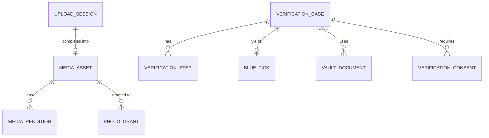

## 12.4 Upload flow — presigned S3 multipart

```mermaid
sequenceDiagram
  participant C as Client
  participant M as media-service
  participant S3
  participant SC as Scanner (Lambda+ClamAV / GuardDuty)
  participant P as Image pipeline (Lambda/ECS)
  C->>M: POST /uploads {kind,contentType,size,sha256}
  M->>M: validate quota, MIME allow-list, size
  M->>S3: CreateMultipartUpload (quarantine bucket, SSE-KMS)
  M-->>C: uploadId, partSize, presigned URLs per part (15 min)
  C->>S3: PUT parts (parallel, resumable)
  C->>M: POST /uploads/{id}/complete {parts[etag]}
  M->>S3: CompleteMultipartUpload
  S3-->>SC: ObjectCreated event (quarantine)
  SC->>S3: scan; tag av-status=clean|infected
  SC->>M: result (SQS)
  alt clean
    M->>P: process job (SQS)
    P->>S3: write renditions to media bucket
    P->>M: done
    M-->>Kafka: pj.media.asset-ready.v1
  else infected
    M->>S3: delete + audit
    M-->>Kafka: pj.media.asset-rejected.v1
  end
```
- Buckets: `pj-media-quarantine` (no public, lifecycle 1 day), `pj-media-public-renditions` (OAC-only behind CloudFront), `pj-media-originals` (private, Glacier IR after 90 d), `pj-vault` (separate account/KMS key, object lock governance).
- Presign constraints: `Content-Type`, `Content-Length-Range`, `x-amz-checksum-sha256` pinned; part URLs expire in 15 min; max 5 GB hard-limit by S3, we cap photo 15 MB, video 500 MB, doc 10 MB.
- Server-side magic-byte sniffing (Apache Tika) post-upload; reject mismatch with declared type; SVG/HTML/PDF-with-JS rejected for photos.
- **Virus scan:** primary = **GuardDuty Malware Protection for S3** on the quarantine bucket; fallback/secondary = ClamAV container in ECS (signature updates 3×/day) for documents. Files not scanned within 5 min → retry; 3 failures → `scan_status=ERROR`, manual alert.
- **Image pipeline** (libvips via Java `vips-ffm` or Lambda on `sharp`): decode → auto-orient → **strip all EXIF/XMP/GPS** (keep only color profile sRGB) → face detect (Rekognition `DetectFaces`) → NSFW/violence label (call moderation) → renditions:
  | variant | size | formats | watermark |
  |---|---|---|---|
  | thumb_150 | 150² crop on face | webp, avif | no |
  | card_480 | 480w | webp, avif, jpg | no |
  | full_1080 | 1080w | webp, avif, jpg | yes (corner text `PahadiJodi · {viewerShort}` dynamic via edge, or static logo) |
  | blur_32 | 32w upscaled-blurred | webp | n/a |
- Watermark: static logo baked for `full_1080` (anti-scrape); viewer-specific watermarks are applied by CloudFront Function + Lambda@Edge only to `PREMIUM_ONLY`/`PRIVATE` assets (cached by `viewer-bucket`).
- **Video:** AWS **MediaConvert** job template → HLS ABR ladder (240p/480p/720p, H.264 AAC, 6 s segments, AES-128 via MediaPackage or SAMPLE-AES), poster frame, max 60 s intro videos, audio loudness normalisation; frames sampled at 1 fps sent to moderation. EventBridge → `media-service` on `COMPLETE`/`ERROR`.
- **Delivery:** CloudFront with **signed URLs / signed cookies** (trusted key group, RSA-2048, rotating every 90 d); TTL = 10 min for private classes, 1 h for public; URL includes `IpAddress` condition for PRIVATE assets. Authorization decision made in `media-service` (`GET /media/{id}/url`) — CloudFront never serves private keys without a signature.

## 12.5 Document vault — KMS envelope encryption
1. Client uploads to quarantine via presigned multipart; after scan, `media-service` streams object (in-VPC) to the vault pipeline.
2. `kms:GenerateDataKey` (CMK `alias/pj-vault`, per-environment, key policy restricted to the vault task role) → plaintext DEK + wrapped DEK.
3. Encrypt with **AES-256-GCM** (random 96-bit IV, AAD = `userId|docId|docType`), write ciphertext to `pj-vault`, persist `encrypted_dek`, `iv`, `kms_key_id`; zero plaintext DEK from memory.
4. Reads: `kms:Decrypt` per access, only for roles `VERIFIER`/`SUPER_ADMIN` with a **time-boxed access ticket** (30 min, case-bound), every read audited and notified (`pj.media.vault-document-accessed.v1`). Users can never download their own raw ID; they see masked data only.
5. Deletion / DPDP erasure: crypto-shred (schedule DEK deletion, delete object, set `shredded_at`); retention default 180 days after verification decision unless law requires longer.
6. Key rotation: CMK annual auto-rotation; DEK re-wrap job quarterly.

## 12.6 Aadhaar & PAN verification (compliance first)
**Aadhaar principles (UIDAI / Aadhaar Act 2016 / DPDP Act 2023):**
- **Never store the 12-digit Aadhaar number, its full image, or biometric data.** Only `masked_identifier` (last 4) and `identifier_hmac` (peppered HMAC for duplicate detection — computed in-memory and discarded input).
- Only a registered AUA/KUA/sub-KUA may do Aadhaar authentication; we **do not** run direct UIDAI auth. We use **(a) DigiLocker** consented pull of "Aadhaar" document / or **(b) Offline eKYC (XML, share-code protected, digital signature verified)** where the user uploads the zip + share code, or **(c) Masked Aadhaar PDF/QR** (signature validated). Name, DOB, gender, masked number, photo are extracted; photo is used only for face match, then discarded (kept in vault encrypted if user consented to retain).
- Explicit consent screen with purpose limitation ("age & identity verification for blue tick"), versioned in `verification_consent`; consent withdrawal triggers deletion.
- Mandatory display: “Aadhaar is used only for verification; we never store your full number.”
- Logs/traces **must never** contain Aadhaar numbers (log scrubber regex + unit-tested Logback converter, plus Macie scan on log buckets).

**PAN:** verified through a licensed provider (e.g. Digio / Signzy / Karza-type; configured per environment) — PAN + DOB/name → `VALID/INVALID`, name-match score. PAN stored only as masked + HMAC; no raw PAN persisted (provider call carries it in-memory over mTLS).

Port abstraction (hexagonal):
```java
public interface IdentityVerificationPort {
  AadhaarResult verifyOfflineEkyc(OfflineEkycPackage pkg, ShareCode code);
  AadhaarResult verifyViaDigiLocker(DigiLockerAuthCode code);
  PanResult verifyPan(PanNumber pan, PersonName name, LocalDate dob);
  default String providerId() { return getClass().getSimpleName(); }
}
public interface FaceBiometricPort {
  LivenessSession startLiveness(UserId u);
  LivenessResult getLiveness(String sessionId);          // Rekognition Face Liveness / Azure Face liveness
  FaceMatchResult compare(ImageRef source, ImageRef target); // returns similarity 0-100
}
```
Adapters: `DigioAdapter`, `SignzyAdapter` (feature-flag + circuit breaker + fallback to the other provider), `RekognitionFaceAdapter`, `AzureFaceAdapter`. Provider payloads are redacted before persisting in `verification_step.result`.

**Selfie liveness + face match thresholds** (tunable in config, A/B logged):
| Check | Auto-pass | Manual review | Fail |
|---|---|---|---|
| Liveness confidence | ≥ 90 | 70–89.9 | < 70 |
| Face match (selfie ↔ ID photo) similarity | ≥ 92 | 80–91.9 | < 80 |
| Face match (selfie ↔ primary profile photo) | ≥ 88 | 75–87.9 | < 75 |
| Name match (ID ↔ profile, Jaro-Winkler/phonetic) | ≥ 0.85 | 0.65–0.85 | < 0.65 |
| DOB match | exact | — | mismatch → fail |
Rules: 3 liveness attempts/day; presentation-attack signals (replay, mask, screen) → hard fail + fraud signal; multiple faces → fail; Indian skin-tone/low-light bias monitored via fairness dashboard (false-reject rate by demographic proxy buckets).

## 12.7 Blue-tick state machine
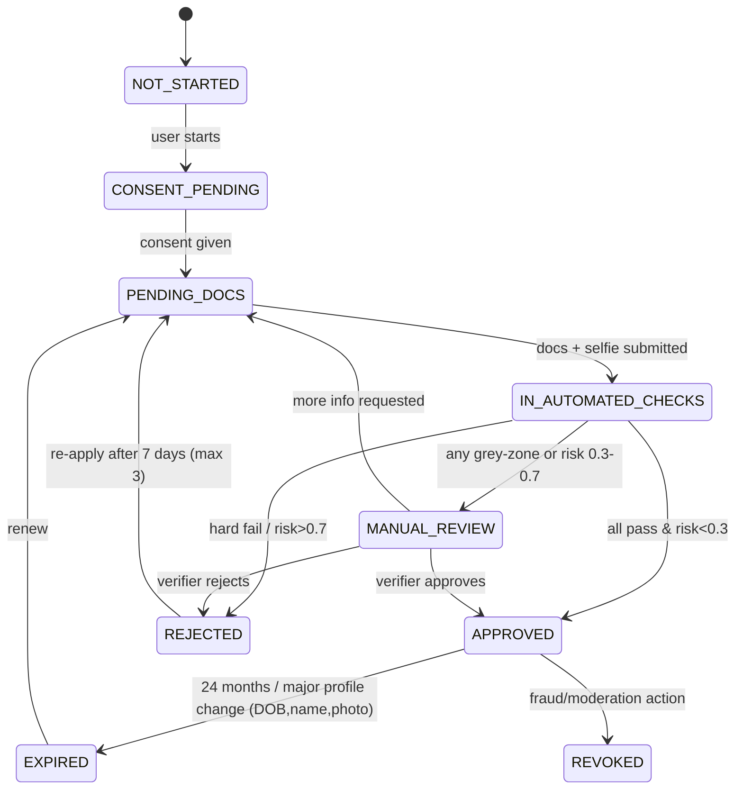
Levels shown on profile: Phone ✔ → Profile ✔ (human-reviewed) → Govt ID ✔ → **Blue tick** (Govt ID + liveness + face match + profile photo match). Transitions are guarded in the aggregate (`VerificationCase.transition(event)`); optimistic locking via `version`.

**Verifier workbench (served via admin-service BFF):** queue sorted by SLA (`sla_due_at`: 24 h standard, 4 h for Premium+/VIP), side-by-side selfie/ID/profile photo, automated scores, reason-code pick-list, two-person rule for rejecting VIP users or any `REVOKED`, masked PII by default (click-to-reveal with justification, audited).

## 12.8 APIs
Base `/api/media/v1` (via API Gateway; JWT; scopes `media:*`).
| Method | Path | Auth | Request → Response | Errors |
|---|---|---|---|---|
| POST | `/uploads` | USER | `{kind, contentType, sizeBytes, sha256}` → `201 {uploadId, parts:[{n,url}], partSize, expiresAt}` | 400 unsupported type, 413 too large, 422 quota exceeded (max 12 photos, 2 videos), 429 |
| POST | `/uploads/{id}/complete` | USER (owner) | `{parts:[{n,etag}]}` → `202 {assetId, status}` | 404, 409 already completed, 410 expired |
| DELETE | `/uploads/{id}` | USER | → 204 (abort) | 404 |
| GET | `/assets/{id}` | USER | → asset metadata + status | 403, 404 |
| GET | `/assets/{id}/url?variant=card_480` | USER | → `{url, expiresAt}` (signed) or blurred url | 403 (never reveals existence), 423 processing |
| GET | `/users/{userId}/photos` | USER | list visible assets for viewer (privacy-resolved) | 404 |
| PATCH | `/assets/{id}` | USER (owner) | `{privacyLevel?, sortOrder?, isPrimary?}` → 200 | 409 version, 422 |
| POST | `/assets/{id}/grants` / DELETE `/assets/{id}/grants/{userId}` | USER (owner) | grant/revoke private access | 404 |
| DELETE | `/assets/{id}` | USER (owner) | → 204 soft delete + purge job | |
| POST | `/verification/consents` | USER | `{purpose, noticeVersion}` → 201 | |
| POST | `/verification/cases` | USER | `{level}` → 201 case | 409 open case exists, 429 |
| POST | `/verification/cases/{id}/aadhaar/digilocker/init` | USER | → `{redirectUrl,state}` | |
| POST | `/verification/cases/{id}/aadhaar/digilocker/callback` | INTERNAL | `{code,state}` | 400 state mismatch |
| POST | `/verification/cases/{id}/aadhaar/offline` | USER | `{uploadId, shareCode}` (4-digit) | 422 signature invalid/expired >3 days |
| POST | `/verification/cases/{id}/pan` | USER | `{pan, fullName, dob}` → `202` (PAN not echoed) | 422 format `[A-Z]{5}[0-9]{4}[A-Z]` |
| POST | `/verification/cases/{id}/liveness` | USER | → `{sessionId, token}`; `POST …/liveness/{sid}/complete` | 429 attempts |
| GET | `/verification/cases/{id}` | USER (owner) | state, steps (no scores), next action | |
| GET | `/admin/verification/queue` | VERIFIER | filters, cursor paging | |
| POST | `/admin/verification/cases/{id}/claim` | VERIFIER | → 200 / 409 already claimed | |
| POST | `/admin/verification/cases/{id}/decision` | VERIFIER | `{decision, reasonCodes[], note}` | 403 two-person rule, 409 |
| POST | `/admin/verification/cases/{id}/vault-access` | VERIFIER | `{docId, justification}` → short-lived signed ticket | |
| POST | `/internal/blue-tick/{userId}/revoke` | SERVICE (fraud/moderation) | `{reason}` | |

## 12.9 Kafka events
Produced: `pj.media.asset-uploaded.v1`, `pj.media.asset-ready.v1` (assetId, ownerId, kind, privacy, primary, variants), `pj.media.asset-rejected.v1` (reason: INFECTED/POLICY/INVALID), `pj.media.asset-deleted.v1`, `pj.media.primary-photo-changed.v1`, `pj.verification.case-opened.v1`, `pj.verification.step-completed.v1`, `pj.verification.approved.v1` (userId, level, expiresAt), `pj.verification.rejected.v1`, `pj.verification.blue-tick-revoked.v1`, `pj.media.vault-document-accessed.v1`, `pj.media.face-embedding-requested.v1` (assetId, s3 ref → fraud-detection).
Consumed: `pj.moderation.decision.v1` (apply asset moderation result), `pj.fraud.action-requested.v1` (revoke tick/lock uploads), `pj.user.account-deleted.v1` (purge + crypto-shred), `pj.user.profile-updated.v1` (DOB/name change → expire blue tick), `pj.subscription.plan-changed.v1` (limits, SLA tier).

## 12.10 Patterns / Security / Cache / Scale
- **Patterns:** Hexagonal ports/adapters for providers, State pattern (verification), Saga (orchestrated verification steps with compensation: delete vault docs on reject), Strategy (rendition profiles), Outbox, Circuit breaker + bulkhead (Resilience4j) per provider, Claim-check (S3 refs in events).
- **Security:** presigned URL restriction as above; quarantine bucket; Tika sniffing; AV scanning; EXIF/GPS stripped (home location privacy for Pahadi villages/families); KMS envelope; IAM least-privilege with separate roles for upload, process, vault; S3 Block Public Access, bucket policies `aws:SecureTransport`; ABAC on `GET /assets/{id}/url`; no PII in logs; per-user upload rate limit (30 uploads/h); DPDP consent and erasure; vault access requires break-glass-style ticket; mTLS to KYC providers; webhook signature (HMAC) validation + replay window 5 min; CloudFront WAF rate rules.
- **Caching:** Redis `media:vis:{viewerId}:{assetId}` visibility decision (60 s), `media:url:{assetId}:{variant}:{tier}` signed URL (≤ TTL−60 s), CloudFront edge caching for public renditions (immutable content-hash keys, 1 y), negative cache for 403 (10 s). Interest-acceptance lookups cached from matchmaking events.
- **Scaling:** upload bytes bypass service (S3 scale); processing via SQS-driven workers on ECS/EKS (KEDA scales on queue depth, target ≤ 30 s p95 for photos); MediaConvert on-demand queues (reserved queue for VIP); DB read-replica for listings; partition `verification_step` monthly after 12 M rows; 1 M users × ~6 photos ≈ 6 M assets × ~9 renditions ≈ 54 M rows (fine on one Postgres with proper indexes; shard by owner hash if > 500 M).

---

# 13. moderation-service

## 13.1 Responsibilities
Single policy decision point for UGC safety: profile text, bios, photos, videos, chat messages, voice-note transcripts, reports from users. Detects toxicity, harassment, hate/caste-slurs, sexual content, solicitation/spam/phishing/contact-info leakage (pre-unlock), underage, scams. Owns rules engine, human review queue, appeals, strikes, bans.

## 13.2 Domain model
`ModerationRequest` (subject, content ref, context) → `ModerationDecision` (verdict, reasons, scores); `Rule`; `ReviewTask` (human queue, SLA); `UserReport`; `Strike`; `Sanction` (warn, mute, shadow-limit, suspend, ban); `Appeal`; `PolicyVersion`.
Verdicts: `ALLOW`, `ALLOW_WITH_FLAG`, `REDACT`, `HOLD_FOR_REVIEW`, `BLOCK`.

## 13.3 Pipeline
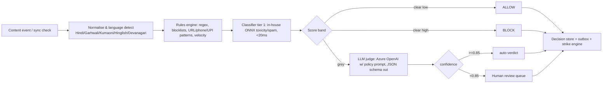
- **Text:** sync path for profile bios and chat (budget 150 ms; tier-1 only, grey zone → deliver-then-review for chat unless high-risk context e.g. first message from new account). Async path for LLM judge. Handles transliteration/obfuscation ("w h a t s a p p", Devanagari digits), Hinglish toxicity, caste-based slurs (curated lexicon, reviewed by community editors), dowry demand language.
- **Image:** Rekognition `DetectModerationLabels` + in-house NSFW model; face-count, minors (age estimate <18 → block), text-in-image OCR (phone numbers / watermarks of other sites), celebrity/stock-photo reverse-match signal to fraud service.
- **Video:** 1 fps keyframes + audio transcript (Transcribe, hi-IN/en-IN) → text+image pipeline; aggregate max-risk.
- **LLM judge prompt** is versioned (`policy_version`), PII-minimised (names replaced by tokens), output validated by JSON Schema; temperature 0; fallback to human on parse failure; every LLM call logged (hash only, no raw content > 30 days).
- **Chat safety:** sliding-window conversation scoring (harassment after being declined, repeated unsolicited messages, money requests, off-platform migration pushing, sextortion patterns) → warn banner, rate-limit, or report prompt.

## 13.4 Database schema (`moderation` schema)
```sql
CREATE TABLE policy_version (
  id serial PRIMARY KEY, version text UNIQUE NOT NULL, doc_uri text NOT NULL, llm_prompt text NOT NULL,
  thresholds jsonb NOT NULL, activated_at timestamptz, created_by uuid NOT NULL
);

CREATE TABLE rule (
  id uuid PRIMARY KEY, name text UNIQUE NOT NULL, scope text NOT NULL CHECK (scope IN ('TEXT','IMAGE','VIDEO','CHAT','ANY')),
  kind text NOT NULL CHECK (kind IN ('REGEX','BLOCKLIST','VELOCITY','CONTEXT')),
  definition jsonb NOT NULL, action text NOT NULL, severity smallint NOT NULL, enabled boolean NOT NULL DEFAULT true,
  version int NOT NULL DEFAULT 1, updated_by uuid, updated_at timestamptz NOT NULL DEFAULT now()
);

CREATE TABLE moderation_request (
  id uuid PRIMARY KEY, subject_type text NOT NULL CHECK (subject_type IN ('PROFILE_TEXT','PHOTO','VIDEO','CHAT_MESSAGE','VOICE_NOTE','REPORT')),
  subject_ref text NOT NULL, author_id uuid NOT NULL, target_user_id uuid,
  content_hash bytea NOT NULL, lang text, mode text NOT NULL CHECK (mode IN ('SYNC','ASYNC')),
  created_at timestamptz NOT NULL DEFAULT now()
) PARTITION BY RANGE (created_at);

CREATE TABLE moderation_decision (
  id uuid PRIMARY KEY, request_id uuid NOT NULL, verdict text NOT NULL,
  labels jsonb NOT NULL,          -- {toxicity:0.91, harassment:0.4, spam:0.1, ...}
  rule_hits text[] NOT NULL DEFAULT '{}', decided_by text NOT NULL CHECK (decided_by IN ('RULES','CLASSIFIER','LLM','HUMAN')),
  confidence numeric(4,3), policy_version text NOT NULL, reviewer_id uuid, created_at timestamptz NOT NULL DEFAULT now()
);
CREATE INDEX ix_dec_req ON moderation_decision(request_id);

CREATE TABLE review_task (
  id uuid PRIMARY KEY, request_id uuid NOT NULL, queue text NOT NULL CHECK (queue IN ('P0_SAFETY','P1_PHOTO','P2_TEXT','P3_REPORTS','APPEALS')),
  priority smallint NOT NULL, status text NOT NULL CHECK (status IN ('OPEN','CLAIMED','DONE','ESCALATED')),
  assigned_to uuid, sla_due_at timestamptz NOT NULL, claimed_at timestamptz, created_at timestamptz NOT NULL DEFAULT now(), version int NOT NULL DEFAULT 0
);
CREATE INDEX ix_task_open ON review_task(queue, priority DESC, sla_due_at) WHERE status = 'OPEN';

CREATE TABLE user_report (
  id uuid PRIMARY KEY, reporter_id uuid NOT NULL, reported_user_id uuid NOT NULL, subject_ref text,
  reason text NOT NULL, details text, status text NOT NULL DEFAULT 'OPEN', created_at timestamptz NOT NULL DEFAULT now()
);
CREATE INDEX ix_report_target ON user_report(reported_user_id, created_at DESC);

CREATE TABLE strike (
  id uuid PRIMARY KEY, user_id uuid NOT NULL, decision_id uuid NOT NULL, category text NOT NULL, weight smallint NOT NULL,
  expires_at timestamptz NOT NULL, created_at timestamptz NOT NULL DEFAULT now(), revoked_at timestamptz
);
CREATE INDEX ix_strike_user ON strike(user_id) WHERE revoked_at IS NULL;

CREATE TABLE sanction (
  id uuid PRIMARY KEY, user_id uuid NOT NULL, type text NOT NULL CHECK (type IN ('WARN','MUTE','SHADOW_LIMIT','SUSPEND','BAN')),
  reason_code text NOT NULL, starts_at timestamptz NOT NULL DEFAULT now(), ends_at timestamptz,
  imposed_by text NOT NULL, decision_id uuid, lifted_at timestamptz, lifted_by uuid
);
CREATE INDEX ix_sanction_active ON sanction(user_id) WHERE lifted_at IS NULL;

CREATE TABLE appeal (
  id uuid PRIMARY KEY, sanction_id uuid NOT NULL REFERENCES sanction(id), user_id uuid NOT NULL, statement text NOT NULL,
  status text NOT NULL DEFAULT 'OPEN' CHECK (status IN ('OPEN','UPHELD','OVERTURNED')), reviewer_id uuid,
  decided_at timestamptz, created_at timestamptz NOT NULL DEFAULT now()
);
CREATE UNIQUE INDEX ux_appeal_one ON appeal(sanction_id) WHERE status = 'OPEN';

CREATE TABLE moderation_audit (
  id bigserial PRIMARY KEY, actor text NOT NULL, action text NOT NULL, entity text NOT NULL, entity_id uuid NOT NULL,
  before jsonb, after jsonb, at timestamptz NOT NULL DEFAULT now()
);
```
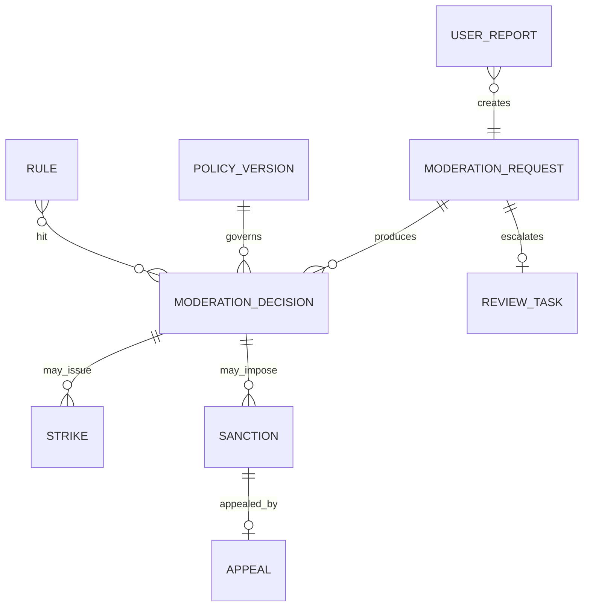

## 13.5 Strike & sanction ladder
Weighted strikes (90-day decay; severe categories 365 d): 
| Category | Weight | Immediate action |
|---|---|---|
| Spam/contact-info leak | 1 | warn, message blocked |
| Harassment / abusive language | 2 | mute 24 h |
| Sexual content / unsolicited explicit | 3 | suspend 7 d + photo purge |
| Fake identity / scam attempt | 5 | ban + fraud case |
| Child safety / sextortion / threats | 10 | instant ban + legal escalation (report as per IT Rules / POCSO) |
Thresholds: 3 → shadow-limit, 5 → 7-day suspension, 8 → permanent ban. Auto-bans require a human second look except category weight 10 (immediate; human post-review within 4 h).

## 13.6 Review queue SLAs
| Queue | Content | SLA first action |
|---|---|---|
| P0_SAFETY | threats, child safety, sextortion | 15 min (24×7 on-call) |
| P1_PHOTO | new/changed profile photos grey-zone | 4 h |
| P2_TEXT | bios, chat flagged | 12 h |
| P3_REPORTS | user reports | 24 h |
| APPEALS | sanction appeals | 72 h, performed by a different reviewer |
SLA breach → escalate (`ESCALATED`) and page via Alertmanager. Reviewer wellness: blurred-by-default imagery, session time caps, rotation.

## 13.7 APIs
Base `/api/moderation/v1`.
| Method | Path | Auth | Description / Errors |
|---|---|---|---|
| POST | `/internal/check/text` | SERVICE | `{subjectType, text, authorId, context}` → `200 {verdict, redactedText?, reasons[]}`; p99 < 150 ms; 422 text > 5 000 chars |
| POST | `/internal/check/media` | SERVICE | `{assetId, kind, s3Ref}` → `202 {requestId}` |
| POST | `/reports` | USER | `{reportedUserId, reason, subjectRef?, details}` → 201; 429 (10/day); 409 duplicate |
| GET | `/me/sanctions` | USER | active sanctions + appeal eligibility |
| POST | `/me/sanctions/{id}/appeals` | USER | `{statement}` → 201; 409 appeal exists; 410 window (14 d) closed |
| GET | `/admin/queues/{queue}/tasks` | MODERATOR | cursor paging |
| POST | `/admin/tasks/{id}/claim` | MODERATOR | 409 if claimed |
| POST | `/admin/tasks/{id}/decision` | MODERATOR | `{verdict, reasonCodes[], sanction?}`; 403 conflict-of-interest |
| POST | `/admin/appeals/{id}/decision` | MODERATOR(senior) | `{outcome, note}` |
| CRUD | `/admin/rules`, `/admin/policy-versions` | SUPER_ADMIN / maker-checker | rule changes require approval; shadow-mode dry-run endpoint `POST /admin/rules/{id}/simulate` |
| GET | `/admin/users/{id}/moderation-history` | MODERATOR | strikes, sanctions, decisions |

## 13.8 Kafka events
Produced: `pj.moderation.decision.v1` (subjectType, subjectRef, verdict, labels), `pj.moderation.sanction-imposed.v1`, `pj.moderation.sanction-lifted.v1`, `pj.moderation.report-received.v1`, `pj.moderation.appeal-decided.v1`, `pj.moderation.review-sla-breached.v1`.
Consumed: `pj.profile.bio-updated.v1`, `pj.media.asset-uploaded.v1`, `pj.chat.message-sent.v1` (async lane, sampled 100 % for new accounts, 20 % otherwise + all reported), `pj.chat.voice-note-transcribed.v1`, `pj.fraud.risk-scored.v1` (raises scrutiny), `pj.user.account-deleted.v1`.
Downstream: `identity-service`/`user-service` apply `sanction-*` (auth deny on BAN, session revoke), `search-service` removes banned profiles from index, `chat-service` enforces mute, `notification-service` sends warnings.

## 13.9 Patterns / Security / Cache / Scale
- **Patterns:** Chain of Responsibility (pipeline stages), Strategy (classifier adapters), Rules engine (Drools-free, own JSON-AST evaluator, rules hot-reloaded), Policy-as-data (versioned), CQRS (decision write-model vs review-queue read-model), Saga for sanction propagation, Outbox, Human-in-the-loop with active-learning feedback (reviewer labels feed retraining set).
- **Security:** reviewer access RBAC+ABAC (queue-scoped), content shown via short-lived signed URLs, all views audited, LLM prompts contain no direct identifiers, Azure OpenAI with data-no-retention + private endpoint, prompt-injection hardening (content in delimited data block, output schema validated, never executes instructions in content), moderation_audit append-only (revoke UPDATE/DELETE).
- **Caching:** compiled rules + blocklists in-memory (Caffeine) with Redis pub/sub invalidation; dedupe cache by `content_hash` → verdict (Redis 24 h) skips re-scoring identical messages; active sanctions cache `mod:sanction:{userId}` (invalidate on event).
- **Scaling:** stateless sync API on EKS HPA (CPU + p99 latency); classifier on CPU ONNX Runtime (or SageMaker/Triton GPU for image); Kafka consumer groups partitioned by `authorId`; LLM calls via bounded queue with token-bucket (cost control) and per-day budget; partition `moderation_request` monthly, retain decisions 12 months (hash-only after 30 d), reports 24 months.

---

# 14. horoscope-service

## 14.1 Responsibilities
Generate Vedic **kundli** (Janma Kundali) from birth data; compute Moon sign (Rashi), Nakshatra + pada, Lagna, Navamsa, Dasha, **Manglik dosha**; compute **Ashtakoot Guna Milan (36 points)** between two profiles; serve cached results to matchmaking/AI/search; store regional custom notes (Garhwali/Kumaoni).

## 14.2 Domain model
`BirthDetails` (VO: date, time, time-known flag, place, lat/lon, tz), `Kundli` (immutable once computed per `(birthHash, ayanamsa, engineVersion)`), `PlanetPosition`, `ManglikAssessment`, `GunaMilanReport` (8 koota scores, total, doshas, cancellations, verdict), `RegionalCustomNote`.

## 14.3 Inputs, geocoding, and calculation
- Inputs: DOB, TOB (HH:mm, with "unknown" option → noon chart + Moon-based only, flagged `lowConfidence`), place of birth. Place autocomplete via Amazon Location Service/Nominatim index seeded with Uttarakhand villages (from profile-service gazetteer) → lat/lon. Timezone via IANA (`Asia/Kolkata`; historical offsets — pre-1945 IST variations & WWII-era India time, handled by tzdb); diaspora births use their local tz.
- Engine: **Swiss Ephemeris** (JNI/`swisseph` Java port; AGPL/commercial licence decision recorded in ADR — a Professional licence is required for closed-source SaaS) with `.se1` files bundled in the image. **Sidereal Lahiri (Chitra-paksha) ayanamsa** default (`SE_SIDM_LAHIRI`); alternate (KP / Raman) selectable. Mean node for Rahu (config).
- Steps: local → UTC → Julian Day (`swe_julday`) → planets `swe_calc_ut` with `SEFLG_SIDEREAL|SEFLG_SPEED` → Lagna via `swe_houses_ex` (whole-sign houses default) → rashi = `floor(lon/30)+1` → nakshatra = `floor(lon/(360/27))+1`, pada = `floor((lon mod 13.3333)/3.3333)+1` → Vimshottari Dasha from Moon nakshatra lord and balance.
- Performance: ~2 ms/chart CPU; deterministic; **charts are immutable → cache forever** keyed by `sha256(dob|tob|lat|lon|ayanamsa|engineVer)`.

## 14.4 Manglik dosha
Mars in houses **1, 2, 4, 7, 8, 12** from Lagna → Manglik (strong in 1/4/7/8/12; 2 = partial in some traditions). Also evaluated from Moon (Chandra Lagna) and Venus per config. Output: `NONE`, `PARTIAL`, `FULL`, with `cancellations[]` (Mars in own sign/exaltation (Aries, Scorpio, Capricorn), Mars in Leo/Aquarius in 4/7 variants, Jupiter aspect on Mars/7th, both partners Manglik, age ≥ 28 per popular rule). Compatibility rule: Manglik↔Manglik OK; Manglik↔non-Manglik → warning unless cancellation present. Presented as "traditional indicator" not a verdict; users may disable horoscope matching.

## 14.5 Ashtakoot Guna Milan — 36 points
Notation: **boy** = groom, **girl** = bride (for same-sex or neutral UI, "Partner A/B" mapped by configured convention, default A=groom role chosen by user). Input per person: Moon rashi (1–12) and Nakshatra (1–27).

| # | Koota | Max | Measures |
|---|---|---|---|
| 1 | Varna | 1 | spiritual compatibility / ego |
| 2 | Vashya | 2 | mutual attraction / control |
| 3 | Tara | 3 | destiny / health |
| 4 | Yoni | 4 | physical/sexual compatibility |
| 5 | Graha Maitri | 5 | mental compatibility |
| 6 | Gana | 6 | temperament |
| 7 | Bhakoot | 7 | emotional/family welfare |
| 8 | Nadi | 8 | health / progeny |
| | **Total** | **36** | |

**1. Varna (1).** Rashi → varna: Brahmin(4)= Cancer, Scorpio, Pisces; Kshatriya(3)= Aries, Leo, Sagittarius; Vaishya(2)= Taurus, Virgo, Capricorn; Shudra(1)= Gemini, Libra, Aquarius. Score 1 if `varna(boy) ≥ varna(girl)` else 0.

**2. Vashya (2).** Rashi → group: Chatushpada (Aries, Taurus, Sagittarius 2nd half, Capricorn 1st half), Manava (Gemini, Virgo, Libra, Sagittarius 1st half), Jalachara (Cancer, Pisces, Capricorn 2nd half), Vanachara (Leo), Keeta (Scorpio). Score matrix (symmetric, stored as versioned seed data `vashya_score`; traditions differ, pandit-reviewed):
| | Chatushpada | Manava | Jalachara | Vanachara | Keeta |
|---|---|---|---|---|---|
| Chatushpada | 2 | 1 | 1 | 0.5 | 1 |
| Manava | 1 | 2 | 0.5 | 0.5 | 1 |
| Jalachara | 1 | 0.5 | 2 | 1 | 1 |
| Vanachara | 0.5 | 0.5 | 1 | 2 | 0 |
| Keeta | 1 | 1 | 1 | 0 | 2 |
(Sagittarius/Capricorn split uses the Moon's degree within the sign.)

**3. Tara (3).** Count from girl's nakshatra to boy's (inclusive), `r1 = count mod 9` (0→9); likewise boy→girl, `r2`. Remainders 3 (Vipat), 5 (Pratyari), 7 (Vadha) are inauspicious. Each direction scores 1.5 if auspicious else 0. Total = 3 / 1.5 / 0.

**4. Yoni (4).** Nakshatra → animal: Ashwini–Horse; Bharani–Elephant; Krittika–Sheep; Rohini–Serpent; Mrigashira–Serpent; Ardra–Dog; Punarvasu–Cat; Pushya–Sheep; Ashlesha–Cat; Magha–Rat; P.Phalguni–Rat; U.Phalguni–Cow; Hasta–Buffalo; Chitra–Tiger; Swati–Buffalo; Vishakha–Tiger; Anuradha–Deer; Jyeshtha–Deer; Mula–Dog; P.Ashadha–Monkey; U.Ashadha–Mongoose; Shravana–Monkey; Dhanishta–Lion; Shatabhisha–Horse; P.Bhadrapada–Lion; U.Bhadrapada–Cow; Revati–Elephant.
Scoring: same animal = **4**; sworn-enemy pairs (Cow–Tiger, Elephant–Lion, Horse–Buffalo, Dog–Deer, Serpent–Mongoose, Monkey–Goat/Sheep, Rat–Cat) = **0**; other pairs from the 14×14 matrix seed (`yoni_score`: friendly 3, neutral 2, unfriendly 1). Matrix lives as reviewed seed data (Flyway `V9__seed_yoni_matrix.sql`) with a golden-test against a published reference for all 196 cells.

**5. Graha Maitri (5).** Rashi lords: Aries/Scorpio–Mars; Taurus/Libra–Venus; Gemini/Virgo–Mercury; Cancer–Moon; Leo–Sun; Sagittarius/Pisces–Jupiter; Capricorn/Aquarius–Saturn. Natural friendships:
| Planet | Friends | Neutral | Enemies |
|---|---|---|---|
| Sun | Moon, Mars, Jupiter | Mercury | Venus, Saturn |
| Moon | Sun, Mercury | Mars, Jupiter, Venus, Saturn | — |
| Mars | Sun, Moon, Jupiter | Venus, Saturn | Mercury |
| Mercury | Sun, Venus | Mars, Jupiter, Saturn | Moon |
| Jupiter | Sun, Moon, Mars | Saturn | Mercury, Venus |
| Venus | Mercury, Saturn | Mars, Jupiter | Sun, Moon |
| Saturn | Mercury, Venus | Jupiter | Sun, Moon, Mars |
Score (relationship of each lord toward the other): same lord **5**; both friends **5**; friend+neutral **4**; both neutral **3**; friend+enemy **1**; neutral+enemy **0.5**; both enemies **0**.

**6. Gana (6).** Deva: Ashwini, Mrigashira, Punarvasu, Pushya, Hasta, Swati, Anuradha, Shravana, Revati. Manushya: Bharani, Rohini, Ardra, P.Phalguni, U.Phalguni, P.Ashadha, U.Ashadha, P.Bhadrapada, U.Bhadrapada. Rakshasa: Krittika, Ashlesha, Magha, Chitra, Vishakha, Jyeshtha, Mula, Dhanishta, Shatabhisha.
| Boy \ Girl | Deva | Manushya | Rakshasa |
|---|---|---|---|
| Deva | 6 | 6 | 1 |
| Manushya | 5 | 6 | 0 |
| Rakshasa | 0 | 0 | 6 |
(Variants exist; matrix is configurable.)

**7. Bhakoot (7).** Count rashi of boy from girl's rashi and vice-versa. Pairs 2/12, 5/9, 6/8 (Dwirdwadash, Navapancham, Shadashtak) → **0**; otherwise **7**. Cancellation: if both rashi lords are the same planet or mutual friends, Bhakoot dosha is cancelled (score restored to 7, flagged `cancelled`).

**8. Nadi (8).** Adi: Ashwini, Ardra, Punarvasu, U.Phalguni, Hasta, Jyeshtha, Mula, Shatabhisha, P.Bhadrapada. Madhya: Bharani, Mrigashira, Pushya, P.Phalguni, Chitra, Anuradha, P.Ashadha, Dhanishta, U.Bhadrapada. Antya: Krittika, Rohini, Ashlesha, Magha, Swati, Vishakha, U.Ashadha, Shravana, Revati. Same nadi → **0** (Nadi dosha); different → **8**. Cancellation (configurable): same nakshatra but different pada, or same rashi with different nakshatra.

**Interpretation bands:** < 18 not recommended; 18–24 average/acceptable; 25–32 very good; 33–36 excellent. Dosha flags (Nadi, Bhakoot, Manglik) surfaced separately — total alone never hides a major dosha.

```java
public GunaMilanReport compute(MoonProfile boy, MoonProfile girl) {
  var k = new EnumMap<Koota, KootaScore>(Koota.class);
  k.put(VARNA,  varna.score(boy.rashi(), girl.rashi()));
  k.put(VASHYA, vashya.score(boy.rashi(), boy.moonDegree(), girl.rashi(), girl.moonDegree()));
  k.put(TARA,   tara.score(boy.nakshatra(), girl.nakshatra()));
  k.put(YONI,   yoni.score(boy.nakshatra(), girl.nakshatra()));
  k.put(GRAHA_MAITRI, maitri.score(boy.rashi(), girl.rashi()));
  k.put(GANA,   gana.score(boy.nakshatra(), girl.nakshatra()));
  k.put(BHAKOOT,bhakoot.score(boy.rashi(), girl.rashi()));
  k.put(NADI,   nadi.score(boy, girl));
  double total = k.values().stream().mapToDouble(KootaScore::points).sum(); // invariant: 0 ≤ total ≤ 36
  return new GunaMilanReport(k, total, doshaFlags(k), band(total), ruleSetVersion);
}
```
Tests: property tests (symmetry where defined, total ≤ 36, each koota ≤ max), ≥ 200 golden vectors from published matches, and pandit-sign-off for rule set versions (`rule_set_version` stored on each report).

## 14.6 Regional customs notes (Uttarakhand)
Seeded content (`regional_custom_note`, editable by CONTENT_EDITOR with pandit review):
- **Garhwal:** families often consult a *purohit*/pandit for *gotra* & *pravar*; same-gotra marriage is traditionally avoided; *Kundli milan* typically with 18+ gunas; Manglik concern generally respected; *Rankar*/*Dhol-damau* ceremonies; local *tithi* usage from Vikram Samvat (Purnimanta in Garhwal-Kumaon calendars, Kumaoni *Pancang* used).
- **Kumaon:** strong *jyotish* tradition (Almora/Bageshwar pandits), *janampatri* written on traditional scroll; "Pithoragarh / Champawat" Katyuri & Chand lineages' *kuldevta* matching (*Golu Devta*, *Nanda Devi*) as cultural preference; *Pichhaura* (ceremonial attire) and *Aipan* motifs in engagement ceremonies.
- **Jaunsari / Bhotiya / Tharu / Buksa:** customs differ (e.g., polyandry history in Jaunsar-Bawar, tribal endogamy); horoscope matching is **optional by default**; UI avoids imposing Brahmanical gotra rules for Scheduled Tribe communities; per-community default config `horoscope_importance` (HIGH/MEDIUM/LOW/OPTIONAL).
- Gotra/Pravar/Kuldevta fields live in profile-service; horoscope-service consumes for `same_gotra` warning.
- Disclaimer: informational; content is reviewed and not presented as scientific claim.

## 14.7 Database schema (`horoscope` schema)
```sql
CREATE TABLE birth_profile (
  user_id uuid PRIMARY KEY,
  birth_date date NOT NULL, birth_time time, time_known boolean NOT NULL DEFAULT true, time_accuracy text CHECK (time_accuracy IN ('EXACT','APPROX_15M','APPROX_1H','UNKNOWN')),
  place_name text NOT NULL, latitude numeric(9,6) NOT NULL, longitude numeric(9,6) NOT NULL, tz_id text NOT NULL,
  birth_hash bytea NOT NULL,                    -- sha256(normalised inputs)
  consent_at timestamptz NOT NULL, updated_at timestamptz NOT NULL DEFAULT now(), version int NOT NULL DEFAULT 0
);
-- birth_date/time/place encrypted at app layer (AES-GCM, KMS DEK) as sensitive personal data; shown here logically.

CREATE TABLE kundli (
  id uuid PRIMARY KEY, birth_hash bytea NOT NULL, ayanamsa text NOT NULL, engine_version text NOT NULL,
  lagna_rashi smallint, moon_rashi smallint NOT NULL, moon_nakshatra smallint NOT NULL, moon_pada smallint NOT NULL, moon_degree numeric(7,4) NOT NULL,
  planets jsonb NOT NULL, houses jsonb, navamsa jsonb, dasha jsonb, low_confidence boolean NOT NULL DEFAULT false,
  created_at timestamptz NOT NULL DEFAULT now(),
  UNIQUE (birth_hash, ayanamsa, engine_version)
);

CREATE TABLE user_kundli (
  user_id uuid PRIMARY KEY, kundli_id uuid NOT NULL REFERENCES kundli(id), manglik text NOT NULL CHECK (manglik IN ('NONE','PARTIAL','FULL')),
  manglik_cancellations text[] NOT NULL DEFAULT '{}', gotra text, computed_at timestamptz NOT NULL
);
CREATE INDEX ix_uk_moon ON user_kundli(manglik);

CREATE TABLE guna_milan_report (
  user_a uuid NOT NULL, user_b uuid NOT NULL,                      -- stored with user_a < user_b ordering + role flag
  role_a text NOT NULL CHECK (role_a IN ('BOY','GIRL','NEUTRAL')),
  kundli_a uuid NOT NULL, kundli_b uuid NOT NULL, rule_set_version text NOT NULL,
  scores jsonb NOT NULL, total numeric(4,1) NOT NULL, dosha_flags text[] NOT NULL DEFAULT '{}', band text NOT NULL,
  computed_at timestamptz NOT NULL DEFAULT now(),
  PRIMARY KEY (user_a, user_b, rule_set_version)
);
CREATE INDEX ix_gm_total ON guna_milan_report(user_a, total DESC);

CREATE TABLE koota_rule (               -- versioned seed tables (matrices as rows)
  rule_set_version text NOT NULL, koota text NOT NULL, key_a text NOT NULL, key_b text NOT NULL, points numeric(3,1) NOT NULL,
  PRIMARY KEY (rule_set_version, koota, key_a, key_b)
);

CREATE TABLE regional_custom_note (
  id uuid PRIMARY KEY, region text NOT NULL CHECK (region IN ('GARHWAL','KUMAON','JAUNSAR','BHOTIYA','THARU','GENERAL')),
  community text, locale text NOT NULL, title text NOT NULL, body_md text NOT NULL,
  reviewed_by text, status text NOT NULL DEFAULT 'DRAFT', updated_at timestamptz NOT NULL DEFAULT now()
);
```
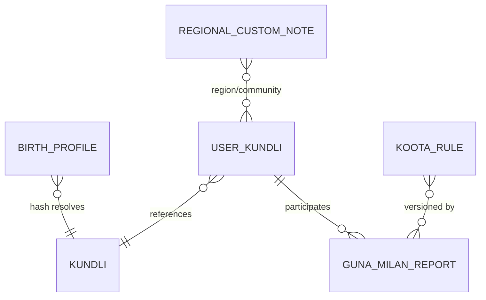

## 14.8 APIs
Base `/api/horoscope/v1`.
| Method | Path | Auth | Description / Errors |
|---|---|---|---|
| PUT | `/me/birth-details` | USER | `{date,time?,timeAccuracy,placeId}` → 200 `{kundliSummary}`; 422 future date/ invalid place |
| GET | `/me/kundli` | USER | full chart (owner only) |
| GET | `/users/{id}/kundli-summary` | USER | rashi, nakshatra, manglik (respecting `horoscope_visibility` setting) |
| GET | `/me/kundli.pdf` | USER (Premium) | rendered PDF (async job; 202 + polling) |
| GET | `/compatibility/{otherUserId}` | USER | Guna Milan report; 403 if other party hasn't shared; 409 birth data missing |
| POST | `/internal/compatibility/batch` | SERVICE | `{userId, candidateIds[≤500]}` → `[{id,total,flags}]` p99 < 80 ms from cache |
| GET | `/places/search?q=` | USER | geocoder autocomplete |
| GET | `/regional-notes?region=&locale=` | PUBLIC | cached content |
| POST/PUT | `/admin/regional-notes` | CONTENT_EDITOR | maker-checker |
| PUT | `/admin/rule-sets/{ver}` | SUPER_ADMIN | publish new rule version (golden tests must pass in CI) |

## 14.9 Kafka events
Produced: `pj.horoscope.kundli-computed.v1` (userId, rashi, nakshatra, manglik), `pj.horoscope.birth-details-changed.v1`, `pj.horoscope.compatibility-computed.v1` (batched, optional).
Consumed: `pj.user.account-deleted.v1`, `pj.profile.created.v1` (prompt for birth details), `pj.profile.preferences-updated.v1` (horoscope importance), `pj.matchmaking.candidates-generated.v1` (pre-warm Guna Milan cache).

## 14.10 Patterns / Security / Cache / Scale
- **Patterns:** Strategy per koota (8 `KootaCalculator` beans), Specification (dosha cancellations), immutable Value Objects, Memoization, anti-corruption layer around Swiss Ephemeris, versioned rule data (event-sourcing-lite: `rule_set_version` pinned in each report).
- **Security:** birth data is sensitive (can derive age); field-level encryption; visibility controlled by user setting (`HIDDEN`, `MATCHES_ONLY`, `ON_INTEREST`); no birth time in events; rate-limit compatibility endpoint (free: 5/day) with subscription feature flags; GDPR/DPDP erase cascades (kundli rows keyed by hash shared among users → reference counted before delete).
- **Caching:** `kundli` rows immutable → L1 Caffeine (24 h), L2 Redis `hs:kundli:{birthHash}` (30 d); `hs:gm:{minId}:{maxId}:{ruleVer}:{roleA}` (7 d, invalidated by `birth-details-changed`); pre-computation: user-level Moon-profile table is tiny (rashi 12 × nakshatra 27 × pada) → full Guna matrix **81 combos×…** precomputed in-memory lookup of `(nakshatraA, rashiA, nakshatraB, rashiB)` → score vector to make batch scoring O(1) per candidate (~1 µs).
- **Scaling:** CPU-light; 6 pods handle > 5k batch calls/s; ephemeris files read-only baked in image; Postgres small (< 1 M kundli rows ≈ 2 GB); read-heavy → Redis absorbs > 95 %.

---

# 15. analytics-service

## 15.1 Responsibilities
Collect product & business events (Kafka + client SDK), build funnels/retention/cohorts, serve **user-facing analytics for Premium Plus** (profile views, interest funnel, visibility boost impact), operational dashboards, revenue/subscription reports (consumed by admin BFF), data export for ML (feature feeds to AI recommendation & fraud). **PII-minimised by design.**

## 15.2 Decision: ClickHouse vs Athena
| Criterion | ClickHouse (self-host on EKS / ClickHouse Cloud on AWS) | Athena + S3/Iceberg |
|---|---|---|
| Latency for dashboards/user analytics | 10–200 ms | seconds–tens of seconds |
| Concurrency | high | limited (query quotas) |
| Cost at 1 M users (~50 M events/day) | moderate (3 nodes) | very cheap storage, per-scan cost |
| Ops | higher | none |
**Decision (hybrid, ADR-015):** **ClickHouse** for hot analytics (90-day raw, rollups forever) serving the Premium Plus UI & admin dashboards; **S3 + Iceberg (Glue catalog) + Athena** as the system-of-record lake (all events, 2 years, Parquet, Hive-partitioned by `dt`) for ad-hoc analysis, ML training and finance audits. Ingestion: Kafka → (a) ClickHouse Kafka engine / MSK Connect sink, (b) MSK Connect S3 sink (Iceberg) with Schema Registry.

## 15.3 Pipeline
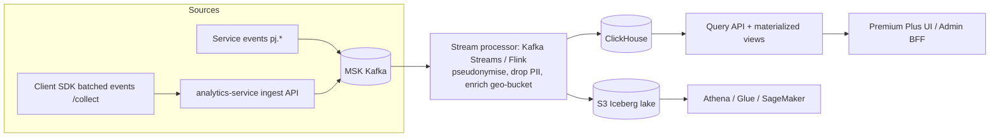
**PII minimisation:** `user_id` replaced by `pid = HMAC-SHA256(pepper_v, userId)` (rotating pepper per quarter with mapping kept in KMS-protected service for user-facing queries only); no names, phones, emails, free text, exact DOB; age → 5-yr bucket; location → district/state; IP → /24 truncated + country; device → hashed. Client events require consent (analytics cookie/SDK flag); DNT honoured. Right to erasure: delete by `pid` using ClickHouse lightweight deletes + Iceberg row-level deletes (batch weekly, SLA 30 d).

## 15.4 Event model & schema
Canonical event (Avro, Schema Registry, backward-compatible): `{eventId, name, ts, pid, sessionId, platform, appVersion, props{}, geo{state,district}, ctx{...}}`.
Key events: `profile_viewed`, `search_performed`, `interest_sent/accepted/declined`, `chat_started`, `message_sent` (count only), `call_started`, `shortlist_added`, `paywall_viewed`, `checkout_started`, `payment_succeeded`, `subscription_renewed/cancelled`, `verification_completed`, `signup_step_completed`.

**ClickHouse DDL**
```sql
CREATE TABLE events_raw ON CLUSTER pj
(
  event_id UUID, name LowCardinality(String), ts DateTime64(3, 'UTC'), dt Date MATERIALIZED toDate(ts),
  pid FixedString(32), session_id String, platform LowCardinality(String), app_version LowCardinality(String),
  state LowCardinality(String), district LowCardinality(String),
  target_pid FixedString(32) DEFAULT '', plan LowCardinality(String) DEFAULT '', props Map(String, String)
)
ENGINE = ReplicatedMergeTree
PARTITION BY toYYYYMM(ts) ORDER BY (name, dt, pid, ts)
TTL dt + INTERVAL 90 DAY DELETE
SETTINGS index_granularity = 8192;

CREATE MATERIALIZED VIEW mv_profile_views_daily
ENGINE = SummingMergeTree PARTITION BY toYYYYMM(dt) ORDER BY (target_pid, dt, viewer_segment)
AS SELECT target_pid, dt,
          multiIf(plan IN ('PREMIUM','PREMIUM_PLUS','VIP'), 'PAID', 'FREE') AS viewer_segment,
          count() AS views, uniqExact(pid) AS unique_viewers
   FROM events_raw WHERE name = 'profile_viewed' GROUP BY target_pid, dt, viewer_segment;

CREATE MATERIALIZED VIEW mv_interest_funnel_daily
ENGINE = SummingMergeTree ORDER BY (pid, dt)
AS SELECT pid, dt,
          countIf(name='interest_sent') sent, countIf(name='interest_accepted') accepted,
          countIf(name='interest_declined') declined, countIf(name='chat_started') chats
   FROM events_raw GROUP BY pid, dt;

CREATE TABLE revenue_daily (dt Date, plan LowCardinality(String), channel LowCardinality(String), gateway LowCardinality(String),
  gross_inr Decimal(14,2), refunds_inr Decimal(14,2), new_subs UInt32, renewals UInt32, churned UInt32)
ENGINE = ReplacingMergeTree ORDER BY (dt, plan, channel, gateway);
```
Retention/funnel queries use `windowFunnel` and `retention()` aggregate functions; cohorts materialised daily.

Operational Postgres (`analytics` schema) holds only metadata:
```sql
CREATE TABLE dashboard_definition (id uuid PRIMARY KEY, name text UNIQUE, owner_role text NOT NULL, sql_template text NOT NULL, params jsonb, updated_at timestamptz);
CREATE TABLE export_job (id uuid PRIMARY KEY, requested_by uuid NOT NULL, kind text NOT NULL, params jsonb, status text NOT NULL, s3_key text, created_at timestamptz NOT NULL DEFAULT now(), expires_at timestamptz);
CREATE TABLE erasure_request (pid bytea PRIMARY KEY, requested_at timestamptz NOT NULL, completed_at timestamptz);
CREATE TABLE metric_definition (key text PRIMARY KEY, description text NOT NULL, formula text NOT NULL, owner text NOT NULL);
```
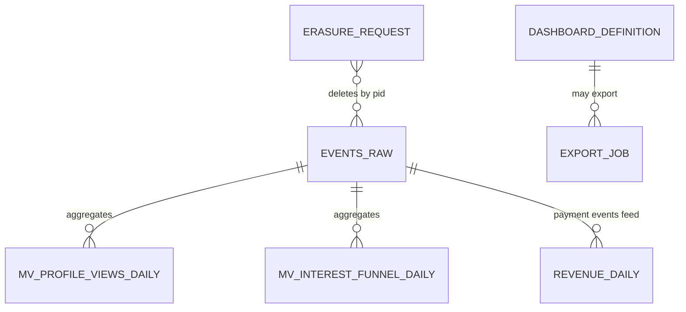

## 15.5 Key metrics
Activation (signup→profile≥80 %→photo→verified), DAU/WAU/MAU, stickiness, search→view→interest→accept→chat→call→“success story” funnel, time-to-first-interest, D1/D7/D30 retention by acquisition channel & district, free→paid conversion, ARPPU, MRR/ARR, churn, refund rate, payment success by gateway/method (UPI vs card), diaspora vs India segments, feature adoption (AI assistant), moderation/fraud rates, match quality (acceptance rate by compatibility-score decile → feeds AI evaluation).

## 15.6 APIs
Base `/api/analytics/v1`.
| Method | Path | Auth | Description / Errors |
|---|---|---|---|
| POST | `/collect` | USER/anon token | batch ≤ 100 events, 202; 400 schema; 429; consent header required |
| GET | `/me/insights/profile-views?range=7d|30d` | USER (PREMIUM_PLUS+) | `{total, unique, byDay[], bySegment, topDistricts[]}` (viewer identities **not** exposed unless viewer-reveal feature for VIP); 402 plan required |
| GET | `/me/insights/interest-funnel?range=` | USER (PREMIUM_PLUS+) | sent/accepted/declined/chats, benchmark vs cohort median |
| GET | `/me/insights/boost-impact` | USER (PREMIUM_PLUS+) | before/after views delta |
| GET | `/admin/reports/revenue?from=&to=&groupBy=` | FINANCE | MRR, gross, refunds, by plan/gateway |
| GET | `/admin/reports/subscriptions` | FINANCE | churn, renewals, cohorts |
| GET | `/admin/reports/funnels/{name}` | SUPER_ADMIN, PRODUCT | |
| POST | `/admin/exports` | FINANCE/SUPER_ADMIN | async CSV to S3 with 24 h presigned link; PII-free by default |
| POST | `/internal/erasure` | SERVICE | `{userId}` → 202 |

## 15.7 Kafka events
Produced: `pj.analytics.insight-ready.v1` (weekly digest data → notification-service), `pj.analytics.segment-updated.v1` (e.g. "at-risk churn" cohort → marketing/notification), `pj.analytics.feature-snapshot.v1` (daily aggregate features for AI/fraud).
Consumed (all via pseudonymising processor): `pj.user.registered.v1`, `pj.profile.viewed.v1`, `pj.profile.updated.v1`, `pj.search.executed.v1`, `pj.match.interest-sent.v1`, `…-accepted.v1`, `…-declined.v1`, `pj.chat.conversation-started.v1`, `pj.chat.message-sent.v1` (metadata only), `pj.call.completed.v1`, `pj.subscription.*`, `pj.payment.succeeded.v1`, `pj.payment.refunded.v1`, `pj.verification.approved.v1`, `pj.moderation.sanction-imposed.v1`, `pj.fraud.risk-scored.v1`, `pj.user.account-deleted.v1` (→ erasure).

## 15.8 Patterns / Security / Cache / Scale
- **Patterns:** Lambda-lite (stream + batch lake), CQRS (write via Kafka, read via ClickHouse), Materialized views / pre-aggregation, Anti-corruption pseudonymisation stage, Event sourcing of facts, Data contracts via Schema Registry.
- **Security:** pseudonymised IDs, k-anonymity threshold (suppress cohort/district stats with < 10 users), row-level security by `pid` for user queries (query templates parameterised — no raw SQL from clients), ClickHouse users per role (`ro_user_insights`, `ro_finance`), TLS everywhere, KMS-encrypted EBS/S3, Lake Formation column-level permissions, audit of every admin export, 90-day raw TTL.
- **Caching:** Redis for `insights:{pid}:{metric}:{range}` (5 min), CloudFront no-cache for private APIs; ClickHouse query cache for admin dashboards (60 s); materialised views serve user insights directly (O(days)).
- **Scaling:** estimate 1 M users, 20 % DAU → ~200 k DAU × ~250 events ≈ 50 M events/day ≈ 580/s avg, 5 k/s peak (evening 8–11 PM IST + festival peaks). Kafka partitions 24 on ingest topic; ClickHouse 3 shards × 2 replicas (r6id.2xlarge) ≈ 3–4 TB/yr compressed (~8:1); S3 lake ≈ 10 TB/yr Parquet; ingest pods scale on consumer lag (KEDA).

---

# 16. admin-service

## 16.1 Responsibilities
Backend-for-frontend for the **Super Admin dashboard** (React admin app). Orchestrates operations across services without owning their data: user management, subscription & revenue reports, fraud dashboard, moderation queues, verification workbench, content management (CMS: success stories, blog, festival & cultural content, regional notes, static pages, FAQ, banners), ban management. Enforces RBAC, maker-checker, break-glass and **immutable audit log**.

## 16.2 Roles & permission matrix
| Capability | SUPER_ADMIN | MODERATOR | VERIFIER | SUPPORT | FINANCE | CONTENT_EDITOR |
|---|---|---|---|---|---|---|
| View user profile (masked PII) | ✔ | ✔ | ✔ (case-scoped) | ✔ | ✔ (billing only) | ✖ |
| Reveal PII (click-to-reveal, audited) | ✔ | limited | ✔ (case) | ✔ (ticket) | ✔ (billing) | ✖ |
| Suspend/ban user | ✔ (approve) | ✔ (propose) | ✖ | propose | ✖ | ✖ |
| Moderation queue | ✔ | ✔ | ✖ | read | ✖ | ✖ |
| Verification workbench | ✔ | ✖ | ✔ | read | ✖ | ✖ |
| Refunds / revenue | ✔ | ✖ | ✖ | request | ✔ (execute w/ approval) | ✖ |
| CMS publish | ✔ | ✖ | ✖ | ✖ | ✖ | ✔ (author; publish needs approval) |
| Rule/policy/role management | ✔ | ✖ | ✖ | ✖ | ✖ | ✖ |
| Impersonate user | **forbidden for all** | | | | | |
ABAC overlays: region/language queue assignment, data sensitivity tier, working-hours + corporate-IP/VPN condition, MFA freshness (< 15 min) for sensitive ops, device posture.

**Maker-checker** (4-eyes) mandatory for: permanent ban, ban reversal, refund > ₹5 000, manual subscription grant/extend, rule/policy changes, role grants, CMS publish of homepage/legal, bulk operations (> 100 users), data export with PII, vault document access for VIP profiles. Maker ≠ checker enforced in DB constraint.

**Impersonation forbidden.** Support uses *view-as (read-only, redacted, server-rendered snapshot)* with consent token from user, never login-as. **Break-glass:** time-boxed (≤ 60 min) elevated access for incident response, requires two approvers (one SUPER_ADMIN), mandatory ticket, auto-expiry, immediate alerts to security channel, post-incident review; all actions flagged `break_glass=true` in the audit log.

## 16.3 Database schema (`admin` schema)
```sql
CREATE TABLE admin_user (
  id uuid PRIMARY KEY, idp_subject text UNIQUE NOT NULL,        -- SSO (Okta/Azure AD/Cognito) subject
  email text UNIQUE NOT NULL, display_name text NOT NULL, status text NOT NULL CHECK (status IN ('ACTIVE','SUSPENDED','OFFBOARDED')),
  mfa_enrolled boolean NOT NULL DEFAULT false, created_at timestamptz NOT NULL DEFAULT now()
);
CREATE TABLE admin_role (id smallserial PRIMARY KEY, name text UNIQUE NOT NULL CHECK (name IN ('SUPER_ADMIN','MODERATOR','VERIFIER','SUPPORT','FINANCE','CONTENT_EDITOR')));
CREATE TABLE admin_user_role (admin_id uuid REFERENCES admin_user(id), role_id smallint REFERENCES admin_role(id), granted_by uuid NOT NULL, granted_at timestamptz NOT NULL DEFAULT now(), expires_at timestamptz, PRIMARY KEY (admin_id, role_id));
CREATE TABLE permission (code text PRIMARY KEY, description text NOT NULL, sensitivity smallint NOT NULL, requires_maker_checker boolean NOT NULL DEFAULT false);
CREATE TABLE role_permission (role_id smallint REFERENCES admin_role(id), permission_code text REFERENCES permission(code), conditions jsonb, PRIMARY KEY (role_id, permission_code));

CREATE TABLE approval_request (
  id uuid PRIMARY KEY, action_code text NOT NULL REFERENCES permission(code), target_type text NOT NULL, target_id text NOT NULL,
  payload jsonb NOT NULL, reason text NOT NULL, ticket_ref text,
  maker_id uuid NOT NULL REFERENCES admin_user(id), checker_id uuid REFERENCES admin_user(id),
  status text NOT NULL DEFAULT 'PENDING' CHECK (status IN ('PENDING','APPROVED','REJECTED','EXECUTED','EXPIRED','FAILED')),
  decided_at timestamptz, executed_at timestamptz, expires_at timestamptz NOT NULL, created_at timestamptz NOT NULL DEFAULT now(),
  CONSTRAINT chk_maker_ne_checker CHECK (checker_id IS NULL OR checker_id <> maker_id)
);
CREATE INDEX ix_approval_pending ON approval_request(status, created_at) WHERE status = 'PENDING';

CREATE TABLE break_glass_grant (
  id uuid PRIMARY KEY, admin_id uuid NOT NULL, role_granted text NOT NULL, ticket_ref text NOT NULL, reason text NOT NULL,
  approver1 uuid NOT NULL, approver2 uuid NOT NULL, starts_at timestamptz NOT NULL, expires_at timestamptz NOT NULL, revoked_at timestamptz,
  CHECK (approver1 <> approver2 AND expires_at <= starts_at + interval '60 minutes')
);

CREATE TABLE pii_reveal (id uuid PRIMARY KEY, admin_id uuid NOT NULL, user_id uuid NOT NULL, field text NOT NULL, justification text NOT NULL, ticket_ref text, at timestamptz NOT NULL DEFAULT now());

CREATE TABLE ban_record (   -- admin-side view of bans; source of truth for sanction is moderation-service
  id uuid PRIMARY KEY, user_id uuid NOT NULL, type text NOT NULL, reason_code text NOT NULL, approval_id uuid REFERENCES approval_request(id),
  status text NOT NULL, created_at timestamptz NOT NULL DEFAULT now(), lifted_at timestamptz
);

-- CMS
CREATE TABLE cms_content (
  id uuid PRIMARY KEY, kind text NOT NULL CHECK (kind IN ('SUCCESS_STORY','BLOG','FESTIVAL','CULTURE_NOTE','FAQ','PAGE','BANNER','LEGAL')),
  slug text NOT NULL, locale text NOT NULL CHECK (locale IN ('en','hi','gar','kum')), title text NOT NULL, body_md text NOT NULL, meta jsonb,
  status text NOT NULL DEFAULT 'DRAFT' CHECK (status IN ('DRAFT','IN_REVIEW','PUBLISHED','ARCHIVED')),
  current_version int NOT NULL DEFAULT 1, publish_at timestamptz, author_id uuid NOT NULL, updated_at timestamptz NOT NULL DEFAULT now(),
  UNIQUE (kind, slug, locale)
);
CREATE TABLE cms_content_version (content_id uuid REFERENCES cms_content(id), version int, body_md text NOT NULL, changed_by uuid NOT NULL, changed_at timestamptz NOT NULL DEFAULT now(), PRIMARY KEY (content_id, version));

-- Immutable audit log with hash chain
CREATE TABLE audit_log (
  seq bigserial PRIMARY KEY,
  id uuid NOT NULL UNIQUE, at timestamptz NOT NULL DEFAULT now(),
  actor_id uuid NOT NULL, actor_roles text[] NOT NULL, break_glass boolean NOT NULL DEFAULT false,
  action text NOT NULL, target_type text, target_id text, outcome text NOT NULL CHECK (outcome IN ('SUCCESS','DENIED','FAILED')),
  request_id text, ip inet, user_agent text, details jsonb,
  prev_hash bytea NOT NULL, hash bytea NOT NULL                -- hash = SHA-256(prev_hash || canonical_json(row w/o hash))
);
REVOKE UPDATE, DELETE, TRUNCATE ON audit_log FROM PUBLIC, admin_app;
CREATE RULE no_update AS ON UPDATE TO audit_log DO INSTEAD NOTHING;
CREATE RULE no_delete AS ON DELETE TO audit_log DO INSTEAD NOTHING;

CREATE TABLE audit_anchor (id bigserial PRIMARY KEY, from_seq bigint NOT NULL, to_seq bigint NOT NULL, root_hash bytea NOT NULL, s3_key text NOT NULL, anchored_at timestamptz NOT NULL DEFAULT now());
```
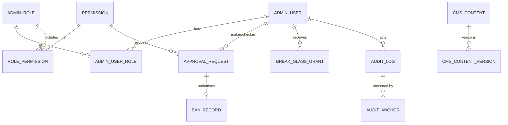

**Hash chain:** appends serialised by `pg_advisory_xact_lock(42)`; `hash = SHA-256(prev_hash ‖ canonicalJSON(row))`. A verifier job (hourly) recomputes the chain, publishes a **Merkle root every hour to S3 Object Lock (compliance mode, 7 y)** → tamper evidence even against a DBA. Metric `audit_chain_valid` alerts on break. Logs also streamed to CloudWatch/OpenSearch (WORM) and SIEM.

## 16.4 Key flows
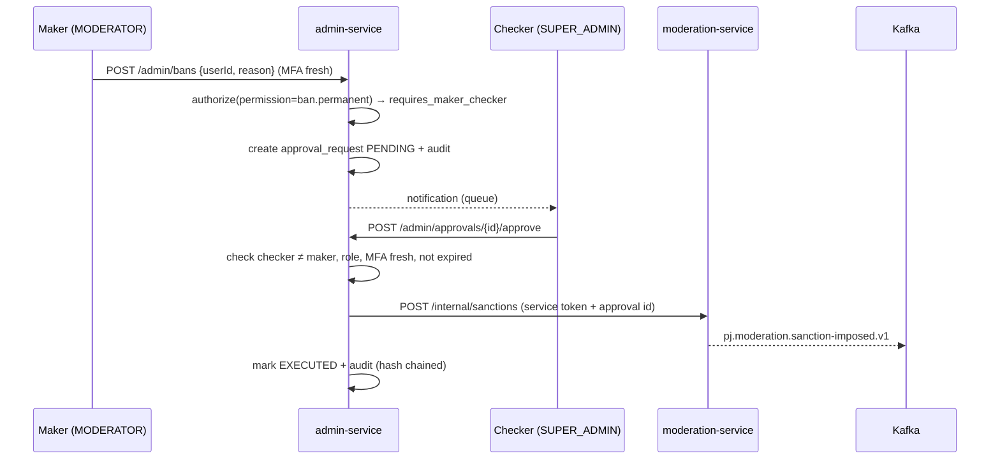

## 16.5 APIs
Base `/api/admin/v1` — all require admin JWT (SSO OIDC, `amr` contains `mfa`), served only via private ALB + VPN/zero-trust (not on public gateway).
| Method | Path | Roles | Notes / Errors |
|---|---|---|---|
| GET | `/me` | any | roles, permissions, pending approvals |
| GET | `/users?query=&status=&district=` | SUPPORT, MODERATOR, SUPER_ADMIN | masked results; query by id/phone-hash/email-hash; 403 |
| GET | `/users/{id}` | same | aggregated view (profile, verification, subs, sanctions, fraud score) |
| POST | `/users/{id}/reveal` | per matrix | `{field, justification, ticketRef}` → value, audited; 429 (20/h) |
| POST | `/users/{id}/view-as-session` | SUPPORT | needs user consent token; read-only snapshot |
| POST | `/bans` | MODERATOR (propose) | → 202 `approvalId` ; temporary ≤ 7 d direct |
| POST | `/bans/{id}/lift` | SUPER_ADMIN (+checker) | |
| GET | `/approvals?status=PENDING` | checker roles | |
| POST | `/approvals/{id}/approve` / `/reject` | checker | 409 self-approval, 410 expired, 403 stale MFA |
| GET | `/reports/revenue`, `/reports/subscriptions` | FINANCE, SUPER_ADMIN | proxies analytics |
| POST | `/refunds` | FINANCE | → payment-service via approval if > ₹5k |
| POST | `/subscriptions/{userId}/grant` | SUPER_ADMIN (+checker) | comp plan |
| GET | `/fraud/dashboard`, `/fraud/cases` | MODERATOR, SUPER_ADMIN | aggregated from fraud service |
| GET | `/moderation/queues`, `/verification/queue` | MODERATOR / VERIFIER | proxied, scoped |
| CRUD | `/cms/contents` ; POST `/cms/contents/{id}/submit` `/publish` | CONTENT_EDITOR / SUPER_ADMIN | publish for LEGAL/PAGE needs approval |
| POST | `/break-glass` | any admin | request; approvals via `/approvals` |
| GET | `/audit?actor=&action=&from=&to=` | SUPER_ADMIN | cursor paging; `GET /audit/verify` → chain status |
| CRUD | `/roles`, `/admins` | SUPER_ADMIN (+checker) | |

## 16.6 Kafka events
Produced: `pj.admin.action-executed.v1` (for SIEM), `pj.admin.approval-requested.v1`, `pj.admin.approval-decided.v1`, `pj.admin.content-published.v1` (→ CDN purge, search index for stories), `pj.admin.break-glass-activated.v1` (→ security alert), `pj.admin.user-ban-requested.v1`.
Consumed: `pj.moderation.sanction-imposed.v1`/`-lifted.v1` (sync ban_record), `pj.fraud.case-opened.v1` (dashboard), `pj.verification.case-opened.v1`, `pj.payment.refund-completed.v1`, `pj.moderation.review-sla-breached.v1` (admin alerts).

## 16.7 Patterns / Security / Cache / Scale
- **Patterns:** BFF / API composition (parallel fan-out w/ timeouts and partial responses), Command pattern + Approval workflow (Saga with `EXECUTED/FAILED`), Policy Enforcement Point (Spring Security + OPA/Cedar sidecar for ABAC), Decorator for auditing (`@Audited` aspect before/after, fail-closed: if audit write fails the action aborts), Outbox.
- **Security:** SSO via OIDC with enforced MFA (hardware keys for SUPER_ADMIN), short sessions (15 min idle, 8 h absolute), network isolation (internal ALB, WAF IP allow-list/Zero-trust like AWS Verified Access), CSP strict + CSRF tokens, PII masked server-side by default (`MaskingSerializer`), reveal quotas, watermark on screenshots with admin id, no bulk export w/o approval, admin service accounts distinct from user identity pool, separate DB credentials, secrets in AWS Secrets Manager, quarterly access recertification, offboarding SCIM auto-deprovision.
- **Caching:** permissions cached per session (Caffeine 60 s, invalidated via `pj.admin.role-changed`), dashboards aggregated via analytics caches; **no caching of PII**.
- **Scaling:** low traffic (< 200 concurrent admins) → 2–3 pods across AZs; heavy parts are downstream. Audit table partitioned monthly (`seq` range); ~2 M rows/month; archived to S3 Parquet after 13 months (chain anchors preserved).

---

# 17. fraud-detection-service

## 17.1 Responsibilities
Real-time and batch risk scoring for signup, login, profile edits, messaging, interest-sending, payments, verification. Detect fake profiles, catfishing, **romance/financial scams**, duplicate accounts, bot/automation, payment fraud (card testing, stolen cards, chargeback abuse), and orchestrate responses (shadow-limit, step-up verification, block). Provide explainability to admins and appeal support.

## 17.2 Domain model
`RiskAssessment` (subject, context, score 0–1, level, reasons), `Signal` (typed evidence), `FraudCase` (aggregate for analysts), `DeviceFingerprint`, `FaceEmbedding`, `Action` (SHADOW_LIMIT, STEP_UP, BLOCK, REVOKE_TICK, FREEZE_PAYMENTS), `FeatureVector`, `Label` (feedback).

## 17.3 Signals & features
| Group | Signals |
|---|---|
| Device | fingerprint (FingerprintJS/Play Integrity/App Attest attestation), emulator/root/jailbreak flags, device ↔ #accounts, device first-seen, install source |
| Network/IP | IP reputation (AbuseIPDB/Spur/MaxMind), VPN/proxy/Tor/datacenter ASN, IP-geo vs declared district/country mismatch, velocity per IP/ASN/ /24 |
| Identity | **disposable email** domains (list + MX check), **VOIP/virtual/recycled phone** (carrier lookup, number age), email/phone reuse, mismatched Aadhaar/PAN name vs profile, age-vs-photo-age estimate gap |
| Photo/face | **face-embedding duplicate detection** (512-d embeddings in pgvector/OpenSearch k-NN; cosine ≥ 0.86 → near-duplicate across different accounts), **photo reverse-match** (perceptual hash + TinEye/Google Lens-type vendor API & internal stock/celebrity index), AI-generated image detector score, screenshots of other sites' watermarks |
| Behaviour | signup speed, form fill cadence/copy-paste, interests sent per hour, % messages with links/phone/UPI, rejection ratio, profile view/like ratios, night-time activity vs declared tz, copy-paste identical messages (SimHash) |
| Chat (romance scam) | patterns: fast move off-platform, early "I'm abroad/army/doctor/NRI + gift/customs/investment/crypto/medical emergency", money/UPI/gift-card requests, love-bombing, inconsistent persona, many parallel conversations with scripted text; LLM classifier on rolling window with reason codes |
| Payment | BIN/card country vs user country, card-testing velocity (many small failed attempts), multiple cards per account/one card to many accounts, UPI VPA reuse, chargebacks/refund abuse, free-trial abuse, gateway risk (Razorpay/Stripe Radar scores) |
| Graph | shared device/IP/payment/phone clusters (connected components, weekly Louvain on Neptune/Neo4j or Spark GraphFrames) |
| Reports | user reports count (weighted by reporter trust), moderation strikes |

## 17.4 Architecture
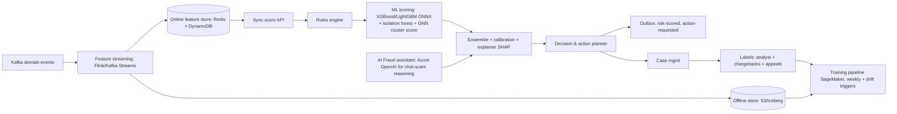
- **Scoring modes:** (1) *sync* (≤ 80 ms p99) at signup, login, payment init, send-interest-burst; fail-open for low-risk surfaces, fail-closed for payments over threshold; (2) *async* continuous on events (chat windows, profile edits); (3) *batch* nightly (graph clusters, dormant mass-account sweeps).
- **Score:** `risk = calibrated( w_r·rules_score + w_m·ML_prob + w_g·graph_score + w_l·LLM_scam_prob )`, weights tuned per surface; isotonic calibration.
- **Levels & actions:**
| Score | Level | Action (policy table, config-as-data) |
|---|---|---|
| 0–0.30 | LOW | none |
| 0.30–0.55 | MEDIUM | **step-up verification** (OTP re-verify, selfie liveness), throttle interests (e.g., 10/day), hide contact info |
| 0.55–0.80 | HIGH | **shadow-limit** (profile hidden from search, messages queued/muted, no premium upsell sends), case opened for analyst, freeze payouts/refunds |
| 0.80–1.0 | CRITICAL | **block** (login denied, sessions revoked, blue tick revoked, payments frozen) — auto only for hard rules (known stolen card/BIN attack, device ban-evasion, sanctioned-list) else analyst confirm within 1 h |
Shadow-limits are intentionally silent to avoid adversary feedback; the user gets a step-up path to recover (appeal flow).
- **Duplicate/ban evasion:** new signup compared by (device, face embedding, phone/email normalised (strip Gmail dots/+), Aadhaar/PAN HMAC from media-service via event, payment instrument fingerprint). Match to a banned user → block + case.
- **Explainability:** SHAP top-5 contributing features + fired rule ids + signal evidence stored with each assessment; shown in admin fraud dashboard; user-facing messages use generic reason categories only. Model cards, fairness checks (false-positive rate across districts/languages/diaspora/IP-types, ensure no use of protected attributes like caste/religion as features), human review for all permanent actions.
- **Feedback loop:** labels from analyst decisions, appeals outcome, chargebacks (90-day lag), user reports confirmed by moderation, verification failures; weekly retrain (shadow evaluation → champion/challenger → canary 5 % → promote); drift monitored (PSI > 0.2 alert); precision@k and review-yield tracked.

## 17.5 Database schema (`fraud` schema)
```sql
CREATE EXTENSION IF NOT EXISTS vector;

CREATE TABLE risk_assessment (
  id uuid PRIMARY KEY, subject_type text NOT NULL CHECK (subject_type IN ('USER','DEVICE','PAYMENT','MESSAGE_WINDOW')),
  subject_id text NOT NULL, user_id uuid, surface text NOT NULL, score numeric(4,3) NOT NULL, level text NOT NULL,
  rules_fired text[] NOT NULL DEFAULT '{}', top_features jsonb NOT NULL, model_version text NOT NULL, policy_version text NOT NULL,
  decision text NOT NULL, latency_ms int, created_at timestamptz NOT NULL DEFAULT now()
) PARTITION BY RANGE (created_at);
CREATE INDEX ix_ra_user ON risk_assessment(user_id, created_at DESC);

CREATE TABLE fraud_signal (
  id bigserial PRIMARY KEY, user_id uuid, device_id uuid, type text NOT NULL, strength numeric(4,3) NOT NULL,
  evidence jsonb NOT NULL, source text NOT NULL, created_at timestamptz NOT NULL DEFAULT now(), expires_at timestamptz
);
CREATE INDEX ix_sig_user ON fraud_signal(user_id, created_at DESC);

CREATE TABLE device_fingerprint (
  id uuid PRIMARY KEY, fp_hash bytea UNIQUE NOT NULL, platform text, attestation_status text, emulator boolean, rooted boolean,
  first_seen timestamptz NOT NULL DEFAULT now(), last_seen timestamptz NOT NULL DEFAULT now(), banned boolean NOT NULL DEFAULT false
);
CREATE TABLE device_user (device_id uuid REFERENCES device_fingerprint(id), user_id uuid NOT NULL, first_seen timestamptz NOT NULL DEFAULT now(), last_seen timestamptz NOT NULL DEFAULT now(), PRIMARY KEY (device_id, user_id));
CREATE INDEX ix_du_user ON device_user(user_id);

CREATE TABLE face_embedding (
  id uuid PRIMARY KEY, user_id uuid NOT NULL, asset_id uuid NOT NULL, embedding vector(512) NOT NULL, quality real, model_version text NOT NULL,
  created_at timestamptz NOT NULL DEFAULT now(), deleted_at timestamptz
);
CREATE INDEX ix_face_hnsw ON face_embedding USING hnsw (embedding vector_cosine_ops) WITH (m = 16, ef_construction = 128);

CREATE TABLE image_fingerprint (asset_id uuid PRIMARY KEY, user_id uuid NOT NULL, phash bigint NOT NULL, ai_generated_score real, reverse_match_hits jsonb, checked_at timestamptz);
CREATE INDEX ix_phash ON image_fingerprint(phash);

CREATE TABLE identity_hash (user_id uuid NOT NULL, kind text NOT NULL CHECK (kind IN ('PHONE','EMAIL_CANON','AADHAAR','PAN','VPA','CARD_FP')), hmac bytea NOT NULL, PRIMARY KEY (user_id, kind));
CREATE INDEX ix_idhash ON identity_hash(kind, hmac);

CREATE TABLE fraud_case (
  id uuid PRIMARY KEY, user_id uuid NOT NULL, type text NOT NULL CHECK (type IN ('FAKE_PROFILE','ROMANCE_SCAM','DUPLICATE','PAYMENT','BOT','BAN_EVASION','OTHER')),
  status text NOT NULL CHECK (status IN ('OPEN','IN_REVIEW','CONFIRMED','FALSE_POSITIVE','CLOSED')), priority smallint NOT NULL,
  cluster_id uuid, assigned_to uuid, assessment_id uuid, resolution text, opened_at timestamptz NOT NULL DEFAULT now(), closed_at timestamptz, version int NOT NULL DEFAULT 0
);
CREATE INDEX ix_case_open ON fraud_case(status, priority DESC, opened_at) WHERE status IN ('OPEN','IN_REVIEW');

CREATE TABLE fraud_action (
  id uuid PRIMARY KEY, user_id uuid NOT NULL, type text NOT NULL CHECK (type IN ('SHADOW_LIMIT','STEP_UP','BLOCK','REVOKE_TICK','FREEZE_PAYMENTS','THROTTLE')),
  assessment_id uuid, case_id uuid, auto boolean NOT NULL, starts_at timestamptz NOT NULL DEFAULT now(), ends_at timestamptz, lifted_at timestamptz, lifted_reason text
);
CREATE INDEX ix_action_active ON fraud_action(user_id) WHERE lifted_at IS NULL;

CREATE TABLE fraud_label (id bigserial PRIMARY KEY, user_id uuid NOT NULL, label text NOT NULL CHECK (label IN ('FRAUD','LEGIT','UNKNOWN')), source text NOT NULL, weight real NOT NULL DEFAULT 1, created_at timestamptz NOT NULL DEFAULT now());

CREATE TABLE fraud_rule (id uuid PRIMARY KEY, code text UNIQUE NOT NULL, surface text NOT NULL, expression text NOT NULL, weight real NOT NULL, hard boolean NOT NULL DEFAULT false, enabled boolean NOT NULL DEFAULT true, mode text NOT NULL DEFAULT 'SHADOW' CHECK (mode IN ('SHADOW','ENFORCE')), version int NOT NULL DEFAULT 1);
CREATE TABLE model_registry (version text PRIMARY KEY, kind text NOT NULL, s3_uri text NOT NULL, metrics jsonb NOT NULL, status text NOT NULL CHECK (status IN ('SHADOW','CANARY','CHAMPION','RETIRED')), promoted_at timestamptz);
CREATE TABLE blocklist_entry (kind text NOT NULL, value_hmac bytea NOT NULL, reason text NOT NULL, added_by text NOT NULL, added_at timestamptz NOT NULL DEFAULT now(), PRIMARY KEY (kind, value_hmac));
```
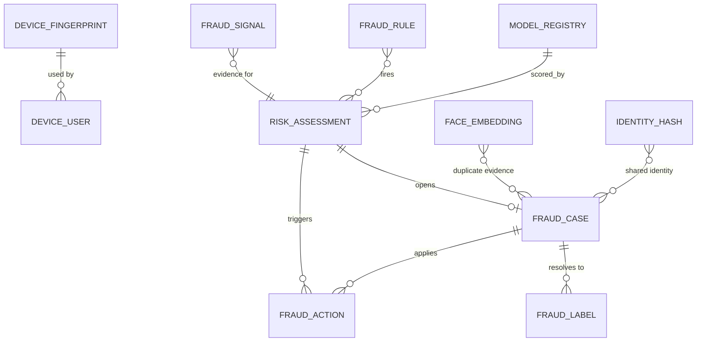

## 17.6 APIs
Base `/api/fraud/v1` (mostly internal; gateway-hidden except `/me/step-up`).
| Method | Path | Auth | Description / Errors |
|---|---|---|---|
| POST | `/internal/score` | SERVICE (mTLS + SPIFFE) | `{surface, userId?, deviceId, ip, context{}}` → `{riskId, score, level, action, reasons[]}`; p99 ≤ 80 ms; on timeout caller applies surface default (fail-open/closed) |
| POST | `/internal/devices` | SERVICE | register fingerprint/attestation → `{deviceId, banned}` |
| POST | `/internal/signals` | SERVICE | push custom signal |
| GET | `/me/step-up` | USER | pending challenge `{type: OTP|SELFIE_LIVENESS|DOC}` |
| POST | `/me/step-up/{id}/complete` | USER | result via verification |
| GET | `/admin/cases?status=&type=` | MODERATOR/SUPER_ADMIN | paging, filters |
| GET | `/admin/cases/{id}` | same | evidence, SHAP reasons, linked accounts graph, chat excerpts (redacted) |
| POST | `/admin/cases/{id}/resolve` | analyst | `{outcome: CONFIRMED|FALSE_POSITIVE, actions[]}` → label feedback; permanent ban needs maker-checker via admin-service |
| POST | `/admin/actions/{id}/lift` | analyst | |
| GET | `/admin/dashboard/summary` | analyst | counts, precision, review backlog, top rules |
| CRUD | `/admin/rules` | SUPER_ADMIN | with SHADOW→ENFORCE promotion + backtest endpoint |
| POST | `/admin/blocklist` | analyst | add device/phone/email/VPA hmac |
| GET | `/admin/models`, POST `/admin/models/{v}/promote` | SUPER_ADMIN | |

## 17.7 Kafka events
Produced: `pj.fraud.risk-scored.v1` (userId, surface, score, level, topReasons — no raw features), `pj.fraud.action-requested.v1` (SHADOW_LIMIT/STEP_UP/BLOCK/…; consumed by identity, search, chat, payment, media), `pj.fraud.case-opened.v1`, `pj.fraud.case-resolved.v1`, `pj.fraud.action-lifted.v1`, `pj.fraud.duplicate-detected.v1`, `pj.fraud.label-created.v1` (→ lake).
Consumed: `pj.user.registered.v1`, `pj.identity.login-succeeded.v1`/`-failed.v1`, `pj.identity.device-registered.v1`, `pj.profile.created.v1`/`updated.v1`, `pj.media.face-embedding-requested.v1`, `pj.media.asset-ready.v1`, `pj.verification.approved.v1`/`rejected.v1`, `pj.chat.message-sent.v1`, `pj.match.interest-sent.v1`, `pj.payment.attempted.v1`/`succeeded.v1`/`failed.v1`/`chargeback.v1`, `pj.moderation.decision.v1`/`sanction-imposed.v1`, `pj.user.account-deleted.v1`.

## 17.8 Patterns / Security / Cache / Scale
- **Patterns:** Pipeline/Chain of Responsibility, Rules engine + ML ensemble, Feature Store (online/offline parity via shared feature definitions), Champion–Challenger model deployment, Shadow mode for rules, Circuit breaker + default-policy fallback, Case Management (aggregate), Event-carried state transfer, Graph analysis batch, Human-in-the-loop.
- **Security:** only service-to-service access (mTLS, SPIFFE IDs, scoped client credentials), identifiers stored as HMACs (phone/email/Aadhaar/PAN/card-fingerprint), face embeddings are biometric → explicit consent, encrypted at rest (KMS), retention ≤ 12 months post-account closure unless active fraud case, access audited, no ability for end-users to see scores; defence against adversarial probing (silent shadow-limits, randomised response timing for step-up triggers, rate limits on score-adjacent endpoints); LLM prompts redact PII and are prompt-injection hardened (chat text is untrusted data); data minimisation for DPDP, DPIA documented, human review required before permanent adverse decisions (no solely automated final bans except hard rules).
- **Caching:** online features in Redis (`ff:user:{id}`, `ff:device:{id}`, `ff:ip:{hash}` sliding-window counters via Redis Lua/HyperLogLog with TTL 1 h–30 d); rule set & model in-memory (hot reload on `pj.fraud.rules-changed`); IP-reputation cache 24 h; blocklist Bloom filter in-process + Redis set for authoritative check; active actions cache `fraud:act:{userId}` (invalidated by events; consumed by gateway for fast deny).
- **Scaling:** sync scoring pods HPA by RPS/latency (target 3 k rps burst — signup/login/payments/interests); ONNX Runtime CPU inference ~3 ms; face-embedding k-NN: pgvector HNSW suffices to ~10 M vectors (6 M photos → ~12 GB index; if exceeding, move to OpenSearch k-NN/Qdrant with the same port); Flink jobs scale by partitions (key = userId/deviceId); training on SageMaker spot; partition `risk_assessment` monthly, retain 13 months (hot 3, S3 cold after); per-surface SLOs with error budgets; load test at 5× expected peak.

---

## Cross-service interaction summary (this document)
```mermaid
flowchart LR
  MEDIA[media-service] -- asset-uploaded --> MOD[moderation-service]
  MEDIA -- face-embedding-requested --> FRAUD[fraud-detection-service]
  FRAUD -- action-requested(REVOKE_TICK/BLOCK) --> MEDIA
  MOD -- sanction-imposed --> ADMIN[admin-service]
  FRAUD -- case-opened --> ADMIN
  ADMIN -- approved ban --> MOD
  HORO[horoscope-service] -- kundli-computed --> ANALYTICS[analytics-service]
  MEDIA & MOD & FRAUD & HORO -- events --> ANALYTICS
  ANALYTICS -- feature-snapshot --> FRAUD
```
Open decisions logged as ADRs: (ADR-012) Aadhaar path = DigiLocker + offline eKYC only; (ADR-014) Swiss Ephemeris licensing; (ADR-015) ClickHouse + Iceberg hybrid; (ADR-017) pgvector first, migrate to dedicated vector DB past ~10 M embeddings; (ADR-016) audit anchoring via S3 Object Lock.
