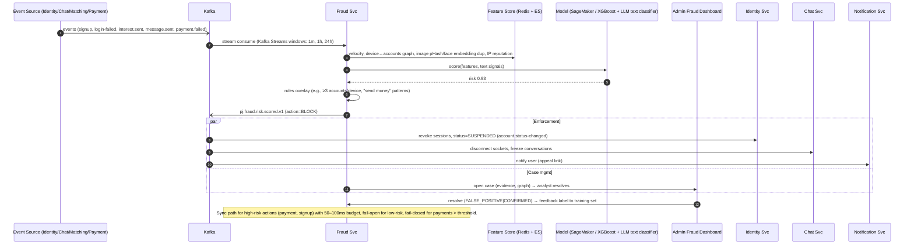

# 05 — API Contracts, Kafka Event Contracts & Sequence Diagrams

Platform: **PahadiJodi** (Uttarakhand matrimonial platform). Base package `in.pahadijodi`, services use Java 21 / Spring Boot 3, Kafka + Schema Registry, PostgreSQL, Redis, Elasticsearch.

> Note: no shared-conventions file existed in the workspace when this was written. The conventions below (service names in kebab-case, `/api/v1` prefix, `pj.<domain>.<event>.v1` topics, UUIDv7 ids, UTC ISO-8601 timestamps) are stated explicitly here; reconcile with docs 01–04 if they differ.

---

## 1. Global API Standards

### 1.1 Versioning
- URI major version: `https://api.pahadijodi.in/api/v1/...`. Breaking changes → `/api/v2`; v1 supported ≥ 12 months after v2 GA with `Deprecation` and `Sunset` headers (RFC 8594).
- Additive changes (new optional fields, new endpoints, new enum values clients must tolerate) are non-breaking. Clients must ignore unknown fields.
- Mobile clients send `X-Client-Version` and `X-Client-Platform` (`web|ios|android`); gateway can force-upgrade via `426 Upgrade Required`.

### 1.2 Conventions
| Topic | Rule |
|---|---|
| IDs | UUIDv7 (time-ordered), serialized as lowercase string. Public profile id is a short code `PJ` + 8 base32 chars (`profileCode`), never the internal user UUID. |
| Time | ISO-8601 UTC (`2026-11-02T10:15:30Z`); dates `YYYY-MM-DD`. |
| Money | Integer minor units (paise) + ISO-4217 `currency`. Never floats. |
| JSON | `camelCase`, `Content-Type: application/json; charset=utf-8`. |
| Enums | `UPPER_SNAKE_CASE`. |
| Auth | `Authorization: Bearer <JWT>` (RS256/ES256, 15 min access, 30 day rotating refresh in HttpOnly cookie on web / secure storage on mobile). |
| Correlation | `X-Request-Id` (client optional, gateway generates UUID otherwise) echoed in response and in problem body `traceId`; W3C `traceparent` propagated (OpenTelemetry). |
| Locale | `Accept-Language: en-IN, hi-IN;q=0.9` — supported `en`, `hi`, `gbm` (Garhwali), `kfy` (Kumaoni, transliterated UI). Server localizes error `title`/`detail` and enum labels (`?labels=true`). Response carries `Content-Language`. |
| PII | Responses mask phone/email unless owner or entitled (contact unlock). Fields classed `PII-HIGH` are never logged. |

### 1.3 Error model — RFC 7807 (`application/problem+json`)
```json
{
  "type": "https://api.pahadijodi.in/problems/entitlement-required",
  "title": "Premium subscription required",
  "status": 403,
  "code": "SUB-4031",
  "detail": "Starting a chat requires an active PREMIUM plan or higher.",
  "instance": "/api/v1/chat/conversations",
  "traceId": "4bf92f3577b34da6a3ce929d0e0e4736",
  "timestamp": "2026-11-02T10:15:30Z",
  "errors": [{ "field": "ageMin", "code": "VAL-4001", "message": "must be >= 21" }],
  "retryAfterSeconds": null,
  "upgradeUrl": "https://pahadijodi.in/plans"
}
```

**Error code catalogue** (format `<DOMAIN>-<HTTP><nn>`):

| Code | HTTP | Meaning |
|---|---|---|
| GEN-4000 | 400 | Malformed request / unreadable body |
| VAL-4001 | 422 | Field validation failed (see `errors[]`) |
| GEN-4010 | 401 | Missing/invalid/expired access token |
| GEN-4030 | 403 | Forbidden (RBAC/ABAC denied) |
| GEN-4040 | 404 | Resource not found (also used to hide existence of blocked users) |
| GEN-4090 | 409 | Conflict / optimistic-lock version mismatch |
| GEN-4120 | 412 | `If-Match` precondition failed |
| GEN-4150 | 415 | Unsupported media type |
| GEN-4290 | 429 | Rate limit exceeded |
| GEN-5000 | 500 | Unexpected error |
| GEN-5030 | 503 | Dependency unavailable / circuit open |
| IDN-4011 | 401 | Invalid credentials |
| IDN-4012 | 401 | OTP invalid or expired |
| IDN-4291 | 429 | OTP resend/attempt limit reached |
| IDN-4031 | 403 | 2FA required (`mfaToken` in body) |
| IDN-4032 | 403 | Account suspended / banned |
| IDN-4091 | 409 | Email/phone already registered |
| IDN-4013 | 401 | Refresh token reuse detected (family revoked) |
| PRF-4041 | 404 | Profile not found |
| PRF-4221 | 422 | Profile incomplete for operation (< required completeness) |
| PRF-4031 | 403 | Profile hidden / blocked by owner |
| SRC-4001 | 400 | Invalid search filter combination |
| SRC-4291 | 429 | Free-tier daily search quota exhausted |
| MAT-4091 | 409 | Interest already sent |
| MAT-4031 | 403 | Daily interest quota exceeded |
| MAT-4032 | 403 | User blocked / ignored |
| CHT-4031 | 403 | Chat not unlocked (no mutual interest or entitlement) |
| CHT-4221 | 422 | Message rejected by moderation |
| CHT-4132 | 413 | Attachment too large |
| SUB-4031 | 403 | Entitlement required (upgrade) |
| SUB-4091 | 409 | Active subscription already exists |
| PAY-4001 | 400 | Invalid payment method / amount mismatch |
| PAY-4021 | 402 | Payment failed at gateway |
| PAY-4092 | 409 | Duplicate idempotency key with different payload |
| PAY-4093 | 409 | Refund not allowed (window/state) |
| MED-4151 | 415 | File type not allowed (magic-byte check) |
| MED-4221 | 422 | Image rejected (NSFW / no face / low quality) |
| VER-4221 | 422 | Document unreadable / mismatch |
| VER-4222 | 422 | Face match below threshold |
| VER-4223 | 422 | Liveness check failed |
| VER-4291 | 429 | KYC attempts exhausted |
| FRD-4031 | 403 | Action blocked by risk engine (step-up required) |
| HOR-4001 | 400 | Birth details insufficient for kundli |

### 1.4 Pagination — cursor based
Request: `?limit=20&cursor=eyJ...` (limit 1–50, default 20). Response envelope:
```json
{ "data": [ ... ], "page": { "nextCursor": "eyJzIjpbMC45MSwiUEowMDEiXX0", "hasMore": true, "limit": 20 } }
```
Cursors are opaque, signed (HMAC), TTL 24 h, encode ES `search_after` values or `(created_at,id)` keyset. No offset pagination (deep-offset cost, drift).

### 1.5 Idempotency
- Required on all non-safe operations with side-effects of money/limits: `POST /payments/orders`, `/subscriptions`, `/refunds`, `/matches/interests`, `/media/uploads`.
- Header `Idempotency-Key: <UUID>`; stored in Redis (24 h) + Postgres for payments: `(key, user_id, request_hash, response_status, response_body)`. Same key+hash → replay stored response with `Idempotent-Replayed: true`; same key different hash → `PAY-4092`.
- Kafka consumers are idempotent via `event_id` dedupe table (`processed_events`, unique on `(consumer_group,event_id)`).

### 1.6 Concurrency & caching
- `GET` of mutable aggregates (profile, preferences) returns `ETag: "v<version>"`; `PUT/PATCH` requires `If-Match` → `412 GEN-4120` on stale.
- Public static reference data (`/reference/*`: districts, castes, languages) → `Cache-Control: public, max-age=86400` + ETag; served via CloudFront.
- Private data: `Cache-Control: private, no-store`.

### 1.7 Rate-limit headers (IETF draft `RateLimit-*`)
```
RateLimit-Limit: 100
RateLimit-Remaining: 87
RateLimit-Reset: 23
RateLimit-Policy: 100;w=60
Retry-After: 23            (only on 429)
```
Limits (token bucket in Redis at gateway, keyed by user → fallback IP/device fingerprint):

| Class | Limit |
|---|---|
| Anonymous | 60/min/IP |
| Authenticated default | 300/min/user |
| `POST /auth/otp/*` | 3/10 min per phone, 10/hour per IP |
| `POST /auth/login` | 5/min per account + IP; exponential lockout after 10 failures |
| Search | 60/min; free tier additionally 10/day (entitlement) |
| Interests | per plan (Free 5/day, Premium 50/day, Plus 100/day, VIP 200/day) |
| Chat send | 30 msgs/min/conversation |
| Webhooks | allow-listed gateway IPs + signature, 1000/min |

### 1.8 Security headers & scopes
OAuth2 scopes (JWT `scope` claim; ABAC adds attribute checks such as ownership, plan, verification level, blocks):
`profile:read profile:write search:read match:write chat:read chat:write media:write kyc:write sub:read sub:write pay:write notif:read admin:users admin:moderation admin:finance admin:kyc support:read`.
JWT claims: `sub, iss, aud, exp, iat, jti, scope, roles[], plan, ver (verification level), did (device id), mfa (bool), amr[]`.

---

## 2. API Contracts

### 2.1 OpenAPI 3.1 excerpt (critical endpoints)

```yaml
openapi: 3.1.0
info:
  title: PahadiJodi Public API
  version: 1.0.0
  description: Edge API exposed via API Gateway. All paths prefixed with /api/v1 by server URL.
servers:
  - url: https://api.pahadijodi.in/api/v1
  - url: https://api.staging.pahadijodi.in/api/v1
security:
  - bearerAuth: []
tags: [identity, profile, search, matchmaking, chat, subscription, payment, media, verification]

paths:
  # ───────────── IDENTITY ─────────────
  /auth/otp/request:
    post:
      tags: [identity]
      operationId: requestOtp
      summary: Send OTP (SMS/WhatsApp) to a mobile number
      security: []
      requestBody:
        required: true
        content:
          application/json:
            schema: { $ref: '#/components/schemas/OtpRequest' }
            example: { phone: "+919876543210", purpose: SIGNUP, channel: SMS, captchaToken: "03AGdBq2..." }
      responses:
        '202':
          description: OTP dispatched (always 202 to prevent enumeration)
          content:
            application/json:
              schema: { $ref: '#/components/schemas/OtpChallenge' }
              example: { challengeId: "0194f3a2-7c11-7e2a-9b1d-2f6a4c1e8a10", expiresInSeconds: 300, resendAfterSeconds: 30 }
        '429': { $ref: '#/components/responses/TooManyRequests' }
  /auth/otp/verify:
    post:
      tags: [identity]
      operationId: verifyOtp
      summary: Verify OTP; registers user on SIGNUP, authenticates on LOGIN
      security: []
      requestBody:
        required: true
        content:
          application/json:
            schema: { $ref: '#/components/schemas/OtpVerify' }
            example: { challengeId: "0194f3a2-7c11-7e2a-9b1d-2f6a4c1e8a10", code: "483920", device: { deviceId: "a1b2", platform: ANDROID, model: "Pixel 8", pushToken: "fcm..." } }
      responses:
        '200':
          description: Authenticated
          content:
            application/json:
              schema: { $ref: '#/components/schemas/AuthResponse' }
        '401': { $ref: '#/components/responses/Problem' }
        '403':
          description: 2FA required (IDN-4031) — body contains mfaToken
          content:
            application/problem+json:
              schema: { $ref: '#/components/schemas/Problem' }
  /auth/login:
    post:
      tags: [identity]
      operationId: loginWithPassword
      summary: Email + password login
      security: []
      parameters:
        - $ref: '#/components/parameters/XRequestId'
      requestBody:
        required: true
        content:
          application/json:
            schema:
              type: object
              required: [email, password, device]
              properties:
                email: { type: string, format: email }
                password: { type: string, minLength: 8, maxLength: 128, writeOnly: true }
                device: { $ref: '#/components/schemas/DeviceInfo' }
      responses:
        '200': { description: OK, content: { application/json: { schema: { $ref: '#/components/schemas/AuthResponse' } } } }
        '401': { $ref: '#/components/responses/Problem' }
        '403': { $ref: '#/components/responses/Problem' }
  /auth/social:
    post:
      tags: [identity]
      operationId: socialLogin
      summary: Exchange provider id_token (Google/Facebook/Apple) for platform tokens
      security: []
      requestBody:
        required: true
        content:
          application/json:
            schema:
              type: object
              required: [provider, idToken, device]
              properties:
                provider: { type: string, enum: [GOOGLE, FACEBOOK, APPLE] }
                idToken: { type: string }
                nonce: { type: string }
                device: { $ref: '#/components/schemas/DeviceInfo' }
      responses:
        '200': { description: OK, content: { application/json: { schema: { $ref: '#/components/schemas/AuthResponse' } } } }
  /auth/mfa/verify:
    post:
      tags: [identity]
      operationId: verifyMfa
      summary: Complete login with TOTP / SMS code
      security: []
      requestBody:
        required: true
        content:
          application/json:
            schema:
              type: object
              required: [mfaToken, code, method]
              properties:
                mfaToken: { type: string }
                code: { type: string, pattern: '^[0-9]{6}$' }
                method: { type: string, enum: [TOTP, SMS, BACKUP_CODE] }
                trustDevice: { type: boolean, default: false }
      responses:
        '200': { description: OK, content: { application/json: { schema: { $ref: '#/components/schemas/AuthResponse' } } } }
  /auth/token/refresh:
    post:
      tags: [identity]
      operationId: refreshToken
      summary: Rotate refresh token (reuse detection revokes the family)
      security: []
      requestBody:
        required: true
        content:
          application/json:
            schema: { type: object, required: [refreshToken], properties: { refreshToken: { type: string } } }
      responses:
        '200': { description: OK, content: { application/json: { schema: { $ref: '#/components/schemas/AuthResponse' } } } }
        '401': { $ref: '#/components/responses/Problem' }
  /auth/devices:
    get:
      tags: [identity]
      operationId: listDevices
      summary: List active sessions/devices
      responses:
        '200':
          description: OK
          content:
            application/json:
              schema: { type: object, properties: { data: { type: array, items: { $ref: '#/components/schemas/Device' } } } }
  /auth/devices/{deviceId}:
    delete:
      tags: [identity]
      operationId: revokeDevice
      parameters: [ { name: deviceId, in: path, required: true, schema: { type: string } } ]
      responses: { '204': { description: Revoked } }

  # ───────────── PROFILE ─────────────
  /profiles/me:
    get:
      tags: [profile]
      operationId: getMyProfile
      security: [ { bearerAuth: [ 'profile:read' ] } ]
      responses:
        '200':
          description: OK
          headers: { ETag: { schema: { type: string }, example: '"v7"' } }
          content: { application/json: { schema: { $ref: '#/components/schemas/Profile' } } }
    patch:
      tags: [profile]
      operationId: updateMyProfile
      summary: JSON Merge Patch update (section-level)
      security: [ { bearerAuth: [ 'profile:write' ] } ]
      parameters:
        - { name: If-Match, in: header, required: true, schema: { type: string } }
      requestBody:
        required: true
        content:
          application/merge-patch+json:
            schema: { $ref: '#/components/schemas/ProfileUpdate' }
            example:
              family: { fatherOccupation: "Retired Teacher", familyType: JOINT, nativeVillage: "Mavara", nativeDistrict: PAURI_GARHWAL }
              lifestyle: { diet: VEGETARIAN, drinking: NO, smoking: NO }
      responses:
        '200': { description: Updated, content: { application/json: { schema: { $ref: '#/components/schemas/Profile' } } } }
        '412': { $ref: '#/components/responses/Problem' }
        '422': { $ref: '#/components/responses/Problem' }
  /profiles/{profileCode}:
    get:
      tags: [profile]
      operationId: getProfile
      summary: View another member's profile (contact fields masked unless unlocked); counts toward view quota
      security: [ { bearerAuth: [ 'profile:read' ] } ]
      parameters:
        - { name: profileCode, in: path, required: true, schema: { type: string, pattern: '^PJ[A-Z2-7]{8}$' } }
      responses:
        '200': { description: OK, content: { application/json: { schema: { $ref: '#/components/schemas/PublicProfile' } } } }
        '403': { $ref: '#/components/responses/Problem' }
        '404': { $ref: '#/components/responses/Problem' }

  # ───────────── SEARCH ─────────────
  /search/profiles:
    post:
      tags: [search]
      operationId: searchProfiles
      summary: Advanced search (Elasticsearch). POST because of complex filter body.
      security: [ { bearerAuth: [ 'search:read' ] } ]
      parameters:
        - { $ref: '#/components/parameters/Limit' }
        - { $ref: '#/components/parameters/Cursor' }
      requestBody:
        required: true
        content:
          application/json:
            schema: { $ref: '#/components/schemas/SearchRequest' }
            example:
              ageMin: 26
              ageMax: 32
              maritalStatus: [NEVER_MARRIED]
              region: GARHWAL
              districts: [PAURI_GARHWAL, TEHRI, DEHRADUN]
              community: [RAJPUT]
              heightCmMin: 152
              education: [POST_GRADUATE, PROFESSIONAL]
              incomeInrMin: 1000000
              manglik: NOT_MANGLIK
              diet: [VEGETARIAN]
              motherTongue: [GARHWALI]
              verifiedOnly: true
              nearby: { lat: 30.3165, lon: 78.0322, radiusKm: 50 }
              sort: RELEVANCE
      responses:
        '200':
          description: OK
          content:
            application/json:
              schema: { $ref: '#/components/schemas/SearchResponse' }
        '429': { $ref: '#/components/responses/TooManyRequests' }
  /search/saved:
    post:
      tags: [search]
      operationId: createSavedSearch
      security: [ { bearerAuth: [ 'search:read' ] } ]
      requestBody:
        required: true
        content:
          application/json:
            schema:
              type: object
              required: [name, criteria]
              properties:
                name: { type: string, maxLength: 60 }
                criteria: { $ref: '#/components/schemas/SearchRequest' }
                alertFrequency: { type: string, enum: [OFF, DAILY, WEEKLY], default: DAILY }
      responses:
        '201': { description: Created }

  # ───────────── MATCHMAKING ─────────────
  /matches/recommendations/daily:
    get:
      tags: [matchmaking]
      operationId: getDailyRecommendations
      security: [ { bearerAuth: [ 'profile:read' ] } ]
      responses:
        '200':
          description: Today's curated matches
          content:
            application/json:
              schema:
                type: object
                properties:
                  generatedAt: { type: string, format: date-time }
                  data: { type: array, items: { $ref: '#/components/schemas/MatchCard' } }
  /matches/interests:
    post:
      tags: [matchmaking]
      operationId: sendInterest
      security: [ { bearerAuth: [ 'match:write' ] } ]
      parameters:
        - { $ref: '#/components/parameters/IdempotencyKey' }
      requestBody:
        required: true
        content:
          application/json:
            schema:
              type: object
              required: [toProfileCode]
              properties:
                toProfileCode: { type: string }
                message: { type: string, maxLength: 300 }
            example: { toProfileCode: "PJK3M7QX2A", message: "Namaste! Our families share roots in Pauri." }
      responses:
        '201': { description: Interest sent, content: { application/json: { schema: { $ref: '#/components/schemas/Interest' } } } }
        '403': { $ref: '#/components/responses/Problem' }
        '409': { $ref: '#/components/responses/Problem' }
  /matches/interests/{interestId}/respond:
    post:
      tags: [matchmaking]
      operationId: respondInterest
      security: [ { bearerAuth: [ 'match:write' ] } ]
      parameters: [ { name: interestId, in: path, required: true, schema: { type: string, format: uuid } } ]
      requestBody:
        required: true
        content:
          application/json:
            schema: { type: object, required: [action], properties: { action: { type: string, enum: [ACCEPT, DECLINE] }, reason: { type: string } } }
      responses:
        '200': { description: Responded; on ACCEPT a Match is created, content: { application/json: { schema: { $ref: '#/components/schemas/Interest' } } } }
  /matches/compatibility/{profileCode}:
    get:
      tags: [matchmaking]
      operationId: getCompatibility
      summary: Compatibility score with breakdown (preferences, lifestyle, horoscope Ashtakoot, AI narrative for Premium Plus+)
      security: [ { bearerAuth: [ 'profile:read' ] } ]
      parameters: [ { name: profileCode, in: path, required: true, schema: { type: string } } ]
      responses:
        '200': { description: OK, content: { application/json: { schema: { $ref: '#/components/schemas/Compatibility' } } } }
  /shortlist/{profileCode}:
    put:
      tags: [matchmaking]
      operationId: setShortlistState
      summary: Favorite / block / ignore / private-list, with optional note
      security: [ { bearerAuth: [ 'match:write' ] } ]
      parameters: [ { name: profileCode, in: path, required: true, schema: { type: string } } ]
      requestBody:
        required: true
        content:
          application/json:
            schema:
              type: object
              required: [state]
              properties:
                state: { type: string, enum: [FAVORITE, BLOCKED, IGNORED, PRIVATE_LIST, NONE] }
                note: { type: string, maxLength: 500 }
      responses:
        '200': { description: OK }

  # ───────────── CHAT ─────────────
  /chat/conversations:
    post:
      tags: [chat]
      operationId: startConversation
      summary: Open a conversation (requires mutual interest or Premium entitlement)
      security: [ { bearerAuth: [ 'chat:write' ] } ]
      requestBody:
        required: true
        content: { application/json: { schema: { type: object, required: [withProfileCode], properties: { withProfileCode: { type: string } } } } }
      responses:
        '201': { description: Created, content: { application/json: { schema: { $ref: '#/components/schemas/Conversation' } } } }
        '403': { $ref: '#/components/responses/Problem' }
  /chat/conversations/{conversationId}/messages:
    get:
      tags: [chat]
      operationId: listMessages
      security: [ { bearerAuth: [ 'chat:read' ] } ]
      parameters:
        - { name: conversationId, in: path, required: true, schema: { type: string, format: uuid } }
        - { $ref: '#/components/parameters/Limit' }
        - { $ref: '#/components/parameters/Cursor' }
      responses:
        '200': { description: OK (newest first), content: { application/json: { schema: { $ref: '#/components/schemas/MessagePage' } } } }
    post:
      tags: [chat]
      operationId: sendMessage
      summary: REST fallback for sending (primary path is Socket.IO `message:send`)
      security: [ { bearerAuth: [ 'chat:write' ] } ]
      parameters:
        - { name: conversationId, in: path, required: true, schema: { type: string, format: uuid } }
        - { $ref: '#/components/parameters/IdempotencyKey' }
      requestBody:
        required: true
        content:
          application/json:
            schema: { $ref: '#/components/schemas/SendMessage' }
            example: { clientMsgId: "0194f3b0-1111-7000-8000-aaaaaaaaaaaa", type: TEXT, text: "Namaste, kaise hain aap?" , lang: hi }
      responses:
        '201': { description: Accepted, content: { application/json: { schema: { $ref: '#/components/schemas/Message' } } } }
        '422': { $ref: '#/components/responses/Problem' }

  # ───────────── SUBSCRIPTION ─────────────
  /subscriptions/plans:
    get:
      tags: [subscription]
      operationId: listPlans
      security: []
      responses:
        '200':
          description: Plans with localized price
          content: { application/json: { schema: { type: object, properties: { data: { type: array, items: { $ref: '#/components/schemas/Plan' } } } } } }
  /subscriptions/me:
    get:
      tags: [subscription]
      operationId: getMySubscription
      security: [ { bearerAuth: [ 'sub:read' ] } ]
      responses:
        '200': { description: OK, content: { application/json: { schema: { $ref: '#/components/schemas/Subscription' } } } }
  /subscriptions/me/cancel:
    post:
      tags: [subscription]
      operationId: cancelAutoRenew
      security: [ { bearerAuth: [ 'sub:write' ] } ]
      responses: { '200': { description: Auto-renew off; access continues till period end } }

  # ───────────── PAYMENT ─────────────
  /payments/orders:
    post:
      tags: [payment]
      operationId: createPaymentOrder
      summary: Create gateway order for a plan (Razorpay for INR, Stripe for international)
      security: [ { bearerAuth: [ 'pay:write' ] } ]
      parameters: [ { $ref: '#/components/parameters/IdempotencyKey' } ]
      requestBody:
        required: true
        content:
          application/json:
            schema:
              type: object
              required: [planCode, billingCycle]
              properties:
                planCode: { type: string, enum: [PREMIUM, PREMIUM_PLUS, VIP] }
                billingCycle: { type: string, enum: [MONTHLY, QUARTERLY, HALF_YEARLY, YEARLY] }
                couponCode: { type: string }
                autoRenew: { type: boolean, default: true }
                gateway: { type: string, enum: [AUTO, RAZORPAY, STRIPE], default: AUTO }
            example: { planCode: PREMIUM, billingCycle: QUARTERLY, couponCode: "PAHAD10", autoRenew: true }
      responses:
        '201': { description: Order created, content: { application/json: { schema: { $ref: '#/components/schemas/PaymentOrder' } } } }
        '409': { $ref: '#/components/responses/Problem' }
  /payments/webhooks/razorpay:
    post:
      tags: [payment]
      operationId: razorpayWebhook
      summary: Razorpay webhook (HMAC-SHA256 `X-Razorpay-Signature`; no bearer auth; IP allow-listed)
      security: [ { razorpaySignature: [] } ]
      requestBody: { required: true, content: { application/json: { schema: { type: object } } } }
      responses: { '200': { description: Acknowledged (idempotent by event id) } }
  /payments/{paymentId}/refunds:
    post:
      tags: [payment]
      operationId: requestRefund
      security: [ { bearerAuth: [ 'pay:write' ] } ]
      parameters:
        - { name: paymentId, in: path, required: true, schema: { type: string, format: uuid } }
        - { $ref: '#/components/parameters/IdempotencyKey' }
      requestBody:
        required: true
        content: { application/json: { schema: { type: object, required: [reason], properties: { reason: { type: string, enum: [DUPLICATE, NOT_SATISFIED, TECHNICAL, OTHER] }, comment: { type: string } } } } }
      responses:
        '202': { description: Refund request registered (admin-approved above threshold) }
        '409': { $ref: '#/components/responses/Problem' }

  # ───────────── MEDIA ─────────────
  /media/uploads:
    post:
      tags: [media]
      operationId: createUpload
      summary: Get pre-signed S3 POST (size/type constrained); server later virus-scans, strips EXIF, moderates
      security: [ { bearerAuth: [ 'media:write' ] } ]
      parameters: [ { $ref: '#/components/parameters/IdempotencyKey' } ]
      requestBody:
        required: true
        content:
          application/json:
            schema:
              type: object
              required: [kind, contentType, sizeBytes, sha256]
              properties:
                kind: { type: string, enum: [PHOTO, VIDEO_INTRO, DOCUMENT, SELFIE, VOICE_NOTE, CHAT_IMAGE, CHAT_VIDEO] }
                contentType: { type: string, examples: ["image/jpeg"] }
                sizeBytes: { type: integer, maximum: 52428800 }
                sha256: { type: string, pattern: '^[a-f0-9]{64}$' }
      responses:
        '201':
          description: Upload slot
          content:
            application/json:
              schema:
                type: object
                properties:
                  mediaId: { type: string, format: uuid }
                  upload: { type: object, properties: { url: { type: string, format: uri }, fields: { type: object, additionalProperties: { type: string } }, expiresAt: { type: string, format: date-time } } }
  /media/{mediaId}/complete:
    post:
      tags: [media]
      operationId: completeUpload
      parameters: [ { name: mediaId, in: path, required: true, schema: { type: string, format: uuid } } ]
      security: [ { bearerAuth: [ 'media:write' ] } ]
      responses:
        '202': { description: Processing started; status via GET /media/{id} or push event, content: { application/json: { schema: { $ref: '#/components/schemas/Media' } } } }

  # ───────────── VERIFICATION ─────────────
  /verification/kyc/aadhaar/initiate:
    post:
      tags: [verification]
      operationId: initiateAadhaar
      summary: Start Aadhaar offline e-KYC / DigiLocker consent flow. Aadhaar number is never stored; only reference + last4 + hash.
      security: [ { bearerAuth: [ 'kyc:write' ] } ]
      requestBody:
        required: true
        content: { application/json: { schema: { type: object, required: [consent], properties: { consent: { type: object, required: [accepted, version], properties: { accepted: { type: boolean }, version: { type: string } } } } } } }
      responses:
        '200': { description: Redirect URL, content: { application/json: { schema: { type: object, properties: { verificationId: { type: string, format: uuid }, redirectUrl: { type: string, format: uri } } } } } }
  /verification/kyc/pan:
    post:
      tags: [verification]
      operationId: verifyPan
      security: [ { bearerAuth: [ 'kyc:write' ] } ]
      requestBody:
        required: true
        content: { application/json: { schema: { type: object, required: [pan, consent], properties: { pan: { type: string, pattern: '^[A-Z]{5}[0-9]{4}[A-Z]$', writeOnly: true }, consent: { type: boolean } } } } }
      responses:
        '202': { description: Queued, content: { application/json: { schema: { $ref: '#/components/schemas/Verification' } } } }
  /verification/selfie:
    post:
      tags: [verification]
      operationId: submitSelfie
      summary: Submit liveness session result + selfie for face match against ID photo and profile photos
      security: [ { bearerAuth: [ 'kyc:write' ] } ]
      requestBody:
        required: true
        content: { application/json: { schema: { type: object, required: [livenessSessionId, selfieMediaId], properties: { livenessSessionId: { type: string }, selfieMediaId: { type: string, format: uuid } } } } }
      responses:
        '202': { description: Queued, content: { application/json: { schema: { $ref: '#/components/schemas/Verification' } } } }
  /verification/status:
    get:
      tags: [verification]
      operationId: getVerificationStatus
      security: [ { bearerAuth: [ 'profile:read' ] } ]
      responses:
        '200': { description: OK, content: { application/json: { schema: { $ref: '#/components/schemas/VerificationSummary' } } } }

components:
  securitySchemes:
    bearerAuth:
      type: http
      scheme: bearer
      bearerFormat: JWT
    oauth2:
      type: oauth2
      flows:
        authorizationCode:
          authorizationUrl: https://auth.pahadijodi.in/oauth2/authorize
          tokenUrl: https://auth.pahadijodi.in/oauth2/token
          refreshUrl: https://auth.pahadijodi.in/oauth2/token
          scopes:
            profile:read: Read profiles
            profile:write: Edit own profile
            search:read: Search profiles
            match:write: Send interests, shortlist
            chat:read: Read messages
            chat:write: Send messages
            media:write: Upload media
            kyc:write: Submit KYC
            sub:read: Read subscription
            sub:write: Manage subscription
            pay:write: Create payments/refunds
    razorpaySignature:
      type: apiKey
      in: header
      name: X-Razorpay-Signature

  parameters:
    XRequestId: { name: X-Request-Id, in: header, schema: { type: string, format: uuid } }
    IdempotencyKey: { name: Idempotency-Key, in: header, required: true, schema: { type: string, format: uuid } }
    Limit: { name: limit, in: query, schema: { type: integer, minimum: 1, maximum: 50, default: 20 } }
    Cursor: { name: cursor, in: query, schema: { type: string } }

  responses:
    Problem:
      description: Error
      content: { application/problem+json: { schema: { $ref: '#/components/schemas/Problem' } } }
    TooManyRequests:
      description: Rate limited
      headers: { Retry-After: { schema: { type: integer } } }
      content: { application/problem+json: { schema: { $ref: '#/components/schemas/Problem' } } }

  schemas:
    Problem:
      type: object
      required: [type, title, status, code]
      properties:
        type: { type: string, format: uri }
        title: { type: string }
        status: { type: integer }
        code: { type: string, examples: ["SUB-4031"] }
        detail: { type: string }
        instance: { type: string }
        traceId: { type: string }
        timestamp: { type: string, format: date-time }
        errors:
          type: array
          items: { type: object, properties: { field: { type: string }, code: { type: string }, message: { type: string } } }
    OtpRequest:
      type: object
      required: [phone, purpose]
      properties:
        phone: { type: string, pattern: '^\+[1-9][0-9]{7,14}$', description: E.164 }
        purpose: { type: string, enum: [SIGNUP, LOGIN, PHONE_CHANGE, STEP_UP] }
        channel: { type: string, enum: [SMS, WHATSAPP, VOICE], default: SMS }
        captchaToken: { type: string }
    OtpChallenge:
      type: object
      properties:
        challengeId: { type: string, format: uuid }
        expiresInSeconds: { type: integer }
        resendAfterSeconds: { type: integer }
    OtpVerify:
      type: object
      required: [challengeId, code, device]
      properties:
        challengeId: { type: string, format: uuid }
        code: { type: string, pattern: '^[0-9]{6}$' }
        device: { $ref: '#/components/schemas/DeviceInfo' }
    DeviceInfo:
      type: object
      required: [deviceId, platform]
      properties:
        deviceId: { type: string }
        platform: { type: string, enum: [WEB, IOS, ANDROID] }
        model: { type: string }
        appVersion: { type: string }
        pushToken: { type: string }
    Device:
      allOf:
        - $ref: '#/components/schemas/DeviceInfo'
        - type: object
          properties:
            lastSeenAt: { type: string, format: date-time }
            lastIp: { type: string }
            current: { type: boolean }
            trusted: { type: boolean }
    AuthResponse:
      type: object
      required: [accessToken, refreshToken, expiresIn, user]
      properties:
        accessToken: { type: string }
        refreshToken: { type: string }
        tokenType: { type: string, const: Bearer }
        expiresIn: { type: integer, examples: [900] }
        isNewUser: { type: boolean }
        user:
          type: object
          properties:
            userId: { type: string, format: uuid }
            profileCode: { type: string }
            plan: { type: string, enum: [FREE, PREMIUM, PREMIUM_PLUS, VIP] }
            onboardingStep: { type: string, enum: [BASIC, FAMILY, EDUCATION_CAREER, LIFESTYLE, HOROSCOPE, PHOTOS, PREFERENCES, DONE] }
    Profile:
      type: object
      properties:
        profileCode: { type: string }
        version: { type: integer }
        completeness: { type: integer, minimum: 0, maximum: 100 }
        basic:
          type: object
          properties:
            displayName: { type: string }
            gender: { type: string, enum: [MALE, FEMALE, OTHER] }
            dob: { type: string, format: date }
            heightCm: { type: integer }
            maritalStatus: { type: string, enum: [NEVER_MARRIED, DIVORCED, WIDOWED, ANNULLED, SEPARATED] }
            motherTongue: { type: string, enum: [GARHWALI, KUMAONI, JAUNSARI, BHOTIYA, HINDI, OTHER] }
            religion: { type: string }
            about: { type: string, maxLength: 2000 }
        community:
          type: object
          properties:
            communityGroup: { type: string, enum: [GARHWALI, KUMAONI, JAUNSARI, BHOTIYA, OTHER_PAHADI] }
            caste: { type: string }
            subCaste: { type: string }
            gotra: { type: string }
        roots:
          type: object
          properties:
            region: { type: string, enum: [GARHWAL, KUMAON] }
            nativeDistrict: { $ref: '#/components/schemas/District' }
            nativeVillage: { type: string }
            nativeTehsil: { type: string }
            currentCity: { type: string }
            currentCountry: { type: string, description: ISO-3166 alpha-2 }
            residencyStatus: { type: string, enum: [RESIDENT, NRI, PIO, OCI] }
        family: { type: object, additionalProperties: true }
        education: { type: array, items: { type: object, properties: { level: { type: string }, field: { type: string }, institution: { type: string }, year: { type: integer } } } }
        career: { type: object, properties: { occupation: { type: string }, employer: { type: string }, annualIncomeInr: { type: integer } } }
        lifestyle: { type: object, additionalProperties: true }
        horoscope:
          type: object
          properties:
            birthTime: { type: string }
            birthPlace: { type: string }
            rashi: { type: string }
            nakshatra: { type: string }
            manglik: { type: string, enum: [MANGLIK, NOT_MANGLIK, PARTIAL, UNKNOWN] }
        verification: { $ref: '#/components/schemas/VerificationSummary' }
        photos: { type: array, items: { $ref: '#/components/schemas/Media' } }
        preferences: { $ref: '#/components/schemas/PartnerPreferences' }
    ProfileUpdate:
      type: object
      description: Subset of Profile sections (merge-patch). `null` removes optional values.
      additionalProperties: true
    PublicProfile:
      allOf:
        - $ref: '#/components/schemas/Profile'
        - type: object
          properties:
            contactUnlocked: { type: boolean }
            interestStatus: { type: string, enum: [NONE, SENT, RECEIVED, ACCEPTED, DECLINED] }
            compatibilityScore: { type: integer, minimum: 0, maximum: 100 }
    District:
      type: string
      enum: [DEHRADUN, HARIDWAR, PAURI_GARHWAL, TEHRI_GARHWAL, CHAMOLI, RUDRAPRAYAG, UTTARKASHI, ALMORA, NAINITAL, BAGESHWAR, PITHORAGARH, CHAMPAWAT, UDHAM_SINGH_NAGAR, OUTSIDE_UTTARAKHAND]
    PartnerPreferences:
      type: object
      properties:
        ageMin: { type: integer }
        ageMax: { type: integer }
        heightCmMin: { type: integer }
        heightCmMax: { type: integer }
        regions: { type: array, items: { type: string } }
        districts: { type: array, items: { $ref: '#/components/schemas/District' } }
        communities: { type: array, items: { type: string } }
        motherTongues: { type: array, items: { type: string } }
        educationMin: { type: string }
        incomeInrMin: { type: integer }
        diet: { type: array, items: { type: string } }
        manglikPref: { type: string }
        willingToRelocate: { type: boolean }
        dealBreakers: { type: array, items: { type: string } }
    SearchRequest:
      type: object
      properties:
        ageMin: { type: integer, minimum: 18 }
        ageMax: { type: integer, maximum: 80 }
        maritalStatus: { type: array, items: { type: string } }
        religion: { type: array, items: { type: string } }
        region: { type: string, enum: [GARHWAL, KUMAON, ANY] }
        districts: { type: array, items: { $ref: '#/components/schemas/District' } }
        villageQuery: { type: string, description: Fuzzy/phonetic village search (Hindi + Latin) }
        community: { type: array, items: { type: string } }
        subCommunity: { type: array, items: { type: string } }
        motherTongue: { type: array, items: { type: string } }
        education: { type: array, items: { type: string } }
        occupation: { type: array, items: { type: string } }
        incomeInrMin: { type: integer }
        incomeInrMax: { type: integer }
        heightCmMin: { type: integer }
        heightCmMax: { type: integer }
        manglik: { type: string }
        diet: { type: array, items: { type: string } }
        verifiedOnly: { type: boolean }
        withPhoto: { type: boolean }
        residency: { type: array, items: { type: string } }
        nearby: { type: object, properties: { lat: { type: number }, lon: { type: number }, radiusKm: { type: integer, maximum: 500 } } }
        keywords: { type: string }
        excludeSeen: { type: boolean, default: true }
        sort: { type: string, enum: [RELEVANCE, NEWEST, LAST_ACTIVE, COMPATIBILITY, DISTANCE], default: RELEVANCE }
    SearchResponse:
      type: object
      properties:
        data: { type: array, items: { $ref: '#/components/schemas/MatchCard' } }
        page: { type: object, properties: { nextCursor: { type: string }, hasMore: { type: boolean }, limit: { type: integer } } }
        facets: { type: object, additionalProperties: { type: array, items: { type: object, properties: { key: { type: string }, count: { type: integer } } } } }
        totalApprox: { type: integer }
        quota: { type: object, properties: { remainingToday: { type: [integer, 'null'] } } }
    MatchCard:
      type: object
      properties:
        profileCode: { type: string }
        displayName: { type: string }
        age: { type: integer }
        heightCm: { type: integer }
        occupation: { type: string }
        nativePlace: { type: string }
        currentCity: { type: string }
        community: { type: string }
        photoUrl: { type: string, format: uri, description: Signed CDN URL (blurred for free tier where applicable) }
        verified: { type: boolean }
        blueTick: { type: boolean }
        compatibilityScore: { type: integer }
        lastActiveAt: { type: string, format: date-time }
        reasons: { type: array, items: { type: string }, description: 'Explainable AI reasons, e.g. "Both from Pauri Garhwal"' }
    Interest:
      type: object
      properties:
        interestId: { type: string, format: uuid }
        fromProfileCode: { type: string }
        toProfileCode: { type: string }
        status: { type: string, enum: [PENDING, ACCEPTED, DECLINED, EXPIRED, WITHDRAWN] }
        message: { type: string }
        sentAt: { type: string, format: date-time }
        respondedAt: { type: [string, 'null'], format: date-time }
        matchId: { type: [string, 'null'], format: uuid }
    Compatibility:
      type: object
      properties:
        overall: { type: integer }
        breakdown:
          type: object
          properties:
            preferences: { type: integer }
            lifestyle: { type: integer }
            interests: { type: integer }
            values: { type: integer }
            horoscope: { type: object, properties: { gunaMilan: { type: integer, maximum: 36 }, doshas: { type: array, items: { type: string } } } }
        narrative: { type: [string, 'null'], description: LLM-generated explanation; null if plan lacks entitlement }
        model: { type: string }
    Conversation:
      type: object
      properties:
        conversationId: { type: string, format: uuid }
        participants: { type: array, items: { type: string } }
        unlockedBy: { type: string, enum: [MUTUAL_INTEREST, PREMIUM] }
        lastMessage: { $ref: '#/components/schemas/Message' }
        unreadCount: { type: integer }
    SendMessage:
      type: object
      required: [clientMsgId, type]
      properties:
        clientMsgId: { type: string, format: uuid, description: Client-generated for dedupe/optimistic UI }
        type: { type: string, enum: [TEXT, IMAGE, VIDEO, VOICE_NOTE, SYSTEM] }
        text: { type: string, maxLength: 4000 }
        mediaId: { type: string, format: uuid }
        replyToMessageId: { type: string, format: uuid }
        lang: { type: string }
    Message:
      type: object
      properties:
        messageId: { type: string, format: uuid }
        conversationId: { type: string, format: uuid }
        senderProfileCode: { type: string }
        type: { type: string }
        text: { type: string }
        media: { $ref: '#/components/schemas/Media' }
        status: { type: string, enum: [SENDING, SENT, DELIVERED, READ, BLOCKED_BY_MODERATION] }
        reactions: { type: array, items: { type: object, properties: { emoji: { type: string }, by: { type: string } } } }
        createdAt: { type: string, format: date-time }
    MessagePage:
      type: object
      properties:
        data: { type: array, items: { $ref: '#/components/schemas/Message' } }
        page: { type: object }
    Plan:
      type: object
      properties:
        planCode: { type: string }
        name: { type: string }
        prices:
          type: array
          items: { type: object, properties: { billingCycle: { type: string }, amountMinor: { type: integer }, currency: { type: string } } }
        entitlements:
          type: object
          example: { searchesPerDay: -1, profileViewsPerDay: 200, interestsPerDay: 50, chat: true, videoCall: true, aiRecommendations: false, visibilityBoost: false, relationshipManager: false }
    Subscription:
      type: object
      properties:
        subscriptionId: { type: string, format: uuid }
        planCode: { type: string }
        status: { type: string, enum: [PENDING, ACTIVE, PAST_DUE, GRACE, CANCELLED, EXPIRED] }
        currentPeriodStart: { type: string, format: date-time }
        currentPeriodEnd: { type: string, format: date-time }
        autoRenew: { type: boolean }
        entitlements: { type: object }
    PaymentOrder:
      type: object
      properties:
        orderId: { type: string, format: uuid }
        gateway: { type: string, enum: [RAZORPAY, STRIPE] }
        gatewayOrderId: { type: string, examples: ["order_Nx3k..."] }
        amountMinor: { type: integer, examples: [149700] }
        currency: { type: string, examples: [INR] }
        checkout: { type: object, description: Gateway-specific client params (Razorpay key_id / Stripe client_secret) }
        expiresAt: { type: string, format: date-time }
    Media:
      type: object
      properties:
        mediaId: { type: string, format: uuid }
        kind: { type: string }
        status: { type: string, enum: [PENDING_UPLOAD, SCANNING, MODERATING, APPROVED, REJECTED] }
        rejectionReason: { type: string }
        url: { type: string, format: uri }
        thumbnailUrl: { type: string, format: uri }
        isPrimary: { type: boolean }
    Verification:
      type: object
      properties:
        verificationId: { type: string, format: uuid }
        type: { type: string, enum: [AADHAAR, PAN, SELFIE, MANUAL_DOC] }
        status: { type: string, enum: [INITIATED, PENDING, VERIFIED, FAILED, MANUAL_REVIEW] }
        failureCode: { type: string }
    VerificationSummary:
      type: object
      properties:
        level: { type: string, enum: [NONE, PHONE, EMAIL, ID, ID_FACE, BLUE_TICK] }
        blueTick: { type: boolean }
        items: { type: array, items: { $ref: '#/components/schemas/Verification' } }
```

### 2.2 Endpoint index — all 17 services

Scope abbreviations: `—` public, `self` = authenticated owner, `ADMIN:x` = role/permission.

| Service | Method | Path | Scope |
|---|---|---|---|
| **1 API Gateway** | GET | `/actuator/health/*` (internal), `/.well-known/jwks.json` (proxied) | — |
| | GET | `/api/v1/reference/{districts,communities,castes,languages,festivals}` | — |
| **2 Identity** | POST | `/auth/otp/request`, `/auth/otp/verify` | — |
| | POST | `/auth/register`, `/auth/login`, `/auth/social`, `/auth/logout` | — / self |
| | POST | `/auth/token/refresh`, `/auth/mfa/verify` | — |
| | POST/DELETE | `/auth/mfa/totp/enroll`, `/auth/mfa/totp` | self |
| | POST | `/auth/password/forgot`, `/auth/password/reset` | — |
| | GET/DELETE | `/auth/devices`, `/auth/devices/{id}` | self |
| | POST | `/auth/biometric/enroll`, `/auth/biometric/assert` (WebAuthn/passkey) | self |
| | DELETE | `/auth/account` (DPDP erasure request) | self |
| **3 User** | GET/PATCH | `/users/me` (account settings, notification prefs, privacy) | self |
| | PUT | `/users/me/privacy`, `/users/me/consents` | self |
| | POST | `/users/me/data-export` | self |
| **4 Profile** | GET/PATCH | `/profiles/me` | profile:read/write |
| | GET | `/profiles/{code}` | profile:read |
| | PUT | `/profiles/me/preferences` | profile:write |
| | GET | `/profiles/me/completeness`, `/profiles/me/views` | profile:read |
| | PUT | `/profiles/me/roots` (village/native place, family tree edges) | profile:write |
| | GET | `/profiles/roots/map?district=` (aggregated map data) | profile:read |
| | POST | `/profiles/me/visibility` | profile:write |
| **5 Matchmaking** | POST | `/matches/interests`, `/matches/interests/{id}/respond`, `/…/withdraw` | match:write |
| | GET | `/matches/interests?direction=sent\|received&status=` | profile:read |
| | GET | `/matches/mutual`, `/matches/nearby`, `/matches/recommendations/daily` | profile:read |
| | PUT/GET | `/shortlist/{code}`, `/shortlist?state=` | match:write |
| | GET | `/matches/compatibility/{code}` | profile:read |
| **6 Search** | POST | `/search/profiles` | search:read |
| | GET | `/search/suggest/village?q=` (autocomplete) | search:read |
| | POST/GET/DELETE | `/search/saved`, `/search/saved/{id}` | search:read |
| | GET | `/search/profiles/{code}/similar` | search:read |
| **7 Chat** | POST/GET | `/chat/conversations` | chat:write/read |
| | GET/POST | `/chat/conversations/{id}/messages` | chat:read/write |
| | POST | `/chat/messages/{id}/reactions`, `/…/translate`, `/…/report` | chat:write |
| | POST | `/chat/conversations/{id}/read` | chat:write |
| | POST | `/chat/calls`, `/chat/calls/{id}/{accept,reject,end,consent}` | chat:write |
| | GET | `/chat/calls/ice-servers` (TURN creds, short-lived) | chat:write |
| | POST | `/chat/conversations/{id}/ai-suggestions` | chat:write + plan PREMIUM_PLUS |
| **8 Notification** | GET | `/notifications`, `/notifications/unread-count` | notif:read |
| | POST | `/notifications/{id}/read`, `/notifications/read-all` | notif:read |
| | PUT | `/notifications/preferences` | self |
| | POST | `/notifications/push-tokens` | self |
| | POST | `/notifications/webhooks/{ses,msg91,whatsapp}` (delivery receipts) | signature |
| **9 Subscription** | GET | `/subscriptions/plans`, `/subscriptions/me`, `/subscriptions/me/entitlements` | —/sub:read |
| | POST | `/subscriptions/me/cancel`, `/subscriptions/me/resume`, `/subscriptions/me/upgrade` | sub:write |
| | POST | `/subscriptions/coupons/validate` | sub:read |
| | GET | `/internal/entitlements/{userId}` (service-to-service, mTLS) | internal |
| **10 Payment** | POST | `/payments/orders`, `/payments/{id}/confirm` | pay:write |
| | GET | `/payments`, `/payments/{id}`, `/payments/{id}/invoice` | pay:write |
| | POST | `/payments/{id}/refunds` | pay:write |
| | POST | `/payments/webhooks/{razorpay,stripe}` | signature |
| | POST | `/payments/methods/mandates` (UPI autopay / card e-mandate) | pay:write |
| **11 AI Recommendation** | GET | `/ai/recommendations`, `/ai/compatibility/{code}` | profile:read + plan |
| | POST | `/ai/profile-assistant/{bio,improve,photo-tips}` | profile:write |
| | POST | `/ai/chat-assistant/icebreakers` | chat:write |
| | POST | `/ai/feedback` (implicit/explicit signal) | self |
| **12 Media** | POST | `/media/uploads`, `/media/{id}/complete` | media:write |
| | GET/DELETE | `/media/{id}`; PUT `/media/{id}/primary`; PUT `/media/order` | media:write |
| | GET | `/media/{id}/signed-url` | profile:read |
| **13 Moderation** | POST | `/moderation/reports` (user report) | self |
| | GET | `/admin/moderation/queue`, POST `/admin/moderation/items/{id}/decision` | ADMIN:moderation |
| | POST | `/internal/moderation/text`, `/internal/moderation/image` (sync check) | internal |
| **14 Horoscope** | POST | `/horoscope/kundli` (generate chart from DOB/TOB/POB) | profile:write |
| | GET | `/horoscope/match/{code}` (Ashtakoot 36-guna + dosha) | profile:read |
| | GET | `/horoscope/panchang?date=&place=`, `/horoscope/festivals` (Kumaoni/Garhwali calendar) | — |
| **15 Analytics** | POST | `/analytics/events` (batched client events) | self |
| | GET | `/analytics/me/insights` (profile views trend; Premium Plus) | sub-gated |
| | GET | `/admin/analytics/{kpis,funnels,cohorts,revenue}` | ADMIN:finance |
| **16 Admin** | GET/PATCH | `/admin/users`, `/admin/users/{id}` | ADMIN:users |
| | POST | `/admin/users/{id}/{ban,unban,suspend,impersonate-readonly}` | ADMIN:users (+ 4-eyes for ban-permanent) |
| | GET/POST | `/admin/kyc/queue`, `/admin/kyc/{id}/decision` | ADMIN:kyc |
| | GET | `/admin/subscriptions`, `/admin/revenue`, `/admin/audit-logs` | ADMIN:finance |
| | POST | `/admin/refunds/{id}/approve` | ADMIN:finance |
| | CRUD | `/admin/cms/{pages,banners,success-stories,festivals}` | ADMIN:content |
| **17 Fraud Detection** | POST | `/internal/fraud/score` (sync risk evaluation) | internal |
| | GET | `/admin/fraud/cases`, `/admin/fraud/cases/{id}`; POST `/…/resolve` | ADMIN:fraud |
| | GET/PUT | `/admin/fraud/rules` | ADMIN:fraud |
| **Verification (owned by Identity+Media+Admin; exposed as `/verification/*`)** | POST | `/verification/kyc/aadhaar/initiate`, `/…/callback`, `/kyc/pan`, `/selfie` | kyc:write |
| | GET | `/verification/status` | profile:read |

---

## 3. Kafka Event Contracts

### 3.1 Platform conventions
| Item | Decision |
|---|---|
| Cluster | AWS MSK (3 AZ, 6 brokers `kafka.m7g.xlarge`, TLS + SASL/IAM, tiered storage), RF=3, `min.insync.replicas=2`, producers `acks=all`, `enable.idempotence=true`. |
| Topic naming | `pj.<domain>.<entity>.<event>.v<major>` e.g. `pj.identity.user.registered.v1`. Commands (rare) `pj.<domain>.cmd.<verb>.v1`. |
| Retry / DLQ | `<topic>.retry.5s`, `<topic>.retry.1m`, `<topic>.retry.15m`, `<topic>.dlq`. Non-blocking retry topics via Spring Kafka `@RetryableTopic`; DLQ retained 30 d, alert on > 0 depth, replay tool in Admin. |
| Serialization | Avro with Confluent-compatible Glue/Apicurio Schema Registry, subject strategy `TopicNameStrategy`, **compatibility `BACKWARD_TRANSITIVE`** (consumers upgrade first). New fields must have defaults; removals require major-version topic. JSON Schema representation shown below for readability — the registered format is Avro (Avro IDL provided for the critical ones is equivalent). |
| Keys | Entity id string (UUID) chosen to preserve per-entity ordering (see catalogue). |
| Delivery | Transactional outbox (Postgres `outbox` table + Debezium CDC `EventRouter` SMT) → at-least-once; consumers idempotent. Exactly-once Kafka transactions only in Kafka-Streams jobs (analytics, rec features). |
| PII in events | No raw phone/email/Aadhaar/PAN in events. Use `userId`, hashed identifiers (`HMAC-SHA256` with per-env pepper) and masked values; message content is **not** emitted except to moderation topic with envelope encryption (field-level via KMS data key). |
| Partition count | Sized for 2× projected peak at 3M MAU; keep multiple of 6. |
| Compaction | `cleanup.policy=compact` for state-carrying topics (`profile.snapshot`, `entitlement.snapshot`, `user.status`); delete for event streams. |
| Headers | `event-id`, `event-type`, `schema-version`, `correlation-id`, `traceparent`, `producer`. |

### 3.2 Event envelope (all events)
```json
{
  "$schema": "https://json-schema.org/draft/2020-12/schema",
  "$id": "https://schemas.pahadijodi.in/common/envelope.v1.json",
  "title": "EventEnvelope",
  "type": "object",
  "required": ["eventId","eventType","eventVersion","occurredAt","producer","aggregateId","aggregateType","correlationId","payload"],
  "properties": {
    "eventId":       { "type": "string", "format": "uuid", "description": "UUIDv7, unique; consumer dedupe key" },
    "eventType":     { "type": "string", "examples": ["identity.user.registered"] },
    "eventVersion":  { "type": "integer", "minimum": 1 },
    "occurredAt":    { "type": "string", "format": "date-time" },
    "producer":      { "type": "string", "examples": ["identity-service@1.14.2"] },
    "aggregateType": { "type": "string" },
    "aggregateId":   { "type": "string" },
    "sequence":      { "type": "integer", "description": "Per-aggregate monotonically increasing version (outbox)" },
    "correlationId": { "type": "string" },
    "causationId":   { "type": ["string","null"] },
    "actor":         { "type": ["object","null"], "properties": { "type": {"enum":["USER","ADMIN","SYSTEM"]}, "id": {"type":"string"} } },
    "traceparent":   { "type": "string" },
    "payload":       { "type": "object" }
  }
}
```

### 3.3 Topic catalogue (~60)

Partitions assume 1M+ users → 3M MAU design headroom. Retention: `7d` default stream; `30d` for business-critical; `compact` as noted. Consumer abbreviations: IDN, USR, PRF, MAT, SRC, CHT, NTF, SUB, PAY, AIR, MED, MOD, HOR, ANL, ADM, FRD.

| # | Topic | Producer | Consumers | Key | Partitions | Retention |
|---|---|---|---|---|---|---|
| 1 | pj.identity.user.registered.v1 | IDN | USR, PRF, NTF, ANL, FRD, SUB | userId | 12 | 30d |
| 2 | pj.identity.user.logged-in.v1 | IDN | ANL, FRD, USR | userId | 24 | 7d |
| 3 | pj.identity.user.login-failed.v1 | IDN | FRD, ANL | userId/ip-hash | 12 | 7d |
| 4 | pj.identity.device.registered.v1 | IDN | FRD, NTF | userId | 12 | 7d |
| 5 | pj.identity.mfa.changed.v1 | IDN | NTF, ADM | userId | 6 | 30d |
| 6 | pj.identity.account.status-changed.v1 (compact) | IDN | all (cache invalidation), CHT, SRC, MAT | userId | 12 | compact |
| 7 | pj.identity.account.deletion-requested.v1 | IDN | all services (DPDP erase) | userId | 6 | 30d |
| 8 | pj.user.settings.updated.v1 | USR | NTF, PRF | userId | 6 | 7d |
| 9 | pj.user.consent.recorded.v1 | USR | ANL, ADM | userId | 6 | 365d |
| 10 | pj.profile.profile.created.v1 | PRF | SRC, MAT, AIR, ANL, HOR | profileId | 24 | 30d |
| 11 | pj.profile.profile.updated.v1 | PRF | SRC, MAT, AIR, ANL, FRD, HOR | profileId | 24 | 14d |
| 12 | pj.profile.snapshot.v1 (compact) | PRF | SRC, AIR, MAT (rebuild) | profileId | 24 | compact |
| 13 | pj.profile.profile.viewed.v1 | PRF | ANL, AIR, NTF, SUB(quota) | viewedProfileId | 48 | 7d |
| 14 | pj.profile.visibility.changed.v1 | PRF | SRC, MAT | profileId | 6 | 14d |
| 15 | pj.profile.profile.verified.v1 | ADM/VER | PRF, SRC, MAT, NTF, ANL | profileId | 12 | 30d |
| 16 | pj.profile.completeness.changed.v1 | PRF | NTF, AIR | profileId | 6 | 7d |
| 17 | pj.matching.interest.sent.v1 | MAT | NTF, SUB, FRD, ANL, AIR | toProfileId | 24 | 30d |
| 18 | pj.matching.interest.accepted.v1 | MAT | NTF, CHT, ANL, AIR | interestId | 12 | 30d |
| 19 | pj.matching.interest.declined.v1 | MAT | AIR, ANL | interestId | 12 | 14d |
| 20 | pj.matching.match.created.v1 | MAT | CHT, NTF, ANL, AIR | matchId | 12 | 30d |
| 21 | pj.matching.shortlist.changed.v1 | MAT | AIR, SRC(exclusions), CHT(blocks) | userId | 12 | 14d |
| 22 | pj.matching.block.created.v1 (compact) | MAT | CHT, SRC, PRF, NTF | userId | 12 | compact |
| 23 | pj.matching.recommendations.generated.v1 | AIR | MAT, NTF | userId | 24 | 3d |
| 24 | pj.search.saved-search.alert-due.v1 | SRC | NTF | userId | 12 | 7d |
| 25 | pj.chat.message.sent.v1 | CHT | MOD, NTF, ANL, FRD, AIR | conversationId | 48 | 7d |
| 26 | pj.chat.message.delivered.v1 | CHT | ANL | conversationId | 24 | 3d |
| 27 | pj.chat.message.read.v1 | CHT | NTF, ANL | conversationId | 24 | 3d |
| 28 | pj.chat.conversation.opened.v1 | CHT | ANL, SUB(usage), FRD | conversationId | 12 | 14d |
| 29 | pj.chat.call.started.v1 | CHT | ANL, NTF, SUB | callId | 12 | 14d |
| 30 | pj.chat.call.ended.v1 | CHT | ANL, SUB | callId | 12 | 14d |
| 31 | pj.chat.call.recording-consent.v1 | CHT | ADM(audit), MED | callId | 6 | 365d |
| 32 | pj.notification.requested.v1 | any | NTF | userId | 48 | 3d |
| 33 | pj.notification.delivery.status.v1 | NTF | ANL, ADM | notificationId | 24 | 7d |
| 34 | pj.subscription.subscription.activated.v1 | SUB | PRF, SRC, MAT, CHT, AIR, NTF, ANL | userId | 12 | 30d |
| 35 | pj.subscription.subscription.renewed.v1 | SUB | NTF, ANL | userId | 12 | 30d |
| 36 | pj.subscription.subscription.past-due.v1 | SUB | NTF, FRD | userId | 6 | 30d |
| 37 | pj.subscription.subscription.cancelled.v1 | SUB | NTF, ANL, AIR | userId | 6 | 30d |
| 38 | pj.subscription.subscription.expired.v1 | SUB | PRF, SRC, CHT, NTF | userId | 6 | 30d |
| 39 | pj.subscription.entitlement.snapshot.v1 (compact) | SUB | gateway, SRC, CHT, MAT, AIR | userId | 12 | compact |
| 40 | pj.subscription.boost.started.v1 | SUB | SRC, MAT | userId | 6 | 14d |
| 41 | pj.payment.order.created.v1 | PAY | SUB, ANL | orderId | 12 | 30d |
| 42 | pj.payment.payment.captured.v1 | PAY | SUB, NTF, ANL, FRD, ADM | orderId | 12 | 90d |
| 43 | pj.payment.payment.failed.v1 | PAY | SUB, NTF, FRD, ANL | orderId | 12 | 90d |
| 44 | pj.payment.refund.initiated.v1 | PAY | SUB, ADM | paymentId | 6 | 90d |
| 45 | pj.payment.refund.completed.v1 | PAY | SUB, NTF, ANL | paymentId | 6 | 90d |
| 46 | pj.payment.mandate.updated.v1 | PAY | SUB | userId | 6 | 30d |
| 47 | pj.payment.reconciliation.completed.v1 | PAY | ADM, ANL | date | 3 | 365d |
| 48 | pj.media.media.uploaded.v1 | MED | MOD, FRD | mediaId | 24 | 7d |
| 49 | pj.media.media.processed.v1 | MED | PRF, MOD, AIR | mediaId | 24 | 7d |
| 50 | pj.media.media.deleted.v1 | MED | PRF, MOD | mediaId | 6 | 14d |
| 51 | pj.moderation.decision.made.v1 | MOD | MED, PRF, CHT, NTF, FRD, ADM | subjectId | 12 | 90d |
| 52 | pj.moderation.report.submitted.v1 | MOD | ADM, FRD | reportedUserId | 6 | 30d |
| 53 | pj.moderation.user.sanctioned.v1 | MOD/ADM | IDN, CHT, SRC, MAT, PRF, NTF | userId | 6 | 365d |
| 54 | pj.verification.kyc.submitted.v1 | IDN/ADM | FRD, ANL | userId | 12 | 90d |
| 55 | pj.verification.kyc.result.v1 | ADM/VER | PRF, NTF, FRD | userId | 12 | 90d |
| 56 | pj.verification.face-match.completed.v1 | AIR | PRF, FRD, ADM | userId | 12 | 90d |
| 57 | pj.horoscope.kundli.generated.v1 | HOR | PRF, MAT, SRC | profileId | 12 | 30d |
| 58 | pj.fraud.risk.scored.v1 | FRD | IDN, MAT, CHT, ADM, ANL | userId | 24 | 30d |
| 59 | pj.fraud.case.opened.v1 | FRD | ADM, MOD, NTF | caseId | 6 | 90d |
| 60 | pj.fraud.duplicate.detected.v1 | FRD | ADM, IDN | userId | 6 | 90d |
| 61 | pj.admin.audit.logged.v1 | ADM + all | ANL (→ S3/OpenSearch, WORM) | actorId | 12 | 365d |
| 62 | pj.analytics.client-event.v1 | gateway/ANL | ANL (Flink/Streams) | userId | 96 | 3d |
| 63 | pj.analytics.metrics.rollup.v1 | ANL | ADM | metric | 6 | 14d |
| 64 | pj.ai.feedback.v1 | AIR/clients | AIR | userId | 12 | 30d |

Consumer-group naming: `<service>.<purpose>` (e.g. `search-service.profile-indexer`).

### 3.4 Event schemas (payload part; wrapped by envelope)

JSON Schema shown first with the equivalent Avro for the first event; remaining events show JSON Schema (registered as Avro with identical field names/defaults).

#### 3.4.1 `identity.user.registered` v1
Topic `pj.identity.user.registered.v1`, key `userId`.
```json
{
  "$id": "https://schemas.pahadijodi.in/identity/user-registered.v1.json",
  "type": "object",
  "required": ["userId","registrationMethod","createdAt","locale","signupChannel"],
  "properties": {
    "userId": {"type":"string","format":"uuid"},
    "registrationMethod": {"enum":["PHONE_OTP","EMAIL","GOOGLE","FACEBOOK","APPLE"]},
    "phoneHash": {"type":["string","null"], "description":"HMAC-SHA256 of E.164"},
    "phoneCountryCode": {"type":["string","null"]},
    "emailHash": {"type":["string","null"]},
    "emailVerified": {"type":"boolean","default":false},
    "locale": {"type":"string","examples":["hi-IN"]},
    "signupChannel": {"enum":["WEB","IOS","ANDROID","REFERRAL","ADMIN"]},
    "referralCode": {"type":["string","null"]},
    "profileFor": {"enum":["SELF","SON","DAUGHTER","BROTHER","SISTER","RELATIVE","FRIEND"]},
    "deviceIdHash": {"type":"string"},
    "ipCountry": {"type":"string"},
    "createdAt": {"type":"string","format":"date-time"}
  }
}
```
Avro:
```json
{
  "type":"record","name":"UserRegistered","namespace":"in.pahadijodi.identity.v1",
  "fields":[
    {"name":"userId","type":{"type":"string","logicalType":"uuid"}},
    {"name":"registrationMethod","type":{"type":"enum","name":"RegMethod","symbols":["PHONE_OTP","EMAIL","GOOGLE","FACEBOOK","APPLE"]}},
    {"name":"phoneHash","type":["null","string"],"default":null},
    {"name":"phoneCountryCode","type":["null","string"],"default":null},
    {"name":"emailHash","type":["null","string"],"default":null},
    {"name":"emailVerified","type":"boolean","default":false},
    {"name":"locale","type":"string","default":"en-IN"},
    {"name":"signupChannel","type":{"type":"enum","name":"Channel","symbols":["WEB","IOS","ANDROID","REFERRAL","ADMIN"]}},
    {"name":"referralCode","type":["null","string"],"default":null},
    {"name":"profileFor","type":["null","string"],"default":null},
    {"name":"deviceIdHash","type":["null","string"],"default":null},
    {"name":"ipCountry","type":["null","string"],"default":null},
    {"name":"createdAt","type":{"type":"long","logicalType":"timestamp-millis"}}
  ]
}
```

#### 3.4.2 `profile.profile.updated` v1
Key `profileId`. Carries changed section list + versioned snapshot of indexed fields (so Search can index without calling back).
```json
{
  "type":"object",
  "required":["profileId","userId","version","changedSections","indexable","updatedAt"],
  "properties":{
    "profileId":{"type":"string","format":"uuid"},
    "profileCode":{"type":"string"},
    "userId":{"type":"string","format":"uuid"},
    "version":{"type":"integer","description":"Monotonic; search uses external versioning"},
    "changedSections":{"type":"array","items":{"enum":["BASIC","COMMUNITY","ROOTS","FAMILY","EDUCATION","CAREER","LIFESTYLE","HOROSCOPE","PHOTOS","PREFERENCES","ABOUT"]}},
    "indexable":{
      "type":"object",
      "properties":{
        "gender":{"type":"string"},"age":{"type":"integer"},"dob":{"type":"string","format":"date"},
        "heightCm":{"type":"integer"},"maritalStatus":{"type":"string"},"religion":{"type":"string"},
        "communityGroup":{"type":"string"},"caste":{"type":"string"},"subCaste":{"type":"string"},"gotra":{"type":"string"},
        "motherTongue":{"type":"string"},"region":{"enum":["GARHWAL","KUMAON","OTHER"]},
        "nativeDistrict":{"type":"string"},"nativeVillage":{"type":"string"},"nativeVillageGeo":{"type":["object","null"],"properties":{"lat":{"type":"number"},"lon":{"type":"number"}}},
        "currentCity":{"type":"string"},"currentCountry":{"type":"string"},"currentGeo":{"type":["object","null"]},
        "educationLevel":{"type":"string"},"occupation":{"type":"string"},"incomeBand":{"type":"string"},"annualIncomeInr":{"type":["integer","null"]},
        "diet":{"type":"string"},"manglik":{"type":"string"},"rashi":{"type":"string"},"nakshatra":{"type":"string"},
        "hasPhoto":{"type":"boolean"},"verificationLevel":{"type":"string"},"plan":{"type":"string"},
        "visibility":{"enum":["PUBLIC","MEMBERS","HIDDEN"]},"completeness":{"type":"integer"}
      }
    },
    "updatedAt":{"type":"string","format":"date-time"}
  }
}
```

#### 3.4.3 `profile.profile.verified` v1
```json
{
  "type":"object",
  "required":["profileId","userId","verificationType","level","verifiedAt"],
  "properties":{
    "profileId":{"type":"string","format":"uuid"},
    "userId":{"type":"string","format":"uuid"},
    "verificationType":{"enum":["PHONE","EMAIL","AADHAAR","PAN","SELFIE_FACE_MATCH","MANUAL_DOCUMENT","BLUE_TICK"]},
    "level":{"enum":["PHONE","EMAIL","ID","ID_FACE","BLUE_TICK"]},
    "blueTick":{"type":"boolean"},
    "method":{"enum":["AUTOMATED","MANUAL"]},
    "faceMatchScore":{"type":["number","null"],"minimum":0,"maximum":1},
    "livenessScore":{"type":["number","null"]},
    "reviewerId":{"type":["string","null"]},
    "documentRef":{"type":["string","null"],"description":"Opaque vault reference, never the document number"},
    "verifiedAt":{"type":"string","format":"date-time"},
    "expiresAt":{"type":["string","null"],"format":"date-time"}
  }
}
```

#### 3.4.4 `matching.interest.sent` v1
Key `toProfileId` (so recipient-side counters/notifications stay ordered).
```json
{
  "type":"object",
  "required":["interestId","fromUserId","toUserId","fromProfileId","toProfileId","sentAt"],
  "properties":{
    "interestId":{"type":"string","format":"uuid"},
    "fromUserId":{"type":"string","format":"uuid"},"toUserId":{"type":"string","format":"uuid"},
    "fromProfileId":{"type":"string","format":"uuid"},"toProfileId":{"type":"string","format":"uuid"},
    "hasMessage":{"type":"boolean"},
    "source":{"enum":["SEARCH","DAILY_RECOMMENDATION","PROFILE_VIEW","NEARBY","AI_MATCH","MAP","SHORTLIST"]},
    "compatibilityScore":{"type":["integer","null"]},
    "senderPlan":{"type":"string"},
    "sentAt":{"type":"string","format":"date-time"},
    "expiresAt":{"type":"string","format":"date-time"}
  }
}
```

#### 3.4.5 `matching.interest.accepted` v1
```json
{
  "type":"object",
  "required":["interestId","fromUserId","toUserId","acceptedAt"],
  "properties":{
    "interestId":{"type":"string","format":"uuid"},
    "fromUserId":{"type":"string","format":"uuid"},"toUserId":{"type":"string","format":"uuid"},
    "fromProfileId":{"type":"string"},"toProfileId":{"type":"string"},
    "acceptedAt":{"type":"string","format":"date-time"},
    "responseLatencySec":{"type":"integer"}
  }
}
```

#### 3.4.6 `matching.match.created` v1
```json
{
  "type":"object",
  "required":["matchId","userAId","userBId","origin","createdAt"],
  "properties":{
    "matchId":{"type":"string","format":"uuid"},
    "userAId":{"type":"string","format":"uuid"},"userBId":{"type":"string","format":"uuid"},
    "profileAId":{"type":"string"},"profileBId":{"type":"string"},
    "origin":{"enum":["MUTUAL_INTEREST","ACCEPTED_INTEREST"]},
    "interestIds":{"type":"array","items":{"type":"string","format":"uuid"}},
    "compatibilityScore":{"type":["integer","null"]},
    "chatUnlocked":{"type":"boolean","const":true},
    "createdAt":{"type":"string","format":"date-time"}
  }
}
```

#### 3.4.7 `chat.message.sent` v1
Key `conversationId` (per-conversation ordering). Text is envelope-encrypted; moderation reads via KMS grant.
```json
{
  "type":"object",
  "required":["messageId","conversationId","senderUserId","recipientUserId","type","sentAt"],
  "properties":{
    "messageId":{"type":"string","format":"uuid"},
    "clientMsgId":{"type":"string","format":"uuid"},
    "conversationId":{"type":"string","format":"uuid"},
    "senderUserId":{"type":"string","format":"uuid"},
    "recipientUserId":{"type":"string","format":"uuid"},
    "type":{"enum":["TEXT","IMAGE","VIDEO","VOICE_NOTE","SYSTEM"]},
    "encryptedText":{"type":["string","null"],"description":"Base64 AES-GCM ciphertext (field-level), null for media-only"},
    "dekRef":{"type":["string","null"],"description":"KMS data-key reference"},
    "mediaId":{"type":["string","null"],"format":"uuid"},
    "textLength":{"type":"integer"},
    "lang":{"type":["string","null"]},
    "moderationStatus":{"enum":["PRE_APPROVED","PENDING_ASYNC","BLOCKED"]},
    "sequence":{"type":"integer"},
    "sentAt":{"type":"string","format":"date-time"}
  }
}
```

#### 3.4.8 `subscription.subscription.activated` v1
```json
{
  "type":"object",
  "required":["subscriptionId","userId","planCode","billingCycle","periodStart","periodEnd","entitlements","activatedAt"],
  "properties":{
    "subscriptionId":{"type":"string","format":"uuid"},
    "userId":{"type":"string","format":"uuid"},
    "planCode":{"enum":["PREMIUM","PREMIUM_PLUS","VIP"]},
    "previousPlanCode":{"enum":["FREE","PREMIUM","PREMIUM_PLUS","VIP",null]},
    "billingCycle":{"enum":["MONTHLY","QUARTERLY","HALF_YEARLY","YEARLY"]},
    "periodStart":{"type":"string","format":"date-time"},
    "periodEnd":{"type":"string","format":"date-time"},
    "autoRenew":{"type":"boolean"},
    "paymentId":{"type":"string","format":"uuid"},
    "entitlements":{
      "type":"object",
      "properties":{
        "searchesPerDay":{"type":"integer","description":"-1 = unlimited"},
        "profileViewsPerDay":{"type":"integer"},
        "interestsPerDay":{"type":"integer"},
        "chat":{"type":"boolean"},"videoCall":{"type":"boolean"},
        "advancedFilters":{"type":"boolean"},"aiRecommendations":{"type":"boolean"},
        "analytics":{"type":"boolean"},"visibilityBoost":{"type":"boolean"},
        "relationshipManager":{"type":"boolean"},"priorityPromotion":{"type":"boolean"}
      }
    },
    "activatedAt":{"type":"string","format":"date-time"}
  }
}
```

#### 3.4.9 `payment.payment.captured` v1
Key `orderId`.
```json
{
  "type":"object",
  "required":["paymentId","orderId","userId","gateway","gatewayPaymentId","amountMinor","currency","method","capturedAt"],
  "properties":{
    "paymentId":{"type":"string","format":"uuid"},
    "orderId":{"type":"string","format":"uuid"},
    "userId":{"type":"string","format":"uuid"},
    "gateway":{"enum":["RAZORPAY","STRIPE"]},
    "gatewayPaymentId":{"type":"string"},
    "gatewayOrderId":{"type":"string"},
    "amountMinor":{"type":"integer"},
    "taxMinor":{"type":"integer","description":"GST 18% component"},
    "currency":{"type":"string"},
    "method":{"enum":["UPI","CARD_CREDIT","CARD_DEBIT","NETBANKING","WALLET","EMANDATE"]},
    "cardNetwork":{"type":["string","null"]},"cardLast4":{"type":["string","null"]},
    "purpose":{"enum":["SUBSCRIPTION_NEW","SUBSCRIPTION_RENEWAL","UPGRADE","BOOST"]},
    "planCode":{"type":"string"},"billingCycle":{"type":"string"},
    "couponCode":{"type":["string","null"]},
    "capturedAt":{"type":"string","format":"date-time"}
  }
}
```

#### 3.4.10 `payment.payment.failed` v1
```json
{
  "type":"object",
  "required":["paymentId","orderId","userId","gateway","failureCode","attempt","failedAt"],
  "properties":{
    "paymentId":{"type":["string","null"],"format":"uuid"},
    "orderId":{"type":"string","format":"uuid"},
    "userId":{"type":"string","format":"uuid"},
    "gateway":{"enum":["RAZORPAY","STRIPE"]},
    "gatewayErrorCode":{"type":"string"},
    "failureCode":{"enum":["INSUFFICIENT_FUNDS","BANK_DECLINED","AUTH_FAILED_3DS","UPI_TIMEOUT","MANDATE_REJECTED","CARD_EXPIRED","RISK_BLOCKED","GATEWAY_ERROR","USER_CANCELLED"]},
    "retryable":{"type":"boolean"},
    "purpose":{"enum":["SUBSCRIPTION_NEW","SUBSCRIPTION_RENEWAL","UPGRADE","BOOST"]},
    "subscriptionId":{"type":["string","null"],"format":"uuid"},
    "attempt":{"type":"integer"},
    "amountMinor":{"type":"integer"},"currency":{"type":"string"},
    "failedAt":{"type":"string","format":"date-time"}
  }
}
```

#### 3.4.11 `moderation.decision.made` v1
```json
{
  "type":"object",
  "required":["decisionId","subjectType","subjectId","ownerUserId","verdict","decidedBy","decidedAt"],
  "properties":{
    "decisionId":{"type":"string","format":"uuid"},
    "subjectType":{"enum":["MESSAGE","PHOTO","VIDEO","PROFILE_TEXT","DOCUMENT","USER_REPORT"]},
    "subjectId":{"type":"string"},
    "ownerUserId":{"type":"string","format":"uuid"},
    "verdict":{"enum":["APPROVED","REJECTED","BLOCKED","ESCALATED","WARN_USER"]},
    "categories":{"type":"array","items":{"enum":["NUDITY","HARASSMENT","TOXICITY","SPAM","SCAM","HATE","CONTACT_SHARING","UNDERAGE","FAKE_PHOTO","OTHER"]}},
    "scores":{"type":"object","additionalProperties":{"type":"number"}},
    "decidedBy":{"enum":["AI_AUTO","HUMAN"]},
    "reviewerId":{"type":["string","null"]},
    "model":{"type":["string","null"]},
    "sanction":{"enum":["NONE","WARNING","MUTE_24H","SUSPEND","BAN",null]},
    "decidedAt":{"type":"string","format":"date-time"}
  }
}
```

#### 3.4.12 `fraud.risk.scored` v1
```json
{
  "type":"object",
  "required":["scoreId","userId","trigger","riskScore","riskLevel","action","scoredAt"],
  "properties":{
    "scoreId":{"type":"string","format":"uuid"},
    "userId":{"type":"string","format":"uuid"},
    "trigger":{"enum":["SIGNUP","LOGIN","PROFILE_UPDATE","PAYMENT","INTEREST_BURST","CHAT_PATTERN","KYC","PERIODIC"]},
    "riskScore":{"type":"number","minimum":0,"maximum":1},
    "riskLevel":{"enum":["LOW","MEDIUM","HIGH","CRITICAL"]},
    "action":{"enum":["ALLOW","STEP_UP_MFA","STEP_UP_KYC","SHADOW_LIMIT","HOLD_FOR_REVIEW","BLOCK"]},
    "signals":{"type":"array","items":{"type":"object","properties":{"name":{"type":"string"},"weight":{"type":"number"},"value":{}}},"description":"e.g. DEVICE_SHARED_ACCOUNTS, STOCK_PHOTO_MATCH, DISPOSABLE_EMAIL, VELOCITY, NRI_MONEY_REQUEST_TEXT"},
    "duplicateOfUserId":{"type":["string","null"],"format":"uuid"},
    "modelVersion":{"type":"string"},
    "caseId":{"type":["string","null"],"format":"uuid"},
    "scoredAt":{"type":"string","format":"date-time"}
  }
}
```

---

## 4. Sequence Diagrams

### 4.1 Signup + Mobile OTP
```mermaid
sequenceDiagram
  autonumber
  actor U as User (App/Web)
  participant GW as API Gateway
  participant IDN as Identity Svc
  participant R as Redis
  participant FRD as Fraud Svc
  participant NTF as Notification Svc
  participant SMS as SMS/WhatsApp Provider
  participant K as Kafka
  U->>GW: POST /auth/otp/request {phone, purpose=SIGNUP, captcha}
  GW->>GW: WAF + rate-limit (3/10min per phone, per-IP)
  GW->>IDN: forward (X-Request-Id)
  IDN->>FRD: POST /internal/fraud/score (phone prefix, IP, device)
  FRD-->>IDN: risk=LOW
  IDN->>R: SETEX otp:{challengeId} = HMAC(code) TTL 300s, attempts=0
  IDN->>K: pj.notification.requested.v1 (OTP, channel=SMS)
  IDN-->>U: 202 {challengeId, resendAfter=30}
  K->>NTF: consume
  NTF->>SMS: send OTP (DLT template)
  U->>GW: POST /auth/otp/verify {challengeId, code, device}
  GW->>IDN: forward
  IDN->>R: compare HMAC, INCR attempts (max 5)
  alt valid
    IDN->>IDN: TX: insert user, credential(phone verified), device, refresh-token family; insert outbox(UserRegistered)
    IDN-->>U: 200 {access JWT, refresh, isNewUser=true}
    IDN-)K: (via Debezium) pj.identity.user.registered.v1
    K-)NTF: welcome notification
  else invalid
    IDN-->>U: 401 IDN-4012
  end
```

### 4.2 Social login (Google/Apple/Facebook)
```mermaid
sequenceDiagram
  autonumber
  actor U as User
  participant App as Client App
  participant P as OAuth Provider
  participant GW as API Gateway
  participant IDN as Identity Svc
  participant JW as Provider JWKS (cached)
  U->>App: Tap "Continue with Google"
  App->>P: OIDC auth (PKCE, nonce)
  P-->>App: id_token
  App->>GW: POST /auth/social {provider, idToken, nonce, device}
  GW->>IDN: forward
  IDN->>JW: fetch/cached JWKS, verify sig, iss, aud, exp, nonce
  alt linked identity exists
    IDN->>IDN: load user; check status & risk
  else email matches existing user (verified)
    IDN->>IDN: link identity (require step-up OTP if phone-verified account)
  else new
    IDN->>IDN: create user (+outbox UserRegistered, emailVerified from provider claim)
  end
  alt MFA enabled & device untrusted
    IDN-->>App: 403 IDN-4031 {mfaToken}
  else
    IDN-->>App: 200 {access, refresh}
  end
```

### 4.3 Login with 2FA and device management
```mermaid
sequenceDiagram
  autonumber
  actor U as User
  participant GW as API Gateway
  participant IDN as Identity Svc
  participant FRD as Fraud Svc
  participant R as Redis
  participant K as Kafka
  U->>GW: POST /auth/login {email, password, device}
  GW->>IDN: forward
  IDN->>IDN: Argon2id verify; check lockout counters
  IDN->>FRD: score(login, device, geo-velocity)
  FRD-->>IDN: risk MEDIUM → step-up
  IDN->>R: store mfa session (mfaToken, 5 min)
  IDN-->>U: 403 IDN-4031 {mfaToken, methods:[TOTP,SMS]}
  U->>GW: POST /auth/mfa/verify {mfaToken, code, method=TOTP, trustDevice}
  GW->>IDN: forward
  IDN->>IDN: verify TOTP (±1 step), replay guard in Redis
  IDN->>IDN: upsert device (fingerprint, push token), issue tokens (jti, did, amr=[pwd,otp])
  IDN-)K: pj.identity.user.logged-in.v1 / device.registered.v1 (new device)
  IDN-->>U: 200 {access, refresh}
  Note over IDN,U: New-device alert via Notification Svc; user can revoke in /auth/devices
```

### 4.4 Profile creation → search indexing (Outbox + CDC)
```mermaid
sequenceDiagram
  autonumber
  actor U as User
  participant PRF as Profile Svc
  participant DB as Profile PostgreSQL
  participant DBZ as Debezium (Kafka Connect)
  participant K as Kafka
  participant SRC as Search Svc (indexer)
  participant ES as Elasticsearch
  participant HOR as Horoscope Svc
  participant MAT as Matchmaking Svc
  U->>PRF: PATCH /profiles/me (If-Match v6)
  PRF->>DB: BEGIN; update sections; version=7; insert outbox(ProfileUpdated); COMMIT
  PRF-->>U: 200 (ETag v7)
  DBZ->>DB: read WAL (logical replication slot)
  DBZ->>K: pj.profile.profile.updated.v1 (EventRouter, key=profileId)
  par Indexing
    K->>SRC: consume (group search.profile-indexer)
    SRC->>SRC: dedupe(eventId); map to ES doc; geo-resolve village (gazetteer)
    SRC->>ES: index (version_type=external, version=7)
    ES-->>SRC: ok / 409 stale (ignore)
  and Horoscope
    K->>HOR: if HOROSCOPE changed → compute kundli
    HOR-)K: pj.horoscope.kundli.generated.v1
  and Matching
    K->>MAT: refresh candidate pool / invalidate Redis rec cache
  end
  Note over SRC,K: Failure → retry.5s → retry.1m → retry.15m → dlq. Rebuild path: replay compacted pj.profile.snapshot.v1 into a new index alias.
```

### 4.5 Search
```mermaid
sequenceDiagram
  autonumber
  actor U as User
  participant GW as API Gateway
  participant SRC as Search Svc
  participant R as Redis
  participant SUB as Subscription Svc (entitlements cache)
  participant ES as Elasticsearch
  participant MAT as Matchmaking Svc
  U->>GW: POST /search/profiles {filters}
  GW->>SRC: JWT validated; claims plan, ver
  SRC->>R: GET entitlement:{userId}  (fallback: SUB internal API)
  SRC->>R: INCR searchquota:{userId}:{yyyymmdd} (free tier)
  alt quota exceeded
    SRC-->>U: 429 SRC-4291 + upgradeUrl
  else
    SRC->>R: GET exclusions:{userId} (blocked/ignored/seen)
    SRC->>ES: bool query (filters, geo_distance, village phonetic, boost verified/active/plan) + search_after
    ES-->>SRC: hits + facets
    SRC->>MAT: batch compatibility scores (cached in Redis, 10 min)
    SRC->>SRC: mask fields by plan & privacy, sign photo URLs (CloudFront)
    SRC-)Kafka: analytics search-performed (async)
    SRC-->>U: 200 {data, page.nextCursor, facets, quota}
  end
```

### 4.6 Interest send → acceptance → mutual match
```mermaid
sequenceDiagram
  autonumber
  actor A as User A
  actor B as User B
  participant MAT as Matchmaking Svc
  participant DB as Matching DB
  participant SUB as Subscription Svc
  participant FRD as Fraud Svc
  participant K as Kafka
  participant NTF as Notification Svc
  participant CHT as Chat Svc
  A->>MAT: POST /matches/interests {to=B} (Idempotency-Key)
  MAT->>MAT: check block/ignore lists, existing interest
  MAT->>SUB: entitlement(interestsPerDay) [Redis cache]
  MAT->>FRD: burst-check (sync, 50ms budget, fail-open)
  MAT->>DB: TX insert interest(PENDING); outbox(InterestSent)
  MAT-->>A: 201 Interest
  K->>NTF: interest.sent → push/email/WhatsApp to B (respect prefs & quiet hours)
  B->>MAT: POST /matches/interests/{id}/respond {ACCEPT}
  MAT->>DB: TX interest=ACCEPTED; insert match; outbox(InterestAccepted, MatchCreated)
  MAT-->>B: 200 {matchId}
  K->>CHT: match.created → create conversation (unlockedBy=MUTUAL_INTEREST)
  K->>NTF: notify A "B accepted your interest"
  Note over MAT,DB: If B had already sent interest to A, A's send detects reverse PENDING and auto-creates match in same TX.
```

### 4.7 Chat message with moderation, delivery & read receipt
```mermaid
sequenceDiagram
  autonumber
  actor A as Sender
  actor B as Recipient
  participant WS as Chat Svc (Socket.IO node)
  participant RA as Redis Adapter/Presence
  participant MOD as Moderation Svc
  participant C as Cassandra/Postgres msg store
  participant K as Kafka
  participant NTF as Notification Svc
  A->>WS: emit message:send {clientMsgId, convId, text}
  WS->>WS: authZ (member, not blocked, entitlement), dedupe clientMsgId
  WS->>MOD: sync text check (≤80ms, rules + toxicity model)
  alt BLOCKED
    WS-->>A: message:rejected {code CHT-4221}
  else OK
    WS->>C: persist message(status=SENT, seq)
    WS-->>A: message:ack {messageId, status=SENT}
    WS->>K: pj.chat.message.sent.v1
    WS->>RA: publish to room user:{B}
    alt B online
      RA->>WS: route to B's node
      WS-->>B: message:new
      B->>WS: emit message:delivered {messageId}
      WS->>C: status=DELIVERED
      WS-->>A: message:status {DELIVERED}
    else B offline
      K->>NTF: push (FCM/APNs) with generic preview
    end
    B->>WS: emit message:read {upToMessageId}
    WS->>C: status=READ
    WS-->>A: message:status {READ}
    WS->>K: pj.chat.message.read.v1
    K->>MOD: async deep scan (spam/scam/harassment); on violation → decision.made → Chat hides message & sanctions
  end
```

### 4.8 WebRTC audio/video call with recording consent
```mermaid
sequenceDiagram
  autonumber
  actor A as Caller
  actor B as Callee
  participant WS as Chat Svc (signalling)
  participant SUB as Subscription Svc
  participant TURN as coturn (TURN/STUN)
  participant K as Kafka
  A->>WS: POST /chat/calls {convId, type=VIDEO}
  WS->>SUB: entitlement(videoCall)? 
  WS-->>A: 201 {callId} + GET /chat/calls/ice-servers (HMAC-TURN creds, 10 min TTL)
  WS-->>B: call:incoming {callId, from} (+ push VoIP/CallKit if offline)
  B->>WS: call:accept
  A->>WS: call:offer {sdp}
  WS-->>B: call:offer
  B->>WS: call:answer {sdp}
  WS-->>A: call:answer
  A-->>B: call:ice-candidate (both directions via WS)
  A->>TURN: media (SRTP/DTLS) P2P or relayed
  B->>TURN: media
  opt Recording
    A->>WS: call:recording-request
    WS-->>B: call:recording-consent-prompt
    B->>WS: call:recording-consent {granted:true}
    WS->>K: pj.chat.call.recording-consent.v1 (both parties' consent persisted)
    Note over A,B: Recording only starts when BOTH consented; revocation stops it immediately. Client-side recording uploaded via Media Svc.
  end
  A->>WS: call:end
  WS->>K: pj.chat.call.ended.v1 {duration}
```

### 4.9 Payment — Razorpay order, webhook, saga
```mermaid
sequenceDiagram
  autonumber
  actor U as User
  participant PAY as Payment Svc
  participant RZP as Razorpay
  participant SUB as Subscription Svc
  participant K as Kafka
  participant NTF as Notification Svc
  U->>PAY: POST /payments/orders {plan, cycle} (Idempotency-Key)
  PAY->>SUB: price quote + coupon validation
  PAY->>RZP: create order (amount, receipt=orderId)
  PAY->>PAY: persist order(CREATED); outbox(OrderCreated)
  PAY-->>U: 201 {gatewayOrderId, checkout params}
  U->>RZP: Complete payment in Checkout (UPI/Card/NetBanking)
  RZP-->>U: handler {payment_id, signature}
  U->>PAY: POST /payments/{id}/confirm (client verify; non-authoritative)
  RZP->>PAY: POST /payments/webhooks/razorpay (payment.captured, HMAC sig)
  PAY->>PAY: verify HMAC; dedupe by event id; amount/currency match; order→CAPTURED
  PAY-)K: pj.payment.payment.captured.v1 (outbox)
  K->>SUB: consume → create/extend subscription (TX) → outbox(SubscriptionActivated) + entitlement.snapshot
  alt activation fails (e.g., user banned)
    SUB-)K: pj.subscription.activation.failed (compensation)
    K->>PAY: consume → auto-refund via Razorpay → refund.initiated
  else success
    K->>NTF: receipt + invoice (GST) email/WhatsApp
  end
  Note over PAY,RZP: Daily reconciliation job: fetch gateway settlements, compare with ledger, flag mismatches → payment.reconciliation.completed.
```

### 4.10 Auto-renewal and failure / dunning
```mermaid
sequenceDiagram
  autonumber
  participant SCH as Subscription Scheduler (ShedLock)
  participant SUB as Subscription Svc
  participant PAY as Payment Svc
  participant GW as Razorpay/Stripe
  participant K as Kafka
  participant NTF as Notification Svc
  SCH->>SUB: find subs where periodEnd ≤ now+24h & autoRenew
  SUB->>NTF: T-3d reminder "renews on ..." (regulatory pre-debit notification for e-mandate)
  SUB->>PAY: charge(mandateId, amount, idempotency=subId:period)
  PAY->>GW: create recurring payment
  alt success
    GW-->>PAY: captured (webhook)
    PAY-)K: payment.captured (purpose=RENEWAL)
    K->>SUB: extend period; status=ACTIVE; emit subscription.renewed
  else failure
    GW-->>PAY: failed
    PAY-)K: payment.failed {retryable}
    K->>SUB: status=PAST_DUE; start GRACE (3 days; entitlements kept)
    loop Dunning D+1, D+3 (retry with backoff)
      SUB->>PAY: retry charge
      SUB->>NTF: "Update payment method" push/email/WhatsApp
    end
    alt still failing at end of grace
      SUB-)K: subscription.expired → entitlement.snapshot(FREE)
      K->>NTF: downgrade notice + win-back offer
    end
  end
```

### 4.11 KYC — Aadhaar / PAN + selfie liveness + face match
```mermaid
sequenceDiagram
  autonumber
  actor U as User
  participant GW as API Gateway
  participant IDN as Identity/Verification
  participant KYC as KYC Provider (DigiLocker/UIDAI-licensed AUA)
  participant MED as Media Svc
  participant AIR as AI Face Svc (Rekognition / Azure Face)
  participant ADM as Admin Verification Workbench
  participant K as Kafka
  U->>GW: POST /verification/kyc/aadhaar/initiate {consent}
  IDN->>IDN: store consent record (purpose, version, ts, ip)
  IDN-->>U: redirectUrl (DigiLocker)
  U->>KYC: authenticate + consent share
  KYC->>IDN: callback {eKYC XML signed / reference}
  IDN->>IDN: verify signature; store ref + last4 + name/DOB hash; photo→ Vault (KMS, S3 SSE-KMS); NEVER store Aadhaar number
  U->>GW: POST /verification/kyc/pan {pan}
  IDN->>KYC: PAN verify (name match w/ Aadhaar, fuzzy ≥0.85)
  U->>MED: upload selfie (liveness session via SDK: challenge-response)
  U->>GW: POST /verification/selfie {livenessSessionId, selfieMediaId}
  IDN->>AIR: getLivenessResult(sessionId) → score
  IDN->>AIR: compareFaces(selfie, ID photo) + compare with profile photos
  AIR-->>IDN: similarity
  alt liveness ≥ 0.9 and similarity ≥ 0.85
    IDN-)K: pj.verification.kyc.result.v1 (VERIFIED) → pj.profile.profile.verified.v1 (ID_FACE)
  else 0.65–0.85 or doc mismatch
    IDN->>ADM: queue manual review (SLA 24h)
    ADM-->>IDN: decision (+audit log, 4-eyes for blue tick)
  else below
    IDN-->>U: VER-4222/4223 (attempts ≤ 3/day)
  end
  K->>K: Blue tick awarded when ID_FACE + phone + email + 1+ approved photo
```

### 4.12 Fraud scoring & block


### 4.13 Daily recommendation batch
```mermaid
sequenceDiagram
  autonumber
  participant SCH as Scheduler (K8s CronJob 02:00 IST)
  participant AIR as AI Recommendation Svc
  participant S3 as S3/Feature Lake
  participant ES as Elasticsearch
  participant EMB as Embedding Model (Azure OpenAI text-embedding-3 / in-house)
  participant VDB as Vector Index (OpenSearch k-NN / pgvector)
  participant R as Redis
  participant K as Kafka
  participant NTF as Notification Svc
  SCH->>AIR: trigger shard i of N (user-id hash partitioning)
  AIR->>S3: load interaction features (views, interests, accepts, skips)
  AIR->>EMB: (incremental) embed changed profiles & bios
  AIR->>VDB: upsert embeddings
  loop for each active user in shard
    AIR->>ES: candidate generation (hard prefs, region/district, age window) top 500
    AIR->>VDB: ANN candidates top 200 (similar to liked profiles)
    AIR->>AIR: rank (GBDT/two-tower): preference fit, lifestyle, mutual-likelihood, freshness; diversity + reciprocity filter; explain reasons
    AIR->>R: ZADD recs:{userId}:{date} (TTL 36h)
  end
  AIR-)K: pj.matching.recommendations.generated.v1 {userId, count}
  K->>NTF: "5 new matches for you" at user-preferred time (quiet hours, daily cap)
```

### 4.14 Admin ban propagation
```mermaid
sequenceDiagram
  autonumber
  actor AD as Admin (Trust & Safety)
  participant ADM as Admin Svc
  participant AUD as Audit Log
  participant IDN as Identity Svc
  participant K as Kafka
  participant GW as API Gateway
  participant R as Redis (deny-list)
  participant CHT as Chat Svc
  participant SRC as Search Svc
  participant MAT as Matchmaking Svc
  participant SUB as Subscription Svc
  participant NTF as Notification Svc
  AD->>ADM: POST /admin/users/{id}/ban {reason, evidence}
  ADM->>ADM: RBAC+ABAC (role=T&S_LEAD; permanent ban needs 2nd approver)
  ADM->>AUD: append (actor, target, before/after, reason) → WORM store
  ADM->>IDN: command ban (or outbox event)
  IDN->>IDN: status=BANNED; revoke all refresh families
  IDN-)K: pj.identity.account.status-changed.v1 (compact)  + pj.moderation.user.sanctioned.v1
  par Fan-out
    K->>GW: SET denyjti/user:{id} in Redis (TTL = access-token lifetime) → immediate 403 on live JWTs
  and
    K->>CHT: force-disconnect sockets, archive conversations
  and
    K->>SRC: delete profile doc from index (or set visibility=HIDDEN)
  and
    K->>MAT: expire pending interests, remove from recommendation pools
  and
    K->>SUB: cancel auto-renew; refund policy per ToS (admin-approved)
  and
    K->>NTF: send ban notice w/ appeal link; suppress marketing
  end
  Note over GW,R: Propagation SLO: ≤ 5 s to block API access, ≤ 60 s to disappear from search.
```

---

## 5. WebSocket / Socket.IO Event Contract

- Endpoint: `wss://rt.pahadijodi.in/socket.io` namespace `/chat` (messaging, presence, calls) and `/notify` (in-app notifications).
- Auth: `auth: { token: <JWT access> }` in handshake; server validates signature + deny-list; auto re-auth on token refresh via `auth:refresh` event. Rooms: `user:{userId}` (personal), `conv:{conversationId}`.
- Scaling: Socket.IO with `@socket.io/redis-streams-adapter` (or Spring `Netty-socketio` + Redis pub/sub), sticky sessions at ALB (`lb_cookie`) or WebSocket-only transport; presence in Redis (`presence:{userId}` TTL 60s heartbeat).
- All client→server emits support ack callbacks `(ack: {ok:boolean, error?:{code}, data?})`.
- Limits: 30 msgs/min/conversation, payload ≤ 16 KB (media via Media Svc IDs), max 5 concurrent sockets per user.

| Direction | Event | Namespace | Payload | Notes |
|---|---|---|---|---|
| C→S | `message:send` | /chat | `{clientMsgId, conversationId, type, text?, mediaId?, replyTo?, lang?}` | Ack `{messageId, status}`; error `CHT-4031/4221` |
| S→C | `message:new` | /chat | `Message` | To recipient's `user:` room and other own devices |
| S→C | `message:ack` | /chat | `{clientMsgId, messageId, status, sentAt}` | Sender confirmation |
| S→C | `message:rejected` | /chat | `{clientMsgId, code, reason}` | Moderation/entitlement |
| C→S | `message:delivered` | /chat | `{messageId}` | Client auto-sends |
| C→S | `message:read` | /chat | `{conversationId, upToMessageId}` | Batched read receipt; honors privacy setting |
| S→C | `message:status` | /chat | `{messageId, status: DELIVERED\|READ, at}` | |
| C→S | `message:react` | /chat | `{messageId, emoji \| null}` | null removes |
| S→C | `message:reaction` | /chat | `{messageId, emoji, by, removed?}` | |
| C→S | `message:translate` | /chat | `{messageId, targetLang}` | Ack with translation (cached; Azure Translator/OpenAI) |
| S→C | `message:removed` | /chat | `{messageId, reason}` | Post-hoc moderation |
| C→S/S→C | `typing:start` / `typing:stop` | /chat | `{conversationId}` / `{conversationId, userId}` | Auto-expire 5s; not persisted |
| S→C | `presence:update` | /chat | `{userId, online, lastSeenAt?}` | Only to matched users; privacy-aware |
| C→S | `conversation:join` / `leave` | /chat | `{conversationId}` | Server validates membership |
| C→S | `voice:upload-intent` | /chat | `{conversationId, durationMs, sizeBytes}` | Returns Media pre-signed slot |
| S→C | `call:incoming` | /chat | `{callId, from, type}` | + VoIP push |
| C→S | `call:accept` / `call:reject` / `call:end` | /chat | `{callId}` | |
| C↔S | `call:offer` / `call:answer` / `call:ice-candidate` | /chat | `{callId, sdp\|candidate}` | Relayed signalling only |
| C→S | `call:recording-request` | /chat | `{callId}` | |
| S→C | `call:recording-consent-prompt` | /chat | `{callId, requestedBy}` | |
| C→S | `call:recording-consent` | /chat | `{callId, granted}` | Persisted + audited |
| S→C | `call:state` | /chat | `{callId, state: RINGING\|CONNECTED\|ENDED\|MISSED, duration?}` | |
| S→C | `notification:new` | /notify | `{id, type, title, body, deepLink, createdAt}` | Deep link e.g. `pahadijodi://profile/PJK3M7QX2A` |
| S→C | `notification:unread-count` | /notify | `{count}` | |
| S→C | `match:new` | /notify | `{matchId, profileCode}` | Confetti UI trigger |
| S→C | `account:force-logout` | all | `{reason}` | On ban/session revoke |
| C→S | `auth:refresh` | all | `{token}` | Without reconnect |
| S→C | `error` | all | `{code, message}` | Includes `GEN-4010` → client refreshes token |

Reconnect: exponential backoff 1s→30s with jitter; on reconnect client sends `sync:request {conversationId→lastSeq map}` and server replays missed messages (also available via REST `GET messages?cursor`). Mobile offline sync queues unsent messages with `clientMsgId` for safe retry.

---

*End of document 05.*
