# 08 — DevOps & Production Deployment Strategy

Scope: AWS `ap-south-1` (Mumbai) primary, `ap-southeast-1` (Singapore) warm-standby DR. Target: 1M+ registered users, ~150–250k MAU concurrent peak evenings (IST 19:00–23:00), 8–15k live WebSockets per 100k concurrent. Artifacts referenced live in this repo under `infra/`, `.github/workflows/`, `services/_template/`.

## 1. Environment strategy

| Env | Account | Purpose | Data | Cost posture | Deploy trigger |
|---|---|---|---|---|---|
| dev | `pj-dev` | integration, PR previews | synthetic only | 1 NAT, Aurora Serverless v2 (0.5–4 ACU), 1-shard Redis, t3 MSK | auto on `main` |
| staging | `pj-staging` | prod-like, load + DR drills, UAT | anonymised nightly subset (PII masked, `pgdump + masker` job) | 1 NAT, small Aurora tiers | auto after dev smoke passes + approval for promote |
| prod | `pj-prod` | live | real | 3 NAT, Multi-AZ everything, 3 Aurora tiers | manual sync in Argo CD after approval |
| dr | `pj-prod` (region 2) | warm standby | Aurora Global DB, S3 CRR, MSK replicator | minimal compute (scaled to 0–2 pods) | DR runbook §9 |

- **Account isolation** via AWS Organizations; SCPs deny disabling CloudTrail/GuardDuty, deny non-approved regions, deny public S3.
- **Tier-based Aurora** (`infra/terraform/modules/aurora`): `tier0` identity/subscription/payment (35-day PITR, 3 instances), `tier1` profile/match/chat/media, `tier2` analytics/admin/moderation. Blast radius and maintenance windows differ per tier.
- **Config differences only in `*.tfvars` / `infra/gitops/envs/<env>/`**; code and charts are identical across envs.
- **Secrets**: AWS Secrets Manager (KMS CMK) → External Secrets Operator → k8s Secret. No secrets in git (gitleaks in CI + pre-commit).

## 2. GitOps flow

```mermaid
flowchart LR
  Dev[Developer PR] --> CI[ci-service: build, test<br/>Testcontainers, Sonar, Trivy,<br/>gitleaks, SBOM]
  CI -->|main| ECR[(ECR immutable tag = git sha<br/>cosign keyless signature)]
  ECR --> DISP[repository_dispatch image-published]
  DISP --> CD[cd-promote: verify signature,<br/>bump infra/gitops/envs/dev/svc.yaml]
  CD --> GIT[(Git: desired state)]
  GIT --> ARGO[Argo CD ApplicationSet<br/>env x service]
  ARGO --> DEVC[dev: auto-sync]
  DEVC --> SMOKE1[smoke + contract tests]
  SMOKE1 -->|workflow_dispatch + approval| STG[staging: auto-sync]
  STG --> SOAK[soak 24h + k6 + canary analysis]
  SOAK -->|approval: release manager| PROD[prod: manual sync<br/>Argo Rollouts canary]
  PROD --> PROM[(Prometheus)]
  PROM -->|AnalysisRun| PROD
  PROD -->|fail| ABORT[auto-abort + revert gitops commit]
  KYV[Kyverno admission] -.verifies cosign sig, hardening.-> ARGO
```



Principles: Git is the only deployment interface; cluster drift is self-healed (`selfHeal: true`); promotion = a commit that changes an image tag; each promotion verifies the cosign signature **and** that the same tag already ran in the prior env. Kyverno re-verifies signatures at admission (defence in depth).

Argo CD layout: `root-app` (app-of-apps) → `platform-addons` ApplicationSet (cert-manager, ESO, Kyverno, KEDA, Argo Rollouts, ALB controller, kube-prometheus, ECK) → `cluster-baseline` (namespaces, PSA, quotas, default-deny, policies, Karpenter pools) → `pj-services` ApplicationSet (matrix: env × service JSON in `infra/gitops/services/`). Sync waves order CRDs → controllers → baseline → workloads. `AppProject` restricts repos, destinations and cluster-scoped kinds and defines a **Friday-18:00-UTC → Monday sync freeze** (manual override for hotfixes).

## 3. Progressive delivery (Argo Rollouts)

Default canary for stateless services (`rollout.enabled: true`):

`5% → pause 5m → analysis → 25% → 10m → 50% → 10m → 100%`, ALB weighted target groups (`trafficRouting.alb`).

AnalysisTemplates (`infra/k8s/base/rollouts-analysis.yaml`): success rate ≥ 99.5% and p95 ≤ 400 ms on canary-labelled series over 5 × 1-min windows, `failureLimit: 1`. Any failure ⇒ automatic abort and traffic returns to stable within one reconcile (~10 s). Extra service-specific gates: payment-service adds `payment_capture_failure_ratio < 1%`; chat adds `ws_connect_error_ratio`.

Exceptions: **chat-service** (long-lived sockets) uses rolling update with `terminationGracePeriodSeconds: 120`, 30 s preStop, clients reconnect with jittered backoff; **payment/subscription** deploys avoid 20:00–23:00 IST and never overlap a Razorpay/Stripe maintenance notice. **Kafka consumers** roll with `maxUnavailable: 0` and cooperative-sticky assignor to avoid rebalance storms.

## 4. Database migrations: expand → migrate → contract (Flyway)

Rules: every migration must be backward-compatible with the **previous** app version (N-1), because rolling/canary means two versions run simultaneously.

1. **Expand** (release N): additive only — new nullable column/table/index (`CREATE INDEX CONCURRENTLY`, outside transaction via `-- flyway:executeInTransaction=false`). App N writes both old and new.
2. **Migrate**: backfill in batches via a Kubernetes Job (idempotent, throttled, resumable, 5–10k rows/batch, sleeps on replica lag > 5 s).
3. **Contract** (release N+1 or later, ≥ 1 full release after N is 100%): switch reads, then drop old column in a later migration.

Operational controls: Flyway runs as an Argo CD `PreSync` hook Job using a dedicated migration role (DDL rights); app roles are DML-only. `lock_timeout=3s`, `statement_timeout=10m` on migration sessions with retry; a CI check (`squawk`) blocks unsafe DDL (`ADD COLUMN NOT NULL DEFAULT` on big tables, non-concurrent index, `ALTER TYPE`). Migrations are tested in CI against a Testcontainers Postgres restored from a schema snapshot. Never edit applied migrations (`validateOnMigrate=true`); repair is a new forward migration. Elasticsearch mappings use **versioned indices + alias swap** (`profiles_v7`, alias `profiles`) with reindex-from-source and dual-write window.

## 5. Zero-downtime checklist

- `maxUnavailable: 0`, `maxSurge: 25%`, readiness gates on `/actuator/health/readiness` (DB + Redis + Kafka reachable), startup probe tolerant of slow JVM start (AppCDS cuts ~40%).
- Graceful shutdown: `server.shutdown=graceful`, 15 s `preStop` sleep so ALB deregistration (30 s) drains before SIGTERM, Kafka consumer `close()` with commit.
- PDB `maxUnavailable: 1`; topology spread over 3 AZs; Karpenter disruption budget forbids consolidation 13:00–17:00 UTC (18:30–22:30 IST peak).
- Idempotent consumers (inbox table / event-id dedupe) and idempotency keys on payment APIs make retries safe.
- Aurora failover < 30 s; RDS Proxy keeps connections; Hikari `maxLifetime` < proxy idle timeout; clients retry with exponential backoff + jitter.

## 6. Rollback

| Layer | Mechanism | RTO |
|---|---|---|
| Canary failing | Argo Rollouts auto-abort | < 1 min |
| Bad release at 100% | `git revert` of the bump commit (cd-promote does this on smoke failure) → Argo sync | 3–5 min |
| Config only | revert values/ConfigMap commit; checksum annotation rolls pods | 3 min |
| Feature | flip flag off (no deploy) | seconds |
| DB | forward-fix; expand/contract guarantees N-1 compat so app rollback is safe. Destructive mishap → Aurora PITR clone / backtrack to new cluster, swap Proxy target | 30–90 min |
| Infra (Terraform) | revert PR + apply; stateful resources `prevent_destroy`/deletion protection | 15–60 min |
| Mobile | OTA channel rollback (`eas update:rollback`); native build: staged-rollout halt + server-side min-version gate with per-version kill switches | min / hrs |

## 7. Feature flags

Self-hosted **Unleash** (or AWS AppConfig) with SDK in services + web + mobile; flags typed by purpose: *release* (short-lived, removed within 2 sprints — lint enforces TTL), *ops/kill-switch* (permanent: AI features, WhatsApp provider, video calling, payments provider failover Razorpay↔Stripe), *experiment* (A/B for recommendations), *entitlement* (driven by Subscription Service, not flags). Evaluation is local with cached rules (resilient to flag-server outage; default-safe values). Changes are audit-logged and require 2-person approval for prod kill-switches that disable revenue paths.

## 8. Backup & restore

| Asset | Backup | Retention | Restore test |
|---|---|---|---|
| Aurora | continuous PITR + daily snapshot; weekly cross-region snapshot copy (KMS re-encrypt); Global Database secondary | tier0 35d, tier1 14d, tier2 7d | monthly automated restore to staging + checksum/row-count validation; quarterly full game-day |
| S3 media | versioning, CRR to DR region, Intelligent-Tiering; `kyc-docs` & `call-recordings` with Object Lock (governance) per DPDP retention | 90d noncurrent | quarterly random-object restore |
| Elasticsearch | hourly snapshots to S3 (SLM) | 14d | search is rebuildable from Postgres + Kafka (reindex job, ~2–3 h for 1M profiles) — snapshot is optimisation |
| Kafka | RF=3, `min.insync=2`, tiered storage; MSK Replicator to DR; topics are not the system of record | 7d hot / 30d tiered | replay drill |
| Redis | daily snapshot; treated as cache/ephemeral (sessions re-authenticable) | 7d | n/a |
| Terraform state | S3 versioned + DynamoDB lock + CRR | ∞ | — |
| Secrets | Secrets Manager multi-region replica | — | — |

Targets: **RPO** tier0 ≤ 1 min (Aurora Global), tier1 ≤ 5 min, tier2 ≤ 1 h. **RTO** regional failover ≤ 60 min; single-AZ loss = 0 (automatic).

## 9. Multi-region DR runbook (region loss of ap-south-1)

Warm standby: Aurora Global secondary clusters, S3 CRR, MSK Replicator, Route 53 health-checked failover records, EKS cluster in DR with Argo CD pointed at the same Git (ApplicationSet env `prod-dr`, replicas minimal), CloudFront origin group (primary→DR).

1. **Declare** (incident commander, ≤ 10 min): confirm via AWS Health + synthetic canaries failing from 3 vantage points for ≥ 5 min. Page `#sev1`, open bridge.
2. **Freeze**: Argo sync freeze, pause payment webhooks processing (Razorpay/Stripe retry for days).
3. **Data**: `aws rds failover-global-cluster` (managed unplanned failover, detaches DR as writer); promote RDS Proxy endpoints; verify replication lag logged (RPO evidence).
4. **Kafka**: switch bootstrap config to DR MSK; consumer groups start from replicated offsets; run reconciliation job to detect lost events > RPO using the outbox tables (events re-published idempotently).
5. **Compute**: scale DR rollouts (`kubectl argo rollouts` / gitops values `replicaCount` bump via `prod-dr` overlay) – Karpenter provisions in minutes; verify ESO secrets, KMS multi-region keys.
6. **Traffic**: Route 53 failover flip (or weight 100 → DR), ALB/WAF in DR, CloudFront origin group already healthy. TTL 60 s.
7. **Verify**: smoke suite + login/search/chat/payment synthetic journeys; reindex Elasticsearch from snapshot or Postgres (priority: active profiles).
8. **Communicate**: status page, in-app banner, email to premium members if > 2 h; extend subscriptions for outage duration.
9. **Fail-back** (after primary stable ≥ 24 h): re-seed primary as Global secondary, planned switchover in low-traffic window (03:00 IST), reverse steps.

Drills: staging region-failover game day semi-annually; prod AZ-failure drills quarterly (chaos: cordon+drain one AZ; Aurora failover; MSK broker kill) using AWS FIS.

## 10. Release calendar

- **Services**: continuous delivery to dev; staging daily; **prod Tue–Thu 11:00–16:00 IST** (low traffic, staff available). No prod deploys Fri 18:00 UTC → Mon (sync window) unless Sev1/security hotfix with IC approval.
- **Web**: same cadence; PWA service worker uses update-on-reload prompt.
- **Mobile**: train every 2 weeks (cut Monday, internal TestFlight/Play internal Tue–Wed, staged rollout 5%→20%→50%→100% over 5 days, halt on crash-free-sessions < 99.5%). OTA JS updates weekly for non-native changes.
- **Blackouts**: Akshaya Tritiya, wedding-season peaks (Nov–Feb, Apr–Jun), Diwali week, Harela/Uttarayani/Phool Dei campaign days, payment-gateway maintenance windows; change freeze 48 h before major campaign marketing pushes.
- **Infra/patching**: EKS upgrade quarterly (dev→staging→prod over 2 weeks, node rotation via Karpenter `expireAfter 14d` gives free AMI refresh); Aurora minor upgrades in Sunday 03:00 IST window; dependency upgrades via Renovate weekly.

## 11. Incident response

Severity: **Sev1** (login, search, payments or chat down for >5% users / data exposure) — page immediately, IC + comms + scribe, 15-min updates. **Sev2** (degraded feature, one provider down) — 1 h response. **Sev3** — business hours.

Flow: Alert (Alertmanager → PagerDuty; SLO burn-rate multi-window alerts) → IC acknowledges ≤ 5 min → mitigate first (rollback / flag / scale / failover) → diagnose with Grafana + Kibana + Tempo/X-Ray traces (trace-id returned in `X-Trace-Id` header and error payloads) → resolve → blameless postmortem within 5 working days with action items tracked.

SLOs: API availability 99.95% (monthly), p95 API latency < 400 ms, chat message delivery p99 < 1.5 s, search p95 < 600 ms, payment success-path availability 99.99%, notification delivery (push) p95 < 30 s. Error budgets gate release velocity (budget exhausted ⇒ reliability-only work).

Security incident addendum: isolate (NetworkPolicy deny-all label, revoke IRSA role sessions, rotate KMS grants/secrets), preserve evidence (EBS snapshot, flow logs, CloudTrail), DPDP Act breach notification to the Data Protection Board and affected users within the statutory window, legal/PR involvement.

On-call: 2-tier rotation (primary/secondary), follow-the-sun not required initially; runbooks for each alert live next to the alert rule (`runbook_url`).

## 12. Load & resilience test plan (k6)

Baseline model for 1M users: 20% DAU = 200k; peak concurrency 25% of DAU = 50k browsing, 12k chatting, 3k searching/sec burst. Run against **staging scaled to prod-equivalent** (scheduled window, Karpenter provisions then tears down; ~USD 300–500 per full run).

| Scenario | Profile | Pass criteria |
|---|---|---|
| S1 Login storm | ramp 0→2k logins/s over 5 min (OTP mocked via test provider) | p95 < 500 ms, 0 5xx, Redis CPU < 60% |
| S2 Search | 1.5k rps mixed filters (age, district, village, community) w/ Elasticsearch | p95 < 600 ms, ES queue rejections = 0 |
| S3 Recommendation feed | 800 rps cache-warm, 100 rps cold | p95 < 800 ms, AI fallback to rules engine on timeout |
| S4 Chat soak | 20k WebSockets, 1 msg/10 s each, 4 h | delivery p99 < 1.5 s, no socket-leak, memory flat |
| S5 Payment | 50 checkouts/s with provider sandbox + webhook replays | exactly-once ledger, dedupe 100%, p95 < 1 s |
| S6 Spike | 5× traffic in 60 s (push-campaign simulation) | HPA/KEDA scale in < 3 min, error rate < 1% |
| S7 Media upload | 200 concurrent 5 MB presigned uploads + scan | scan SLA < 20 s |
| S8 Chaos | during S1–S4: kill AZ, Aurora failover, MSK broker, Redis shard failover | SLO breach < 2 min, no data loss |

Scripts in `tests/load/` (k6 with `ramping-arrival-rate` executors, thresholds as above, results to Prometheus remote-write + Grafana dashboard). Run before each wedding-season peak and after any major architectural change; nightly 5-minute smoke profile in staging.

## 13. Cost guardrails

- **Budgets** (AWS Budgets per account/env + per-service cost-allocation tags `Project/Env/Service/Team`): alerts at 50/80/100% forecast; dev auto-stop schedule (scale to 0 nights/weekends via KEDA cron + Aurora Serverless auto-pause).
- **Infracost** comment on every Terraform PR; fail PR if monthly delta > 10% without `cost-approved` label.
- **Compute**: ARM (Graviton) everywhere; Karpenter spot for stateless pools (≤ 60% spot, on-demand base via system pool + PDBs), consolidation on; Compute Savings Plans for 60–70% of steady baseline, RIs for Aurora/ElastiCache/MSK after 3 months of data.
- **Network**: VPC endpoints for S3/DynamoDB (gateway, free) and ECR/STS/Logs; CloudFront in front of media (egress ≈ 40% cheaper than direct S3); single-AZ-aware routing (topology-aware hints) to cut cross-AZ traffic; NAT egress budget alarm.
- **Storage**: S3 Intelligent-Tiering, 2-day quarantine expiry, image variants (WebP/AVIF thumbs) so originals aren't served; log retention 30d hot in ES, 1y in S3 Glacier IR; MSK tiered storage.
- **Observability cost**: OTel tail sampling (100% errors/slow, 5–10% rest), metric cardinality limits enforced in review (no user-id labels), drop-rules in Fluent Bit.
- **AI cost**: per-user daily token budgets, response caching (embeddings of profiles cached; compatibility explanations cached 24 h), cheaper model tier for moderation/ice-breakers, circuit breaker to rules-based fallback; budget metric `pj_ai_spend_usd` alerts.
- **FinOps cadence**: weekly cost review, monthly rightsizing (VPA recommendations in recommend-only mode), quarterly commitment review.

## 14. Security in the pipeline (summary)

OIDC federation (no long-lived AWS keys), least-privilege roles per workflow (plan = read-only, apply = env-scoped with reviewers), pinned third-party actions by version (move to SHA pinning via Renovate), branch protection + CODEOWNERS + signed commits for `infra/**`, gitleaks, OWASP Dependency-Check, Sonar quality gate, Trivy (fail on fixable HIGH/CRITICAL), CycloneDX SBOM attested, cosign keyless signing, Kyverno verification, tfsec + Checkov on IaC, distroless non-root read-only containers, ECR immutable tags + scan-on-push, Pod Security `restricted`, default-deny NetworkPolicies, WAF managed rules + rate limits (auth endpoints stricter), IMDSv2 required with hop limit 1.

## 15. Terraform / repo map

```
infra/terraform/{modules/{vpc,eks,irsa,aurora,elasticache,msk,s3-cloudfront,waf,kms-secrets,observability},envs/{dev,staging,prod}}
infra/helm/pj-service        generic chart (Deployment|Rollout, HPA|KEDA, PDB, NetworkPolicy, ServiceMonitor, ExternalSecret)
infra/helm/values/*.yaml     per-service values (profile-service, chat-service hand-tuned; others baseline)
infra/gitops/{services,envs} service registry + per-env image tags (the only thing CD edits)
infra/argocd                 root app, AppProject, platform + services ApplicationSets
infra/k8s/base               namespaces, PSA, quotas, default-deny, Kyverno, analysis templates, Karpenter pools, ESO store, issuers, edge ingress
.github/workflows            ci-service, ci-web, ci-mobile, terraform, cd-promote
services/_template/Dockerfile  multi-stage: layered jar → jlink JRE → AppCDS → distroless nonroot
```

Bootstrap order: `bootstrap-backend.tf.example` (state bucket/lock) → `terraform apply envs/<env>` (VPC, EKS+Karpenter, data stores) → install Argo CD (Helm) → `kubectl apply -f infra/argocd/projects -f infra/argocd/root-app.yaml` → everything else is GitOps. Placeholders to replace before first apply: `REPLACE_ACCOUNT_ID`, ACM ARNs, CloudFront public key, `000000000000` ECR account, GitHub org/repo URLs, `CIDR` allow-lists.

## 16. Known gaps / assumptions

- Terraform/Helm/YAML written to be reviewed and iterated; `terraform validate`/`helm lint` have not been executed in this authoring environment (no CLIs installed) — run them in CI (`terraform.yml`) before first apply. YAML syntax of all manifests/workflows was parsed successfully.
- Service mesh (mTLS) is assumed via Istio ambient or Linkerd for east-west encryption; not provisioned here. NetworkPolicies are the baseline control.
- CloudFront WAF (scope `CLOUDFRONT`) requires a us-east-1 provider alias; env `main.tf` attaches only the regional ACL for ALB. Add alias provider when enabling CDN WAF.
- MSK KRaft version string must match a version currently offered in `ap-south-1`; fall back to ZooKeeper-mode `3.6.0` if not.
